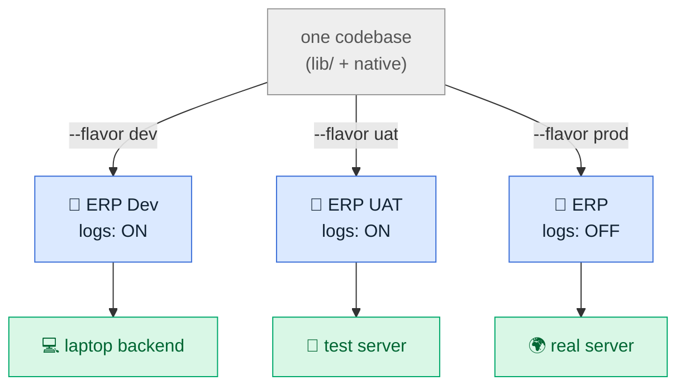
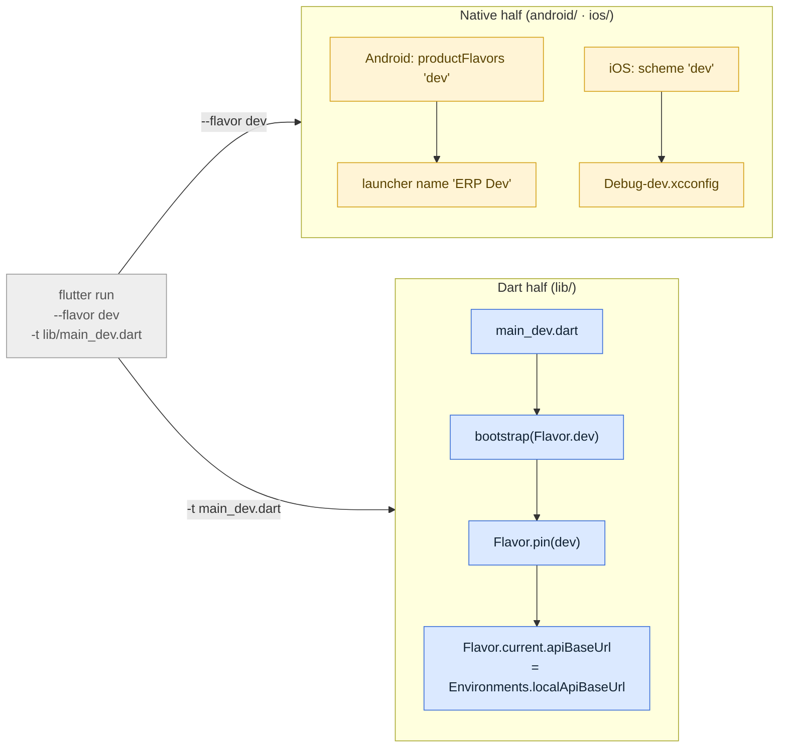
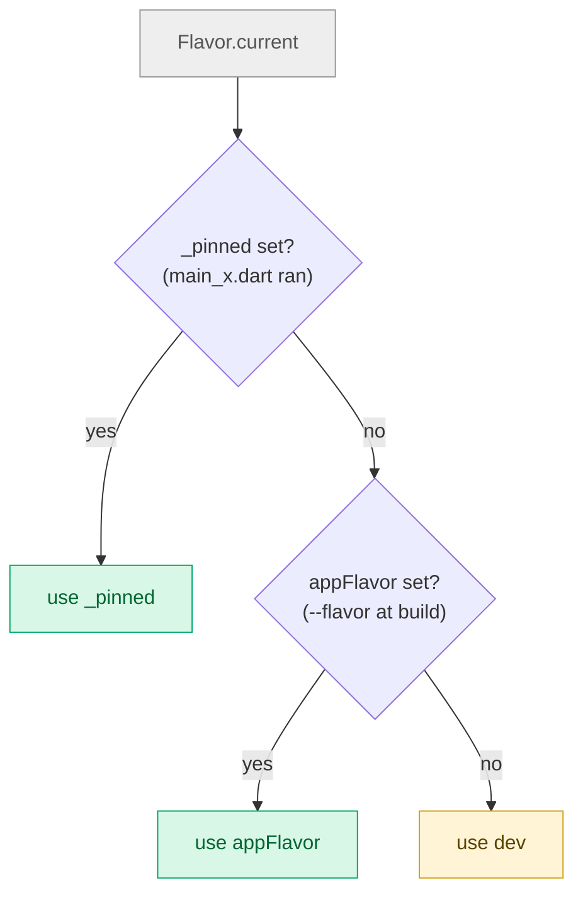
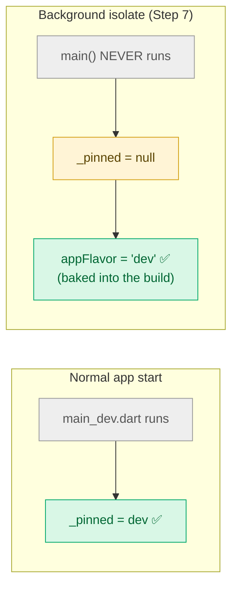
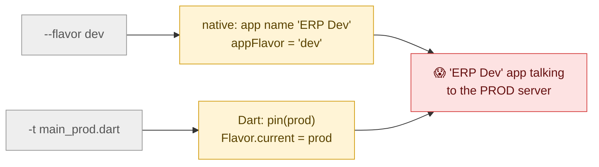
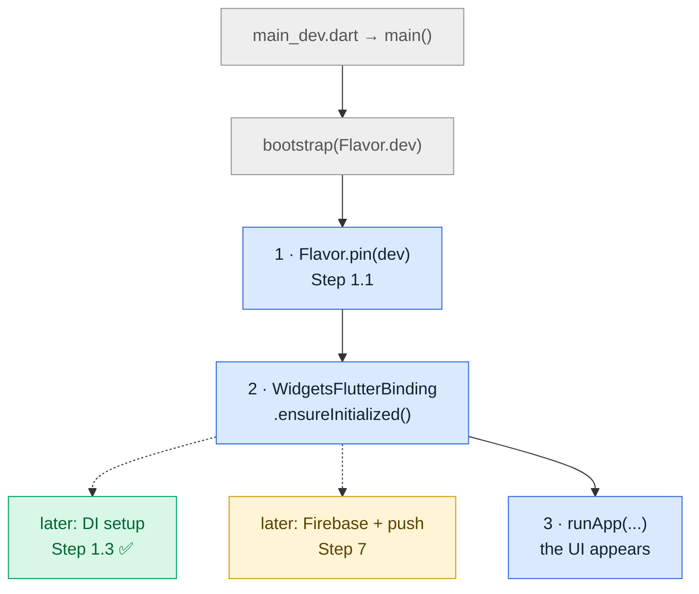
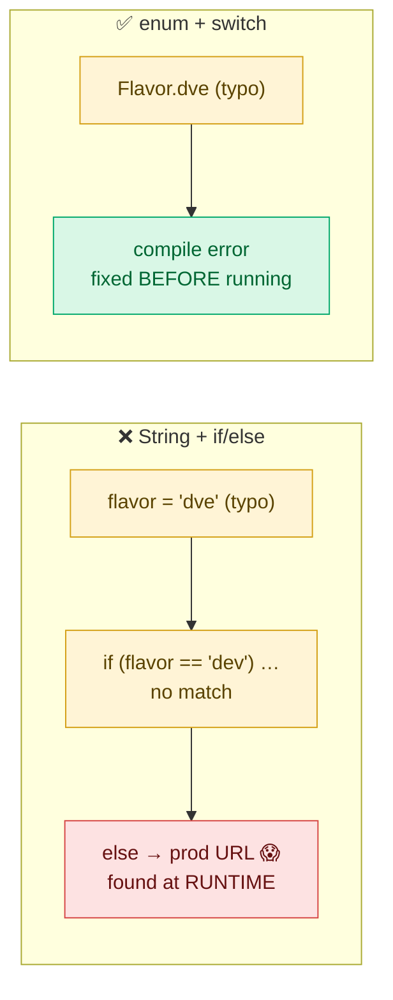

# Step 1.1 — Flavor (dev / uat / prod)

## 1. Why

We have 3 backends:

- **dev**: your laptop
- **uat**: the test server
- **prod**: the real one

We want **one codebase** that builds 3 apps. Each app knows its own backend
URL and its own name. That is called a **flavor**.



## 2. Picture



There are **two halves**:

| Half | Where | Decides |
|---|---|---|
| Native | `android/app/build.gradle.kts`, `ios/Flutter/*-dev.xcconfig`, iOS schemes | app name on the home screen |
| Dart | `lib/core/config/flavor.dart` | backend URL, logging |

The native half already exists, because we did not delete `android/` or `ios/`.
In this step we wrote the Dart half.

## 3. Code

### `lib/core/config/environments.dart`

```dart
class Environments {
  Environments._();
  static const String localApiBaseUrl = 'http://…:8080';   // server root
  …
}
```

- `Environments._()` is a **private constructor**. Nobody can write
  `Environments()`. The class is only a box of constants.
- `static const`: the value is known at compile time, and you read it as
  `Environments.localApiBaseUrl`.
- **Rule:** never write a URL anywhere else. If the IP changes, you edit
  one line here.

### `lib/core/config/flavor.dart`

```dart
enum Flavor {
  dev, uat, prod;
```

A Dart **enhanced enum**: an enum that can also have fields and getters.

```dart
  static Flavor? _pinned;
  static Flavor get current => _pinned ?? fromName(appFlavor) ?? dev;
  static void pin(Flavor flavor) => _pinned = flavor;
```

`current` answers "which flavor am I?" and checks 3 places, in order:

1. `_pinned`: set by `main_dev.dart` / `main_uat.dart` / `main_prod.dart`.
2. `appFlavor`: a constant Flutter fills in from `--flavor dev` at build time.
3. `dev`: the fallback for a plain `flutter run`.



**Who goes down which path:**



> 💡 **Why do we need #2 when we already have #1?** Later (Step 7), when a
> call arrives while the app is **killed**, Flutter starts a *background
> isolate*. That isolate never runs `main()`, so `_pinned` is empty there. But
> `appFlavor` is baked into the build, so it still works. That's why the
> fallback exists.

```dart
  String get apiBaseUrl => switch (this) {
        dev => Environments.localApiBaseUrl,
        uat => Environments.stagingApiBaseUrl,
        prod => Environments.prodApiBaseUrl,
      };
```

A Dart 3 **switch expression**. If you add a 4th flavor and forget it here,
the code **won't compile**. The compiler checks every case for you.

```dart
  bool get enableNetworkLogging => this != prod;
```

We use this in Step 2: print HTTP traffic in dev/uat, never in prod
(so tokens don't leak into logs).

### `lib/main.dart`

```dart
Future<void> main() => bootstrap(Flavor.current);

Future<void> bootstrap(Flavor flavor) async {
  assert(
    appFlavor == null || appFlavor == flavor.name,
    'Flavor mismatch: --flavor $appFlavor but entry point is ${flavor.name}',
  );
  Flavor.pin(flavor);
  WidgetsFlutterBinding.ensureInitialized();
  runApp(const HelloApp());
}
```

- `bootstrap` is the **only** start-up function. Every later step adds its
  setup here (DI, Firebase…), once.
- `Flavor.pin(flavor)` runs **first**, so everything after it can read
  `Flavor.current`.

#### Why `pin` at all? (`appFlavor` already exists)

In the normal case (`--flavor dev -t lib/main_dev.dart`), `appFlavor` is
already `"dev"` and `pin` only says the same thing again. `pin` matters in
two cases:

| Case | Without `pin` | With `pin` |
|---|---|---|
| `flutter run -t lib/main_uat.dart` (forgot `--flavor`) | `appFlavor` is null, so **dev** 😕 | **uat** ✅ |
| Unit tests need prod behaviour | Impossible: `appFlavor` is a build-time constant | `Flavor.pin(Flavor.prod)` ✅ |

#### The `assert`: catch a mismatch

`pin` has one danger: the two halves can **disagree** without anyone noticing.



The `assert` stops this:

| `appFlavor` | entry point | result |
|---|---|---|
| `null` (no `--flavor`) | any | ✅ OK, the entry point wins |
| `"dev"` | `dev` | ✅ OK, they agree |
| `"dev"` | `prod` | 💥 crash in debug: *"Flavor mismatch…"* |

- `assert` only runs in **debug** builds. In release it is removed, so it
  costs nothing. That's fine: mismatches happen while you develop, when you
  type the run command.
- **Crash loudly early > fail silently later.** A red error on your screen
  is much cheaper than test users hitting the prod server.

**Start-up order (it grows every step):**



### `lib/main_dev.dart` (uat / prod are the same)

```dart
Future<void> main() => bootstrap(Flavor.dev);
```

It is only one line. It forces the flavor, so `-t lib/main_dev.dart` and
`--flavor dev` always agree.

## 4. 🤔 Why like this? (other ways)

Every choice above had other options. Here is why we picked these.

| Choice we made | Other way | Why we didn't pick the other way |
|---|---|---|
| `enum Flavor` | A `String` like `'dev'` + `if/else` | A typo like `'dve'` still compiles and silently uses the wrong server. An enum makes the compiler catch it. |
| `switch` expression for URLs | A `Map<Flavor, String>` | A map can miss a key and give `null` at **runtime**. A switch must cover every case at **compile time**. |
| URLs in `environments.dart` | `--dart-define=API_URL=…` on every run | You must type the URL every time, it's easy to forget, and the default is hidden. A file is visible and reviewed in git. |
| `main_dev.dart` + `--flavor dev` | Only `--flavor dev` | That works too, but `-t main_dev.dart` makes the flavor visible in the command and **forces** it. |
| Fallback to `appFlavor` | Only `_pinned` | The background isolate (calls when the app is killed) never runs `main()`, so `_pinned` would be empty and we'd silently use dev. |
| Same app ID for all flavors | A different ID per flavor (`com.x.erp.dev`) | Then you could install all 3 at once, **but** each one needs its own Firebase app, push certificate and CallKit setup. That's 3× the setup. |
| One `bootstrap()` function | Setup code copied into each `main_*.dart` | With 3 copies, one gets forgotten. One function means one place to change. |
| `pin` + mismatch `assert` | Remove `pin`, trust only `appFlavor` | Simplest and mismatch-proof, **but** tests couldn't switch flavor and forgetting `--flavor` would silently give dev. The `assert` keeps `pin`'s benefits and removes its one danger. |
| `pin` + mismatch `assert` | Keep `pin` with no check | A mismatch (`--flavor dev -t main_prod.dart`) would be silent: a "dev" app on the prod server. |



## 5. Try it

```bash
flutter run --flavor dev  -t lib/main_dev.dart    # shows "ERP Dev" + URL
flutter run --flavor uat  -t lib/main_uat.dart    # shows "ERP UAT" + URL
```

On your phone's home screen, the app is named **ERP Dev** / **ERP UAT**.

Now try a **mismatch** on purpose, to see the guard work:

```bash
flutter run --flavor dev -t lib/main_prod.dart
# 💥 Failed assertion: 'Flavor mismatch: --flavor dev but entry point is prod'
```

> ⚠️ All 3 flavors use the **same app ID**, so only one can be installed at a
> time. Installing uat replaces dev. That is on purpose: they share one
> Firebase/push/CallKit setup.

## 6. Check yourself

1. You change the dev server IP. Which file do you edit?
2. Why does `Flavor.current` fall back to `appFlavor` and not only use `_pinned`?
3. What happens at compile time if you add `Flavor.demo` but don't update
   `apiBaseUrl`?
4. Why do we keep `pin` when `appFlavor` already gives the flavor? And why
   does the `assert` allow `appFlavor == null`?

<details><summary>Answers</summary>

1. `lib/core/config/environments.dart`, and nothing else.
2. A background isolate (a call while the app is killed) never runs `main()`,
   so nothing pins it. `appFlavor` is baked in at build time.
3. A compile error: the `switch` expression is not exhaustive.
4. For tests (they can't change the `appFlavor` constant) and for runs
   without `--flavor`. `null` means "no `--flavor` given", so there is nothing
   to disagree with, and the entry point decides.

</details>
