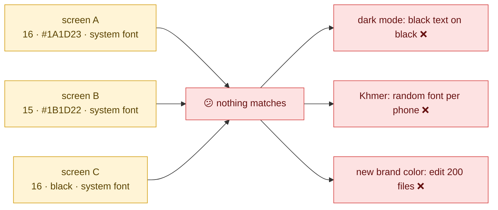
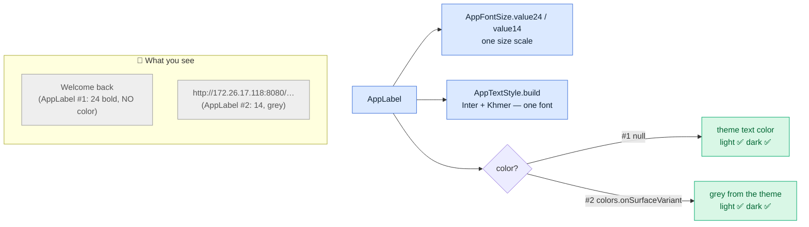
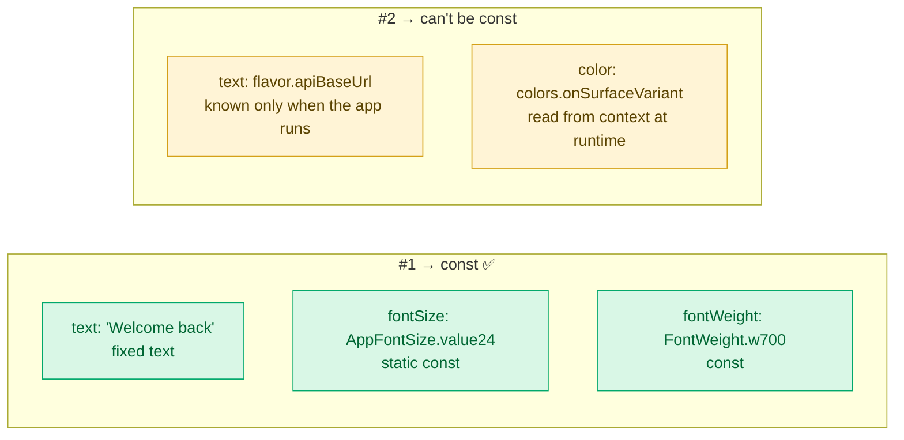
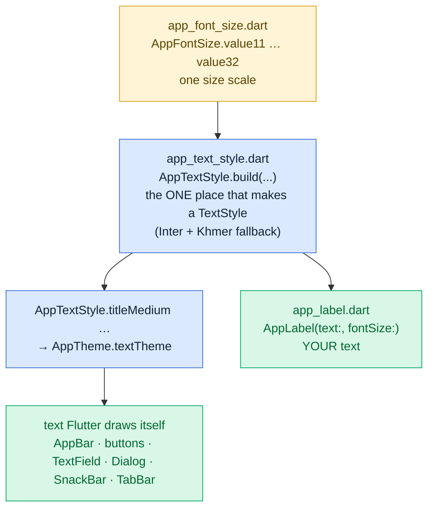
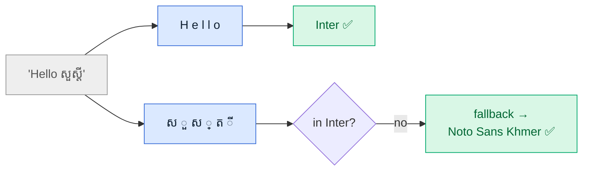
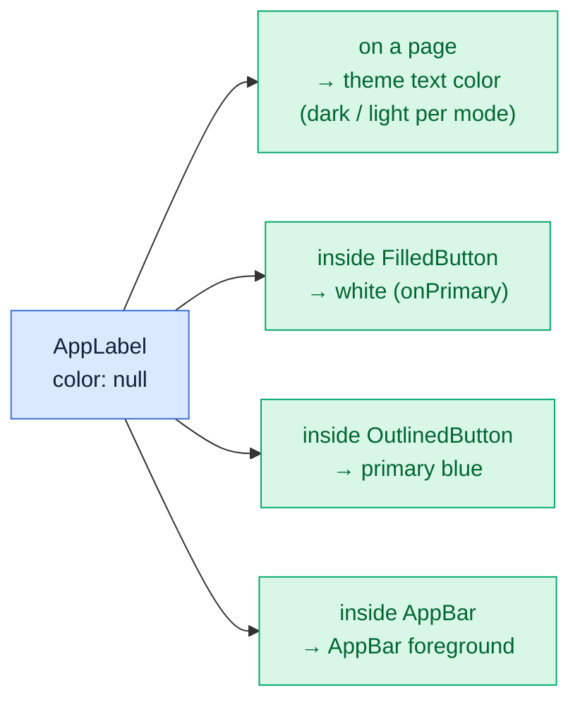
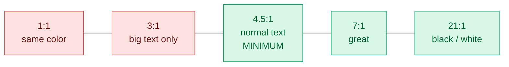
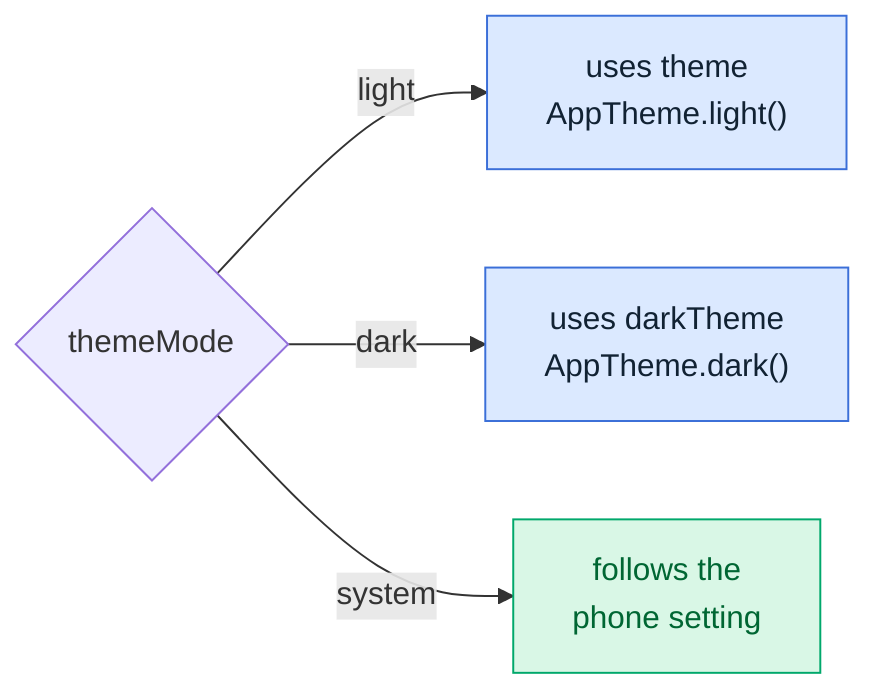

# Step 1.2 — Theme (design tokens)

## 1. Why

Our app has many screens. Look at the same title written two ways.

### ❌ Before: every screen writes its own values (we do NOT do this)

```dart
// screen A
Text('Hi', style: TextStyle(fontSize: 16, color: Color(0xFF1A1D23)))
// screen B — someone typed 15 and a slightly different color 😕
Text('Hi', style: TextStyle(fontSize: 15, color: Color(0xFF1B1D22)))
```



### ✅ After: every screen uses `AppLabel` + tokens (what we do)

This is the real code from our demo page in `lib/main.dart`:

```dart
const AppLabel(
  text: 'Welcome back',
  fontSize: AppFontSize.value24,
  fontWeight: FontWeight.w700,
),
AppLabel(
  text: flavor.apiBaseUrl,
  fontSize: AppFontSize.value14,
  color: colors.onSurfaceVariant,
),
```



**Two things to notice:**

**1. When to pass `color`.**

| | `color` | Why |
|---|---|---|
| #1 "Welcome back" | *(none)* | Normal text → let the theme decide. |
| #2 the URL | `colors.onSurfaceVariant` | Secondary text must be **grey**. We take the grey from the **theme** (`colors` = `Theme.of(context).colorScheme`), never `AppColors` or `Color(0x…)`, so it flips in dark mode. |

**2. Why #1 is `const` but #2 is not.**



`const` means Flutter builds the widget **once** and reuses it on every
rebuild. Use `const` whenever every value is fixed. The analyzer will remind
you (`prefer_const_constructors`).

| Problem | ❌ Raw `Text` + `TextStyle` | ✅ `AppLabel` + tokens |
|---|---|---|
| Sizes match? | each screen picks a number | one scale: `AppFontSize` |
| Dark mode | hard-coded black → invisible | color comes from the theme |
| Khmer | system font, different per phone | Noto Sans Khmer fallback |
| Inter font | not loaded | loaded by `google_fonts` |
| Brand change | edit every file | edit one token |

**Design tokens** are names for values (`AppFontSize.value16`,
`AppSpacing.md`, `colorScheme.primary`). We define each value **once**, and
every widget uses the name.

## 2. Picture

```mermaid
flowchart TD
    G["📄 ERP_MOBILE_DESIGN_GUIDE.md<br/>(the designer's spec)"] -->|"copied once into code"| TOK
    subgraph TOK["lib/core/theme/ — TOKENS (names for values)"]
        direction LR
        T1["app_colors<br/>#3B4FE8 …"] ~~~ T2["app_spacing<br/>4 · 8 · 16 · 24 · 32 · 48"] ~~~ T3["app_radius<br/>8 · 12 · 16 · 24 · 999"]
        T4["app_shadow<br/>card · modal"] ~~~ T5["app_font_size<br/>11 … 32"] ~~~ T6["app_text_style<br/>15 styles + build()"] ~~~ T7["app_label<br/>AppLabel widget"]
    end
    TOK -->|"mapped ONCE"| TH["app_theme.dart — THEME<br/>light() / dark() → ThemeData"]
    TH -->|"MaterialApp(theme, darkTheme, themeMode)"| USE
    subgraph USE["every widget — USE"]
        direction TB
        U1["AppLabel(text: 'Welcome back', fontSize: AppFontSize.value24)"]
        U2["Theme.of(context).colorScheme.onSurfaceVariant"]
        U3["AppSpacing.md · AppRadius.lg"]
    end
    class G none
    class T1,T2,T3,T4,T5,T6,T7 wait
    class TH app
    class U1,U2,U3 ok
    classDef app fill:#dbe9ff,stroke:#3b6fd8,color:#123
    classDef ok fill:#d9f7e6,stroke:#00a86b,color:#063
    classDef wait fill:#fff4d6,stroke:#d4a017,color:#5a4300
    classDef none fill:#eeeeee,stroke:#999,color:#555
    classDef err fill:#fde2e2,stroke:#d64545,color:#611
```



**Two kinds of tokens:**

| Kind | Changes in dark mode? | How widgets read it |
|---|---|---|
| Colors, text colors | ✅ yes | `Theme.of(context).colorScheme.xxx` |
| Spacing, radius, font size | ❌ no | `AppSpacing.md`, `AppRadius.lg` directly |

## 3. Code

### `abstract final class` (used in every token file)

```dart
abstract final class AppSpacing {
  static const double md = 16;
}
```

- `abstract` → you can't create it: `AppSpacing()` is an error.
- `final` → nobody can `extends` or `implements` it.
- Together: a **namespace** — just a box of constants.
- (In `Environments` we used a private constructor `Environments._()` for
  the same goal. `abstract final` is the newer Dart 3 way. Both work.)

### `app_colors.dart`: the raw palette

```dart
static const Color primary = Color(0xFF3B4FE8);
static const Color surface = Color(0xFFF8F9FC); // page background
static const Color surfaceDark = Color(0xFF0F1117);
```

- `0xFF3B4FE8` = `FF` (alpha, fully visible) + `3B4FE8` (RGB).
- Light **and** dark values both live here.
- **Rule:** widgets don't import `AppColors`. Only `AppTheme` does. Widgets
  use `colorScheme`, so they work in dark mode with zero extra code.
- The guide only gives dark `surface` + `card`. The other dark values
  (`surfaceVariantDark`, …) are **our picks** — change them freely.

### `app_spacing.dart`, `app_radius.dart`, `app_shadow.dart`

Plain numbers. Spacing is always a multiple of 4, so layouts line up.

### Text: 3 files, 2 ways to style text



| You want… | Use |
|---|---|
| Text that Flutter draws itself (AppBar title, typed text, hints, dialogs) | nothing — `AppTheme` already did it |
| Show your own text | `AppLabel(text: …, fontSize: AppFontSize.value16)` |
| A `TextStyle` for `TextField(style:)`, `RichText` | `Theme.of(context).textTheme.bodyLarge` |

#### `app_text_style.dart`: the single builder

```dart
static TextStyle build({required double fontSize, String fontFamily = 'Inter', Color? color, ...}) {
  return GoogleFonts.getFont(fontFamily, fontSize: fontSize, color: color, ...)
      .copyWith(fontFamilyFallback: [khmerFallback]);
}
```

- `GoogleFonts.getFont('Inter')` downloads the font the first time and caches
  it. Any Google Font name works (`'Poppins'` too).
- **`fontFamilyFallback`**: Inter has no Khmer letters. When Flutter meets `ស`,
  it tries the next font in the list → Noto Sans Khmer.



- The **15** named styles fill **every** Material `TextTheme` slot. If one slot
  is empty, Flutter uses its own default there (Roboto, **no Khmer**). For
  example a Dialog title uses `headlineSmall` and TabBar labels use
  `titleSmall`. 6 of them aren't in the design guide; they're marked
  *"our pick"* in the code.
- The named styles have **no color**. `AppTheme` adds the color per
  light/dark mode.
- They use `AppFontSize`, so the theme and `AppLabel` share one size scale.
- `static final` (not `const`): `GoogleFonts.getFont()` runs at runtime, and
  `const` needs a value known at compile time.

#### `app_label.dart`: the widget

(Usage example: see the "Welcome back" + URL code in **1. Why** above.)

- It's `Text` + `AppTextStyle.build(...)`, with handy defaults
  (`lineHeight 1.3`, `overflow: fade`, `softWrap: true`).
- **`color` is optional, and we pass it straight through (`color: color`).**
  When null, `Text` takes the color from the widget around it:



- ⚠️ **Don't** write `color: color ?? Theme.of(context).textTheme.bodyMedium?.color`.
  That *always* sets a color, so a FilledButton label becomes dark text on
  blue. Leaving it `null` is what lets the parent decide.
- ⚠️ **Don't** build the style with a plain `TextStyle(fontFamily: 'Inter')`.
  A plain name only works if `Inter.ttf` is bundled in `assets/`; we have none,
  so Flutter silently uses the system font and loses the Khmer fallback.
  Always go through `AppTextStyle.build`.
- `AppFontSize.value24` instead of `24`: the sizes match the design scale,
  so nobody invents a `23`.

### `app_theme.dart`: tokens → Flutter `ThemeData`

```dart
static ThemeData light() => _build(_lightScheme);
static ThemeData dark()  => _build(_darkScheme);
```

**One `_build`, two color schemes.** Light and dark share all the shape rules
(radius, button height…). Only colors differ. So we can't forget to style a
button in dark mode.

```dart
static const ColorScheme _lightScheme = ColorScheme(
  brightness: Brightness.light,
  primary: AppColors.primary,
  surface: AppColors.surface,
  surfaceContainerLowest: AppColors.card,           // cards
  surfaceContainerHighest: AppColors.surfaceVariant, // input fill
  ...
```

The **mapping** from the design guide names to Material 3 names:

| Design guide | Material 3 `ColorScheme` | Used for |
|---|---|---|
| primary | `primary` | buttons, links |
| primaryContainer | `primaryContainer` | chip / badge background |
| surface | `surface` | page background |
| card (white) | `surfaceContainerLowest` | `Card` |
| surfaceVariant | `surfaceContainerHighest` | input fill |
| onSurface | `onSurface` | main text |
| onSurfaceVariant | `onSurfaceVariant` | secondary text |

**Dark mode is not just "dark background".** Two colors change too:

| Token | Light | Dark | Why |
|---|---|---|---|
| `primary` | `#3B4FE8` | `#7B8BFF` | `#3B4FE8` on `#0F1117` = **3.1:1** contrast. Text needs **4.5:1**. `#7B8BFF` = **6.3:1** ✅ |
| `onPrimary` | white | `#0F1117` | White on the light `#7B8BFF` = 3.0:1 ❌, dark text = 6.3:1 ✅ |
| `errorContainer` | `#FEE2E2` | `#3B1518` | A light pink box would glow in dark mode. |



```dart
final textTheme = TextTheme(
  titleMedium: AppTextStyle.titleMedium,
  ...   // all 15 slots
).apply(bodyColor: scheme.onSurface, displayColor: scheme.onSurface);
```

`AppTextStyle` styles go into Flutter's `TextTheme` and get their color here.
Now `Theme.of(context).textTheme.titleMedium` = the right font, size, weight
**and** color for the current mode.

**Component themes** (set once, every widget gets them):

| Theme | What it does |
|---|---|
| `appBarTheme` | flat, same color as the page, left-aligned title |
| `cardTheme` | white (dark: `#1A1D23`), radius 16, no shadow |
| `filledButtonTheme` / `outlinedButtonTheme` | full width, 52px high, radius 12 |
| `inputDecorationTheme` | filled, no border at rest, 2px primary border on focus |

So in a screen you just write `FilledButton(...)` — no styling at all.

### `main.dart`: plug it in

```dart
MaterialApp(
  theme: AppTheme.light(),
  darkTheme: AppTheme.dark(),
  themeMode: _mode,          // light / dark / system
  ...
```

`MaterialApp` picks `theme` or `darkTheme` based on `themeMode`, and every
widget below rebuilds with the new colors.



The demo screen (`_ThemePreviewPage`) is **temporary**. It shows a title,
card, Khmer text, input, and buttons so you can see every token. Step 1.4
replaces it with the router.

> ⚠️ The toggle uses `setState` — fine for a throwaway demo. The real theme
> switch will be a Cubit (BLoC) saved in `shared_preferences`, because our
> rule is "BLoC owns all real state".

## 4. 🤔 Why like this? (other ways)

| Choice we made | Other way | Why we didn't pick the other way |
|---|---|---|
| Tokens in `core/theme/` | Hard-coded `Color(...)` / `16` in widgets | Nothing matches, no dark mode, a brand change means editing every file. |
| Widgets read `colorScheme` | Widgets read `AppColors.primary` | `AppColors` doesn't know light vs dark. `colorScheme` changes automatically. |
| Our own `ColorScheme(...)` | `ColorScheme.fromSeed(seedColor: …)` (the old app did this) | `fromSeed` **generates** colors, so you don't get the exact designer values (`#F8F9FC`, `#EEF0F5`…). We want the guide's exact colors. |
| Named styles fed into `TextTheme` **and** an `AppLabel` widget | Only the `AppLabel` widget | A widget can't style things that Flutter draws itself (AppBar title, button labels, `ListTile`). The `TextTheme` covers those; `AppLabel` is a shortcut for your own text. |
| `color` nullable everywhere | Default `Colors.black` | Black is invisible on the dark page `#0F1117`. |
| `AppLabel` uses `AppTextStyle.build` | `AppLabel` builds a plain `TextStyle(fontFamily: …)` | Two builders = two places to fix the font. And a plain family name doesn't load Google Fonts, so Inter + Khmer silently disappear. |
| `AppLabel` passes `color: color` (may be null) | `color ?? textTheme.bodyMedium.color` | Always setting a color stops the parent from deciding: FilledButton text turns dark on blue. |
| Fill all 15 `TextTheme` slots | Only the 9 in the design guide | Empty slots fall back to Roboto (no Khmer) in dialogs, tabs, etc. |
| A lighter `primary` in dark mode | The same `#3B4FE8` | Only 3.1:1 contrast on the dark page: blue text is hard to read. |
| Static classes for spacing/radius | `ThemeExtension<AppSpacing>` | Spacing doesn't change with dark mode, so the extension adds code for no gain. We **will** use a `ThemeExtension` later for status colors (success/warning containers) if they need dark versions. |
| `google_fonts` (download + cache) | Bundle `.ttf` files in `assets/fonts/` | Bundling works offline from the first launch, but adds ~1 MB per font + license files. `google_fonts` is simpler to learn. **Trade-off:** the very first launch needs internet, or the system font is used. We can switch to bundled files later without touching any widget. |
| One `_build(scheme)` | Two full `ThemeData(...)` blocks | Two copies drift apart: you style a button in light and forget dark. |

## 5. Try it

```bash
flutter run --flavor dev -t lib/main_dev.dart
```

You should see:
- the app bar with **ERP Dev** and a 🌙 button
- "Welcome back" in **Inter Bold 24** (every text on this page is an `AppLabel`)
- a white card with **Khmer text** rendering correctly
- a grey filled **Email** field → tap it: a **blue 2px border** appears
- a blue **Sign in** button with **white** text, and an outlined
  **Use biometrics** button with **blue** text (the `AppLabel` inherits the
  color from the button)

Tap 🌙 → everything switches to **dark**: page `#0F1117`, card `#1A1D23`,
light text, and a **lighter blue** button with **dark** text. **No widget code changed** — only the theme.

**Experiment:** in `app_colors.dart` change `primary` to `Color(0xFFE11D48)`
(red), hot reload. Every button, the focus border, and links turn red. That
is the power of tokens. (Change it back after.)

## 6. Check yourself

1. A widget needs the secondary text color. Do you write
   `AppColors.onSurfaceVariant` or `Theme.of(context).colorScheme.onSurfaceVariant`? Why?
2. Why does `AppLabel` pass `color: color` instead of `color ?? bodyMedium.color`?
3. Why is `AppTextStyle.titleMedium` `static final` and not `static const`?
4. What happens to Khmer text if we remove `fontFamilyFallback`?
5. Why can `AppLabel(text: 'Welcome back', …)` be `const`, but
   `AppLabel(text: flavor.apiBaseUrl, color: colors.onSurfaceVariant)` can't?

<details><summary>Answers</summary>

1. `colorScheme.onSurfaceVariant` — it switches with dark mode. `AppColors`
   is always the light value.
2. `null` lets `Text` take the color from its parent: white in a
   FilledButton, blue in an OutlinedButton, the theme text color on a page.
   Always setting a color breaks button labels.
3. `GoogleFonts.getFont()` is a function that runs at runtime. `const` only
   allows values known at compile time.
4. Inter has no Khmer glyphs, so Flutter falls back to whatever the system
   picks — it may look different on each phone, or show boxes (☐).
5. Every value in the first one is fixed at compile time. In the second,
   `flavor.apiBaseUrl` and `colors` (from `Theme.of(context)`) are only known
   when the app runs.

</details>
