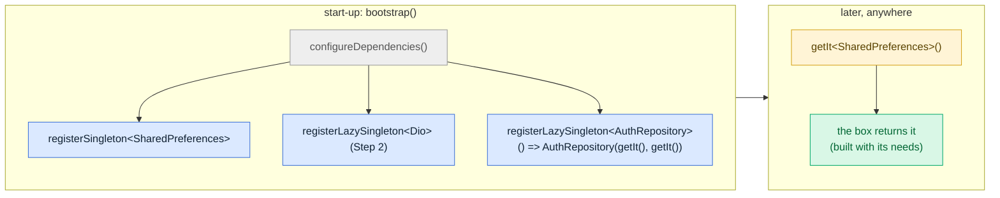
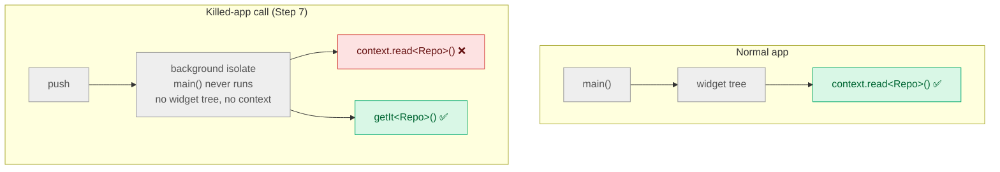
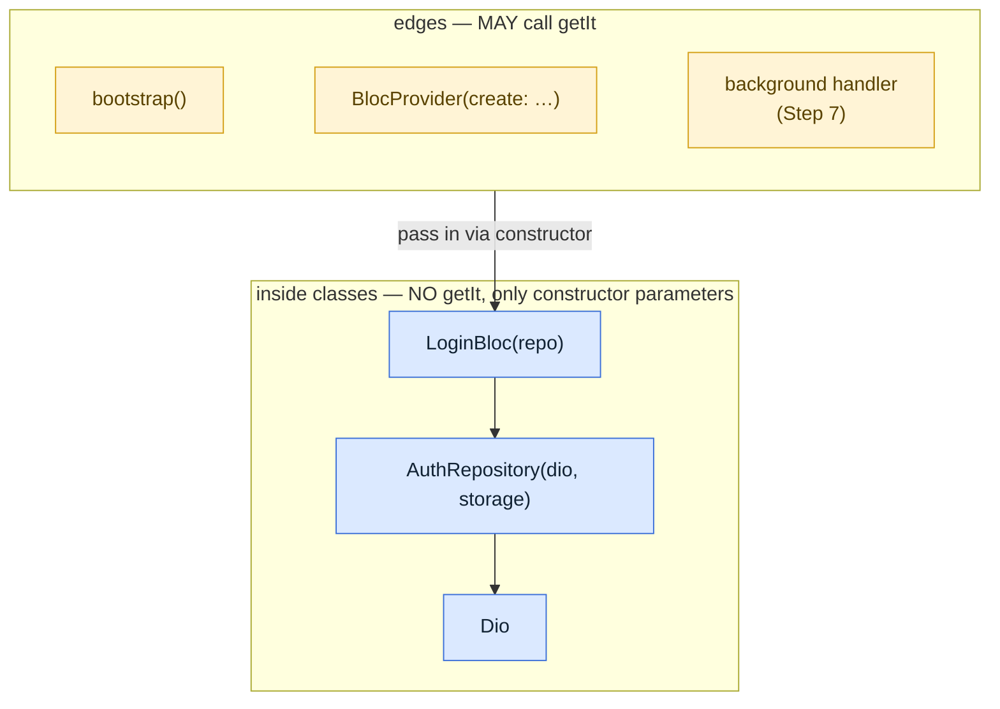
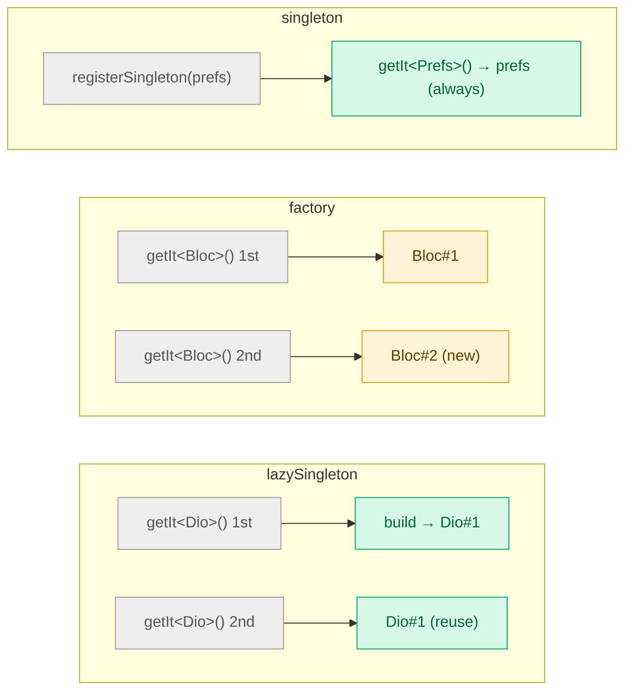
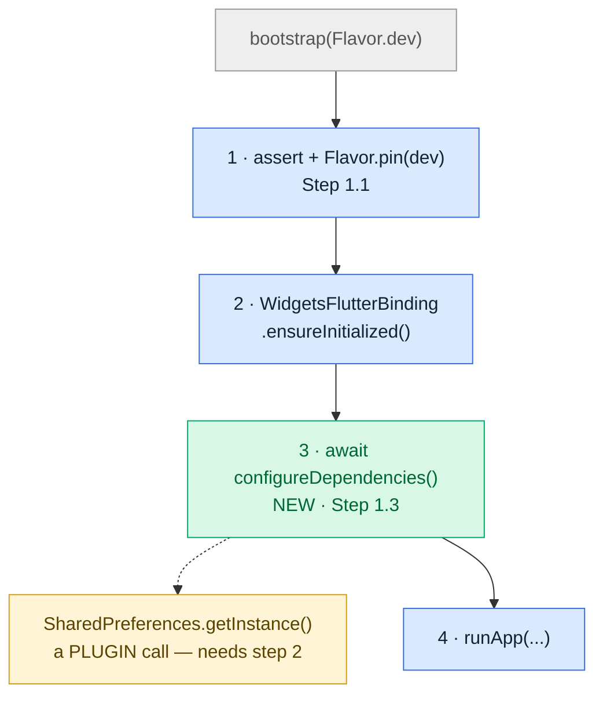

# Step 1.3 — DI (hand-written service locator)

## 1. Why

**DI = Dependency Injection.**

- A **dependency** is something a class *needs*.
- **Injection** = it *receives* that thing from outside instead of building
  it itself.

☕ **Coffee shop:** the barista doesn't grow beans and build the machine.
Suppliers **deliver** them; the barista only makes coffee.

### ❌ Without DI: the class builds what it needs

```dart
class AuthRepository {
  final dio = Dio(BaseOptions(baseUrl: 'http://…'));   // builds its own
  final storage = FlutterSecureStorage();              // builds its own
}
```

### ✅ With DI: the class receives what it needs (constructor injection)

```dart
class AuthRepository {
  AuthRepository(this.dio, this.storage);   // "give me these"
  final Dio dio;
  final TokenStorage storage;
}
```

| Problem without DI | How DI fixes it |
|---|---|
| 5 classes each create their own `Dio` → 5 copies, each needs the token interceptor | **One** `Dio`, built once, shared |
| Can't test — the class always calls the real server | Tests pass a **fake**: `AuthRepository(FakeDio(), FakeStorage())` |
| A new setting means editing every class | Change it in **one** place |
| You can't see what a class needs | The constructor **lists** it |

## 2. Picture

Constructor injection answers *"how does a class get its needs?"*.
The **service locator** answers *"who builds everything?"* — a box where we
**register** how to build each type, then **ask** for it by type.



### Why a *global* box? (and not only `RepositoryProvider`)



### Who calls `getIt`? Only the edges.



If a class calls `getIt` inside itself, its needs are hidden again — the same
problem as "builds its own Dio".

## 3. Code

```
lib/core/di/
├── service_locator.dart   the box (ServiceLocator + global getIt)
└── injection.dart         configureDependencies(): fills the box
test/core/di/
└── service_locator_test.dart
```

### `service_locator.dart`

```dart
final ServiceLocator getIt = ServiceLocator.instance;

class ServiceLocator {
  ServiceLocator._();
  static final ServiceLocator instance = ServiceLocator._();

  final Map<Type, _Registration<Object>> _registrations = {};
```

- `ServiceLocator._()` — private constructor: nobody can make a **second**
  box. There is exactly one, `instance`.
- `getIt` — a short global name for it.
- **The box is just a `Map`**: key = a type (`Dio`), value = *how to build it*.

| `_registrations` key (type) | value (how to build it) |
|---|---|
| `SharedPreferences` | `_Singleton(prefs)` |
| `Dio` (Step 2) | `_LazySingleton(() => Dio())` |
| `LoginBloc` (Step 3) | `_Factory(() => LoginBloc())` |

#### The 3 ways to register

| Method | When is it built? | Same object each time? | Use for |
|---|---|---|---|
| `registerLazySingleton` | on the **first** `getIt<T>()` | ✅ yes | Dio, repositories, storage |
| `registerFactory` | on **every** `getIt<T>()` | ❌ new each time | BLoCs (fresh per screen) |
| `registerSingleton` | **you** built it already | ✅ yes | things needing `await` (SharedPreferences) |



**Why "lazy"?** Nothing is built until someone asks. The app starts faster,
and things nobody uses are never built.

#### `call` — why `getIt<Dio>()` works

```dart
T call<T extends Object>() => get<T>();
```

In Dart, an object with a `call` method can be used like a function.
So `getIt<Dio>()` = `getIt.call<Dio>()` = `getIt.get<Dio>()`.

#### `get` — a clear error

```dart
if (registration == null) {
  throw StateError('ServiceLocator: $T is not registered. ...');
}
```

Forgot to register? You get a message naming the type — not a mysterious
`null` crash later.

#### `_add` — no double registration

```dart
assert(!_registrations.containsKey(T), '… $T is already registered.');
```

Registering `Dio` twice would mean two different `Dio`s in the app — a quiet
bug. We crash in debug instead. (The old app silently replaced it.)

#### `sealed class _Registration` — the 3 kinds

```dart
sealed class _Registration<T extends Object> { T resolve(); }

final class _LazySingleton<T> extends _Registration<T> {
  T resolve() => _instance ??= _create();   // build once, then reuse
}
final class _Factory<T> extends _Registration<T> {
  T resolve() => _create();                 // build every time
}
final class _Singleton<T> extends _Registration<T> {
  T resolve() => _instance;                 // already built
}
```

- **`sealed`** (Dart 3): these 3 are the **only** subtypes, and the compiler
  knows it. We'll use the same idea for BLoC states (`LoginLoading`,
  `LoginSuccess`, `LoginFailure`).
- **`??=`** = "if `_instance` is null, assign it; then return it". That one
  operator is the whole lazy-singleton trick.
- Each kind decides **how** to resolve itself, so `get` doesn't need an
  `if/else` for the 3 cases.

### `injection.dart`

```dart
Future<void> configureDependencies() async {
  await _registerCore();
}

Future<void> _registerCore() async {
  final prefs = await SharedPreferences.getInstance();
  getIt.registerSingleton<SharedPreferences>(prefs);
}
```

- The **one** place that fills the box. Each feature will add a line here
  (`registerAuthModule()` in Step 3, …).
- `SharedPreferences.getInstance()` is **async**, so we `await` it first and
  register the **ready** object with `registerSingleton`. Then everyone can
  get it **synchronously**: `getIt<SharedPreferences>()`.

### `main.dart` — start-up order

```dart
Flavor.pin(flavor);
WidgetsFlutterBinding.ensureInitialized(); // plugins need the bridge first
await configureDependencies();             // fill the DI box
runApp(const HelloApp());
```



> 💡 Remember `ensureInitialized()` from Step 1.1? **Now it really matters.**
> `SharedPreferences` is a plugin that talks to Android/iOS. Remove line 2 and
> the app crashes with *"Binding has not yet been initialized"*.

### The test file

7 small tests prove each behaviour: lazy builds once, factory builds every
time, singleton returns what you gave, constructor injection works, a clear
error for unregistered types, double registration fails, and `unregister`
lets a test swap in a fake.

```dart
setUp(() => getIt.reset());   // empty box before EACH test
```

The box is global, so without `reset()` one test's registrations would leak
into the next.

## 4. 🤔 Why like this? (other ways)

| Choice we made | Other way | Why we didn't pick the other way |
|---|---|---|
| Hand-written locator | `get_it` package | CLAUDE.md: don't reintroduce it. ~100 lines we fully understand vs. a black box. Same `getIt<T>()` API, so it feels the same. |
| A global locator | Only `RepositoryProvider` / `BlocProvider` (the template's way) | The killed-app background isolate (Step 7) has no widget tree, so `context.read` can't work there. We'll still **use** `BlocProvider` for screens — fed from `getIt`. |
| Constructor injection inside classes | Classes call `getIt` (or static services) inside | Needs become hidden again, and tests must fill the global box instead of just passing a fake. |
| `sealed class` + 3 small classes | One class with `bool isFactory` (the old app) | Each kind owns its own `resolve()`. No flags, no `if/else`, and you learn `sealed` for BLoC states. |
| `assert` on double registration | Silently replace (the old app) | Two objects for one type is a hidden bug. Crash early in debug. |
| `registerSingleton` for SharedPreferences | Static `SharedPreferenceService.init()` (the template) | Static services can't be swapped for a fake in tests. From the box, a test can `unregister` + register a fake. |
| Lazy singleton by default | Build everything at start-up | Faster start; unused things are never built. |

## 5. Try it

```bash
flutter test test/core/di            # 7 tests → "All tests passed!"
flutter run --flavor dev -t lib/main_dev.dart   # app starts as before
```

**Experiment 1:** in `main.dart`, comment out
`WidgetsFlutterBinding.ensureInitialized();` and run → crash:
*"Binding has not yet been initialized"*. Put it back.

**Experiment 2:** in `injection.dart`, register `SharedPreferences` twice →
debug crash: *"SharedPreferences is already registered"*.

## 6. Check yourself

1. `Dio` should be one shared object, built only when first needed. Which
   register method?
2. Each screen needs a fresh `LoginBloc`. Which register method?
3. Why can't we use only `RepositoryProvider` in this app?
4. Where should `getIt<…>()` be called: inside `AuthRepository`, or where
   `AuthRepository` is created? Why?
5. What does `_instance ??= _create()` do?

<details><summary>Answers</summary>

1. `registerLazySingleton`.
2. `registerFactory`.
3. A killed-app call runs in a background isolate with no widget tree and no
   `BuildContext`, so `context.read` can't reach anything. A global box can.
4. Where it's created (an "edge"). Inside, `AuthRepository` just takes its
   needs in the constructor — so they're visible and a test can pass fakes.
5. If `_instance` is null, build it with `_create()` and save it; either way
   return `_instance`. So it's built once, then reused.

</details>
