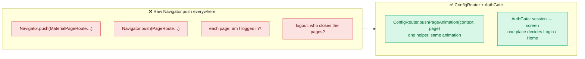
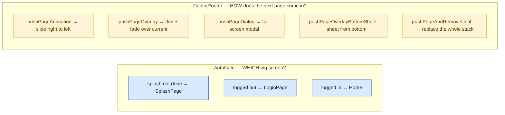
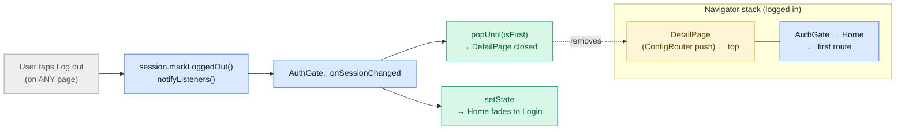
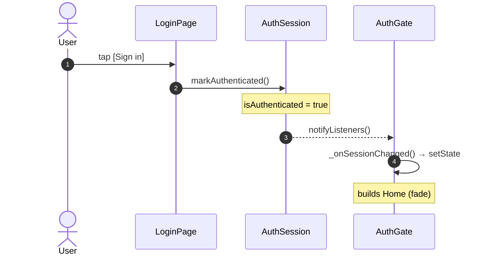
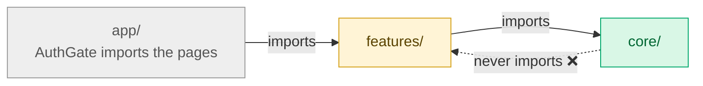
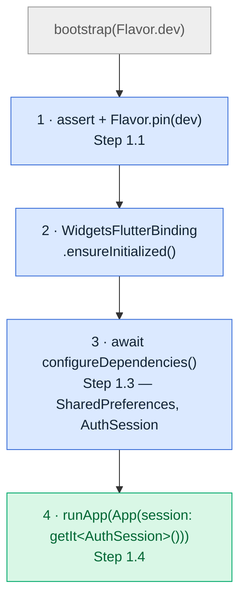

# Step 1.4 — Navigation (ConfigRouter + AuthGate)

## 1. Why

An app has many pages. We need 2 things:

1. **Move between pages**, with the **same animation** everywhere
   (design guide: push = slide from right).
2. **Never show private pages to a logged-out user** — and when the user logs
   out (or the token expires in Step 2), **close everything** and show Login.



We chose **`ConfigRouter`** (your helper class — familiar and simple) and
removed `go_router`. go_router's job "guard the private pages" moves into one
small widget: **`AuthGate`**.

## 2. Picture

### Two jobs, two tools



### The navigator stack



### Pages flip the session, AuthGate swaps the screen



`LoginPage` never pushes Home. Logout works the same way the other direction.
So the "logged in or not?" rule lives in **one** place.

### Files

```
lib/
├── main.dart              bootstrap: DI → runApp(App(session))
├── app/                   top layer: MAY import features
│   ├── app.dart              MaterialApp (theme + navigatorKey + home: AuthGate)
│   ├── auth_gate.dart        session → Splash / Login / Home
│   └── home_placeholder_page.dart   + a ConfigRouter demo detail page
├── core/router/           NO feature imports
│   ├── config_router.dart    all push helpers (your code)
│   ├── app_navigator.dart    AppNavigator.rootKey
│   └── auth_session.dart     logged in? (ChangeNotifier)
└── features/auth/views/
    ├── splash_page.dart      animation, then onFinished()
    └── login_page.dart       placeholder until Step 3
```



## 3. Code

### `core/router/config_router.dart`

Your helper class, with 3 small changes:

| Change | Why |
|---|---|
| `screenWidth` → `MediaQuery.sizeOf(context).width` | `screenWidth` came from another project (`red_ant_express/utils/global_use.dart`). |
| `modalBarrierColo` → `modalBarrierColor` | Typo in the parameter name. |
| Every method returns `Future<T?>` | Some had no return type. Now `final ok = await ConfigRouter.pushPageDialog<bool>(…)` gets a typed result back from `Navigator.pop(context, true)`. |

Which one to use:

| You want… | Method |
|---|---|
| Normal "next page" | `pushPageAnimation` (slide right→left, iOS style) |
| Replace everything (rare — AuthGate handles login/logout) | `pushPageAndRemoveUntilAnimation` |
| A page **over** the current one (current stays visible, dimmed) | `pushPageOverlay` |
| Full-screen modal with ✕ | `pushPageDialog` |
| Sheet from the bottom | `pushPageOverlayBottomSheet` |
| No animation | `pushPageNotAnimation` / `pushPageFast` |

**`opaque`** (the long comments in the file):

| `opaque` | What Flutter does | Use for |
|---|---|---|
| `true` | stops painting the page below (faster) | normal pages |
| `false` | keeps painting the page below → it can show through | overlays |

`PageTransition` defaults to `opaque: false`, which is why `pushPageAnimation`
sets `opaque: true` explicitly.

### `core/router/app_navigator.dart`

```dart
abstract final class AppNavigator {
  static final GlobalKey<NavigatorState> rootKey = GlobalKey<NavigatorState>();
}
```

Given to `MaterialApp(navigatorKey: …)`. Now code **without** a `context`
can still navigate:

| Who | When |
|---|---|
| `AuthGate` | logout → `popUntil(isFirst)` |
| Token interceptor | Step 2: refresh failed → back to Login |
| Incoming-call overlay | Step 6: push the call page (lesson from the old app) |

### `core/router/auth_session.dart`

Unchanged from before: a `ChangeNotifier` with `isAuthenticated`,
`markAuthenticated()`, `markLoggedOut()`. It only notifies when the value
**really** changes. Registered once in DI.

### `app/auth_gate.dart`

```dart
@override
void initState() {
  super.initState();
  widget.session.addListener(_onSessionChanged);
}

@override
void dispose() {
  widget.session.removeListener(_onSessionChanged);
  super.dispose();
}

void _onSessionChanged() {
  if (!widget.session.isAuthenticated) {
    AppNavigator.rootKey.currentState?.popUntil((route) => route.isFirst);
  }
  setState(() {});
}
```

- **`addListener` / `removeListener`** — subscribe in `initState`, unsubscribe
  in `dispose`. Always in pairs, or the session keeps calling a dead widget.
- **`popUntil((route) => route.isFirst)`** — pop pages until only the first
  route (the gate) is left. So logout from a deep page closes everything.
- **`currentState?.`** — `?.` means "only if not null" (the navigator may not
  exist yet).

```dart
final Widget screen;
if (!_splashDone)                       screen = SplashPage(…, onFinished: …);
else if (widget.session.isAuthenticated) screen = HomePlaceholderPage(…);
else                                     screen = LoginPage(…);

return AnimatedSwitcher(
  duration: const Duration(milliseconds: 300),
  child: KeyedSubtree(key: ValueKey(screen.runtimeType), child: screen),
);
```

- **`final Widget screen;`** without a value, then set in every branch —
  Dart checks that every path assigns it exactly once.
- **`AnimatedSwitcher`** fades from the old screen to the new one.
- **`ValueKey(screen.runtimeType)`** — `AnimatedSwitcher` only animates when
  the child's **key** changes. Splash → Login → Home are different types, so
  different keys → a fade each time.
- **`_splashDone` with `setState`** — this is a tiny **UI** flag ("has the
  animation finished?"), not business data. Business state ("logged in?")
  lives in `AuthSession`.

### `features/auth/views/splash_page.dart`

```dart
Future<void> _decide() async {
  await Future<void>.delayed(const Duration(milliseconds: 1200));
  // Step 3 here: tokens found → widget.session.markAuthenticated();
  if (!mounted) return;
  widget.onFinished();
}
```

- The splash **doesn't navigate**. It updates the session (Step 3), then calls
  **`onFinished`** — a **callback**: a function the parent passed in.
  `AuthGate` decides what comes next.
- Why a callback and not "import AuthGate and push it"? `features/` must not
  import `app/` (arrows only point down).
- `if (!mounted) return;` — after an `await` the page may be gone.
- Logo: fade + scale, 900 ms, `easeOutBack` (design guide).

### `features/auth/views/login_page.dart` (placeholder)

```dart
FilledButton(onPressed: session.markAuthenticated, …)   // flip — don't push
```

`session.markAuthenticated` without `()` is a **method tear-off**: we pass the
function itself, so it runs on tap.

### `app/home_placeholder_page.dart` — a ConfigRouter demo

```dart
FilledButton(
  onPressed: () => ConfigRouter.pushPageAnimation(
    context,
    _DemoDetailPage(session: session),
  ),
  …
```

The detail page also has a **Log out** button, so you can see `AuthGate`
close it.

### `app/app.dart` and `main.dart`

```dart
MaterialApp(
  navigatorKey: AppNavigator.rootKey,
  home: AuthGate(session: session),
  theme: …, darkTheme: …, themeMode: ThemeMode.system,
)
```

```dart
await configureDependencies();
runApp(App(session: getIt<AuthSession>()));   // edge: take from the box, pass in
```



## 4. 🤔 Why like this? (other ways)

| Choice we made | Other way | Why we didn't pick the other way |
|---|---|---|
| `ConfigRouter` (Navigator + `page_transition`) | `go_router` | Simpler and familiar. **Trade-offs we accept:** no URL paths, so opening "chat 42" from a notification (Step 7) means pushing the page ourselves with `AppNavigator.rootKey` instead of `go('/chat/42')`. |
| `AuthGate` swaps Login / Home | Each page checks login, or Login pushes Home with `pushPageAndRemoveUntil` | Rules spread across pages. Logout from a deep page, or a token expiring in the background, would need manual stack clearing every time. |
| Pages flip `AuthSession` | Pages navigate after login/logout | Two places deciding → they disagree sooner or later. |
| `popUntil(isFirst)` on logout | Leave pushed pages open | A logged-out user could press Back into private pages. |
| `AppNavigator.rootKey` | Always use `context` | The interceptor (Step 2) and the call overlay (Step 6) have no navigator context. |
| Splash calls `onFinished` | Splash imports and pushes the next page | `features/` would import `app/` (arrow pointing up). |
| `AuthGate` in `lib/app/` | In `core/router/` | It imports feature pages; `core/` must never import `features/`. |
| `ThemeMode.system` | A `setState` toggle | No real state outside BLoC. The phone's dark-mode setting is enough to test. |

## 5. Try it

```bash
flutter test                                    # 9 tests → All tests passed!
flutter run --flavor dev -t lib/main_dev.dart
```

1. **Splash:** logo fades + scales in, spinner at the bottom.
2. ~1.2 s later, it fades to **Login**.
3. **Sign in (demo)** → fades to **Home**. You never pushed anything — the gate did it.
4. **Open detail (ConfigRouter)** → Detail slides in from the right.
5. On Detail, tap **logout** → Detail closes **and** you land on **Login**.
6. Switch the phone to **dark mode** → everything follows.

**Experiment:** in `auth_gate.dart`, comment out the `popUntil` line. Repeat
step 5: you land on Login, but press **Back** → the private Detail page is
still there. That's the bug `popUntil` prevents. Put it back.

## 6. Check yourself

1. The user taps **Log out** on the Detail page. Which 2 things happen in
   `AuthGate`, and why both?
2. Why does `LoginPage` call `session.markAuthenticated` instead of pushing Home?
3. Why does `SplashPage` call `onFinished()` instead of pushing `AuthGate`?
4. Why does `AnimatedSwitcher` need `ValueKey(screen.runtimeType)`?
5. Normal page vs overlay: when do you use `pushPageAnimation`, and when
   `pushPageOverlay`?

<details><summary>Answers</summary>

1. `popUntil(isFirst)` closes the Detail page (and anything else pushed), and
   `setState` makes the gate show Login. Without `popUntil`, Back would return
   to a private page.
2. So **one** place (`AuthGate`) decides Login vs Home. Pages only change the
   session.
3. `features/` must not import `app/`. The parent passes a callback; the
   splash just says "I'm done".
4. `AnimatedSwitcher` only animates when the child's key changes. Different
   screen types → different keys → a fade.
5. `pushPageAnimation`: a normal next page that covers the screen (opaque).
   `pushPageOverlay`: a page on top where the screen below stays visible and
   dimmed (`opaque: false`).

</details>
