# Step 2.1 — Network (AppService, MVVM-template style)

> Step 2 is split in two:
> - **2.1 (this lesson):** send requests, unwrap the backend's envelope, turn
>   every error into a `NetworkErrorModel`.
> - **2.2 (next):** store tokens, attach them, refresh on 401, log out on failure.

This step follows **your MVVM template's network folder**
(`~/Downloads/flutter_mvvm_pattern-develop/lib/core/network`): same names,
same calling style. A few parts are changed because they would break later
steps — each one is explained in **4. Why like this?**.

> 🖼 Diagrams are **Mermaid** (same style as `flutter-chat/docs`). They render
> on GitHub. In VS Code, install a Mermaid preview extension (e.g.
> *Markdown Preview Mermaid Support*) to see them in the Markdown preview.

## 1. Why

Every feature (auth, profile, chat, call) talks to the same Spring backend.
Without one shared network layer, each repository would repeat the same work:

```mermaid
flowchart LR
    subgraph BAD["❌ Without: every repository by itself"]
        direction TB
        B1["Dio() + baseUrl + timeouts"]
        B2["json['data'] … json['success']"]
        B3["try / catch DioException"]
        B4["401? 500? offline? server down?"]
    end
    subgraph GOOD["✅ With: one AppService"]
        direction TB
        G1["ONE Dio (from DI)"]
        G2["unwrap the envelope ONCE"]
        G3["every error → NetworkErrorModel"]
        G4["never throws"]
    end
    BAD -.->|"move all this<br/>into one place"| GOOD

    classDef bad fill:#fde2e2,stroke:#d64545,color:#611
    classDef ok fill:#d9f7e6,stroke:#00a86b,color:#063
    class B1,B2,B3,B4 bad
    class G1,G2,G3,G4 ok
```

Your backend (`API_LIST_BACKEND.md`) wraps **every** response:

```json
{ "success": true, "message": "Success", "data": { … }, "errorCode": null, "traceId": "…" }
```

So we unwrap it in **one** place, and repositories only see `data`.

## 2. Picture

### Template vs ours, side by side

```
 TEMPLATE                                       OURS
 ────────                                       ────
 AppService(                                    appService.send(           ← ONE AppService from DI
   httpMethods: HttpMethods.GET,                  httpMethods: HttpMethods.get,
   endPoint: ApiEndPoint.product,                 endPoint: ApiEndPoint.me,
   queryParameters: {...},                        queryParameters: {...},
 ).send()                                         parse: UserModel.fromData, ← unwraps + parses
                                                )
 → Either<NetworkErrorModel, HttpResponse>      → Either<NetworkErrorModel, UserModel>
 repo: jsonDecode(success.response.toString())  repo: nothing to decode
```

### A request, end to end

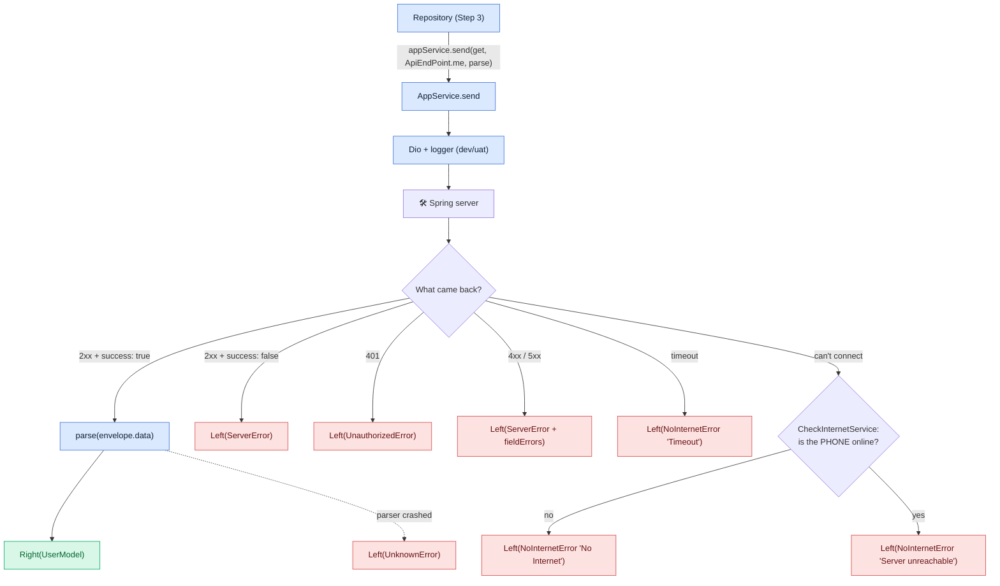

### A request, step by step through every layer ✅ success

The same request through **every layer** (the BLoC + Repository parts arrive
in Step 3). Follow the numbers.

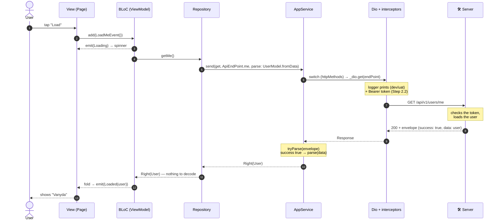

| # | Who | What happens |
|---|---|---|
| 1–2 | View | User taps. The page only **sends an event** — no network code in widgets. |
| 3 | BLoC | Emits `Loading` → the page shows a spinner/shimmer. |
| 4 | BLoC | Calls the repository (never `AppService` directly — CLAUDE.md rule). |
| 5 | Repository | Calls `appService.send(...)` with the endpoint and **how to parse**. |
| 6 | AppService | Picks the Dio method from `HttpMethods` (`switch`). Logger + token interceptors run. |
| 7 | Dio | Sends `GET /api/v1/users/me`. |
| 8 | Server | Checks the token, answers the envelope. |
| 9–10 | AppService | Unwraps the envelope, checks `success`, runs `parse(data)` → `Right(User)`. |
| 11 | Repository | Passes `Right(User)` up — nothing to decode. |
| 12–13 | BLoC → View | `result.fold(...)` → emits `Loaded(user)` → the page shows the name. |

**Who knows what** — each layer only knows the one below it:

| Layer | Knows | Never knows |
|---|---|---|
| View | events + states | Dio, JSON, URLs |
| BLoC | the repository | Dio, JSON, URLs |
| Repository | `AppService` + `ApiEndPoint` | widgets, `BuildContext` |
| AppService | `Dio` + the envelope | your models (`parse` is passed in) |
| Dio | HTTP | our envelope |

### A request, step by step ❌ error (can't reach the server)

Same layers, but the connection fails. Watch where the error is **turned into
a `NetworkErrorModel`** — only once, inside `AppService`. Every layer above just
passes a `Left` up.

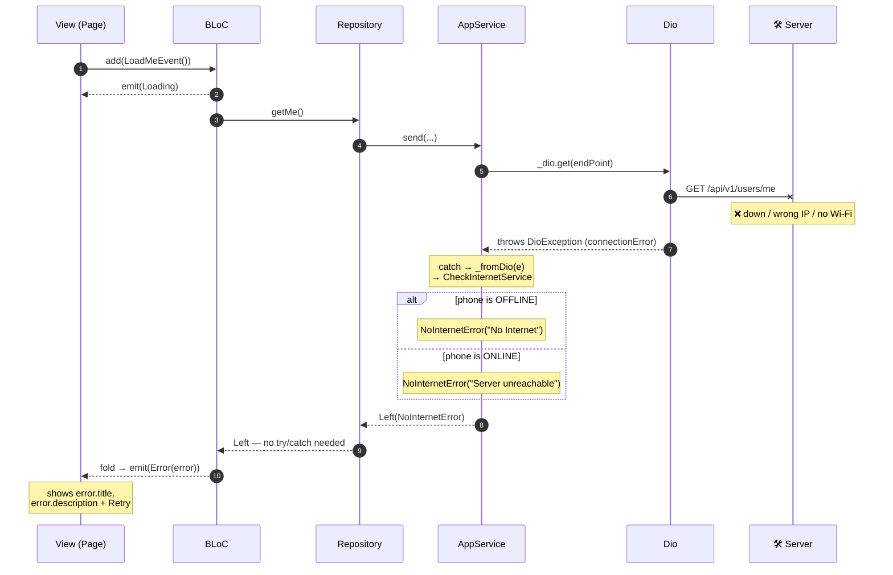

- **Nothing throws past `AppService`.** The BLoC never needs `try/catch`.
- The BLoC can show `error.title` / `error.description` directly (template
  style), or `switch` on the kind (e.g. show Retry only for `NoInternetError`).

### The template's request, step by step (for comparison)

Your MVVM template does the same job like this. The **⚠** notes are the steps
we changed (see the table below):

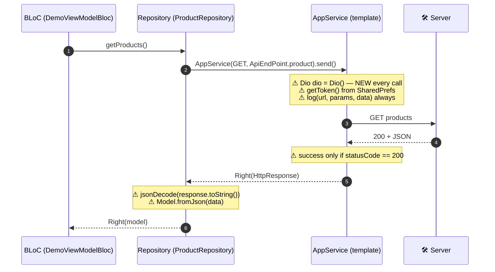

| ⚠ Template step | Ours |
|---|---|
| `Dio()` new each call | ONE shared Dio from DI (interceptors live there) |
| `getToken()` from SharedPreferences | auth interceptor reads secure storage (Step 2.2) |
| `log(url, params, data)` always | logger in dev/uat only, no headers |
| `if statusCode == 200` | any 2xx + check `envelope.success` |
| Repo `jsonDecode` + `fromJson` | `AppService` unwraps; repo only passes `parse:` |

### `Either<NetworkErrorModel, T>`: two boxes, exactly one is full

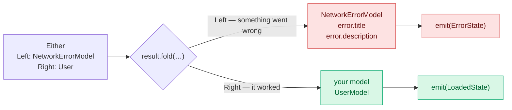

`fold` makes you handle **both** boxes — you can't forget the error case.

### Files

```
lib/core/network/
├── api_endpoints.dart         ApiEndPoint: every path         (template)
├── helper_service.dart        HttpMethods enum                (template)
├── network_error_model.dart   sealed NetworkErrorModel        (template + kinds)
├── check_internet_service.dart  is the PHONE online?          (template)
├── app_service.dart           AppService.send(...)            (template, injected)
├── api_envelope.dart          unwrap { success, data, … }     (ours: backend needs it)
└── dio_factory.dart           the ONE Dio                     (ours)
lib/core/utils/
└── constants.dart             error titles/codes              (template)
test/core/network/
└── app_service_test.dart      12 tests with a fake server
```

## 3. Code

### Base URL: `environments.dart`

```dart
static const String localApiBaseUrl = 'http://172.26.17.118:8080';   // server root
```

`/health` lives **outside** `/api/v1`, so the base URL is the server root and
the version prefix goes into each endpoint.

| baseUrl (Flavor) | + endPoint (`ApiEndPoint`) | = full URL Dio calls |
|---|---|---|
| `http://172.26.17.118:8080` | `/health` | `…:8080/health` ✅ |
| `http://172.26.17.118:8080` | `/api/v1/users/me` | `…:8080/api/v1/users/me` ✅ |
| ❌ `http://…:8080/api/v1` | `/health` | `…:8080/api/v1/health` → **404** |

### `api_endpoints.dart`: `ApiEndPoint`

```dart
abstract final class ApiEndPoint {
  static const String _v1 = '/api/v1';
  static const String health = '/health';
  static const String login = '$_v1/auth/login';
  static const String refresh = '$_v1/auth/refresh';
  static const String logout = '$_v1/auth/logout';
  static const String me = '$_v1/users/me';
}
```

Same as the template's `ApiEndPoint`. `'$_v1/auth/login'` is interpolation
inside a `const` — allowed because `_v1` is `const` too.

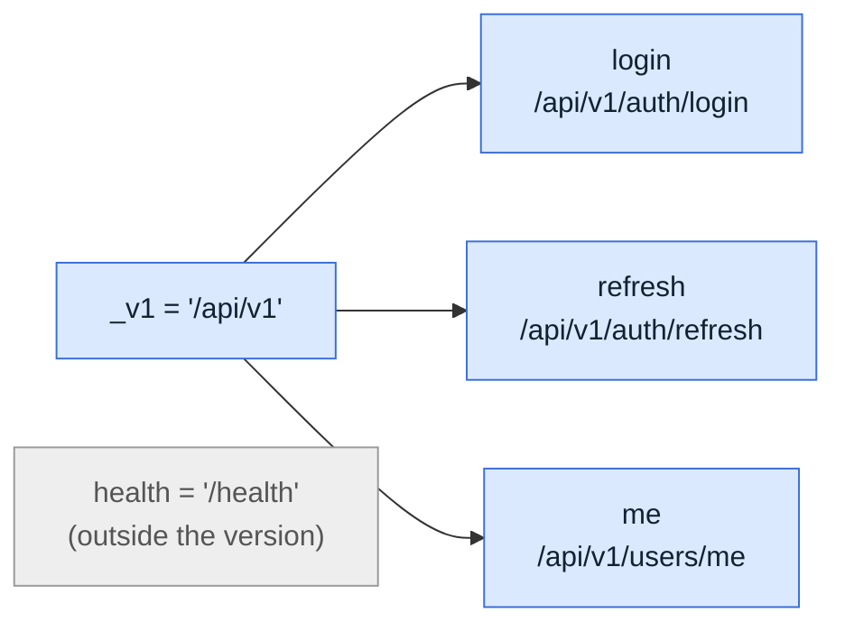

Backend moves to `/api/v2` one day? Change **one** line: `_v1 = '/api/v2'`.

### `helper_service.dart`: `HttpMethods`

```dart
enum HttpMethods { get, post, put, patch, delete }
```

- Template: `GET, POST, PUT, DELETE`. Dart style for enum values is
  lowerCamelCase (the linter warns on `GET`), so `get`, `post`…
- **`patch` added**: the backend updates with `PATCH` (`PATCH /users/{id}`).
- The template's `HttpResponse` wrapper and `getToken()` are **not** here —
  see **4. Why like this?**.

| `HttpMethods` | Dio method | HTTP verb | Typical use (our backend) |
|---|---|---|---|
| `.get` | `_dio.get` | GET | read: `GET /users/me` |
| `.post` | `_dio.post` | POST | create: `POST /auth/login`, send a message |
| `.put` | `_dio.put` | PUT | replace a whole thing |
| `.patch` | `_dio.patch` | PATCH | update some fields: `PATCH /users/{id}` |
| `.delete` | `_dio.delete` | DELETE | remove: `DELETE /chats/messages/{id}` |

### `utils/constants.dart`: `Constants`

```dart
static const int codeUnknown = 0;
static const int codeNetwork = -1;
static const String noInternet = 'No Internet';
static const String pleaseCheckInternet = 'Please check internet connection.';
...
```

- Same idea as the template: all error texts and our invented codes in **one**
  file. One place = easy to turn into translation keys in Step 8.
- Fixed a typo from the template: `somethingWhenWrong` → `somethingWentWrong`.

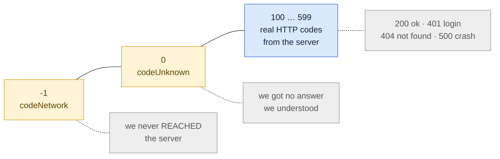

Real HTTP codes are 100–599, so our `-1` and `0` can never be confused with them.

### `network_error_model.dart`: `NetworkErrorModel`

Same 3 fields as the template — `title`, `description`, `statusCode` — so
`error.title` / `error.description` work everywhere. The change: it's
**`sealed`**, with 4 kinds.

```dart
sealed class NetworkErrorModel {
  final String title;
  final String description;
  final int statusCode;
}
final class NoInternetError extends NetworkErrorModel { … }   // offline, timeout, server down
final class ServerError extends NetworkErrorModel {           // 4xx / 5xx / success:false
  final String? errorCode;               // e.g. VALIDATION_ERROR
  final Map<String, String> fieldErrors; // {"email": "invalid"}
  final String? traceId;                 // for the backend team's logs
}
final class UnauthorizedError extends NetworkErrorModel { … } // 401
final class UnknownError extends NetworkErrorModel { … }      // bad JSON, a bug
```

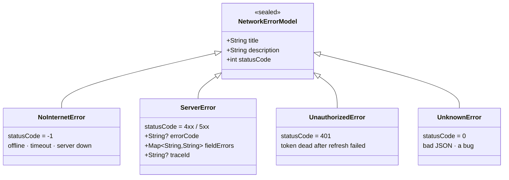

| Kind | When | What the UI does |
|---|---|---|
| `NoInternetError` | offline, timeout, server down | message + **Retry** |
| `ServerError` | server said NO (400, 404, 500, `success:false`) | message; forms → red text under each field |
| `UnauthorizedError` | token dead (after refresh failed, Step 2.2) | nothing — `AuthGate` shows Login |
| `UnknownError` | bad JSON, a bug | "Something went wrong" |

**Two ways to use it:**

```dart
// 1. Simple (template style): just show the text
emit(LoadMeErrorState(error: error));        // UI shows error.title / error.description

// 2. By kind: the compiler checks you covered all 4
switch (error) {
  ServerError(:final fieldErrors) => showUnderFields(fieldErrors),
  UnauthorizedError() => null,          // Step 2.2 logs out automatically
  NoInternetError() || UnknownError() => showRetry(error.description),
}
```

`ServerError(:final fieldErrors)` is a **pattern**: "if it's a `ServerError`,
take its `fieldErrors` into a variable". `||` matches either kind.

**`super.title = Constants.noInternet`** — a **super parameter** with a
default: passes straight to the parent's `title`, and uses the constant when
you don't give one.

### `check_internet_service.dart`: `CheckInternetService`

```dart
static Future<bool> checkDataConnection() async {
  try {
    final result = await InternetAddress.lookup('google.com')
        .timeout(const Duration(seconds: 5));
    return result.isNotEmpty && result.first.rawAddress.isNotEmpty;
  } catch (_) {
    return false;
  }
}
```

Same name and job as the template. Used **only after** a request failed to
connect, to choose the right message:

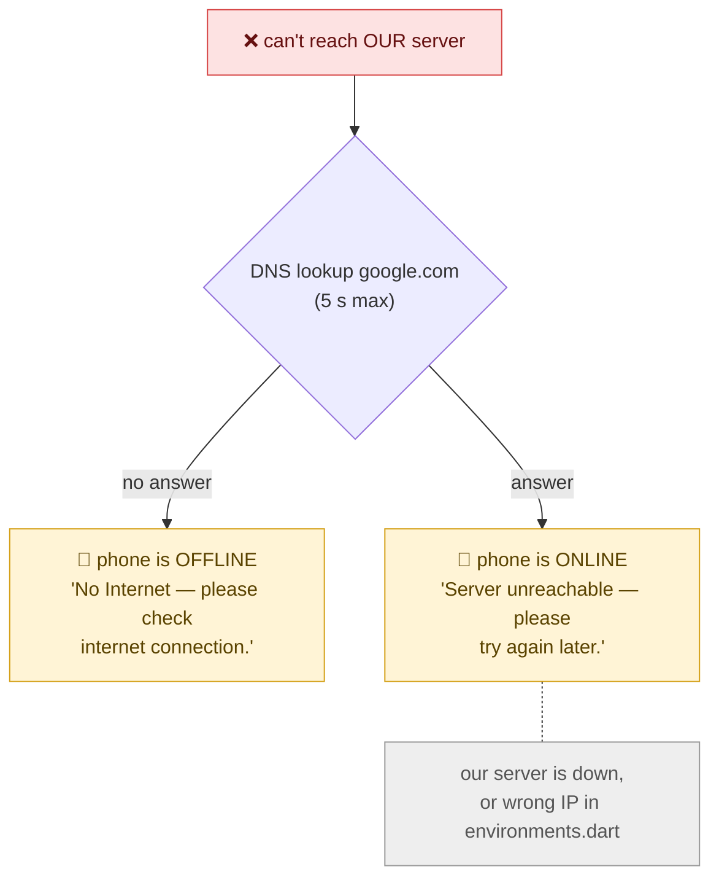

Template: full `http.get('https://www.google.com')`. Ours: a **DNS lookup** —
same answer, much lighter, and no extra `http` package.

### `app_service.dart`: `AppService.send`

```dart
class AppService {
  AppService(this._dio, {Future<bool> Function() hasInternet = CheckInternetService.checkDataConnection})
      : _hasInternet = hasInternet;

  Future<Either<NetworkErrorModel, T>> send<T>({
    required HttpMethods httpMethods,
    required String endPoint,
    required Parser<T> parse,
    Object? data,
    Map<String, dynamic>? queryParameters,
    FormData? formData,
  }) async { … }
}
```

- **`AppService(this._dio, …)`** — the shared `Dio` is **injected** (template:
  `Dio dio = Dio();` inside, a new one for every request).
- **`hasInternet`** — also injected, with the real check as the default. Tests
  pass `() async => true/false`, so they don't depend on the test machine's
  internet.
- **`parse`** — `typedef Parser<T> = T Function(Object? data);` — "a function
  that turns JSON into your model". `<T>` = one method for any model, checked
  by Dart (like `Future<T?>` in ConfigRouter).
- **`formData`** — like the template: for **file uploads** (avatar, chat
  images). `body = formData ?? data`.

**`parse` is a function you hand over** — `AppService` doesn't know your
model, so you tell it *how* to build it:

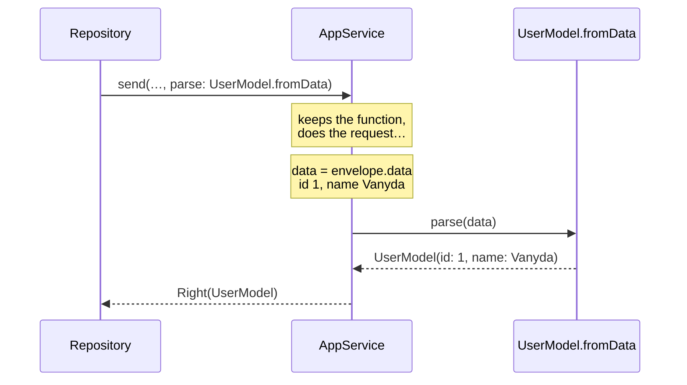

Like giving a chef your recipe: the chef (`AppService`) cooks, but the recipe
(`parse`) decides the dish.

**`data` vs `formData`** — two kinds of body:

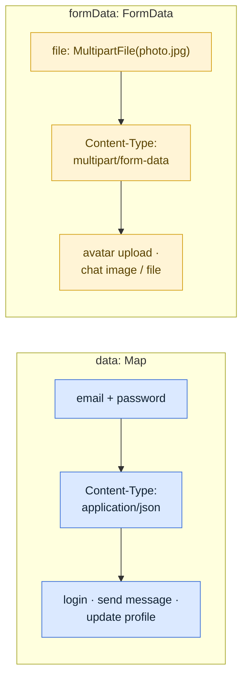

```dart
final response = switch (httpMethods) {
  HttpMethods.get    => await _dio.get<Object?>(endPoint, queryParameters: queryParameters),
  HttpMethods.post   => await _dio.post<Object?>(endPoint, data: body, …),
  HttpMethods.put    => …,
  HttpMethods.patch  => …,
  HttpMethods.delete => …,
};
```

A **switch expression** over the enum (template: a `switch` statement with
`break`). Add a 6th method and forget it here → compile error.

```dart
  final envelope = ApiEnvelope.tryParse(response.data);
  if (envelope == null) return Right(parse(response.data));   // plain JSON
  if (!envelope.success) return Left(_serverError(envelope, response.statusCode));
  return Right(parse(envelope.data));
} on DioException catch (e) {
  return Left(await _fromDio(e));
} catch (e) {
  return Left(UnknownError(description: 'Could not read the response: $e'));
}
```

- **Any 2xx is success.** Dio throws for non-2xx by default, so a `201 Created`
  arrives here as a normal response. (Template: only `statusCode == 200`, so a
  `201` became "Something Went Wrong".)
- **`success: false` with 2xx** → still an error. We check the backend's own
  flag, not only the HTTP code.
- **`catch (e)`** catches **our parser** crashing on an unexpected shape —
  still a `Left`, never a red screen.

### `api_envelope.dart` (ours — the template has no envelope)

**The envelope is like a parcel:** the server always sends a box with labels;
our model is inside `data`. `AppService` opens the box once.

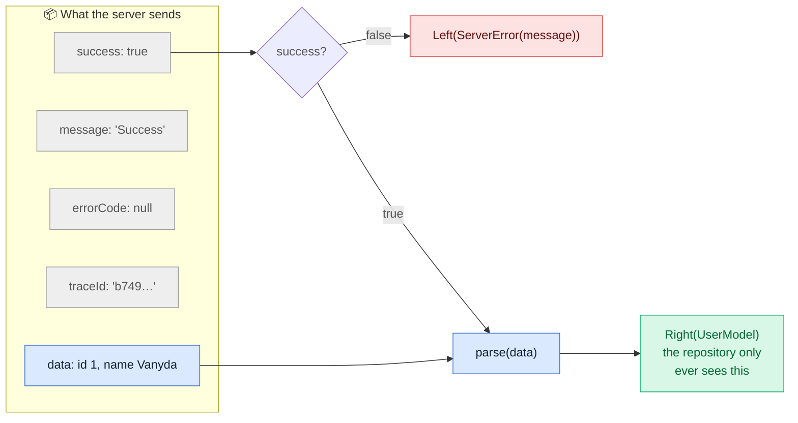

```dart
static ApiEnvelope? tryParse(Object? json) {
  if (json is! Map<String, dynamic> || json['success'] is! bool) return null;
  ...
}
```

- Returns `null` for anything that isn't an envelope. `is!` = "is not".
- **`fieldErrors`** accepts both shapes a Spring backend may send (a map, or a
  list of `{field, message}`) and always gives `Map<String, String>`:

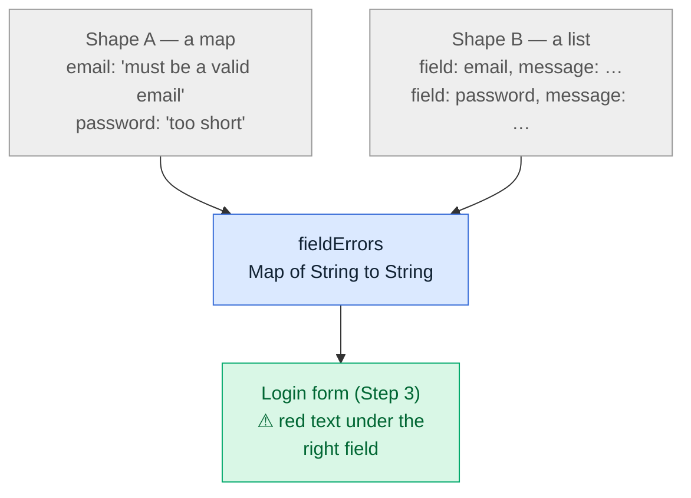

> 🔎 **Doc vs reality:** `API_LIST_BACKEND.md` says `/health` returns a plain
> `{ "status": "UP" }`. The real server **wraps** it in the envelope. Because
> `tryParse` handles both, it works either way. Always check the real server.

### `dio_factory.dart` (ours)

```dart
Dio createDio(Flavor flavor) {
  final dio = Dio(BaseOptions(
    baseUrl: flavor.apiBaseUrl,
    connectTimeout: const Duration(seconds: 15),   // same values as the template
    sendTimeout: const Duration(seconds: 15),
    receiveTimeout: const Duration(seconds: 30),
  ));
  if (flavor.enableNetworkLogging) {
    dio.interceptors.add(PrettyDioLogger(requestHeader: false, …));
  }
  return dio;
}
```

- Template timeouts (15 / 30 / 15) — set **once** here instead of per request.

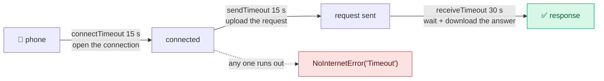

- An **interceptor** = code that runs on **every** request/response, like a
  checkpoint:

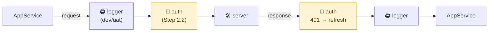

### DI: `injection.dart`

```dart
getIt.registerLazySingleton<Dio>(() => createDio(Flavor.current));
getIt.registerLazySingleton<AppService>(() => AppService(getIt<Dio>()));
```

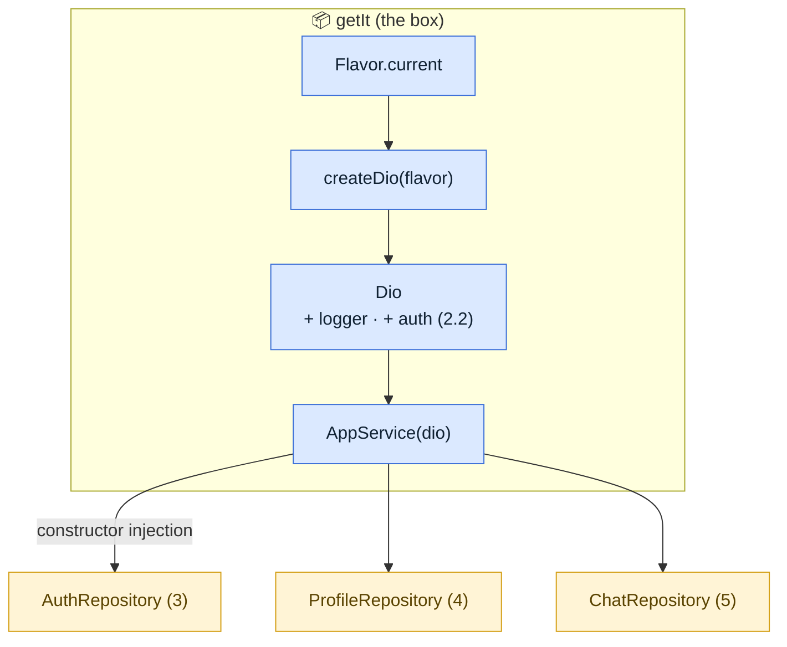

All repositories share the **same** `AppService` → the **same** `Dio` → the
**same** interceptors.

### The demo: "Check server" on the home page

```dart
final messenger = ScaffoldMessenger.of(context);   // read BEFORE the await
final result = await appService.send<String>(
  httpMethods: HttpMethods.get,
  endPoint: ApiEndPoint.health,
  parse: (data) => (data as Map<String, dynamic>)['status'] as String,
);
```

`AppService` reaches the page by constructor (`bootstrap → App → AuthGate →
Home`). Real screens (Step 3+) will call it from a **Repository**, used by a
**BLoC** — exactly like the template's `ProductRepository` → `DemoViewModelBloc`.

### The tests: a fake server

```dart
class _FakeAdapter implements HttpClientAdapter { int status; Object? body; … }
final dio = Dio(BaseOptions(baseUrl: 'http://test'))..httpClientAdapter = server;
appService = AppService(dio, hasInternet: () async => phoneOnline);
```

Dio sends bytes through an **adapter**; the fake returns whatever the test
sets.

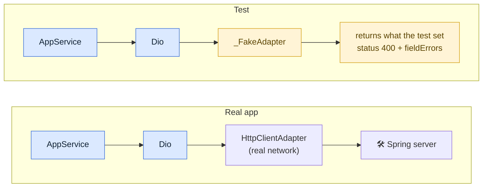

Same `AppService` code in both — only the adapter at the bottom is swapped.
This only works because `Dio` is **injected**: with the template's `Dio()`
inside `AppService`, there's no way to put a fake in.

12 tests: success, **201**, every `HttpMethods` → right verb, plain JSON,
`success:false`, 400 + `fieldErrors`, 401, 500, offline, server unreachable,
timeout, parser crash.

## 4. 🤔 Why like this? (template vs ours)

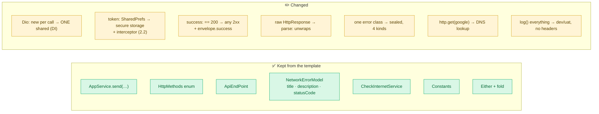

| Template | Ours | Why |
|---|---|---|
| `Dio dio = Dio();` inside `AppService` (new per request) | ONE `Dio` injected from DI | Step 2.2 adds the token interceptor once; refresh must queue all requests on one Dio. Tests can inject a fake. |
| `AppService(...).send()` (new object per call) | `appService.send(...)` (one object from DI) | Same call shape, but the service holds the shared Dio. |
| `getToken()` reads the token from `SharedPreferences` | No token code here; Step 2.2 interceptor reads `flutter_secure_storage` | Tokens are secrets → secure storage (CLAUDE.md). An interceptor adds them to **every** request automatically. |
| Success only when `statusCode == 200` | Any 2xx | `201 Created` is success (creating a group, sending a message). |
| Returns raw `HttpResponse`; repo does `jsonDecode(success.response.toString())` | `parse:` gets the unwrapped `data` | Our backend wraps everything in an envelope; unwrap once, not in every repo. |
| One `NetworkErrorModel` class | Same fields, but `sealed` with 4 kinds | `ServerError` carries `fieldErrors`/`errorCode`/`traceId`; `switch` is compiler-checked. `error.title` still works. |
| `CheckInternetService`: `http.get(google.com)` on every error | DNS lookup, only on connection errors, injectable | Lighter, no `http` package; tests don't need real internet. |
| `log()` url + params + data on every call (also in prod) | `PrettyDioLogger` dev/uat only, no headers | The login body contains the **password**; tokens are in headers. Never in logs. |
| `HttpMethods.GET` … | `HttpMethods.get` … + `patch` | Dart naming style; backend uses PATCH. |
| `ConfigReader.rootApi()` from JSON files | `Flavor.current.apiBaseUrl` (Step 1.1) | We already have flavors; one source of truth. |
| `Either` from `dartz` | Same, imported with `show Either, Left, Right` | dartz also exports `State`, which clashes with Flutter's `State`. |

## 5. Try it

```bash
flutter test                                    # 21 tests → All tests passed!
flutter run --flavor dev -t lib/main_dev.dart
```

1. Sign in (demo) → Home → **Check server (GET /health)** → **✅ Server is UP**.
2. In the console (dev flavor) you see the pretty request/response log.
3. **Airplane mode** → tap again → **❌ No Internet: Please check internet connection.**
4. Wi-Fi on, but change the IP in `environments.dart` to a wrong one → hot
   restart → tap → **❌ Server unreachable: …** (phone online, server not).

> 📱 On a real phone the IP must be reachable on the same Wi-Fi. Android
> emulator → `10.0.2.2`. iOS simulator → `localhost`.

## 6. Check yourself

1. The server answers **201** with a valid envelope. What does the template's
   `AppService` return, and what does ours return?
2. Why does `AppService` receive `Dio` in its constructor?
3. The phone is online but our server is down. Which title does the user see,
   and which code decided it?
4. Why isn't there a `getToken()` in our `helper_service.dart`?
5. What does `ServerError(:final fieldErrors)` mean in a `switch`?

<details><summary>Answers</summary>

1. Template: `Left("Something Went Wrong")`, because it only accepts 200.
   Ours: `Right(model)` — any 2xx is success.
2. One shared Dio = one place for interceptors (logger now, token refresh in
   2.2). And tests can pass a Dio with a fake adapter.
3. "Server unreachable". `_fromDio` got `connectionError`, called
   `CheckInternetService` (→ online), so it picked `Constants.serverUnreachable`.
4. Tokens are secrets → `flutter_secure_storage`, not SharedPreferences. And
   the Step 2.2 interceptor attaches them to every request, so no code needs
   to call `getToken()` by hand.
5. "If `error` is a `ServerError`, match it and put its `fieldErrors` into a
   local variable named `fieldErrors`."

</details>
