# Step 2.2 — Tokens + auth interceptor (attach, refresh, log out)

## 1. Why

Our backend protects almost everything: you must send
`Authorization: Bearer <accessToken>` on **every** request. Tokens expire.
Without help, every repository would have to:

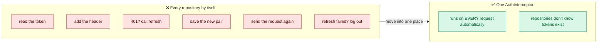

**Two tokens, two jobs** (`AuthResponse` in `API_LIST_BACKEND.md`):

| Token | Lives | Sent | Job |
|---|---|---|---|
| `accessToken` | short (minutes/hours) | on **every** request | "I am Vanyda" |
| `refreshToken` | long (weeks) | **only** to `/auth/refresh` | get a new pair when the access token expires |

The refresh token is **rotated**: every refresh returns a **new** refresh
token, and the old one stops working. That detail drives a big part of the
design (see "3 requests at once" below).

### What the real server does (we tested it)

| Request | Real answer |
|---|---|
| `GET /users/me` with no token | **401** `UNAUTHORIZED` "Authentication required" |
| `GET /users/me` with a bad token | **401** `UNAUTHORIZED` |
| `POST /auth/refresh` with a bad refresh token | **401** "Invalid or expired token" |
| `POST /auth/login` with a **wrong password** | **401** "Invalid email or password" ⚠ |

⚠ The last row is a trap: a wrong password **also** returns 401. If the
interceptor treated it like "token expired", a typo in the password would
trigger a refresh and log you out. So **public endpoints never refresh**.

## 2. Picture

### The happy path: token expired → fixed by itself

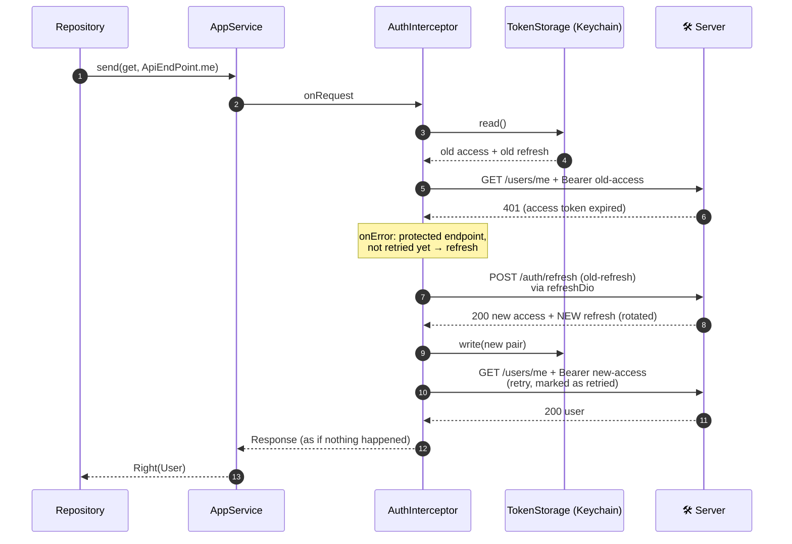

The repository **never knows** a refresh happened.

### Every decision in `onError`

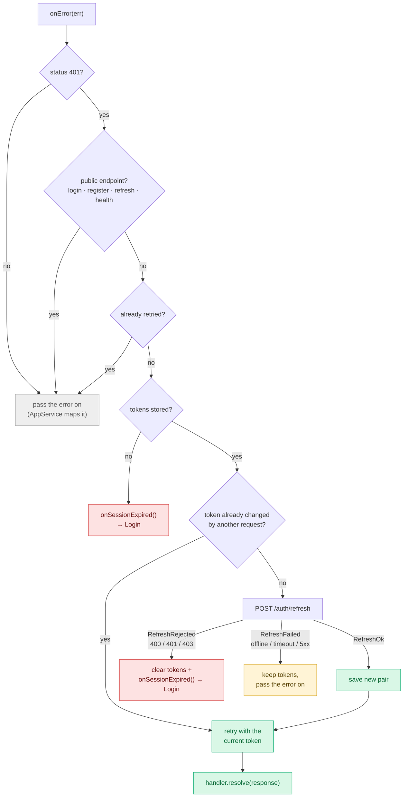

<a id="pic-rejected"></a>

### Rejected vs failed: why the difference matters

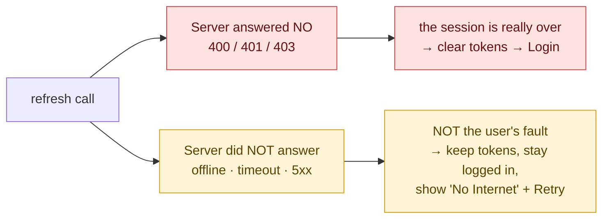

Imagine walking into a lift with no signal while the token expires. Without
this rule, you'd be **logged out** just for losing the internet for 5 seconds.

<a id="pic-queued"></a>

### 3 requests get 401 at the same time

The chat screen loads conversations, the profile and presence **together**.
If the token just expired, all 3 get 401.

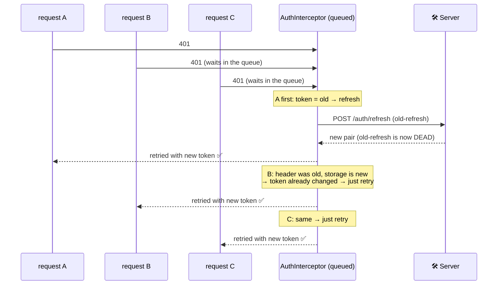

**ONE refresh, not three.** With a normal `Interceptor`, all 3 would refresh
in parallel with the **same** old refresh token. The first wins, and since
the token is rotated, the other 2 get "Invalid token" → **logout**. That's
why we use `QueuedInterceptor`.

### Two Dio objects

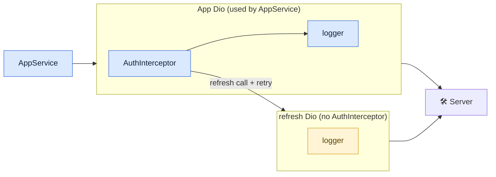

If the refresh call went through the **app** Dio, a 401 on refresh would come
back into the same interceptor → refresh again → 401 → … an endless loop. The
refresh Dio has **no** auth interceptor, so that can't happen.

### Files

```
lib/core/network/
├── auth_tokens.dart        AuthTokens: access + refresh (+ expiry)
├── token_storage.dart      TokenStorage: Keychain / Keystore (read · write · clear)
├── auth_interceptor.dart   AuthInterceptor + RefreshResult (Ok · Rejected · Failed)
├── api_endpoints.dart      + register, publicEndpoints, isPublic()
└── dio_factory.dart        createDio(flavor, interceptors: [...])
test/core/network/
├── token_storage_test.dart     5 tests
└── auth_interceptor_test.dart  9 tests
```

## 3. Code

<a id="code-tokens"></a>

### `auth_tokens.dart`

```dart
class AuthTokens {
  final String accessToken;
  final String refreshToken;
  final DateTime? accessTokenExpiresAt;
  final DateTime? refreshTokenExpiresAt;

  factory AuthTokens.fromJson(Map<String, dynamic> json) => …
  Map<String, dynamic> toJson() => …
  @override bool operator ==(Object other) => …   // CLAUDE.md: value types get ==
  @override String toString() => 'AuthTokens(access: ***, refresh: ***)';
}
```

- **Hand-written `==` / `hashCode`** (project rule, no `freezed`): two pairs
  with the same values are equal. Tests use it: `expect(read, tokens)`.
- **`toString` hides the tokens.** If someone writes `print(tokens)`, the log
  shows `***`, not a working token.
- `DateTime.tryParse(...)` returns `null` instead of crashing on a missing or
  bad date.

<a id="code-storage"></a>

### `token_storage.dart`

```dart
class TokenStorage {
  TokenStorage(this._storage);
  final FlutterSecureStorage _storage;
  static const String _key = 'auth_tokens';

  Future<AuthTokens?> read() async { … }
  Future<void> write(AuthTokens tokens) => _storage.write(key: _key, value: jsonEncode(tokens.toJson()));
  Future<void> clear() => _storage.delete(key: _key);
}
```

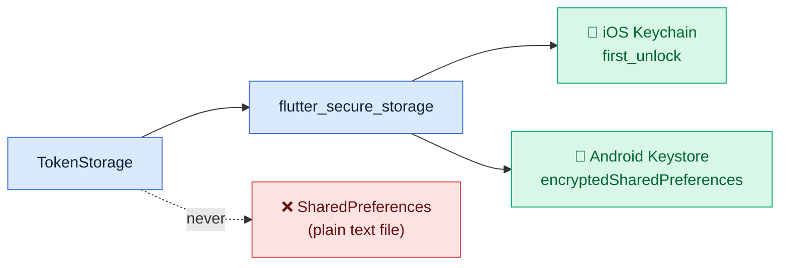

- **One key, one JSON value.** Access and refresh are always written
  **together**. With two keys, a crash between the two writes could leave a
  new access token with an old (dead) refresh token.
- **`read()` heals itself:** a broken value → `clear()` → `null` ("no
  session"), instead of crashing every request.
- **`FlutterSecureStorage` is injected** → tests use
  `FlutterSecureStorage.setMockInitialValues({})`, an in-memory fake.

➡ Why not SharedPreferences, Hive, or memory? [All options compared](#why-secure-storage)

<a id="code-first-unlock"></a>

**The options (in `TokenStorage.secureStorage`):**

| Option | Why |
|---|---|
| Android `encryptedSharedPreferences: true` | values encrypted with a Keystore key |
| iOS `KeychainAccessibility.first_unlock` | readable after the **first** unlock since boot — even while the phone is **locked**. Step 7: a call arrives at a killed app in your pocket → the background code must read the token to talk to the server. The default (`unlocked`) would fail there. |

➡ What do the other Keychain levels do? [All options compared](#why-first-unlock)

<a id="code-public"></a>

### `api_endpoints.dart`: public endpoints

```dart
static const Set<String> publicEndpoints = {health, login, register, refresh};
static bool isPublic(String path) => publicEndpoints.contains(path);
```

Matches the backend doc's "Public endpoints" list. **One** place decides
"no token, no refresh" — not each repository.

<a id="code-interceptor"></a>

### `auth_interceptor.dart`

```dart
class AuthInterceptor extends QueuedInterceptor {
  AuthInterceptor({
    required TokenStorage tokenStorage,
    required Dio refreshDio,
    required void Function() onSessionExpired,
  });
```

All 3 needs come by **constructor** (Step 1.3 rule):

| Parameter | Real app (DI) | Test |
|---|---|---|
| `tokenStorage` | `TokenStorage(Keychain)` | `TokenStorage(mock)` |
| `refreshDio` | `createDio(flavor)` (no auth) | Dio + fake server |
| `onSessionExpired` | `getIt<AuthSession>().markLoggedOut` | `() => sessionExpired++` |

`onSessionExpired` is a **function**, not `AuthSession` itself. The
interceptor doesn't need to know *how* logout works — only *that* it should
happen. A test just counts the calls.

#### `onRequest`

```dart
if (!ApiEndPoint.isPublic(options.path)) {
  final tokens = await _tokenStorage.read();
  if (tokens != null) options.headers['Authorization'] = 'Bearer ${tokens.accessToken}';
}
handler.next(options);
```

`handler.next(options)` = "continue to the next interceptor / the server".
Forget it and the request hangs forever.

<a id="code-onerror"></a>

#### `onError`: the 3 handler choices

| Call | Meaning |
|---|---|
| `handler.next(err)` | "I can't fix it" → the error continues → `AppService` turns it into a `NetworkErrorModel` |
| `handler.resolve(response)` | "I fixed it" → the caller gets this response as if no error happened |
| (`handler.reject(err)`) | stop with an error (we don't need it) |

<a id="code-refresh-result"></a>

#### `RefreshResult`: a sealed family (again)

```dart
sealed class RefreshResult {}
final class RefreshOk extends RefreshResult { final AuthTokens tokens; }
final class RefreshRejected extends RefreshResult {}
final class RefreshFailed extends RefreshResult {}

switch (result) {
  case RefreshOk(:final tokens): …       // save + retry
  case RefreshRejected(): …              // clear + logout
  case RefreshFailed(): …                // keep tokens
}
```

Same idea as `NetworkErrorModel` and `_Registration` in DI: the compiler checks
the `switch` covers all 3. A `bool?` (`true` / `false` / `null`) could say the
same thing, but nobody remembers what `null` means six months later.

<a id="code-retried"></a>

#### `_retriedKey`: no endless loop

```dart
extra: {...request.extra, _retriedKey: true},
```

`extra` is a bag of notes that travels **with** a request (not sent to the
server). We mark the retry. If the retry also gets 401, `onError` sees the
mark and gives up instead of refreshing forever.

#### `{...request.headers, …}`: the spread operator

```dart
headers: {...request.headers, _header: 'Bearer ${tokens.accessToken}'},
```

`...map` copies all entries into a **new** map, then we override one key. The
original request is not changed.

<a id="code-two-dio"></a>

### `dio_factory.dart` + DI

```dart
Dio createDio(Flavor flavor, {List<Interceptor> interceptors = const []}) { … }
```

```dart
getIt.registerLazySingleton<Dio>(
  () => createDio(Flavor.current, interceptors: [
    AuthInterceptor(
      tokenStorage: getIt<TokenStorage>(),
      refreshDio: createDio(Flavor.current),               // no interceptor
      onSessionExpired: getIt<AuthSession>().markLoggedOut,
    ),
  ]),
);
```

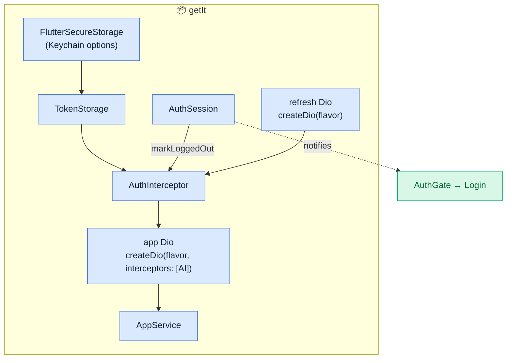

When the session expires anywhere, `AuthSession.markLoggedOut()` fires →
`AuthGate` (Step 1.4) closes all pages and shows Login. No screen code needed.

### The demo: "Call GET /users/me (needs a token)"

The demo login (Step 1.4) stores **no** tokens. So the button shows the
"no session" path with the real server:

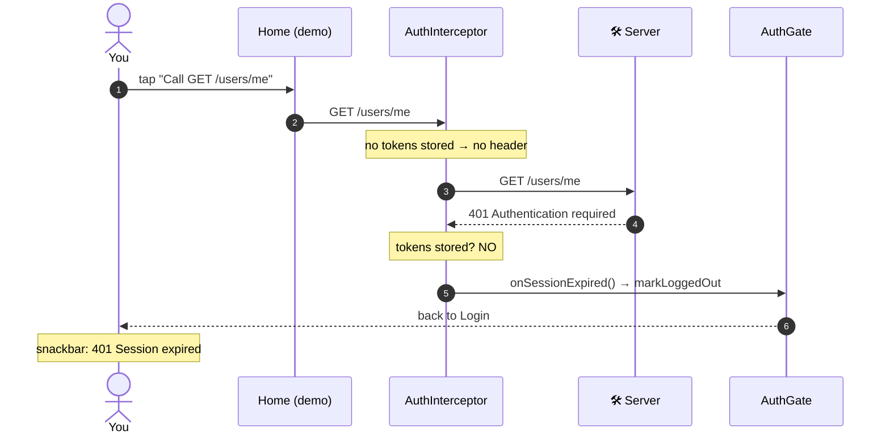

In Step 3 the **real** login saves tokens → the same button shows
"✅ Signed in as …".

## 4. 🤔 Why like this? (other ways)

Each **Choice we made** links back to where it is explained.

| Choice we made | Other way | Why we didn't pick the other way |
|---|---|---|
| [An interceptor adds the token](#code-interceptor) | The template's `getToken()` inside `AppService` / each repo | One place, automatic, and it can also **fix** a 401. `getToken()` only adds. |
| [`flutter_secure_storage`](#code-storage) | `SharedPreferences` (the template) | SharedPreferences is a plain file — readable on rooted phones and in backups. Tokens = your identity. **All options compared below** ↓ |
| [One JSON key for the pair](#code-storage) | Two keys | A crash between two writes could leave a mismatched pair. |
| [iOS `first_unlock`](#code-first-unlock) | The default (`unlocked`) | Step 7: background code must read the token while the phone is locked. **All options compared below** ↓ |
| [`QueuedInterceptor`](#pic-queued) | `Interceptor` | Parallel 401s would refresh in parallel; our refresh token is rotated → 2 of 3 fail → logout. |
| [A separate refresh Dio](#code-two-dio) | Refresh through the app Dio | A 401 on refresh would re-enter the interceptor → loop. |
| [Rejected vs Failed](#pic-rejected) | "Any refresh error → logout" | Losing signal for 5 s would log the user out. |
| [Public endpoints skip auth](#code-public) | Treat every 401 the same | Wrong password on login is 401 → would refresh + log out. |
| [`_retriedKey` mark](#code-retried) | No mark | A server that always says 401 would loop forever. |
| [Refresh **after** a 401](#code-onerror) | Refresh **before** expiry using `accessTokenExpiresAt` (flutter-chat does this) | Simpler and always correct (phone clock may be wrong). We store the expiry, so a "refresh 60 s early" step can be added later without changing callers. |
| [`onSessionExpired` as a function](#code-interceptor) | Pass `AuthSession` | The interceptor needs *one* action, not the whole session. Tests count calls. |

<a id="why-secure-storage"></a>

### 🔐 Where can tokens live? All options

[← back to the code](#code-storage)

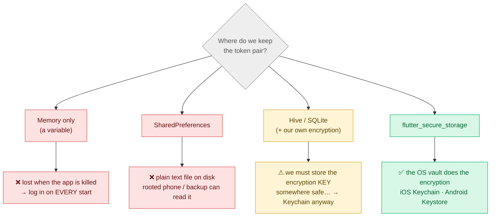

| Option | Survives app kill? | Encrypted? | Who holds the key? | Verdict |
|---|---|---|---|---|
| Memory (a variable) | ❌ no | — | — | ❌ no auto-login (Step 3 needs it) |
| `SharedPreferences` | ✅ | ❌ plain text | nobody | ❌ the template's choice — not for secrets |
| Hive / SQLite + our own encryption | ✅ | ✅ | **we** must hide it… in the Keychain | ⚠ more code, same Keychain in the end |
| **`flutter_secure_storage`** | ✅ | ✅ by the OS | the **OS** (Secure Enclave / TEE) | ✅ **our choice** |

**Rule of thumb** (also in CLAUDE.md):

| Data | Where |
|---|---|
| Tokens, passwords, keys (secrets) | `flutter_secure_storage` |
| Cached user name, theme, language (not secret) | `shared_preferences` |

<a id="why-first-unlock"></a>

### 🍎 iOS Keychain: when can the app read the token? All options

[← back to the code](#code-first-unlock)

The iOS Keychain lets each item choose **when** it can be read. Our token
must be readable when a call arrives and the app is **killed** and the phone
is **locked** in your pocket (Step 7).

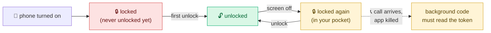

| `KeychainAccessibility` | 🔒 never unlocked since boot | 🔓 unlocked | 🔒 locked again (pocket) | Fits us? |
|---|---|---|---|---|
| `unlocked` (default) | ❌ | ✅ | ❌ | ❌ a call to a locked phone can't read the token |
| `unlocked_this_device` | ❌ | ✅ | ❌ | ❌ same, and not in backups |
| **`first_unlock`** | ❌ | ✅ | ✅ | ✅ **our choice** |
| `first_unlock_this_device` | ❌ | ✅ | ✅ | ✅ also OK — but not restored to a new iPhone from backup |
| `passcode` | ❌ | ✅ only if a passcode is set | ❌ | ❌ too strict |

- **`first_unlock`** = "after the user unlocked the phone **once** since it was
  turned on". That covers the pocket case, and it's what Apple recommends for
  background tasks.
- The only time it can't read: right after a reboot, before the first unlock.
  Then the user isn't using the phone anyway.
- **Android** has no such levels: `encryptedSharedPreferences: true` stores the
  values encrypted with a Keystore key, readable whenever the app runs.

## 5. Try it

```bash
flutter test                                    # 35 tests → All tests passed!
flutter run --flavor dev -t lib/main_dev.dart
```

1. Sign in (demo) → Home → **Call GET /users/me (needs a token)**.
2. The server answers 401, the interceptor finds no tokens → you're sent
   back to **Login**, with a snackbar **❌ 401 Session expired**.
3. **Check server (GET /health)** still works — it's public, no token needed.

The refresh path (401 → refresh → retry) needs a real token pair, which
arrives with the real login in **Step 3**. Until then it's proven by the 9
interceptor tests.

## 6. Check yourself

1. Why does a wrong password on login **not** trigger a refresh?
2. 3 requests get 401 together. How many refresh calls happen, and why does
   it matter for **our** backend?
3. The refresh call times out in a lift. Is the user logged out? Why?
4. Why does the refresh go through a **different** Dio?
5. Why `first_unlock` on iOS?

<details><summary>Answers</summary>

1. `/auth/login` is in `ApiEndPoint.publicEndpoints`, so `onError` passes the
   401 on without refreshing. (The real server answers 401 for a wrong
   password.)
2. One. `QueuedInterceptor` handles them one by one; requests 2 and 3 see the
   token already changed and just retry. Our refresh token is **rotated**, so
   parallel refreshes with the old one would fail → logout.
3. No. A timeout is `RefreshFailed` (no answer), not `RefreshRejected`. Tokens
   are kept; the user sees "No Internet" and can retry.
4. So a 401 on the refresh call can't come back into the same interceptor and
   loop forever.
5. So code running in the background while the phone is locked (a call to a
   killed app, Step 7) can still read the token.

</details>
