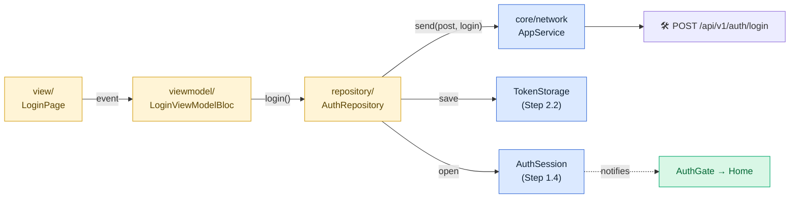
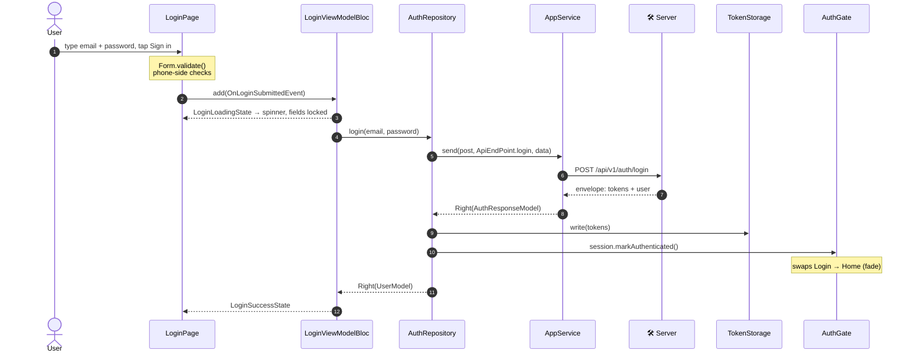
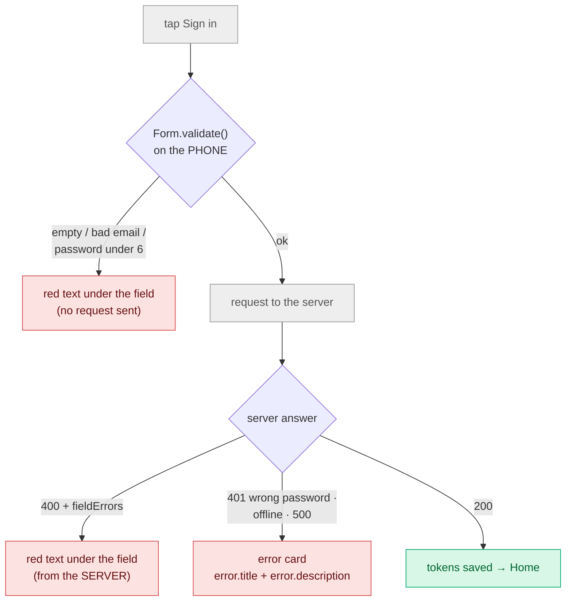
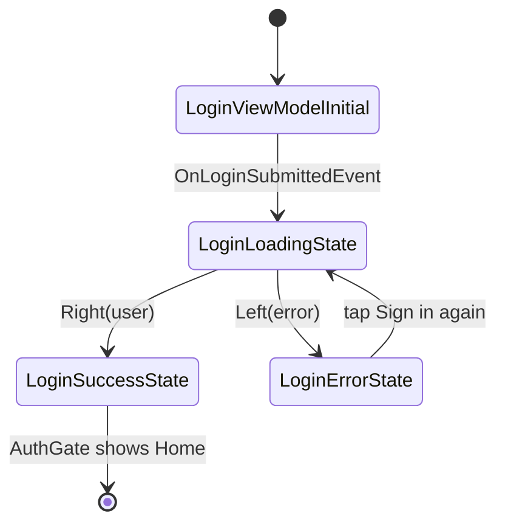
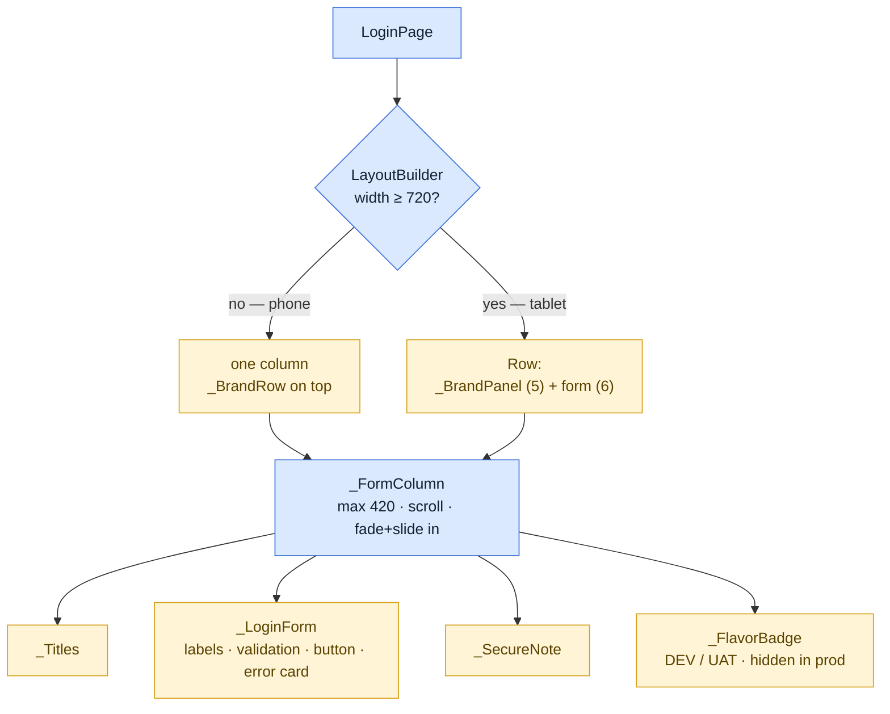
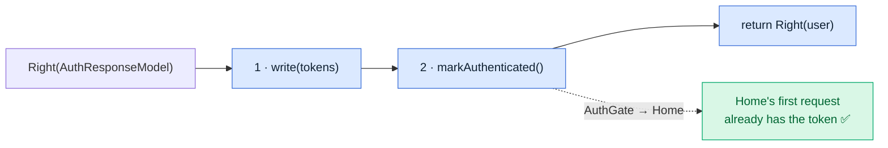
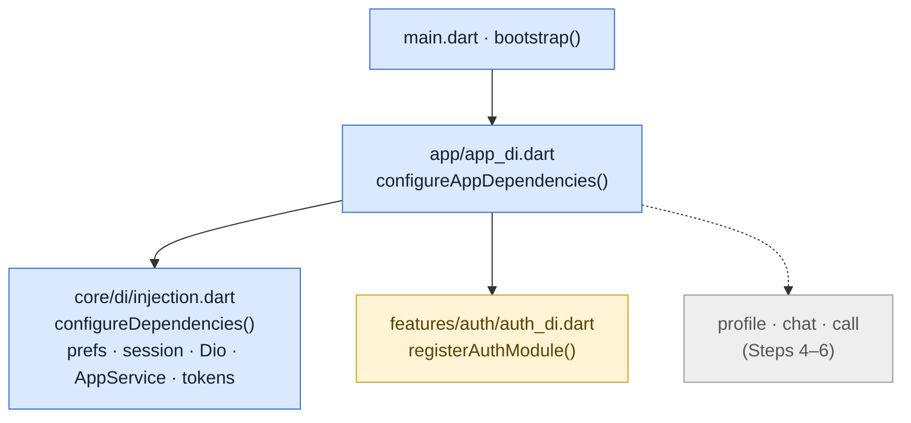
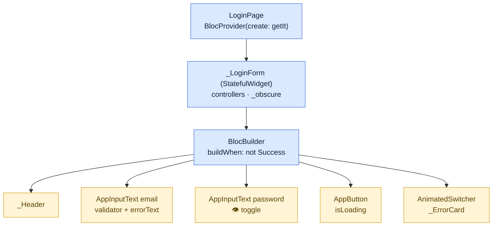

# Step 3.1 — Login (model · repository · ViewModel BLoC · form)

> Step 3 is split in two:
> - **3.1 (this lesson):** a real login: form → BLoC → repository → server →
>   save tokens → open the session.
> - **3.2 (next):** splash auto-login from saved tokens + real logout.

This is the **first real feature**, built the way your MVVM template builds
features: `model/ · repository/ · viewmodel/ · view/`, a `…ViewModelBloc` with
`part` event/state files, states named `…LoadingState / …ErrorState /
…SuccessState`.

## 1. Why

Steps 1–2 built the **roads** (theme, DI, navigation, network, tokens). Now
the first **car** drives on them. Login touches every layer:



🟨 new in this step (the feature) · 🟦 built before (core) · 🟩 result

## 2. Picture

### Login, end to end



**The page never navigates.** Step 1.4's rule: pages flip the session,
`AuthGate` moves the screen.

### Two kinds of errors, two places to show them



| Error | Checked by | Shown |
|---|---|---|
| Empty field, bad email, password under 6 | the **phone** (`FormValidators`) | under the field, **before** any request |
| `400 VALIDATION_ERROR` + `fieldErrors` | the **server** | under the field (`errorText`) |
| `401` wrong password, offline, server down | the **server** / `AppService` | the red error card |

### The BLoC's states



### The design (phone + tablet)

The login follows design-guide Screen 1.1 (*professional, welcoming, single
column, no card around the form*) and the CLAUDE.md design skill (*clean,
elegant, works on phone **and** tablet*).

```
 PHONE (< 720 wide)                      TABLET / LANDSCAPE (≥ 720 wide)
 ┌──────────────────────────┐            ┌───────────────────┬──────────────────────────┐
 │                    [DEV] │            │                   │                    [DEV] │
 │  [icon]  ERP Dev         │            │      [icon]       │   Welcome back           │
 │                          │            │     ERP Dev       │   Sign in to your account│
 │  Welcome back            │            │                   │                          │
 │  Sign in to your account │            │  Chat, voice and  │   Email                  │
 │                          │            │  video calls —    │   [ you@company.com    ] │
 │  Email                   │            │  your team, in    │   Password               │
 │  [ you@company.com     ] │            │  one place.       │   [ ••••••••        👁 ] │
 │  Password                │            │                   │                          │
 │  [ ••••••••         👁 ] │            │  (primary colour) │   [      Sign in       ] │
 │                          │            │                   │     Secured connection   │
 │  [       Sign in       ] │            │                   │                          │
 │  ⚠ error card (if any)   │            └───────────────────┴──────────────────────────┘
 │     Secured connection   │              the form column is never wider than 420
 └──────────────────────────┘
```



| Design choice | Why |
|---|---|
| **Labels above fields** (`AppInputText(label:)`) | A hint disappears when you type; a label stays. Clearer, better for accessibility. |
| **`LayoutBuilder`** at 720 | Decides by the **available width**, not the device type — works for tablets, landscape phones, split-screen. |
| **Form max 420 wide** (`ConstrainedBox`) | 1000-px-wide text fields on an iPad look broken and are hard to read. |
| **Brand panel on wide screens** | Fills the empty half with calm brand colour instead of white space. On phones the brand moves to a small row above the form. |
| **`_FlavorBadge` (DEV / UAT), hidden in prod** | Testers always know which server they're on. |
| **Fade + 16 px slide in, 300 ms** (`TweenAnimationBuilder`) | Design guide motion rules: calm, no bounce. `child:` is passed in so the form isn't rebuilt every frame. |
| **Tap anywhere → hide keyboard** (`GestureDetector`) | Expected on mobile; the button is never hidden behind the keyboard. |
| **`AnimatedSize` around the error card** | The card slides open instead of making the page jump. |
| **"Secured connection" note** | Quiet reassurance — no marketing copy (design guide). |
| **All colours from `colorScheme`** | Dark mode works with zero extra code. |

### Files

```
lib/
├── app/app_di.dart                  configureAppDependencies(): core + features   NEW
├── core/
│   ├── widgets/
│   │   ├── app_input_text.dart      AppInputText (template, themed)              NEW
│   │   └── app_button.dart          AppButton + isLoading (template, themed)     NEW
│   └── utils/validators/
│       ├── validators.dart          Validators.email / password / phone         NEW
│       ├── form_validators.dart     FormValidators.loginEmail / loginPassword    NEW
│       └── validation_messages.dart                                              NEW
└── features/auth/
    ├── model/
    │   ├── user_model.dart          UserModel (UserDto)
    │   └── auth_response_model.dart tokens + user
    ├── repository/auth_repository.dart   login → save tokens → open session
    ├── viewmodel/
    │   ├── login_view_model_bloc.dart     + part …_event.dart, …_state.dart
    ├── view/
    │   ├── login_page.dart          the real form (Screen 1.1)
    │   └── splash_page.dart         moved from views/
    └── auth_di.dart                 registerAuthModule()
test/
├── features/auth/auth_repository_test.dart        3 tests (fake server)
├── features/auth/login_view_model_bloc_test.dart  3 tests (bloc_test + mocktail)
└── core/utils/validators_test.dart                6 tests
```

## 3. Code

### Folders: the template's names

| Template | Ours | Holds |
|---|---|---|
| `model/` | `model/` | data classes (`UserModel`) |
| `repository/` | `repository/` | business rules (`AuthRepository`) |
| `viewmodel/` | `viewmodel/` | the BLoC + `part` event/state |
| `view/` | `view/` | pages |

(Steps 1.4 used `views/` — renamed to `view/` to match the template.)

### `model/user_model.dart`

```dart
factory UserModel.fromJson(Map<String, dynamic> json) {
  ...
  return UserModel(
    id: '${json['id'] ?? ''}',                                       // 7 or "7" → "7"
    fullName: (json['fullName'] ?? json['name'] ?? json['displayName'] ?? '') as String,
    roles: strings('roles'),                                          // ["STAFF"] or [{"code":"STAFF"}]
    ...
```

- **Tolerant parsing**, learned from the old app on `feature/call`: the
  backend doc doesn't list `UserDto`'s fields, so we accept the shapes we've
  seen.
- `'${json['id'] ?? ''}'` — **string interpolation** turns a number or a
  string into a string. One type (`String id`) everywhere in the app.
- `displayName` — a **getter**: never show an empty name (falls back to email).
- Hand-written `==` with `ListEquality` from `package:collection` (CLAUDE.md
  rule: list fields need deep equality, `[1] == [1]` is `false` in Dart).

### `model/auth_response_model.dart`

```dart
factory AuthResponseModel.fromData(Object? data) {
  final json = data as Map<String, dynamic>;
  return AuthResponseModel(
    tokens: AuthTokens.fromJson(json),
    user: UserModel.fromJson(json['user'] as Map<String, dynamic>),
  );
}
```

`fromData(Object? data)` has exactly the `Parser<T>` shape from Step 2.1, so we
pass it **by name**: `parse: AuthResponseModel.fromData` (a tear-off).

### `repository/auth_repository.dart`

```dart
Future<Either<NetworkErrorModel, UserModel>> login({required String email, required String password}) async {
  final result = await _appService.send(
    httpMethods: HttpMethods.post,
    endPoint: ApiEndPoint.login,
    data: {'email': email.trim(), 'password': password},
    parse: AuthResponseModel.fromData,
  );
  return result.fold<Future<Either<NetworkErrorModel, UserModel>>>(
    (error) async => Left(error),
    (response) async {
      await _tokenStorage.write(response.tokens);   // 1. save tokens
      _session.markAuthenticated();                  // 2. open the session
      return Right(response.user);
    },
  );
}
```



- **The order matters.** Save tokens **first**, open the session **second**.
  If we opened first, Home could fire `GET /users/me` before the token is
  written → 401 → logged out right after logging in.
- **`email.trim()`** — a space pasted after the email is a classic "why can't
  I log in?" bug.
- **`fold<Future<…>>`** — `fold` handles both boxes; the success side must
  `await` the save, so both sides return a `Future`. The `<…>` tells Dart the
  type, because `Left(error)` alone doesn't say what the Right side is.
- Business rules live **here**, not in the BLoC (CLAUDE.md): the BLoC doesn't
  know tokens or sessions exist.

### `viewmodel/`: the BLoC, template style

```dart
// login_view_model_bloc.dart
part 'login_view_model_event.dart';
part 'login_view_model_state.dart';
```

**`part` / `part of`** — one library split over 3 files. Events and states see
the bloc's imports, and the page imports **one** file to get all three.

```dart
// login_view_model_event.dart
@immutable
sealed class LoginViewModelEvent {}
final class OnLoginSubmittedEvent extends LoginViewModelEvent {
  OnLoginSubmittedEvent({required this.email, required this.password});
  final String email;
  final String password;
}
```

```dart
// login_view_model_state.dart
@immutable
sealed class LoginViewModelState {}
final class LoginViewModelInitial extends LoginViewModelState {}
final class LoginLoadingState extends LoginViewModelState {}
final class LoginErrorState extends LoginViewModelState {
  final NetworkErrorModel error;
  Map<String, String> get fieldErrors => switch (error) {
    ServerError(:final fieldErrors) => fieldErrors,
    _ => const {},
  };
}
final class LoginSuccessState extends LoginViewModelState { final UserModel user; }
```

- **`@immutable`** — the analyzer warns if a field isn't `final`. Events and
  states never change after they're made (CLAUDE.md rule).
- **`fieldErrors` getter** — the page asks the state "any field errors?"
  instead of digging into `ServerError` itself. Logic stays out of the widget.

```dart
// login_view_model_bloc.dart
Future<void> _onLoginSubmitted(OnLoginSubmittedEvent event, Emitter<LoginViewModelState> emit) async {
  if (state is LoginLoadingState) return;          // ignore double taps
  emit(LoginLoadingState());
  final result = await _repository.login(email: event.email, password: event.password);
  result.fold(
    (error) => emit(LoginErrorState(error: error)),
    (user) => emit(LoginSuccessState(user: user)),
  );
}
```

Exactly the template's `_onLoadProduct` shape: Loading → repository →
`fold` → Error / Loaded.

### `auth_di.dart` + `app/app_di.dart`

```dart
void registerAuthModule(ServiceLocator getIt) {
  getIt
    ..registerLazySingleton<AuthRepository>(() => AuthRepository(
        appService: getIt<AppService>(), tokenStorage: getIt<TokenStorage>(), session: getIt<AuthSession>()))
    ..registerFactory<LoginViewModelBloc>(() => LoginViewModelBloc(getIt<AuthRepository>()));
}
```

- Repository → **lazy singleton** (one for the app). BLoC → **factory** (a
  fresh one each time the page opens — Step 1.3's table).
- `..` is the **cascade**: call two methods on the same `getIt`.



**Why `app/app_di.dart`?** `core/di/injection.dart` must not import
`features/` (the arrows-point-down rule). The `app/` layer may import both, so
it calls core first, then each feature. (Same reason `AuthGate` lives in
`app/`.)

### `view/login_page.dart`

```dart
return BlocProvider(
  create: (_) => getIt<LoginViewModelBloc>(),   // an "edge": may use getIt
  child: const Scaffold(body: SafeArea(child: _LoginForm())),
);
```



| Piece | Why |
|---|---|
| `_LoginForm` is a `StatefulWidget` | it owns `TextEditingController`s (must be `dispose()`d) and `_obscure` — **UI-only** state. Business state (loading, error) lives in the BLoC. |
| `GlobalKey<FormState>` + `validate()` | runs every field's `validator` at once; returns `false` → no request. |
| `buildWhen: current is! LoginSuccessState` | on success `AuthGate` is already fading to Home — no need to rebuild the form (CLAUDE.md: `buildWhen` on every `BlocBuilder`). |
| `enabled: !loading` | fields locked while the request runs. |
| `errorText: fieldErrors['email']` | the SERVER's message under the field (`forceErrorText`). |
| `AutofillGroup` + `autofillHints` | iOS/Android password managers can fill the form. |
| `FocusScope.of(context).unfocus()` | hides the keyboard on submit. |
| `ValueKey(state)` on the error card | a **new** error → a new key → `AnimatedSwitcher` animates again. |

### `core/widgets/`: the template's widgets, themed

| Template | Ours | Why |
|---|---|---|
| `AppInputText(fillColor: Colors.white, Colors.grey border…)` | colors from `AppTheme.inputDecorationTheme` | hard-coded white breaks dark mode |
| no server errors | `errorText` → `forceErrorText` | show `fieldErrors` from the server |
| `AppButton(backgroundColor: Colors.blue, height: 48…)` | `FilledButton` + theme (52px, primary) | tokens, dark mode |
| no loading | `isLoading` → spinner, taps ignored | design guide 1.1; no double submit |

### `core/utils/validators/`: the template's validators

```dart
FormValidators.loginEmail   → Validators.email     → ValidationMessages.emailInvalid
FormValidators.loginPassword → Validators.password → ValidationMessages.passwordShort
```

Three layers, like the template: **messages** (texts) → **validators**
(rules) → **form validators** (named after the field). A rule change for
"login password" happens in one place.

## 4. 🤔 Why like this? (other ways)

| Choice we made | Other way | Why we didn't pick the other way |
|---|---|---|
| Template folders (`model · repository · viewmodel · view`) | `models · repositories · bloc · views` (old CLAUDE.md) | You know the template; one naming everywhere. |
| `…ViewModelBloc` + `part` files | One file per event / state | Template style; one import for the page. |
| `Form` + `FormValidators` for field rules, BLoC for submit + server errors | A separate "form BLoC" per field change | Phone-side rules are instant and need no state. The BLoC handles what really is state: loading, server errors, success. Less code, same safety. |
| Repository saves tokens + opens the session | BLoC does it | BLoCs never touch storage (CLAUDE.md); a future "register" flow reuses the same repository rule. |
| Save tokens **before** opening the session | Open first | Home's first request could go out without a token → 401. |
| Page doesn't navigate | `pushReplacement(Home)` on success | `AuthGate` owns Login ↔ Home (Step 1.4). |
| BLoC from `getIt` via `BlocProvider(create:)` | Pass the repository down the constructor chain | `BlocProvider.create` is an "edge" (Step 1.3); no long constructor chain. |
| `app/app_di.dart` registers features | `core/di/injection.dart` does | `core/` must never import `features/`. |
| `UserModel.id` as `String` | `int` | Backend may send a number or a string; one type everywhere. |
| `bloc_test` + `mocktail` | Real repository in BLoC tests | The BLoC test checks only the BLoC: state order. The repository has its own tests. |

## 5. Try it

```bash
flutter test                                    # 47 tests → All tests passed!
flutter run --flavor dev -t lib/main_dev.dart
```

You need a **real account** on the backend (create one with
`POST /api/v1/auth/register`, or ask the backend team).

1. Tap **Sign in** with empty fields → red text under both fields, **no**
   request in the console log.
2. Type `abc` as email → "Invalid email address".
3. Wrong password → spinner → red card **"Error: Invalid email or password"**.
4. Airplane mode → **"No Internet"** card.
5. Correct email + password → spinner → **Home** fades in.
6. On Home, tap **Call GET /users/me** → **✅ Signed in as your@email** —
   the token from Step 2.2 is now real!

> ⚠ Until Step 3.2, the Home **logout** icon only closes the session; the
> tokens stay saved, and a cold start always shows Login. Step 3.2 adds
> auto-login and a real logout (server revoke + clear tokens).

## 6. Check yourself

1. Why does the repository save the tokens **before** calling
   `markAuthenticated()`?
2. The email field is empty. Does a request go to the server? Which code
   stops it?
3. Where does "must be a well-formed email address" from a 400 appear, and
   which line puts it there?
4. Why is the login BLoC registered with `registerFactory`, but the
   repository with `registerLazySingleton`?
5. Why does `registerAuthModule` get called from `app/app_di.dart` and not
   from `core/di/injection.dart`?

<details><summary>Answers</summary>

1. `markAuthenticated()` makes `AuthGate` show Home, and Home may send a
   request right away. The token must already be in storage, or that request
   gets 401.
2. No. `_formKey.currentState!.validate()` runs `FormValidators.loginEmail`,
   which returns "This field is required", so `_submit` returns early.
3. Under the email field. `LoginErrorState.fieldErrors` picks it from the
   `ServerError`, and `AppInputText(errorText: fieldErrors['email'])` shows it.
4. Each page visit needs a fresh BLoC (old states must not leak in). The
   repository has no per-screen state, so one shared instance is enough.
5. `core/` must never import `features/`. `app/` is the top layer, allowed to
   import both.

</details>
