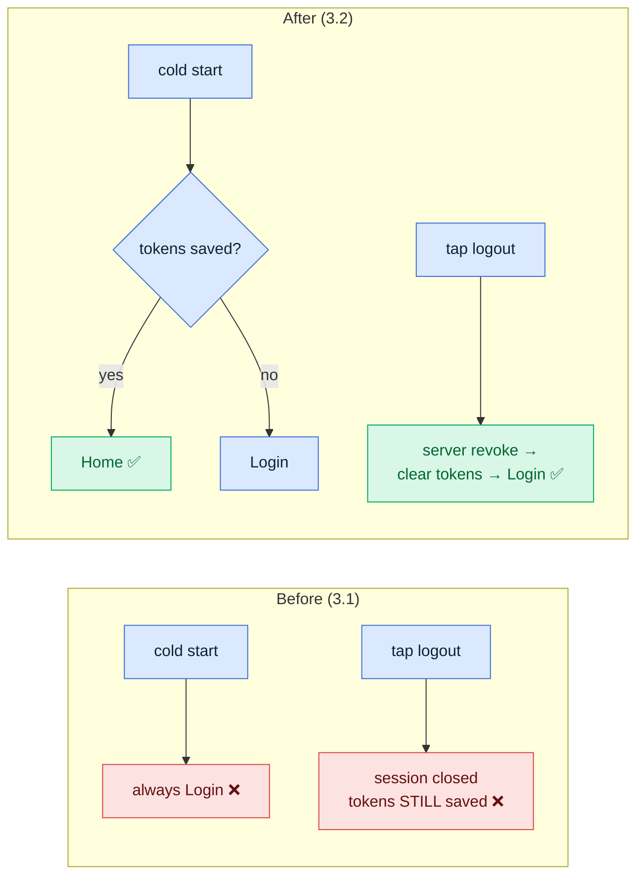
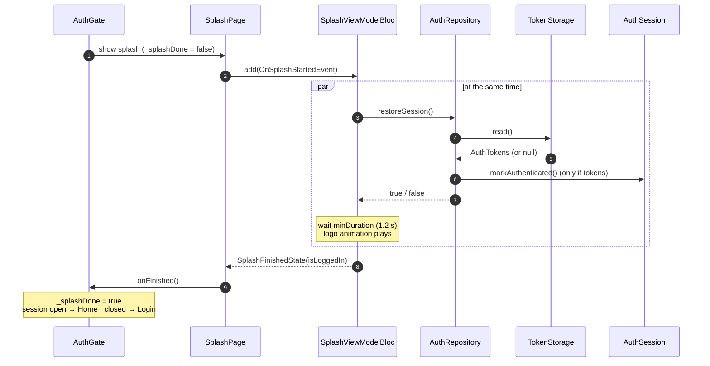
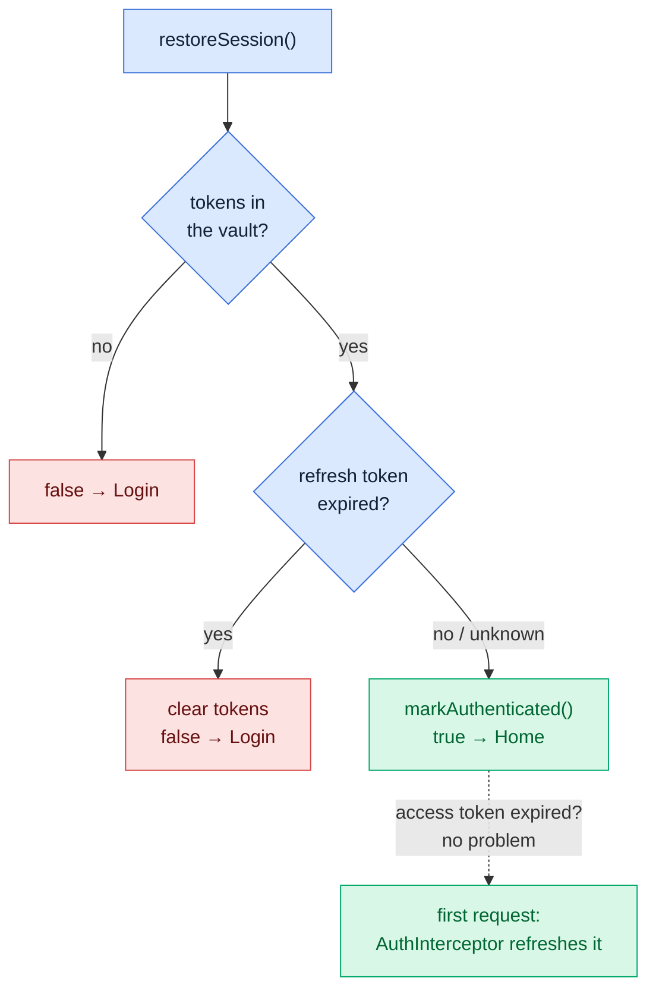
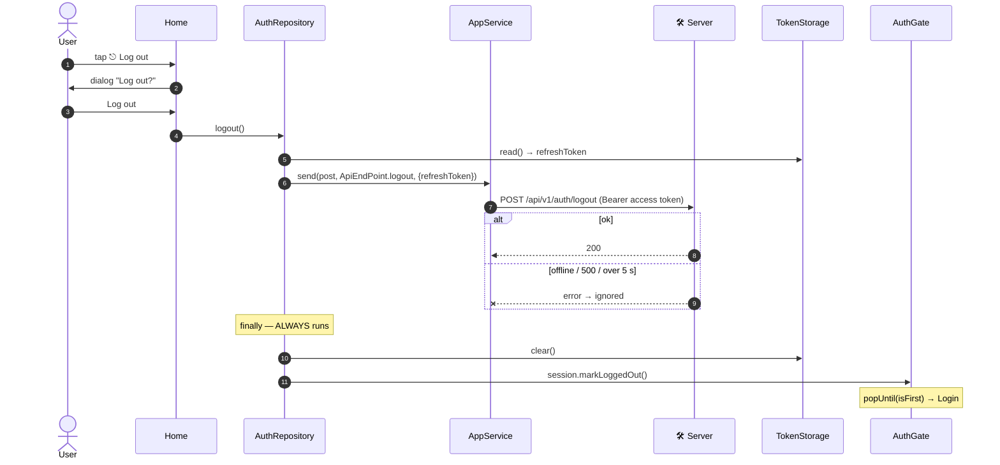
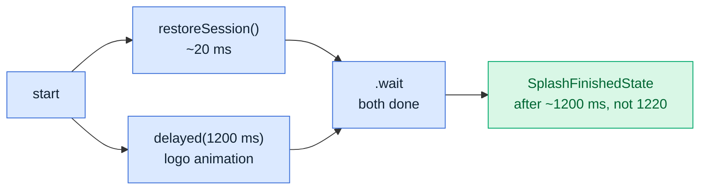

# Step 3.2 — Splash auto-login + real logout

> ← Previous: [07-login.md](07-login.md) · Next: [09-profile-view.md](09-profile-view.md) · Roadmap: [README.md](README.md)

Step 3.1 saved the tokens. Now we **use** them:

- **Auto-login:** open the app again → tokens are still in the vault → go
  straight to Home, no password.
- **Real logout:** tell the server to revoke the refresh token → delete the
  tokens → back to Login. Before this step the logout icon only closed the
  session, and the tokens stayed in the vault.

## 1. Why



Keeping tokens after logout is a **security bug** (CLAUDE.md): the next cold
start would read them and log the user back in.

## 2. Picture

### Auto-login, end to end



**Order matters (same rule as login):** the session is opened **inside**
`restoreSession()`, **before** `onFinished()`. When `AuthGate` rebuilds, it
already sees `isAuthenticated == true`, so it shows Home, never a flash of
Login.

### What `restoreSession()` decides



### Logout, end to end



### Files

```
lib/
├── app/
│   ├── auth_gate.dart               SplashPage(onFinished) · Home(onLogout: repo.logout)   CHANGED
│   └── home_placeholder_page.dart   logout → AppConfirmDialog → onLogout()               CHANGED
├── core/widgets/app_confirm_dialog.dart  AppConfirmDialog.show(...) → bool             NEW
└── features/auth/
    ├── repository/auth_repository.dart   + restoreSession() + logout()                   CHANGED
    ├── viewmodel/
    │   ├── splash_view_model_bloc.dart   + part …_event.dart, …_state.dart              NEW
    ├── view/splash_page.dart        layout only: BlocProvider + BlocListener             CHANGED
    ├── widgets/splash_logo.dart     logo fade + scale animation                          NEW
    └── auth_di.dart                 + SplashViewModelBloc (factory)                      CHANGED
test/features/auth/
├── auth_repository_test.dart        + 6 tests (restoreSession ×3, logout ×3)
└── splash_view_model_bloc_test.dart 3 tests                                              NEW
```

## 3. Code

### `AuthRepository.restoreSession()`

```dart
Future<bool> restoreSession() async {
  final tokens = await _tokenStorage.read();
  if (tokens == null) return false;

  final refreshExpiresAt = tokens.refreshTokenExpiresAt;
  if (refreshExpiresAt != null && refreshExpiresAt.isBefore(DateTime.now())) {
    await _tokenStorage.clear();      // dead tokens → don't keep them
    return false;
  }

  _session.markAuthenticated();       // open BEFORE returning
  return true;
}
```

- **No network call.** The splash must be fast and must work offline: you can
  open the app in a lift and still see your chats (from Step 5).
- **The access token is not checked** (CLAUDE.md). It lives ~15 min, so on a
  cold start it is almost always expired. That's fine: the first request gets
  401 → the `AuthInterceptor` (Step 2.2) refreshes it by itself.
- **The refresh token IS checked**, because it's free (the date is already in
  the vault) and an expired refresh token can never work. Without this check:
  Home opens → first request → refresh fails → kicked to Login. With it: Login
  straight away.
- `refreshExpiresAt != null &&` — old tokens may have no date. Unknown → let
  the server decide.

### `AuthRepository.logout()`

```dart
Future<void> logout() async {
  try {
    final tokens = await _tokenStorage.read();
    if (tokens != null) {
      await _appService
          .send<void>(
            httpMethods: HttpMethods.post,
            endPoint: ApiEndPoint.logout,
            data: {'refreshToken': tokens.refreshToken},
            parse: (_) {},
          )
          .timeout(logoutTimeout, onTimeout: () => const Left(UnknownError()));
    }
  } finally {
    await _tokenStorage.clear();      // 1. no more auto-login
    _session.markLoggedOut();         // 2. AuthGate → Login
  }
}
```

| Line | Why |
|---|---|
| Server call **first**, clear **after** | `POST /logout` needs the access token, and the `AuthInterceptor` reads it **from storage**. Clear first → no token → 401 → the revoke never happens. |
| The result is **ignored** | "Best effort". The user pressed Log out; offline or a 500 must **never** keep them logged in. The backend doc says logout "succeeds even if the token is unknown", so there's nothing useful to show. |
| `.timeout(5 s)` | Dio waits up to 15 s to connect. Nobody should wait 15 s to log out of a dead server. `onTimeout` returns a `Left` so the types still match. |
| `try { … } finally { … }` | `finally` runs **no matter what**, even if something throws. Clearing the tokens is the one thing that must never be skipped. |
| `parse: (_) {}` | We don't need anything from the answer. `send<void>` + a parser that does nothing. |

### `SplashViewModelBloc`: the only place that decides

```dart
Future<void> _onStarted(OnSplashStartedEvent event, Emitter<SplashViewModelState> emit) async {
  final (isLoggedIn, _) = await (
    _repository.restoreSession(),
    Future<void>.delayed(minDuration),
  ).wait;
  emit(SplashFinishedState(isLoggedIn: isLoggedIn));
}
```

- **`(futureA, futureB).wait`**: a Dart 3 **record of futures**. Both start
  together, and we wait for **both**. The total time is the **longer** one,
  not the sum:



- `final (isLoggedIn, _) = …` **destructures** the record: the first value
  goes into `isLoggedIn`, and `_` throws the second (`void`) away.
- **`minDuration` is a constructor parameter.** The app uses 1.2 s. Tests pass
  `Duration.zero`, so they don't wait.
- Template style: `@immutable sealed` event/state, `On…Event`, `…State`, and
  `part` files, like the login BLoC.

### `SplashPage`: layout only

```dart
return BlocProvider(
  create: (_) => getIt<SplashViewModelBloc>()..add(OnSplashStartedEvent()),
  child: BlocListener<SplashViewModelBloc, SplashViewModelState>(
    listenWhen: (previous, current) => current is SplashFinishedState,
    listener: (context, state) => onFinished(),
    child: const Scaffold(body: Column(children: [
      Expanded(child: Center(child: SplashLogo())),
      /* small spinner */
    ])),
  ),
);
```

- **`..add(OnSplashStartedEvent())`**: the cascade creates the bloc **and**
  starts it in one line.
- **`BlocListener`, not `BlocBuilder`**: "finished" is a **one-time action**
  (call `onFinished`), not something to draw.
- The splash **doesn't need the session any more**. The repository opens it,
  so `SplashPage` lost its `session` parameter.
- The logo animation moved to `widgets/splash_logo.dart` (CLAUDE.md: page =
  layout, one widget per file).

### Home: logout asks first

```dart
IconButton(
  tooltip: 'Log out',
  onPressed: () => confirmLogout(context, onLogout),
  icon: const Icon(Icons.logout),
),
// AuthGate:
HomePlaceholderPage(onLogout: getIt<AuthRepository>().logout, ...)
```

- **"Log out?" dialog**: logout is destructive (you must type the password
  again), so a mistake tap must not do it.

### `core/widgets/app_confirm_dialog.dart`

```
┌──────────────────────────────┐
│            ( ⎋ )             │  icon in a soft red circle
│          Log out?            │  title, centred
│ You will need to sign in…    │  message, muted
│ [  Cancel  ] [  Log out   ]  │  two EQUAL buttons, red confirm on the right
└──────────────────────────────┘
```

```dart
final yes = await AppConfirmDialog.show(
  context,
  icon: Icons.logout_rounded,
  title: 'Log out?',
  message: 'You will need to sign in again.',
  confirmText: 'Log out',
  destructive: true,
);
if (yes) await onLogout();
```

Our first try used a plain `AlertDialog` and looked broken: **Cancel** was
alone on the right and **Log out** was a huge blue bar under it.

| Problem | Cause | Fix |
|---|---|---|
| Log out button full width, on its own row | The **theme** gives every `FilledButton` `minimumSize: Size.fromHeight(52)` = infinitely wide (right for the login form) | In the dialog: `minimumSize: Size(0, 48)` + `Expanded` → two buttons share the row |
| Log out in brand blue | Default `FilledButton` colour | `destructive: true` → `colors.error` / `onError` (red = "careful") |
| Cancel floating alone as plain text | `TextButton` next to a giant button | `OutlinedButton`, same size as confirm |
| Cancel border invisible | `outlineVariant` ≈ the dialog's background | `colors.outline` at 35 % |
| Text could wrap in a narrow button | Long words / Khmer later | `maxLines: 1` + ellipsis |

- **Returns `bool`, not `bool?`**: tapping outside or pressing back = Cancel
  (`yes ?? false`), so callers write `if (yes)`.
- **`ConstrainedBox(maxWidth: 400)`**: on a tablet the dialog doesn't stretch.
- **Reusable**: chat "Delete message?", "Leave group?", call "End call?" will
  use the same widget.
- **`onLogout: getIt<AuthRepository>().logout`** is a **tear-off**: we pass
  the method itself, without calling it. Home doesn't know about repositories,
  it just calls `onLogout()`.
- In Step 4 the logout button moves to the **Profile** page, with its own BLoC.
  Home is still a placeholder.

## 4. 🤔 Why like this? (other ways)

| Choice we made | Other way | Why we didn't pick the other way |
|---|---|---|
| Splash checks tokens **locally** (no network) | Call `GET /users/me` on the splash to "validate" | Slow, fails offline, and the interceptor already handles an expired access token on the first real request. |
| Check the **refresh** token's expiry date | Don't check any date | Free and avoids "Home → instantly kicked to Login" when the refresh token is dead. |
| Decision in `SplashViewModelBloc` → repository | `getIt<AuthRepository>()` straight from the splash widget | Template style; no business calls in widgets (CLAUDE.md); testable with `bloc_test`. |
| `(a, b).wait` for min time + check | `await check; await delay;` | Sequential = the times **add up** (1.2 s + check). Parallel = the longer one only. |
| Session opened **inside** `restoreSession()` | Splash opens it after `isLoggedIn == true` | One rule in one place: the repository opens/closes the session for login, auto-login and logout. |
| Logout: server → clear → close, in `finally` | Clear first, then call the server | The interceptor needs the token from storage to authorize `/logout`. |
| Ignore the logout result, 5 s timeout | Show an error if the server fails | The user wants out. A failed revoke can't keep them in; the refresh token expires on the server anyway. |
| "Log out?" dialog | Log out on one tap | Destructive action → confirm (design guide). |
| `AppConfirmDialog` in `core/widgets/` | `AlertDialog` with default buttons | The theme's full-width buttons broke `AlertDialog` actions. One shared dialog = the same look for every "are you sure?". |
| Tokens only (no user cache yet) | Cache `UserModel` in SharedPreferences now | Home doesn't show the user yet. Step 4 (Profile) loads `/users/me` and decides about caching. |

## 5. Try it

```bash
flutter test                                    # 57 tests → All tests passed!
flutter run --flavor dev -t lib/main_dev.dart
```

1. Sign in → Home.
2. **Kill the app** (swipe it away) → open it again → splash → **Home**, no
   password. ✅ auto-login
3. Tap **Call GET /users/me** → **✅ Signed in as …** (the access token may be
   old; if so the interceptor refreshes it, and you see `POST /auth/refresh`
   in the log first).
4. Tap **⎋** → the **"Log out?"** dialog (red icon, Cancel | Log out side by
   side) → **Cancel** → nothing happens. Tap outside the dialog → same.
5. Tap **⎋** → **Log out** → in the log: `POST /api/v1/auth/logout` → Login.
6. **Kill the app → open again → Login** (not Home). ✅ tokens really cleared
7. Airplane mode → sign in is impossible, but if you were signed in: log out
   still works (after ≤ 5 s) and step 6 still gives Login.

## 6. Check yourself

1. Why doesn't the splash call the server to check the access token?
2. Why does `logout()` call the server **before** clearing the tokens?
3. The server is down. The user taps Log out. What happens, and how long can
   it take?
4. `restoreSession()` takes 20 ms and `minDuration` is 1200 ms. How long does
   the splash show, and why not 1220 ms?
5. Why is the session opened inside `restoreSession()` and not after
   `onFinished()`?

<details><summary>Answers</summary>

1. It must be fast and work offline. An expired access token is normal; the
   `AuthInterceptor` refreshes it on the first real request.
2. `POST /logout` needs the access token, and the interceptor reads it from
   storage. If we cleared first, the request would go out without a token
   (401) and the refresh token would never be revoked.
3. The request fails or times out, the error is ignored, and `finally` still
   clears the tokens and closes the session → Login. At most ~5 s
   (`logoutTimeout`).
4. ~1200 ms. `(a, b).wait` runs both at the same time and waits for the
   longer one.
5. `onFinished()` makes `AuthGate` rebuild and pick Home or Login from the
   session. If the session opened later, the gate would show Login first (a
   flash), then jump to Home.

</details>
