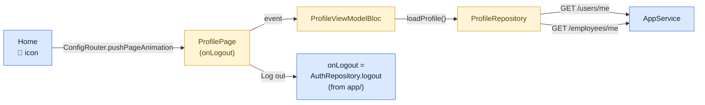
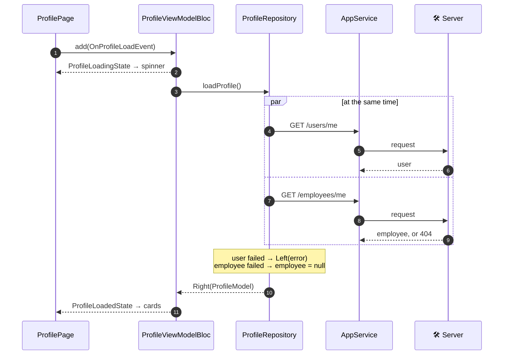
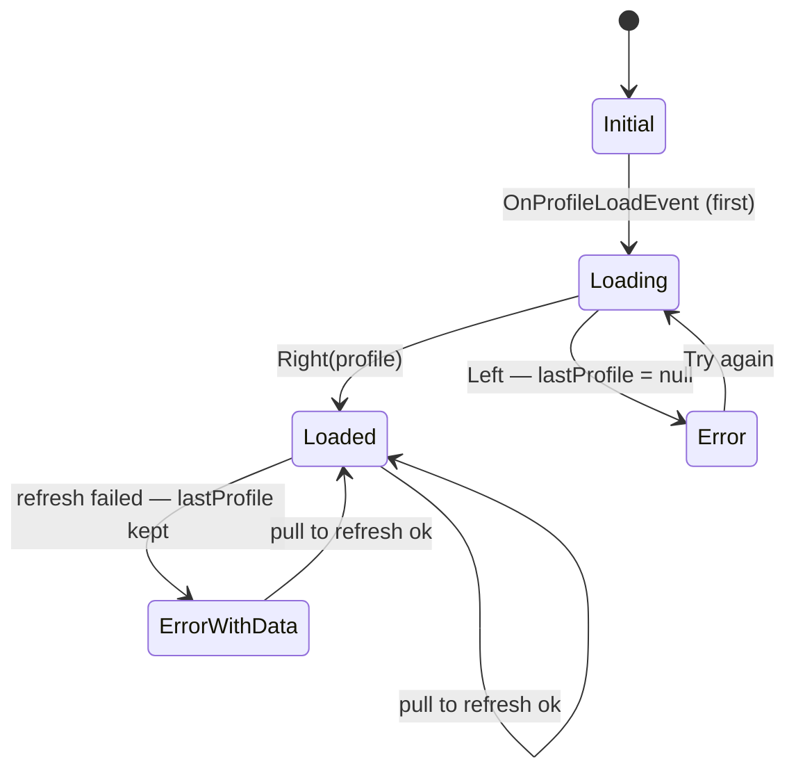

# Step 4.1 — Profile: view my profile (+ logout moves here)

> ← Previous: [08-auto-login-logout.md](08-auto-login-logout.md) · Next: [10-profile-avatar.md](10-profile-avatar.md) · Roadmap: [README.md](README.md)

Step 4 is split in three:

| Part | What | Status |
|---|---|---|
| **4.1 (this lesson)** | View my profile (`/users/me` + `/employees/me`), ⎋ logout at the top right | ✅ |
| 4.2 | Avatar: camera / gallery → `POST /employees/me/avatar` → [10-profile-avatar.md](10-profile-avatar.md) | ✅ |
| 4.3 | Edit name / phone | ⏸ waiting for the backend's `PATCH /api/v1/users/me` |

> **Why 4.3 waits.** The API doc has no "edit **my** profile" endpoint. The
> only one, `PATCH /users/{id}`, needs `user:write` (admin), so a normal user
> gets **403**. We asked the backend for `PATCH /api/v1/users/me` (option A).

## 1. Why

The first screen **after** login that shows real data. It reuses everything
from Steps 1–3 and adds three things you'll use in every later feature:

- **Two requests at once** (`(a, b).wait`): user + employee.
- **Three page states**: loading → data → error, plus **refresh** that keeps
  the data on screen.
- **Shared widgets**: `AppAvatar` (chat list, call screen) and `AppErrorView`
  (any page that can fail to load).



🟨 new (profile feature) · 🟦 built before

## 2. Picture

### Load, end to end



### The page's states



| State | The page shows |
|---|---|
| `Initial` / `ProfileLoadingState` | a spinner |
| `ProfileLoadedState(profile)` | the cards (pull to refresh) |
| `ProfileErrorState(lastProfile: null)` | `AppErrorView` + **Try again** |
| `ProfileErrorState(lastProfile: p)` | the cards **and** an `AppSnackBar` |

### The design (Screen 9.9)

```
 PHONE (< 720)                    TABLET (≥ 720, content max 900)
 ┌──────────────────────────┐     ┌──────────────────────────────────────┐
 │ ← My Profile          ⎋  │     │ ← My Profile                       ⎋ │
 │ ┌──────────────────────┐ │     │ ┌──────────────────────────────────┐ │
 │ │        ( JD )        │ │     │ │             ( JD )               │ │
 │ │       Jane Doe       │ │     │ │            Jane Doe              │ │
 │ │   jane@company.com   │ │     │ │        jane@company.com          │ │
 │ │  (Developer) ( IT )  │ │     │ │       (Developer) ( IT )         │ │
 │ └──────────────────────┘ │     │ └──────────────────────────────────┘ │
 │ CONTACT                  │     │ CONTACT            PERSONAL          │
 │ ┌──────────────────────┐ │     │ ┌──────────────┐  ┌──────────────┐   │
 │ │(✉) Email             │ │     │ │(✉) Email     │  │(🎂) Birthday │   │
 │ │(☎) Phone             │ │     │ │(☎) Phone     │  │(⌂) Address   │   │
 │ │(🪪) Employee ID      │ │     │ │(🪪) Emp. ID  │  │(!) Emergency │   │
 │ │(📅) Hire date        │ │     │ │(📅) Hire date│  │(☎) Em. phone │   │
 │ └──────────────────────┘ │     │ └──────────────┘  └──────────────┘   │
 │ PERSONAL                 │     └──────────────────────────────────────┘
 │ ┌──────────────────────┐ │      ⎋ = log out (red icon, top right)
 │ │ ...                  │ │
 │ └──────────────────────┘ │
 └──────────────────────────┘
```

### Files

```
lib/
├── app/
│   ├── app_di.dart                  + registerProfileModule()                       CHANGED
│   └── home_placeholder_page.dart   👤 icon → ProfilePage (logout moved there)      CHANGED
├── core/
│   ├── network/api_endpoints.dart   + employeesMe · fileUrl("/uploads/…")           CHANGED
│   └── widgets/
│       ├── app_avatar.dart          photo (cached) or initials                     NEW
│       └── app_error_view.dart      full-page error + Try again                    NEW
└── features/profile/
    ├── model/
    │   ├── employee_model.dart      /employees/me (all nullable but id)             NEW
    │   └── profile_model.dart       user + employee? + getters (phone, avatarUrl)  NEW
    ├── repository/profile_repository.dart   loadProfile(): 2 calls at once         NEW
    ├── viewmodel/profile_view_model_bloc.dart  + part event / state                NEW
    ├── view/profile_page.dart       layout: BlocConsumer → content / error / spin  NEW
    ├── widgets/
    │   ├── profile_content.dart     scroll + responsive (1 or 2 columns)           NEW
    │   ├── profile_hero_card.dart   avatar · name · email · chips                  NEW
    │   ├── profile_info_card.dart   section title + card of rows                   NEW
    │   ├── profile_info_row.dart    icon · label · value ("—" if empty)            NEW
    │   └── profile_logout_button.dart  AppBar ⎋ icon: confirm → onLogout, spinner  NEW
    └── profile_di.dart              registerProfileModule()                        NEW
test/
├── features/profile/profile_repository_test.dart      3 tests (fake server per path)
├── features/profile/profile_view_model_bloc_test.dart 3 tests
└── core/widgets/app_avatar_test.dart                   1 test (initials, Khmer)
```

## 3. Code

### `ProfileRepository.loadProfile()`: two requests at once

```dart
final (userResult, employeeResult) = await (
  _appService.send(httpMethods: HttpMethods.get, endPoint: ApiEndPoint.me,
      parse: (data) => UserModel.fromJson(data as Map<String, dynamic>)),
  _appService.send(httpMethods: HttpMethods.get, endPoint: ApiEndPoint.employeesMe,
      parse: (data) => EmployeeModel.fromJson(data as Map<String, dynamic>)),
).wait;

final employee = employeeResult.fold((_) => null, (e) => e);
return userResult.fold(
  Left.new,
  (user) => Right(ProfileModel(user: user, employee: employee)),
);
```

- **`(a, b).wait`**: the same trick as the splash (Step 3.2). Both requests
  fly together, so the time is the slower one, not the sum.
- **User fails → `Left`**: without the user there's nothing to show.
- **Employee fails → `null`**: a 404 means "this login has no employee
  record", which is **normal**. Any other employee error must not hide the
  whole profile either.
- **`Left.new`** is a **constructor tear-off**: the same as
  `(error) => Left(error)`.

### `ProfileModel`: decide once, not in widgets

```dart
String? get phone => _firstNotEmpty(user.phone, employee?.phone);
String? get avatarUrl => _firstNotEmpty(employee?.avatarUrl, user.avatarUrl);
```

The page never asks "user or employee?". Rules like "the employee avatar is
newer, because Step 4.2 uploads to `/employees/me/avatar`" live in **one**
place (CLAUDE.md: no business logic in widgets).

> `ProfileModel` uses `UserModel` from the **auth** feature. A model is the
> small public API of a feature, so that's allowed. The auth **repository** is
> not: logout comes in as a callback (below).

### `EmployeeModel`

Fields from API_LIST_BACKEND.md §5. Everything except `id` is **nullable**,
because HR may not fill every field. `hireDate` / `dateOfBirth` come as
`"YYYY-MM-DD"` → `DateTime.tryParse` (bad text → `null`, no crash).
Explicit `==` / `hashCode` over all 15 fields; `toString` shows only
`id` + `employeeNo` (no address or phones in logs).

### `ProfileViewModelBloc`: refresh keeps the data

```dart
Future<void> _onLoad(OnProfileLoadEvent event, Emitter<ProfileViewModelState> emit) async {
  if (state is ProfileLoadingState) return;        // already loading
  final shown = state.profile;                     // null on the first load
  if (shown == null) {
    emit(ProfileLoadingState());                   // full-page spinner only once
  }
  final result = await _repository.loadProfile();
  result.fold(
    (error) => emit(ProfileErrorState(error: error, lastProfile: shown)),
    (profile) => emit(ProfileLoadedState(profile: profile)),
  );
}
```

- **One event** for first load, pull-to-refresh and "Try again".
- **`state.profile` getter on the base state**: every state answers "what can
  I draw?" (`null` for Initial/Loading). The page checks one thing instead of
  three state types.
- **Refresh doesn't emit Loading**: the cards stay, and only the pull
  spinner turns. A failed refresh becomes `ProfileErrorState(lastProfile:
  shown)`, so the page keeps the data and shows a snackbar.

### `ProfilePage`: one builder, three bodies

```dart
builder: (context, state) {
  final profile = state.profile;
  if (profile != null) {
    return RefreshIndicator(
      onRefresh: () {
        bloc.add(OnProfileLoadEvent());
        return bloc.stream.firstWhere(
          (s) => s is ProfileLoadedState || s is ProfileErrorState);
      },
      child: ProfileContent(profile: profile, onLogout: onLogout),
    );
  }
  if (state is ProfileErrorState) return AppErrorView(..., onRetry: ...);
  return const Center(child: CircularProgressIndicator());
}
```

| Piece | Why |
|---|---|
| `RefreshIndicator.onRefresh` returns `stream.firstWhere(...)` | The pull spinner stays until the bloc **answers**, not just until the event is sent. |
| `listenWhen: current is ProfileErrorState && current.lastProfile != null` | Only a failed **refresh** gets a snackbar. A failed first load gets `AppErrorView`. |
| `buildWhen: … previous.profile != current.profile` | Uses the models' `==` (Step 3.1). Same data after a refresh → no rebuild. |
| `AlwaysScrollableScrollPhysics` in `ProfileContent` | Pull-to-refresh needs a scrollable, even when the content is short. |
| `onLogout` parameter | The app layer passes `AuthRepository.logout`. Profile doesn't import the auth repository. |

### Shared widgets

| Widget | What | Why in `core/widgets/` |
|---|---|---|
| `AppAvatar(name, imageUrl, size)` | `CachedNetworkImage` in a circle; initials while loading / on error / with no photo | Chat list, conversation header and call screen use it too. Caching = no re-download on scroll. |
| `AppErrorView(title, message, onRetry)` | cloud icon · title · message · **Try again** | Every list or detail page can fail to load. |
| `ApiEndPoint.fileUrl(path)` | `"/uploads/a.jpg"` → `"http://host:8080/uploads/a.jpg"` | The server sends paths; `Image` needs a full URL. `/uploads/**` is public, so no token is needed. |

`AppAvatar.initialsOf` uses `.characters`, so it counts letters as a
**person** sees them: `"សុខ ចាន់"` → `"សុចា"` (the vowel sign stays on its
consonant; `"សច"` would cut it off).

### Logout moved to the profile (top right)

```dart
appBar: AppBar(
  title: const AppLabel(text: 'My Profile', ...),
  actions: [ProfileLogoutButton(onLogout: onLogout)],   // ⎋ top right
),
```

`ProfileLogoutButton` = a **red ⎋ `IconButton`** in the AppBar →
`AppConfirmDialog` → `onLogout()`. While it runs (up to 5 s if the server is
slow) the icon becomes a small spinner and ignores taps. `AuthGate` then pops
the profile page (`popUntil(isFirst)`, Step 1.4) and shows Login.

- **In the AppBar, not in the content**: it's always visible (no scrolling
  down), and it works even when the profile **failed to load** (the error
  view replaces the content, not the AppBar).
- **Red icon**: logout is destructive; the colour says "careful".

## 4. 🤔 Why like this? (other ways)

| Choice we made | Other way | Why we didn't pick the other way |
|---|---|---|
| Wait for the backend's `PATCH /users/me` (4.3) | Call `PATCH /users/{id}` | Needs `user:write` → 403 for normal users. |
| `/users/me` + `/employees/me` together | Only `/users/me` | Position, department, hire date and avatar live on the employee. |
| Employee error → `null`, keep going | Any error fails the page | A 404 is normal (no linked employee). |
| `ProfileModel` getters (`phone`, `avatarUrl`) | `user.phone ?? employee?.phone` in widgets | Business rules in one place, testable. |
| One `OnProfileLoadEvent` + `state.profile` getter | Separate Load / Refresh / Retry events | Same work for all three; less code. |
| Refresh error keeps data + snackbar | Refresh error → full error page | Never take data away from the user because of a hiccup. |
| `onLogout` callback from `app/` | Profile imports `AuthRepository` | Features don't use each other's internals (CLAUDE.md). |
| `cached_network_image` | `Image.network` | Disk cache: chat lists show the same avatars many times. |
| ⎋ logout icon top right in the AppBar | A big button at the bottom of the content | Always visible, and still there when the load failed. |
| Empty value → "—" | Hide empty rows | Every card keeps the same shape; the user sees what is missing. |
| Tablet: Contact + Personal side by side, max 900 | One long column | Uses the width; long lines are hard to read. |

## 5. Try it

```bash
flutter test                                    # 64 tests → All tests passed!
flutter run --flavor dev -t lib/main_dev.dart
```

1. Home → tap the **👤** icon (top right) → the page slides in → spinner →
   your profile.
2. In the log: `GET /api/v1/users/me` and `GET /api/v1/employees/me` start
   **together**.
3. If your login has no employee record: `/employees/me` → 404, and the page
   still shows the hero + Contact (no Personal card).
4. **Pull down** → refresh. Turn on airplane mode and pull → the data stays,
   and a red bar appears at the top.
5. Airplane mode, go back, open the profile again → **"No Internet"** page →
   turn wifi on → **Try again**.
6. Tap the red **⎋** (top right) → dialog → Log out → small spinner → Login.
7. Rotate a tablet / use a wide window → two columns.

## 6. Check yourself

1. Why can't the app let the user edit their name yet?
2. `/employees/me` returns 404. What does the page show?
3. Pull-to-refresh fails. Which state comes out, and what does the page do?
4. Why does `ProfilePage` take `onLogout` instead of calling
   `AuthRepository.logout()` itself?
5. Where is the rule "the employee avatar wins over the user avatar"? Why
   there?

<details><summary>Answers</summary>

1. The only edit endpoint, `PATCH /users/{id}`, needs `user:write` (admin).
   A normal user gets 403. We wait for `PATCH /users/me`.
2. The hero card and Contact card (no Employee ID / Hire date, no Personal
   card). The repository turns the employee error into `employee = null`.
3. `ProfileErrorState(error, lastProfile: <old data>)`. `state.profile`
   is still set, so the cards stay. The listener shows an `AppSnackBar`.
4. Features don't use each other's internals. The app layer (`app/`) may
   import both and passes the method in as a callback.
5. In `ProfileModel.avatarUrl`. Business rules live in models / repositories,
   not in widgets, and there it's in one place and testable.

</details>
