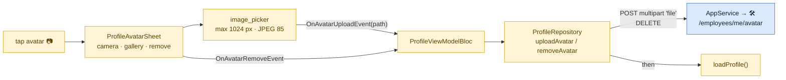
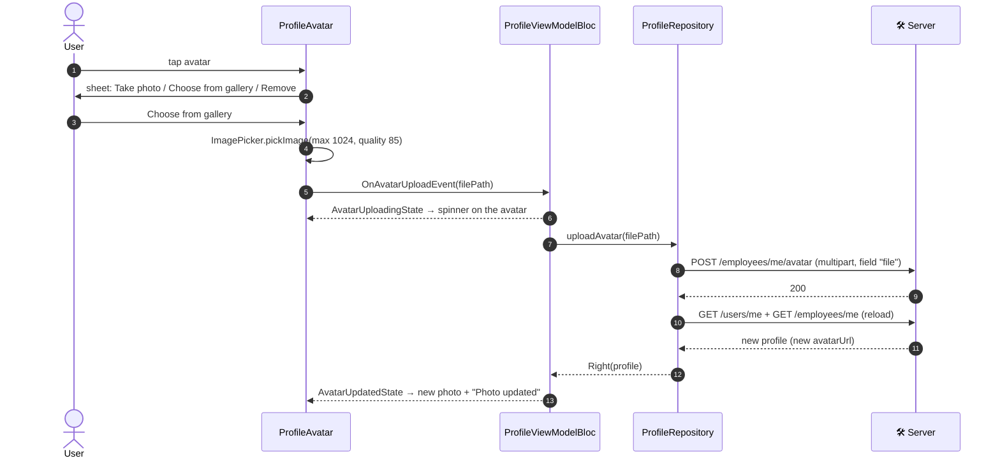
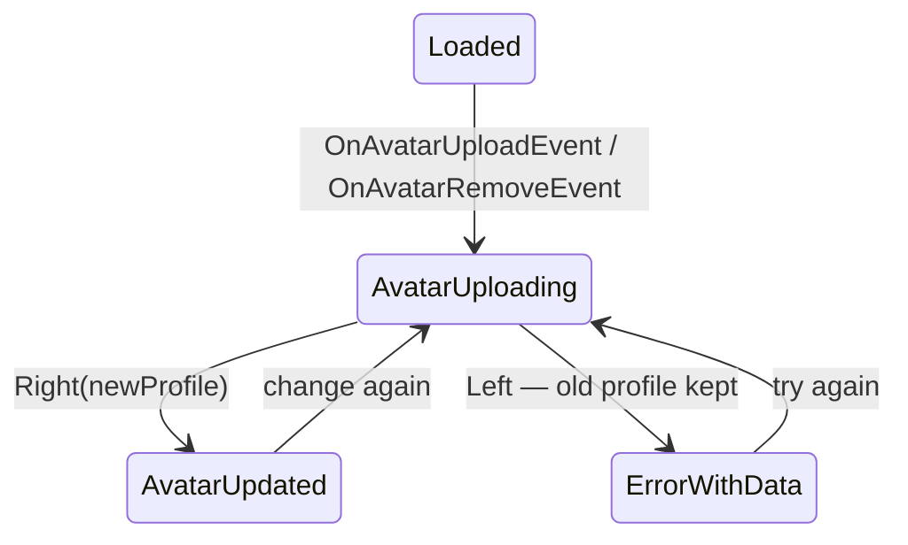
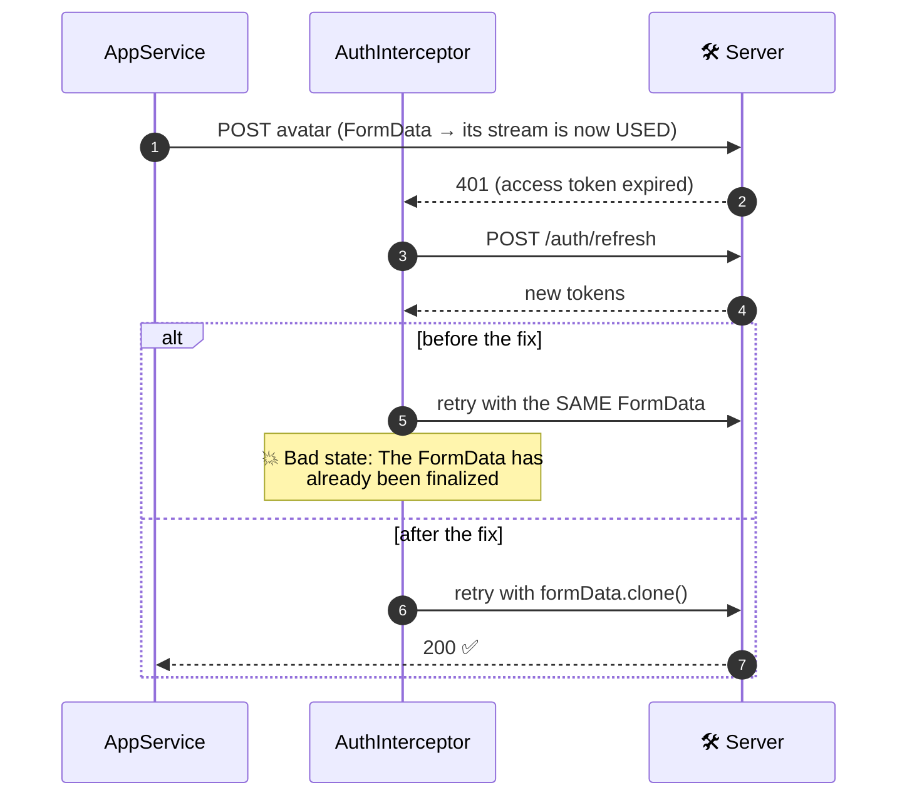
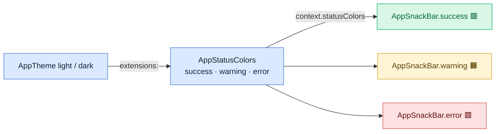

# Step 4.2 — Profile: change my avatar (camera / gallery / remove)

> ← Previous: [09-profile-view.md](09-profile-view.md) · Roadmap: [README.md](README.md)

Tap the avatar → take a photo or pick one → it uploads → the new photo
shows. Or remove it.

## 1. Why

The first **file upload** in the app. Chat (Step 5) sends images, files and
voice the same way, so we learn the hard parts now:

- **multipart / `FormData`**: how files travel over HTTP;
- **making photos small** before they leave the phone;
- **a real bug**: a `FormData` can only be sent **once**, and our token
  refresh retries requests.



## 2. Picture

### Upload, end to end



### The BLoC's states (new ones in bold)



| State | Page | Snackbar |
|---|---|---|
| `ProfileAvatarUploadingState(profile)` | the old profile, a **spinner on the avatar**, taps ignored | — |
| `ProfileAvatarUpdatedState(profile, removed)` | the **new** profile | ✓ **green** "Photo updated" / "Photo removed" |
| `ProfileErrorState(error, lastProfile)` | the old profile | ✕ the error |

### The bug we fixed first: upload + expired token



### The design

```
 ┌──────────────────────────┐        ┌──────────────────────────────┐
 │ ← My Profile          ⎋  │        │            ────              │ drag handle
 │ ┌──────────────────────┐ │  tap   │  Profile photo               │
 │ │        ┌────┐        │ │ ─────► │  (📷) Take photo             │
 │ │        │ JD │        │ │        │  (🖼) Choose from gallery    │
 │ │        └──(📷)        │ │        │  (🗑) Remove photo   ← red   │
 │ │       Jane Doe       │ │        └──────────────────────────────┘
 │ │  (Developer) ( IT )  │ │         tablet: sheet max 480 wide
 │ └──────────────────────┘ │
 └──────────────────────────┘        uploading: veil + spinner on the avatar
```

### Files

```
lib/
├── core/network/
│   ├── api_endpoints.dart           + employeesMeAvatar                             CHANGED
│   └── auth_interceptor.dart        retry sends formData.clone()                    CHANGED
└── features/profile/
    ├── repository/profile_repository.dart   + uploadAvatar() + removeAvatar()       CHANGED
    ├── viewmodel/…_bloc / _event / _state   + 2 events, + 2 states                  CHANGED
    ├── view/profile_page.dart       listener: success / error snackbars, busy flag  CHANGED
    └── widgets/
        ├── profile_avatar.dart      avatar + 📷 badge + busy veil + pick flow       NEW
        ├── profile_avatar_sheet.dart  camera / gallery / remove                     NEW
        ├── profile_hero_card.dart   uses ProfileAvatar                              CHANGED
        └── profile_content.dart     passes avatarBusy                               CHANGED
test/
├── core/network/auth_interceptor_test.dart        + FormData retry test
├── features/profile/profile_repository_test.dart  + 3 (upload, 413, remove)
└── features/profile/profile_view_model_bloc_test.dart + 4
```

## 3. Code

### Multipart: how a file travels

A normal request sends JSON. A file is sent as **multipart/form-data**: the
body has "parts" with names, and one part holds the file's bytes.

```dart
final form = FormData.fromMap({
  'file': await MultipartFile.fromFile(
    filePath,
    filename: name,                                    // "me.jpg"
    contentType: DioMediaType.parse(_imageType(name)), // "image/jpeg"
  ),
});
await _appService.send<void>(
  httpMethods: HttpMethods.post,
  endPoint: ApiEndPoint.employeesMeAvatar,
  formData: form,              // AppService (Step 2.1) already supports this
  parse: (_) {},
);
```

| Line | Why |
|---|---|
| `'file'` | The field name the backend expects (API doc: "multipart `file`"). A wrong name → 400. |
| `filename:` | Servers often keep the extension from it. |
| `contentType:` from the extension | Dio's default is `application/octet-stream`. Many servers only accept `image/*`. |
| `formData:` | `AppService.send` already had this parameter. Step 2.1 planned for uploads. |
| then `loadProfile()` | The API doc doesn't show the upload's response shape. Reloading shows exactly what the server has now. No guessing (CLAUDE.md). |

### Small photos: `image_picker` options

```dart
await ImagePicker().pickImage(
  source: ImageSource.gallery,          // or .camera
  preferredCameraDevice: CameraDevice.front,
  maxWidth: 1024, maxHeight: 1024,      // phone photos are ~4000 px
  imageQuality: 85,                     // JPEG: much smaller, looks the same
);
```

A phone photo is 3–8 MB. Resized to 1024 px at quality 85 it's about
100–300 KB. That means a faster upload, less mobile data, and it stays under
Spring's default upload limit (1 MB). The avatar shows at 88 px, so 1024 px is
plenty even on a 3× screen.

### Why picking lives in the widget, the upload in the BLoC

| Work | Where | Why |
|---|---|---|
| Show the sheet, open the camera / gallery | `ProfileAvatar` (widget) | It opens **system screens** and needs a `BuildContext`. A BLoC must never hold a context (CLAUDE.md). |
| Upload, reload, decide states | BLoC → repository | Business logic, testable with `bloc_test`. |

```dart
final bloc = context.read<ProfileViewModelBloc>();   // read BEFORE the awaits
final action = await ProfileAvatarSheet.show(context, canRemove: ...);
if (action == null || !context.mounted) return;      // page may be gone
```

**`context.read` before any `await`**: after an `await` the widget may be
gone, and the context can't be used. The `context.mounted` check guards the
rest.

**Permission denied** → `image_picker` throws a `PlatformException`. We catch
it and show "Please allow access in Settings" in an `AppSnackBar`. The iOS
texts (`NSCameraUsageDescription`, `NSPhotoLibraryUsageDescription`) were
already in `Info.plist`.

### The BLoC: upload and remove share one method

```dart
on<OnAvatarUploadEvent>((event, emit) => _changeAvatar(emit,
    removed: false, run: () => _repository.uploadAvatar(event.filePath)));
on<OnAvatarRemoveEvent>((event, emit) => _changeAvatar(emit,
    removed: true, run: _repository.removeAvatar));

Future<void> _changeAvatar(Emitter<ProfileViewModelState> emit, {
  required bool removed,
  required Future<Either<NetworkErrorModel, ProfileModel>> Function() run,
}) async {
  final shown = state.profile;
  if (_busy || shown == null) return;               // busy, or nothing on screen
  emit(ProfileAvatarUploadingState(profile: shown));
  final result = await run();
  result.fold(
    (error) => emit(ProfileErrorState(error: error, lastProfile: shown)),
    (profile) => emit(ProfileAvatarUpdatedState(profile: profile, removed: removed)),
  );
}
```

- **`run` is a function parameter**: the two events differ only in *which*
  repository call runs, so we pass that call in. One copy of the state logic.
- **`_busy`** blocks a second upload, a refresh, or a remove while one is
  running.
- **An error keeps the old profile** (`lastProfile: shown`): a failed upload
  never empties the page.

### The interceptor fix

```dart
final data = request.data;
final options = request.copyWith(
  headers: {...},
  extra: {...},
  data: data is FormData ? data.clone() : data,   // a fresh copy for the retry
);
```

A `FormData` turns into a **stream** of bytes when Dio sends it, and a stream
can only be read once. The test `file upload (FormData) + 401 → refresh →
retry with a FRESH copy` proves it: **without** `clone()` it fails with
*"The FormData has already been finalized"*.

### The page: one listener, two kinds of message

```dart
listener: (context, state) {
  switch (state) {
    case ProfileErrorState(:final error):
      AppSnackBar.error(context, title: error.title, message: error.description);
    case ProfileAvatarUpdatedState(:final profile, :final removed):
      final url = ApiEndPoint.fileUrl(profile.avatarUrl);
      if (url != null) CachedNetworkImage.evictFromCache(url);
      AppSnackBar.success(context, message: removed ? 'Photo removed' : 'Photo updated');
    default:
      break;
  }
},
```

- **`switch` with patterns** (`case X(:final y)`): match the type **and**
  take out a field in one line.
- **`evictFromCache`**: `AppAvatar` caches photos on disk by URL. If the
  server ever saves the new photo under the **same** URL, the cache would
  still show the old one, so we forget that URL.

### Green success bar: status colours in the theme

Flutter's `ColorScheme` has `error` but **no `success` or `warning`**.
Instead of hard-coding colours (which would break dark mode and the
CLAUDE.md rule), all three status colours live **in the theme**, in one
place:

```dart
// core/theme/app_status_colors.dart
class AppStatusColors extends ThemeExtension<AppStatusColors> {
  final Color success, onSuccess;   // "it worked"
  final Color warning, onWarning;   // "careful, not broken"
  final Color error,   onError;     // "it failed" (= colorScheme.error)
  static const light = AppStatusColors(...);
  static const dark  = AppStatusColors(...);
  // + copyWith, lerp (smooth light ↔ dark switch)
}

// AppTheme._build:
extensions: [isDark ? AppStatusColors.dark : AppStatusColors.light],

// anywhere:
context.statusColors.success / .warning / .error
```



| | Light bg + text | Contrast | Dark bg + text | Contrast |
|---|---|---|---|---|
| **success** | `#15803D` + white | 5.0 : 1 ✅ | `#4ADE80` + dark | 10.8 : 1 ✅ |
| **warning** | `#B45309` + white | 5.0 : 1 ✅ | `#FBBF24` + dark | 11.3 : 1 ✅ |
| **error** | `#DC2626` + white | 4.8 : 1 ✅ | `#F87171` + dark | 6.8 : 1 ✅ |

**Why not the design tokens `#16A34A` / `#D97706`?** With white text they're
only **~3.2 : 1**, and small text needs **4.5 : 1** (WCAG AA), so they're hard
to read outdoors. The tokens stay for icons and badges; text **backgrounds**
use the deeper shades (`AppColors.successDeep`, `warningDeep`). It's the same
idea as the dark-mode `primary` fix in Step 1.2.

**A test guards it:** `test/core/theme/app_status_colors_test.dart` computes
the contrast of every pair in both modes. Change a colour so the text becomes
hard to read, and the test fails.

`AppSnackBar` now has four types: `error`, `warning`, `success` and `info`.

### Design details

| Piece | Why |
|---|---|
| 📷 badge bottom-right, in `primary` with a `primaryContainer` ring | Design guide 9.9 "camera overlay icon". The ring separates the badge from the photo. |
| No badge without an employee record | `/employees/me/avatar` would answer 404. Don't offer what can't work. |
| Busy veil: `onSurface` at 50 % + `surface` spinner | Light mode: a dark veil and a light spinner. Dark mode: the opposite. Always readable, no hard-coded colours. |
| Sheet with drag handle, round icons, "Remove" in red | Native-feeling. Red = destructive. "Remove" only shows when there is a photo. |
| Sheet max 480 wide | Tablet rule: don't stretch. |
| `Semantics(button: true, label: 'Change profile photo')` | Screen readers say what the avatar does. |

## 4. 🤔 Why like this? (other ways)

| Choice we made | Other way | Why we didn't pick the other way |
|---|---|---|
| Resize to 1024 px, JPEG 85 | Upload the original | 3–8 MB per photo: slow, costs data, and likely over the server's limit. |
| Reload the profile after upload | Parse the upload's response | The response shape isn't documented; reloading is always right. |
| Pick in the widget, upload in the BLoC | Pick inside the BLoC | Picking needs a context; BLoCs never hold one. |
| `contentType` from the extension | Dio's default `octet-stream` | Servers often reject non-image types for avatars. |
| `formData.clone()` on retry | Don't retry uploads | Then every upload right after the token expires would fail. |
| One `_changeAvatar(run:)` | Two copies of the same handler | Same states, same rules. Less code to keep in sync. |
| No crop screen (yet) | `image_cropper` package | Not in scope. The circle crops visually with `BoxFit.cover`. |
| No avatar badge without an employee | Show it and let the server 404 | Don't offer actions that can't work. |

## 5. Try it

```bash
flutter test                                    # 72 tests → All tests passed!
flutter run --flavor dev -t lib/main_dev.dart   # a REAL phone for the camera
```

1. Home → 👤 → tap the avatar (📷 badge) → the sheet slides up.
2. **Choose from gallery** → pick a photo → the avatar dims with a spinner →
   new photo + "Photo updated" at the top.
3. In the log: `POST /api/v1/employees/me/avatar` with `multipart/form-data`,
   then `GET /users/me` + `GET /employees/me`.
4. **Take photo** → the front camera opens → take it → same flow.
5. **Remove photo** (only when you have one) → initials come back + "Photo
   removed".
6. Deny photo access in Settings → try again → red bar "Please allow access in
   Settings."
7. Airplane mode → upload → red bar, and the old photo stays.

## 6. Check yourself

1. Why do we resize photos before uploading?
2. Why does the picker run in the widget, but the upload in the BLoC?
3. What breaks without `formData.clone()` in the interceptor, and when?
4. The upload fails. What does the page show?
5. Why is there no 📷 badge for a user without an employee record?

<details><summary>Answers</summary>

1. Phone photos are 3–8 MB: slow, costly, and likely over Spring's 1 MB
   limit. 1024 px at JPEG 85 is about 100–300 KB and looks the same at 88 px.
2. Picking opens system screens and needs a `BuildContext`; a BLoC must never
   hold one. Uploading is business logic, so it goes BLoC → repository and
   is testable.
3. When the access token has expired, the upload gets 401, the interceptor
   refreshes and retries the **same** `FormData`, whose stream was already
   used → "The FormData has already been finalized".
4. `ProfileErrorState(lastProfile: old)`: the old profile and photo stay,
   with a red `AppSnackBar` at the top.
5. The avatar endpoint is `/employees/me/avatar`; without an employee record
   the server answers 404. Don't offer an action that can't work.

</details>
