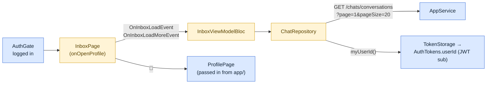
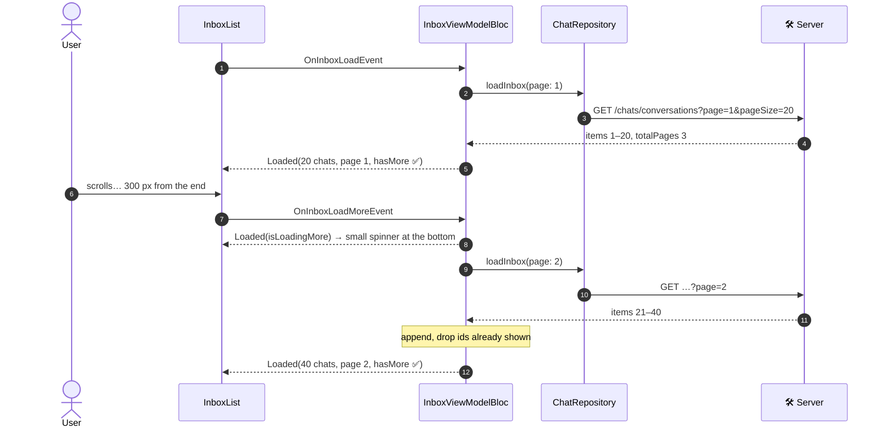
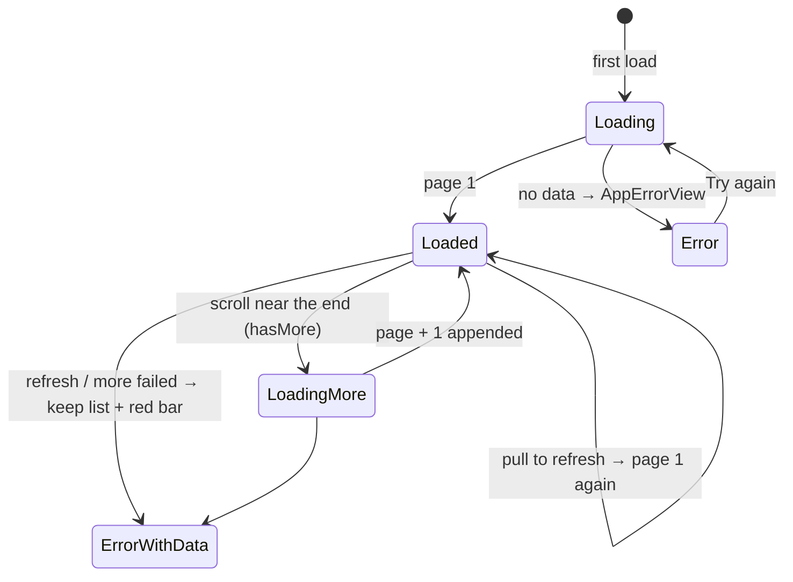
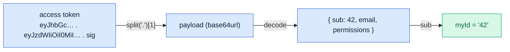
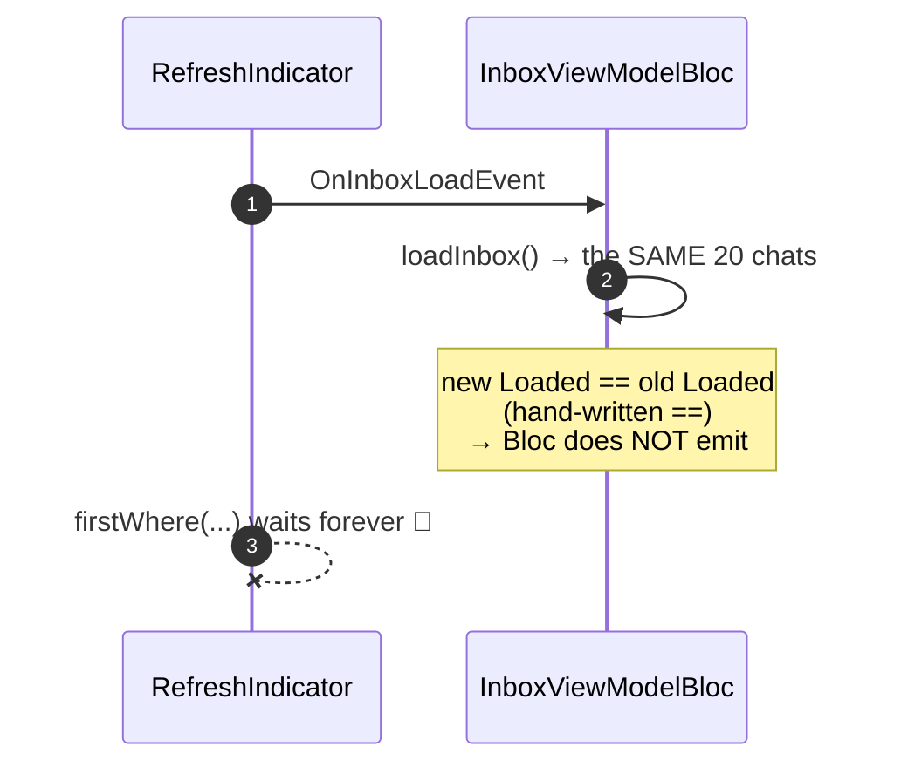
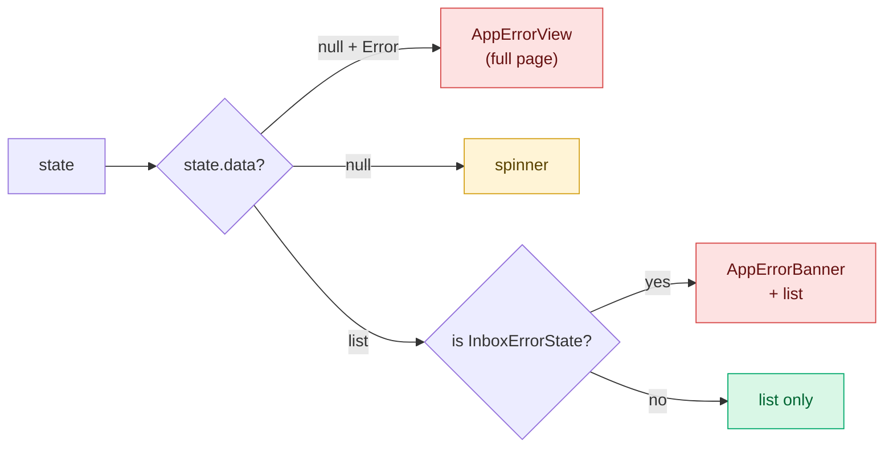

# Step 5.1 — Chat: the inbox

> ← Previous: [10-profile-avatar.md](10-profile-avatar.md) · Next: [12-chat-conversation.md](12-chat-conversation.md) → · Roadmap: [README.md](README.md)

Step 5 is the biggest step, so it's split:

```
5.1 Inbox (REST)       GET /chats/conversations, paged → list, pull to refresh   ← this lesson
5.2 Conversation       message history (paged) + send text
5.3 Realtime (STOMP)   live messages, inbox updates, reconnect
5.4 New chat + groups  member picker (GET /users), create DIRECT / GROUP
5.5 Attachments        image · file · voice
5.6 Extras             read receipts · edit / delete · reactions · presence · search
```

After login you now land on **Chats** instead of the demo Home (deleted).

## 1. Why

The inbox teaches three things every list screen needs:

- **Paging**: the server sends 20 at a time; scroll near the end → the next 20.
- **"Who am I?"**: a direct chat's title is the **other** person, and "You: "
  needs my id.
- **Models copied from the real backend.** We read the Java records
  (`ConversationDto`, `MessageDto`, `MemberDto`, `ReactionDto`,
  `PageResponse`) in the backend repo, so nothing is guessed.



## 2. Picture

### Paging: load more as you scroll



### The BLoC's states



### The design

```
 PHONE                               TABLET (list max 720, centred)
┌──────────────────────────────┐
│ Chats                    👤  │    👤 → My Profile
│ ┌──┐ Jane Doe          10:42 │    unread: bold + blue time + badge
│ │JD│ Are we still on fo… (3) │
│ ├──┤                         │
│ │TE│ 👥 Team ERP   Yesterday │    group: 👥 icon, "Dara: 📷 Photo"
│ │  │ Dara: 📷 Photo          │
│ ├──┤                         │
│ │SC│ Sok Chan            Tue │    my last message: "You: …"
│ │  │ You: See you            │
│ ├──┤                         │
│ │VA│ Vanna          20/10/26 │    > 99 unread → "99+"
│ │  │ 🎤 Voice message  (99+) │
│ ├──┤                         │
│ │BO│ Bopha          10/11/26 │    no messages yet
│ └──┘ No messages yet         │
└──────────────────────────────┘
```

### Files

```
lib/
├── app/
│   ├── auth_gate.dart               logged in → InboxPage(onOpenProfile → ProfilePage)  CHANGED
│   ├── app.dart · ../main.dart      no more appService (only the demo used it)         CHANGED
│   ├── app_di.dart                  + registerChatModule()                             CHANGED
│   └── home_placeholder_page.dart   DELETED (demo Home)
├── core/
│   ├── network/
│   │   ├── page_model.dart          PageModel<T> (backend PageResponse) + hasMore     NEW
│   │   ├── auth_tokens.dart         + userId (JWT "sub")                              CHANGED
│   │   └── api_endpoints.dart       + conversations                                   CHANGED
│   └── utils/chat_time.dart         "10:42" · "Yesterday" · "Mon" · "12/11/26"        NEW
└── features/chat/
    ├── model/
    │   ├── chat_enums.dart          ConversationType · MessageType · MemberRole       NEW
    │   ├── member_model.dart        MemberDto                                          NEW
    │   ├── reaction_model.dart      ReactionDto                                        NEW
    │   ├── message_model.dart       MessageDto + previewText                          NEW
    │   └── conversation_model.dart  ConversationDto + title(myId) · avatarUrlFor     NEW
    ├── repository/chat_repository.dart   loadInbox(page) · myUserId()                 NEW
    ├── viewmodel/inbox_view_model_bloc.dart  + part event / state                     NEW
    ├── view/inbox_page.dart         layout: data / empty / error / spinner            NEW
    ├── widgets/
    │   ├── inbox_list.dart          ListView + load-more trigger + spinner row        NEW
    │   ├── inbox_tile.dart          avatar · title · time · preview · badge           NEW
    │   └── inbox_empty_view.dart    "No chats yet"                                    NEW
    └── chat_di.dart                 registerChatModule()                              NEW
test/  (+19)
├── core/network/page_model_test.dart · auth_tokens_test.dart
├── core/utils/chat_time_test.dart
└── features/chat/chat_models_test.dart · chat_repository_test.dart · inbox_view_model_bloc_test.dart
```

## 3. Code

### Models: copied from the backend's Java records

```java
// backend: ConversationDto.java
public record ConversationDto(Long id, ConversationType type, String name, String avatarUrl,
    List<MemberDto> members, MessageDto lastMessage, Instant lastMessageAt,
    Long unreadCount, Instant createdAt) { … }
```

```dart
// app: conversation_model.dart: same fields, Dart types
final String id;                    // Long → String (like UserModel)
final ConversationType type;        // "DIRECT" / "GROUP" → enum
final List<MemberModel> members;    // each has fullName + avatarUrl already
final MessageModel? lastMessage;
final DateTime? lastMessageAt;      // Instant (UTC) → .toLocal()
final int unreadCount;
```

| Rule | Why |
|---|---|
| Ids → `String` | One id type everywhere (Step 3.1). |
| `Instant` → `DateTime.tryParse(...)?.toLocal()` | The server sends UTC; people read local time. A bad value → `null`, no crash. |
| Enums: an unknown value → a safe default | If the backend adds `STICKER` one day, the inbox shows it as text instead of crashing. |
| Lists: `json['x'] as List? ?? const []` | A missing list is empty, not a crash. |
| `==` with `ListEquality` / `SetEquality` | `[a] == [a]` is `false` in Dart (Step 3.1). Needed for `buildWhen`. |
| `toString` shows no message text | Chats are private; logs aren't. |

### Who am I? The token already knows

```dart
// AuthTokens: the access token is a JWT: header.payload.signature
String? get userId {
  final parts = accessToken.split('.');
  final payload = utf8.decode(base64Url.decode(base64Url.normalize(parts[1])));
  return '${(jsonDecode(payload) as Map)['sub']}';   // backend: .subject(userId)
}
```



- We **read** the payload; we never **trust** it for security. The server
  checks the signature on every request. This is only for the UI.
- `base64Url.normalize` adds the missing `=` padding (JWTs drop it).
- **Works offline and needs no request.** The id survives refresh (same `sub`).
- Anything odd → `null` (never a crash).

### `ConversationModel.title(myId)`: a direct chat shows the other person

```dart
MemberModel? otherMember(String? myId) {
  if (isGroup) return null;
  return members.firstWhereOrNull((m) => m.userId != myId) ?? members.firstOrNull;
}
String title(String? myId) => isGroup ? (name ?? 'Group') : otherMember(myId)?.displayName ?? 'Chat';
```

A DIRECT conversation has `name: null`; its name **is** the other person.
These rules live in the model, never in the tile.

### The preview: "You: " in ONE place

```dart
// message_model.dart: WHAT was sent, no prefix
String get previewText => deleted ? 'Message deleted' : switch (type) {
  MessageType.image => '📷 Photo', MessageType.voice => '🎤 Voice message',
  MessageType.file  => '📎 File',  MessageType.text  => (body ?? '').trim(),
};

// inbox_tile.dart: WHO sent it. The ONLY place a prefix is added
if (last.senderId == myId) return 'You: $text';
if (conversation.isGroup) return '${firstName}: $text';
return text;
```

This is a lesson from the old app (CLAUDE.md): it stored "You: hi" and later
showed "You: You: hi". The data stays raw; the screen decorates it.

### `PageModel<T>`: one class for every paged list

```dart
PageModel.fromData(data, ConversationModel.fromJson)   // inbox
PageModel.fromData(data, MessageModel.fromJson)        // messages (5.2)
bool get hasMore => page < totalPages;
```

A **generic** class: `T` is the item type. `fromData` takes the "how to read
ONE item" function, the same tear-off idea as `parse:` (Step 2.1).

### The BLoC: load, refresh, load more

```dart
Future<void> _onLoadMore(...) async {
  final current = state;
  if (current is! InboxLoadedState || !current.hasMore || current.isLoadingMore) return;
  emit(current.copyWith(isLoadingMore: true));
  final result = await _repository.loadInbox(page: current.page + 1);
  result.fold(
    (error) => emit(InboxErrorState(error: error, lastData: current)),
    (page) {
      final seen = current.conversations.map((c) => c.id).toSet();
      emit(current.copyWith(
        conversations: [...current.conversations, ...page.items.where((c) => seen.add(c.id))],
        page: page.page, hasMore: page.hasMore, isLoadingMore: false));
    },
  );
}
```

| Piece | Why |
|---|---|
| Three guards (`is!`, `hasMore`, `isLoadingMore`) | The scroll listener fires on **every** pixel. The BLoC ignores repeats, so there's one request per page. |
| `seen.add(c.id)` in `where` | `Set.add` returns `false` if the id is already there. A new message moves a chat to the top, which shifts pages, and the same chat could come twice. |
| `copyWith` | Change 2–3 fields, keep the rest (Step 3.1). |
| Errors keep the list (`lastData: current`) | Same rule as the profile: never take data away because of a hiccup. |
| `state.data` getter on the base state | Loaded → itself, Error → the last list. The page checks one thing. |

### Pull-to-refresh: wait for "finished", not for a new state 🐞

The first version had a bug: **pull down → the spinner turned forever**.

```dart
// ❌ the first version
onRefresh: () {
  bloc.add(OnInboxLoadEvent());
  return bloc.stream.firstWhere((s) => s is InboxLoadedState || s is InboxErrorState);
},
```



`InboxLoadedState` has a hand-written `==` (that's good: it stops useless
rebuilds). But **Bloc never emits a state that is `==` the current one**. When
nothing changed on the server, no state comes, so `firstWhere` never finishes.

The fix: the event carries a `Completer`, and the BLoC completes it in
`finally`, after **any** ending (success, error, unchanged, early return).

```dart
// page
final done = Completer<void>();
bloc.add(OnInboxLoadEvent(done: done));
return done.future;

// BLoC
try { ... } finally {
  if (event.done?.isCompleted == false) event.done!.complete();
}
```

| Other way | Why not |
|---|---|
| Remove `==` from the state | Breaks `buildWhen` (rebuilds every time) and breaks our CLAUDE.md rule. |
| Add a `refreshedAt` counter to the state | Puts a fake field in the state only to force an emit. |
| `firstWhere(...).timeout(5 s)` | Still spins 5 s for nothing, and hides real slowness. |
| **`Completer` in the event** ✅ | Says exactly what the page needs: "tell me when you're done". |

Test: `refresh with an unchanged list emits nothing but completes done`
(`test/features/chat/inbox_view_model_bloc_test.dart`).

### A failed load with chats on screen: `AppErrorBanner`

When the **first** load fails, there's nothing to show, so the page shows the
big `AppErrorView`. When the list is **already** there (refresh or load more
failed), we keep the chats and add a small strip above them:

```
┌ Chats ───────────────────── 👤 ┐
│ ☁̸ No Internet       Try again │  ← AppErrorBanner (grey; red for server errors)
├────────────────────────────────┤
│ (JD) Jane Doe           10:42  │  ← old chats stay readable
│ (👥) Team ERP        Yesterday │
└────────────────────────────────┘
```



| Piece | Why |
|---|---|
| `AppErrorBanner` in `core/widgets/` | Any page with data can reuse it (profile later). Same `iconFor` and colours as `AppErrorView`. |
| `onRetry` returns a `Future` | "Try again" turns into a small spinner and can't be tapped twice. It reuses the same `refresh()` as pull-to-refresh (the `done` Completer). |
| `AnimatedSize` around it | The list slides down/up smoothly instead of jumping. |
| It stays until a load **works** | Then the state is `InboxLoadedState` again and the banner is gone. A snackbar disappears after a few seconds, and you'd forget the list is old. |
| No snackbar on this page any more | Two messages for one problem is noise. |
| Load more failed → banner too | `_onLoadMore` only runs from a Loaded state, so after an error, scrolling can't load more. "Try again" reloads page 1 and fixes that. |

### `InboxList`: when to load more

```dart
NotificationListener<ScrollNotification>(
  onNotification: (n) {
    if (n.metrics.extentAfter < 300) onLoadMore();   // 300 px left to scroll
    return false;                                     // RefreshIndicator still sees it
  },
  child: ListView.separated(...),
)
```

- **`extentAfter`** = how many pixels are left below. Loading starts **before**
  the end, so the user rarely sees the spinner.
- **`key: ValueKey(conversation.id)`** on each tile: in 5.3 chats will jump to
  the top as messages arrive, and keys keep each row with its own data.

### The app layer: inbox ↔ profile

```dart
// auth_gate.dart: app/ may import both features
screen = InboxPage(
  onOpenProfile: (context) => ConfigRouter.pushPageAnimation(
    context, ProfilePage(onLogout: getIt<AuthRepository>().logout)),
);
```

Chat never imports profile, and profile never imports auth's repository.
`app/` connects them with callbacks (CLAUDE.md feature rule).

### `ChatTime.inbox`

| When | Shows |
|---|---|
| today | `10:42` |
| yesterday | `Yesterday` |
| 2–6 days ago | `Mon` |
| older | `12/11/26` |

It compares **calendar days** (as UTC dates), not 24-hour blocks, so 23:59
yesterday vs 00:01 today = "Yesterday", even on a daylight-saving day.
`now:` is a parameter so tests can fix "today".

## 4. 🤔 Why like this? (other ways)

| Choice we made | Other way | Why we didn't pick the other way |
|---|---|---|
| Models from the backend's Java records | Guess from the API doc | The doc has no field list for conversations; the code does. |
| My id from the JWT `sub` | `GET /users/me` on every start / cache the user | No request, works offline, always there after login and auto-login. |
| Page-based loading (`page`, `hasMore`) | Load all chats at once | 500 chats = a slow first screen and lots of data. |
| Trigger 300 px before the end | At the very end | The next page is usually there before the user arrives. |
| Drop duplicate ids when appending | Trust the pages | Pages shift when new messages reorder chats. |
| "You: " only in the tile | Store it in the model | The old app showed "You: You: …". |
| Inbox replaces the demo Home | Keep Home + a "Chats" button | Chats **is** the home of a chat app. The demos did their job (Steps 2–3). |
| `onOpenProfile` callback | Inbox imports `ProfilePage` | Features don't import each other. |
| Tablet: list max 720 for now | Two panes now | Two panes need the conversation page (5.2). |

**Old-app lessons that no longer apply** (checked in the backend code):
- *"Send `targetIds`"*: the server finds the receivers itself
  (`ChatMessageNotifier`). The client sends nothing extra.
- *"Direct conversation ids differ per device"*: that came from the old
  offline database. Conversations now have **server ids**, the same everywhere.

## 5. Try it

```bash
flutter test                                    # 100 tests → All tests passed!
flutter run --flavor dev -t lib/main_dev.dart
```

1. Log in → **Chats** (no more demo Home).
2. In the log: `GET /api/v1/chats/conversations?page=1&pageSize=20`.
3. Direct chats show the **other** person's name and photo; groups show 👥 +
   the group name.
4. Your own last message shows **"You: …"**; in groups others show
   **"Dara: …"**.
5. Unread chats: bold, a blue time, a count badge.
6. More than 20 chats? Scroll down → a small spinner → `…page=2` in the log.
7. Pull down → refresh → the spinner stops (even when nothing changed).
   Airplane mode + pull → the list stays and a grey **No Internet · Try
   again** strip shows above it. Wi-Fi back on → Try again → the strip slides away.
8. 👤 → My Profile → ⎋ Log out → Login.
9. No chats yet → "No chats yet" (create one in Postman to see the list fill).

## 6. Check yourself

1. Where does the app get **my** user id, and why is it safe to read it there?
2. A direct chat has `name: null`. What does the inbox show, and which code
   decides?
3. Why is "You: " added in `InboxTile` and not stored in `MessageModel`?
4. The user scrolls and `onLoadMore` fires 30 times. How many requests go out?
5. Why can the same conversation come on page 1 **and** page 2?
6. Pull-to-refresh returns exactly the same list. Why does no new state come,
   and how does the spinner still stop?

<details><summary>Answers</summary>

1. From the access token's `sub` claim (`AuthTokens.userId`). We only read it
   for the UI; the server checks the token's signature on every request.
2. The other member's name and avatar: `ConversationModel.title(myId)` /
   `avatarUrlFor(myId)` via `otherMember(myId)`.
3. The data stays raw and the screen decorates it. Adding it in one place
   avoids "You: You: …" (a bug in the old app).
4. One per page. The BLoC ignores the event while `isLoadingMore` is true, or
   when `hasMore` is false.
5. A new message moves a chat to the top, which shifts every later chat by
   one. The BLoC drops ids it already shows.
6. The new `InboxLoadedState` is `==` the old one, and Bloc skips equal
   states. The event's `done` Completer is completed in `finally`, and
   `onRefresh` awaits that.

</details>
