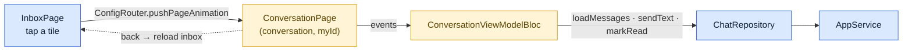
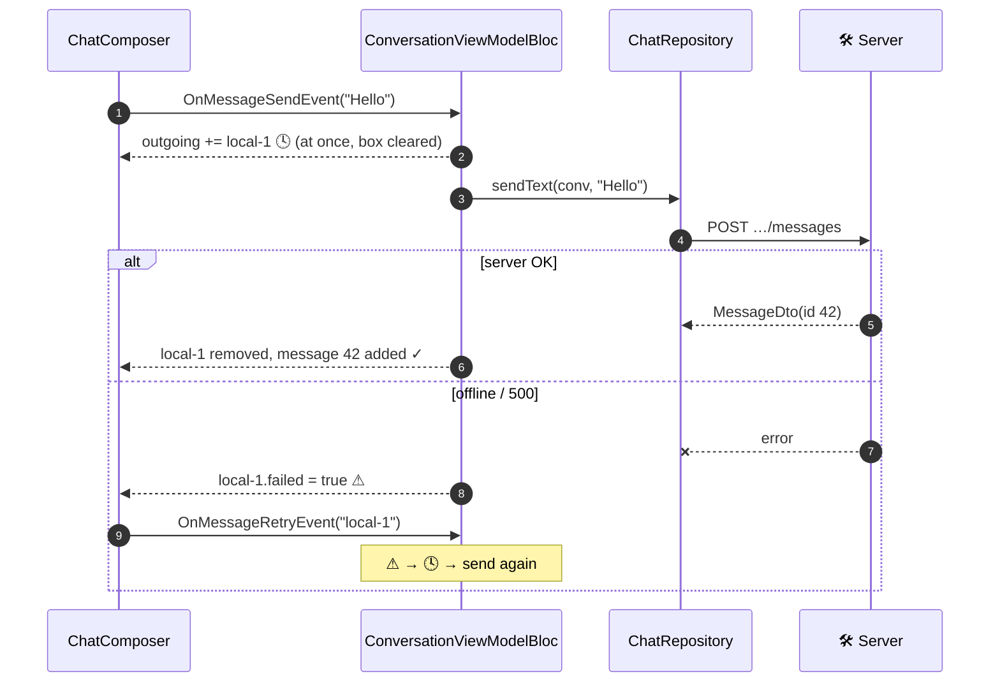
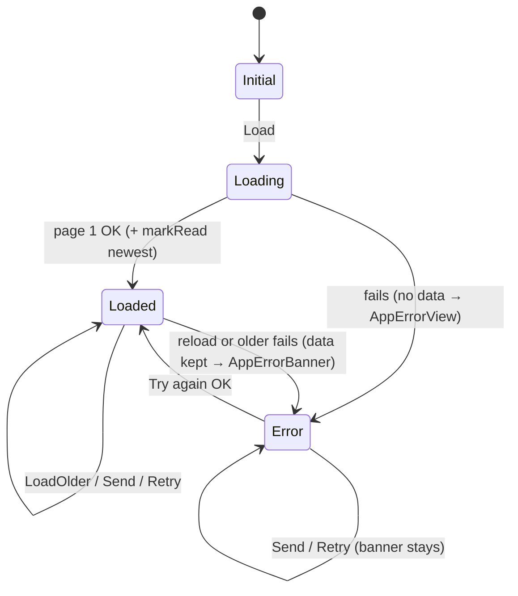

# Step 5.2 — Chat: one conversation

> ← Previous: [11-chat-inbox.md](11-chat-inbox.md) · Next: [13-chat-realtime.md](13-chat-realtime.md) → · Roadmap: [README.md](README.md)

```
5.1 Inbox (REST)       ✅
5.2 Conversation       message history (paged) + send text   ← this lesson
5.3 Realtime (STOMP)   live messages, inbox updates, reconnect
5.4 New chat + groups
5.5 Attachments        image · file · voice
5.6 Extras             edit / delete · reactions · presence · search
```

Tap a chat in the inbox → its messages, newest at the bottom → type → ➤.

## 1. Why

A conversation looks like "just another list", but it teaches three new
ideas:

- **A list that starts at the bottom** and loads **older** pages when you
  scroll **up** (`ListView(reverse: true)`).
- **Optimistic UI**: your bubble shows **at once**, before the server
  answers. If the send fails, the text is kept and you can retry.
- **Two kinds of data in one list**: what the **server** has
  (`MessageModel`, real ids) and what **you typed** but the server hasn't
  confirmed yet (`OutgoingMessage`, local ids).



🟨 new · 🟦 built before (the repository got 3 new methods)

## 2. Picture

### The backend (read from `MessageController`, not guessed)

| Need | Endpoint | Notes |
|---|---|---|
| History | `GET /api/v1/chats/conversations/{id}/messages?page&pageSize` | **Newest first**, 30 per page. `readByUserIds` = who has read it. |
| Send text | `POST /api/v1/chats/conversations/{id}/messages` | `{ "type": "TEXT", "body": "…" }` → the saved `MessageDto`. |
| Mark read | `POST /api/v1/chats/conversations/{id}/read` | `{ "lastReadMessageId": 42 }` (a **number**). |

### The screen

```
┌ ←  (JD) Jane Doe ──────────────────┐
│            ⟳  (loading older…)     │  ← scroll UP = older pages
│              ── Yesterday ──       │
│ (JD) ┌──────────────────┐          │
│      │ Are we still on? │          │  ← theirs: left, grey
│      └──────────── 18:02┘          │
│                ── Today ──         │
│          ┌──────────────────┐      │
│          │ Yes, 9am 👍      │      │  ← mine: right, primary
│          └───────── 08:10 ✓✓┘      │     🕓 sending · ✓ sent · ✓✓ read
│          ┌──────────────────┐      │
│          │ See you          │      │  ← faded = failed
│          └──────────────────┘      │
│          ⚠ Not sent · Tap to retry │
├────────────────────────────────────┤
│ ┌ Message… ──────────────┐  (➤)    │  ← ➤ only when text isn't blank
└────────────────────────────────────┘
```

Groups: the sender's **name** above the first bubble of a run, their
**avatar** next to the last one.

### Sending: optimistic



### The BLoC's states



### Files

```
lib/core/network/api_endpoints.dart        + messages(id), markRead(id)
lib/core/utils/chat_time.dart              + bubble(), day(), sameDay()
lib/core/widgets/app_input_text.dart       + minLines / maxLines / textCapitalization
lib/features/chat/
├── model/outgoing_message.dart            NEW  my text, not confirmed yet
├── repository/chat_repository.dart        + loadMessages · sendText · markRead
├── viewmodel/conversation_view_model_*    NEW  bloc + event + state
├── view/conversation_page.dart            NEW  layout only
├── view/inbox_page.dart                   tile tap → open, back → reload
└── widgets/
    ├── message_list.dart                  NEW  reversed list, runs, day dividers
    ├── message_bubble.dart                NEW  one bubble + BubbleStatus
    ├── chat_day_divider.dart              NEW  "Today" pill
    ├── chat_composer.dart                 NEW  text box + ➤
    ├── conversation_app_bar_title.dart    NEW  avatar + name (+ "5 members")
    └── conversation_empty_view.dart       NEW  "No messages yet"
test/features/chat/conversation_view_model_bloc_test.dart   NEW (9 tests)
```

## 3. Code

### `ListView(reverse: true)`: the bottom is index 0

Our lists are **newest first** (that's how the server sends them). A
reversed `ListView` draws index 0 at the **bottom**, so:

- the newest message is at the bottom, and the list **opens there** by
  itself (no "scroll to the end after the first frame");
- a new message goes to index 0 = the bottom;
- loading older = scrolling towards the **top**, which `extentAfter`
  measures in a reversed list.

```dart
NotificationListener<ScrollNotification>(
  onNotification: (n) {
    if (n.metrics.extentAfter < 300) widget.onLoadOlder(); // near the TOP
    return false;
  },
  child: ListView.builder(reverse: true, ...),
)
```

### Two kinds of message: `MessageModel` vs `OutgoingMessage`

```dart
final List<MessageModel> messages;      // what the SERVER has (real ids)
final List<OutgoingMessage> outgoing;   // what I typed, not confirmed (local ids)
```

The list draws `outgoing` **below** `messages` (they are newer). A small
private `_Entry` class in `message_list.dart` turns either one into "one row"
(text, time, mine?, status), so the drawing code doesn't care which it is.

### The send, step by step

```dart
final local = OutgoingMessage(localId: 'local-${++_localSeq}', text: text, createdAt: DateTime.now());
_emitData(emit, data.copyWith(outgoing: [local, ...data.outgoing]));   // 🕓 at once
await _deliver(local, emit);
```

```dart
final result = await _repository.sendText(conversationId, local.text);
final data = state.data;   // read AGAIN: other events may have run meanwhile
result.fold(
  (_)    => … outgoing: _replace(data.outgoing, local.copyWith(failed: true)),  // ⚠
  (sent) => … outgoing: without local, messages: [sent, ...without sent.id],     // ✓
);
```

| Piece | Why |
|---|---|
| `state.data` read **after** the `await` | Bloc runs handlers **at the same time**. While a send waits, a reload or a second send may change the state. Using the old copy would undo their work. A test checks "a message sent during a reload is not lost". |
| `messages: [sent, ...without sent.id]` | If a reload already brought message 42, it must not show twice. |
| `_emitData` keeps the Error type | Sending while the "No Internet" banner shows must not hide the banner. |
| A failed send does **not** make `ConversationErrorState` | Only that one bubble failed. The rest of the chat is fine. |
| Retry needs `failed == true` | Two fast taps on "Retry" send only once. |

### Mark read: best effort

```dart
void _markRead(MessageModel? newest) {
  if (newest == null || newest.id == _markedReadId) return;   // once per newest id
  _markedReadId = newest.id;
  unawaited(_repository.markRead(conversationId, newest.id));
}
```

- Not awaited, result ignored: a failed "read" must never block the chat.
- The server wants a **number**: `int.tryParse(messageId) ?? messageId`.
- Back in the inbox, `InboxPage` reloads, so the unread badge disappears.
  (In 5.3, a live event will do this.)

### Runs and the "tail"

Two bubbles from the same person **less than 5 minutes apart, on the same
day** form a run:

| In a run | Why |
|---|---|
| 2 px gap (10 px between runs) | Easy to see who said what. |
| Small corners between bubbles; the "tail" corner only on the last | Looks like one block of speech. |
| Group: name on the **first**, avatar on the **last** | Same as most chat apps; less noise. |

### Ticks

```dart
status = m.senderId != myId ? BubbleStatus.none
       : m.readByUserIds.isNotEmpty ? BubbleStatus.read   // ✓✓
       : BubbleStatus.sent;                                // ✓
// outgoing: failed ? BubbleStatus.failed (⚠) : BubbleStatus.sending (🕓)
```

`readByUserIds` comes with the history, so ✓✓ works after a reload. Live
✓✓ needs 5.3.

### The bloc is built in the page, not by `getIt`

```dart
create: (_) => ConversationViewModelBloc(getIt<ChatRepository>(), conversationId: conversation.id)
  ..add(OnConversationLoadEvent()),
```

Our service locator has no "factory with a parameter", and every page
needs **its own** conversation id. The repository still comes from `getIt`.

## 4. 🤔 Why like this? (other ways)

| Choice we made | Other way | Why we didn't pick the other way |
|---|---|---|
| `ListView(reverse: true)` | Normal list + `jumpTo(maxScrollExtent)` | Needs a post-frame jump on open and after every new message; it flickers and fails when items change height (images). |
| Optimistic send | Wait for the server, then show | Feels slow (0.3–2 s per message), and the text is lost on failure. |
| Separate `OutgoingMessage` | A `MessageModel` with a fake id + `status` field | `MessageModel` = exactly the server's record. A fake id could clash and leak into requests. |
| Failed send → mark the bubble | Show a snackbar and drop the text | The user would have to type it again. |
| Page passes the whole `ConversationModel` | Page loads `GET /conversations/{id}` | The inbox already has the title, avatar and members. 0 extra requests. |
| No pull-to-refresh here | `RefreshIndicator` | In a reversed list it sits at the **oldest** end, which is odd. Re-open the chat until 5.3 makes it live. |
| Mark read once per newest id | On every load | Fewer requests; the server only needs the newest id. |
| Bubble max 75% wide, list max 720 | Full width | Long lines are hard to read; the two sides stay clear. |

## 5. Try it

```bash
flutter test                                    # 120 tests → All tests passed!
flutter run --flavor dev -t lib/main_dev.dart
```

1. Chats → tap a conversation → it slides in, newest at the bottom.
2. In the log: `GET …/conversations/{id}/messages?page=1&pageSize=30`,
   then `POST …/{id}/read`.
3. Type "Hello" → ➤ → the bubble shows **at once** with 🕓, then ✓.
4. Airplane mode → send → the bubble fades and **"Not sent · Tap to retry"**.
   Wi-Fi on → tap it → 🕓 → ✓.
5. A chat with 30+ messages → scroll up → a small ⟳ at the top → older ones
   appear (`page=2` in the log).
6. Back → the inbox reloads: your message is the preview, and the unread
   badge is gone.
7. A group: names above the bubbles and small avatars next to them.
8. Log in as the other user (another phone or Postman) → reply → re-open the
   chat to see it. (Live updates come in 5.3.)

## 6. Check yourself

1. Why does `ListView(reverse: true)` fit a chat so well?
2. You send "Hi" and the network fails. What happens to the text, and what
   does the user see?
3. Why does `_deliver` read `state.data` again **after** `await sendText`?
4. Why is `OutgoingMessage` a separate class instead of a `MessageModel` with a
   fake id?
5. When does a message get ✓✓?

<details><summary>Answers</summary>

1. Index 0 is drawn at the bottom and our lists are newest first, so the
   newest message is at the bottom and the list opens there with no scroll
   code. Loading older is scrolling towards the top.
2. It stays as an `OutgoingMessage` with `failed: true`: a faded bubble with
   "Not sent · Tap to retry". Tapping it sends the same text again.
3. Bloc runs handlers at the same time. While we waited, a reload or another
   send may have changed the state. Using the old copy would throw their
   changes away.
4. A `MessageModel` always means "the server has this, with this id". A fake
   id could clash with a real one or be sent to the server (for example in
   `markRead`).
5. When it's mine and `readByUserIds` is not empty: at least one other member
   has read up to it. (Live in 5.3; for now after a reload.)

</details>
