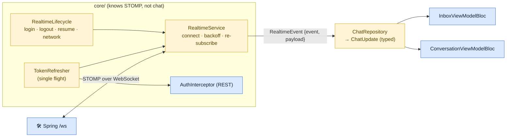
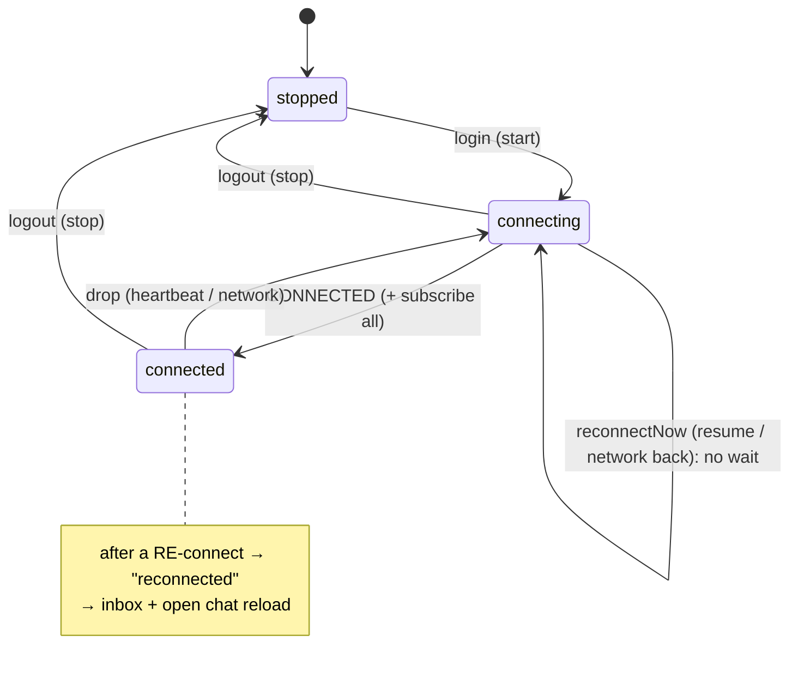
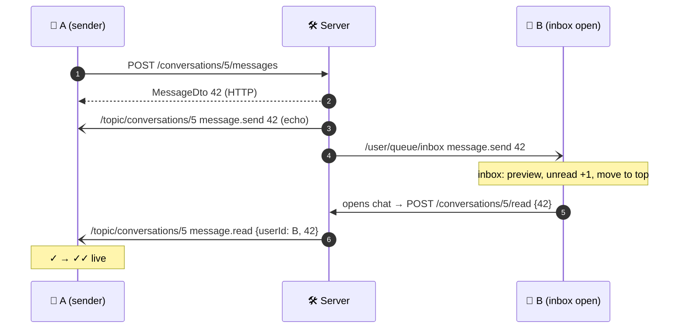

# Step 5.3 — Chat: real time (STOMP)

> ← Previous: [12-chat-conversation.md](12-chat-conversation.md) · Next: [14-chat-groups.md](14-chat-groups.md) → · Roadmap: [README.md](README.md)
>
> 📖 New to WebSockets? Start with the step-by-step [reading path](13b-realtime-reading-path.md).

```
5.1 Inbox ✅ · 5.2 Conversation ✅
5.3 Realtime (STOMP)   live messages, inbox updates, ✓✓, reconnect   ← this lesson
5.4 New chat + groups · 5.5 Attachments · 5.6 Extras
```

Until now the app only knew what it **asked** for. Now the server **tells**
it: a new message appears by itself, the inbox moves, ✓ turns into ✓✓.

## 1. Why

REST is "phone asks, server answers". A chat needs the opposite as well:
"something happened → server tells the phone **now**". For that we keep ONE
open connection: a **WebSocket**, with **STOMP** on top (the backend is
Spring, which speaks STOMP).

This step teaches:

- **One connection for the whole app**, in `core/`, knowing nothing about
  chat (calls in Step 6 use the same one).
- **Reconnecting well**: backoff, a fresh token every try, and **catch-up**
  (reload) because events sent while you were offline are lost.
- **Single-flight token refresh**, shared by REST and the socket.
- **Live updates through the BLoC**: a stream becomes events, so every change
  still goes through one handler.



## 2. Picture

### What the backend sends (read from `ChatBroadcaster` callers)

Every frame is `{ "event": "...", "payload": {...} }`.

| Destination | Events | Used by |
|---|---|---|
| `/user/queue/inbox` (only mine) | `message.send` (MessageDto) · `conversation.create` / `update` / `remove` | Inbox |
| `/topic/conversations/{id}` | `message.send` · `message.edit` · `message.delete` · `message.read` `{conversationId, userId, lastReadMessageId}` · `conversation.update` | Open conversation |
| `/user/queue/calls` · `/topic/presence` | calls · online/offline | Step 6 · 5.6 |

The CONNECT frame carries `Authorization: Bearer <accessToken>`. Heartbeats
every 10 s (both sides), so a dead socket is noticed in ~20 s.

### The connection's life



### A message, end to end



### Files

```
lib/core/network/token_refresher.dart     NEW  single-flight refresh (moved out of AuthInterceptor)
lib/core/network/auth_interceptor.dart    uses TokenRefresher
lib/core/config/environments.dart         realtime URL → the backend's /ws
lib/core/realtime/
├── realtime_event.dart                   NEW  {event, payload} envelope
├── stomp_connection.dart                 NEW  tiny interface + the real stomp_dart_client connector
├── realtime_service.dart                 NEW  connect · backoff · re-subscribe · status · reconnected
└── realtime_lifecycle.dart               NEW  session / app resume / network → start · stop · reconnectNow
lib/core/widgets/app_realtime_title.dart  NEW  "⟳ Connecting…" title
lib/features/chat/
├── model/chat_update.dart                NEW  sealed: MessageArrived, MessageChanged, MessagesRead, ConversationChanged, ConversationRemoved
├── repository/chat_repository.dart       + inboxUpdates · conversationUpdates · reconnected · loadConversation
└── viewmodel/inbox/ · conversation/    + live update handlers
```

## 3. Code

### `TokenRefresher`: why "single flight" is a must

The refresh token is **rotated**: using it gives a new one and kills the old
one. Before 5.3, only `AuthInterceptor` refreshed (and its queue made sure it
was once). Now the socket also needs a fresh token. Two refreshers = danger:

```
socket: refresh with r1 ──► OK, new r2   (r1 dead)
REST:   refresh with r1 ──► REJECTED ──► clear tokens ──► logged out 😱
```

So both share ONE `TokenRefresher`, and a second caller waits for the
running refresh instead of starting another:

```dart
Future<RefreshResult>? _inFlight;
Future<RefreshResult> refresh() =>
    _inFlight ??= _run().whenComplete(() => _inFlight = null);
```

The socket asks `validTokens()`: "a token good for at least 60 s more"
(refresh first if not).

### `RealtimeService`: the important rules

| Rule | Why |
|---|---|
| Our own reconnect loop (`reconnectDelay: Duration.zero` in the package) | The package's reconnect re-sends the **old** CONNECT headers = an expired token. We make a new connection with a fresh token each try. |
| Backoff 1, 2, 4, 8, 16, 30 s | A server that is down isn't hammered; a short blip comes back fast. |
| `reconnectNow()` on app resume / network back | The OS kills sockets in the background. Waiting 30 s after opening the app would feel broken. |
| Subscriptions are remembered and replayed | A page subscribes once; it keeps working across drops. |
| `reconnected` stream → reload | Events sent while we were down are **lost** (STOMP doesn't queue them). Catch-up = reload page 1. |
| `_generation` counter | An answer from an old try (after logout, or a newer try) is ignored. |
| Last listener cancels → STOMP unsubscribe | Closing a conversation stops its topic. |
| Knows nothing about chat | Calls (Step 6) reuse it with `/user/queue/calls`. |

### From frames to BLoC events

```dart
// ChatRepository
Stream<ChatUpdate> inboxUpdates() => _realtime
    .subscribe(ApiEndPoint.inboxQueue)
    .map(ChatUpdate.fromRealtime)   // JSON → typed, unknown → null
    .where((u) => u != null).cast<ChatUpdate>();

// InboxViewModelBloc constructor
_repository.inboxUpdates().listen((u) => add(OnInboxLiveUpdateEvent(u)));
_repository.reconnected.listen((_) => add(OnInboxLoadEvent()));
```

The BLoC turns each update into an **event**, so live changes go through the
same handlers and rules as everything else (and `close()` cancels the
subscriptions).

### The inbox, live

| Update | What happens |
|---|---|
| `MessageArrived` | Preview + time; unread +1 **unless** it's mine or that chat is open; moved to the top. Chat not loaded → `GET /conversations/{id}` and insert it. |
| `ConversationChanged` | Replace it, but keep **our** unread count (see below). New → insert at the top. |
| `ConversationRemoved` | Drop it. |
| reconnected | Reload page 1. |

`OnInboxConversationOpenedEvent(id / null)` tells the inbox which chat is on
screen: its badge goes to 0 at once, and its new messages don't count. The
"reload when you come back" from 5.2 is gone.

> **Backend quirk:** `conversation.update` is computed for the member who
> made the change (`toDtoWithLastMessage(c, me)`) but sent to **everyone**,
> so its `unreadCount` is the sender's, not ours. We keep our own count.

### The conversation, live

| Update | What happens |
|---|---|
| `MessageArrived` from someone | New bubble at the bottom + `markRead` (you're looking at it). |
| `MessageArrived` from **me** (the echo) | Replaces the oldest 🕓 bubble with the same text. It may come **before** the HTTP answer; either way the message shows once (ids are de-duplicated). |
| `MessageChanged` (edit / delete) | Swapped in place, keeping the ✓✓ we know (these events carry no read receipts). |
| `MessagesRead(userId, lastId)` | Every message not sent by `userId` with id ≤ `lastId` gets ✓✓. Ids compared as **numbers** ("9" < "11"). |
| reconnected | Reload page 1. |

`markRead` now only moves **forward** (a newer id than the last one sent).

### "⟳ Connecting…"

`AppRealtimeTitle` listens to `RealtimeService.status` (a `ValueNotifier`)
and replaces "Chats" with a small spinner + "Connecting…" while not
connected. When everything is fine, it says nothing.

## 4. 🤔 Why like this? (other ways)

| Choice we made | Other way | Why we didn't pick the other way |
|---|---|---|
| STOMP over WebSocket | Polling every few seconds | Late, wastes battery and data, and loads the server. |
| One `RealtimeService` in `core/` | A socket per page / per feature | Many sockets = more battery, more auth, harder reconnect. |
| Own reconnect loop | The package's `reconnectDelay` | Old token on every retry; fixed delay, no backoff. |
| Shared single-flight `TokenRefresher` | Socket calls `/auth/refresh` itself | Two refreshes with one rotated token → logout. |
| Catch-up reload after reconnect | Trust the stream | Events during the drop are gone; the list would be wrong. |
| Stream → BLoC event | `emit.forEach` / widgets listening to the socket | Events keep one path for all changes; widgets stay layout only. |
| Keep our unread on `conversation.update` | Take the server's | The server's number belongs to another member (backend quirk). |
| Echo replaces the 🕓 bubble by text | Wait only for the HTTP answer | The echo can come first → the message would show twice for a moment. |

**For the backend team** (we don't change it):
1. `StompAuthChannelInterceptor` checks the token only on CONNECT. It
   should also check on SUBSCRIBE that the user is a member of
   `/topic/conversations/{id}`; today any logged-in user could listen in.
2. `conversation.update` sent to all members carries the actor's
   `unreadCount`.

## 5. Try it

```bash
flutter test                                    # 145 tests → All tests passed!
flutter run --flavor dev -t lib/main_dev.dart   # on TWO devices (or one + Postman)
```

1. Log in on phone A and phone B (two users with a chat together).
2. A sends "Hi" → on B's **inbox** the chat jumps to the top, bold, badge 1.
   No refresh.
3. B opens the chat → the badge goes away; on A's open chat, ✓ → **✓✓**.
4. B types back → the bubble appears on A at once.
5. Turn A's Wi-Fi off → A's inbox title: **"⟳ Connecting…"**. B sends 2
   messages. Wi-Fi on → the title comes back and A's list shows both
   (catch-up reload).
6. Put A in the background for a minute, open it again → reconnects at once.
7. Log out → the socket closes (no more events for that user).

## 6. Check yourself

1. Why does the app have its own reconnect loop instead of the package's?
2. The socket and a REST call need a refresh at the same moment. What would
   go wrong without single flight, and how does `TokenRefresher` stop it?
3. The phone was offline for 2 minutes. Why reload after reconnecting?
4. My own `message.send` echo arrives before the HTTP answer. Why doesn't
   the message show twice?
5. Why does the inbox ignore `unreadCount` in `conversation.update` for chats
   it already has?

<details><summary>Answers</summary>

1. The package re-sends the same CONNECT headers, so an expired token would
   fail forever, and its delay is fixed. Ours gets a fresh token each try and
   backs off 1 → 30 s.
2. The refresh token is rotated. The second refresh would use the dead one →
   rejected → tokens cleared → logged out. `TokenRefresher` keeps the running
   refresh in `_inFlight`; a second caller gets the same future.
3. STOMP doesn't keep events for you. Whatever was sent during the drop is
   lost, so the inbox and the open chat load page 1 again.
4. The echo removes the oldest 🕓 bubble with the same text and adds the
   real message; when the HTTP answer comes, its id is already there, so it's
   not added again.
5. The server computes it for the member who made the change but sends it to
   everyone, so it isn't our number.

</details>
