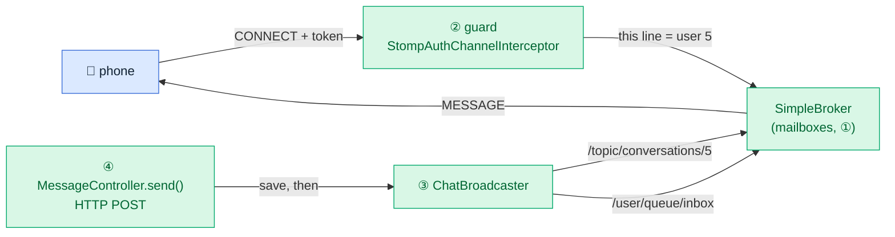
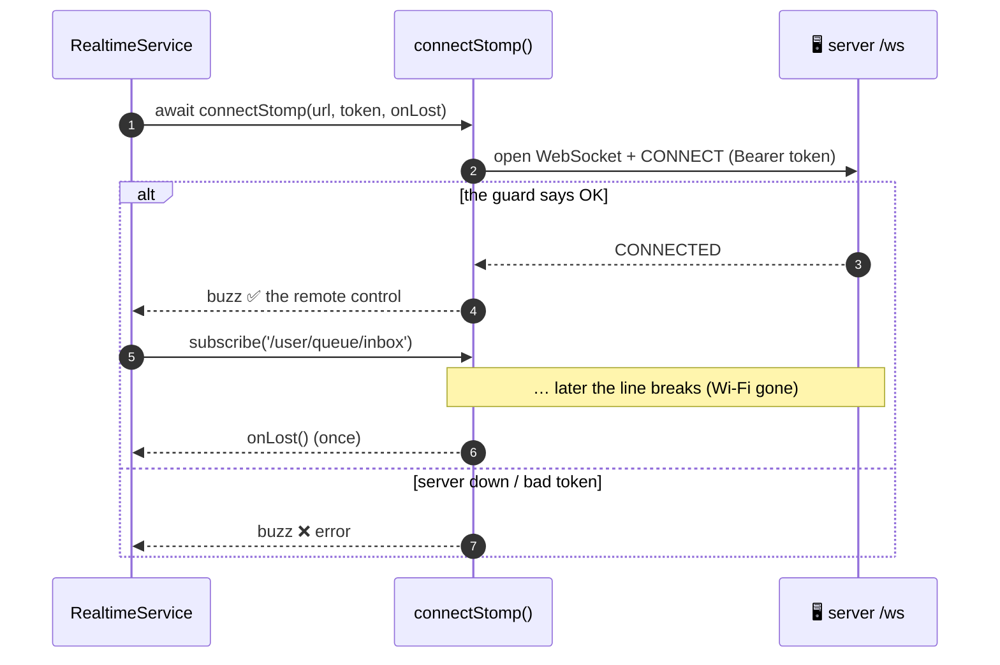
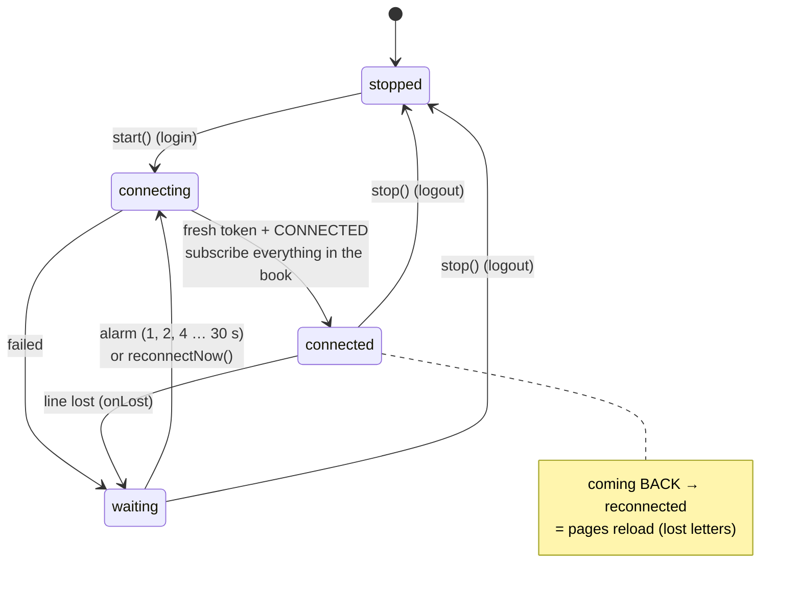
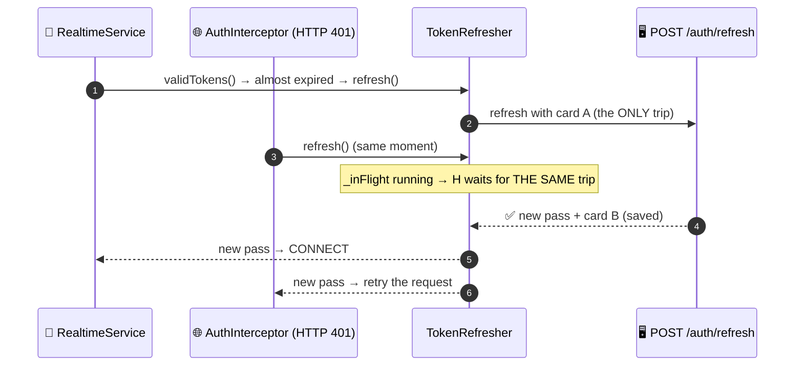
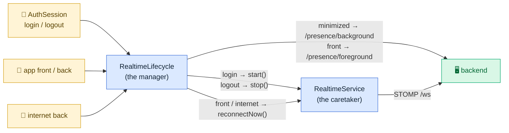

# Realtime (WebSocket + STOMP): a reading path

> Goes with: [13-chat-realtime.md](13-chat-realtime.md) · Roadmap: [README.md](README.md)

Read the stages **in order**. Each stage says what to read, what to look for,
and a ❓ question to answer before you move on.

Suggested pace: Stages 0–2 on day 1 · 3–5 on day 2 · 6–8 on day 3.

---

## Stage 0: the idea (no code)

### Part 1: what is a "request"? (HTTP)

Your phone and the server are two computers talking through the internet.
Most of our app talks with **HTTP**, like a **shop counter**:

```
📱 phone:  "Give me my chats."         (request)
🖥 server: "Here: chat 1, chat 2."      (response)
           … the talk is finished …
```

**The rule:** only the phone can START a talk. The shopkeeper never runs
after you. In our code, every `AppService.send(...)` is one trip to the counter.

### Part 2: the problem

Mr Lin sends you "Hello" at 10:00. The server saves it, but it **can't tell
you**: it has to wait until your phone asks.

```
10:00  Mr Lin ──"Hello"──► 🖥 server   (saved)
       📱 your phone: … nothing … (doesn't know)
```

### Part 3: the bad fix: "keep asking" (polling)

```
10:00:00  📱 "Anything new?"   🖥 "No."
10:00:03  📱 "Anything new?"   🖥 "No."
10:00:06  📱 "Anything new?"   🖥 "Yes: Hello"   ← late
```

- 🐢 **Late:** you see the message only at the next ask.
- 🔋 **Wasteful:** most answers are "No", but each ask costs battery + internet.
- 🖥 **Heavy:** many phones × many asks = the server works for nothing.

Like walking to the post office every 3 seconds: "Is my parcel here?"

### Part 4: the good fix: WebSocket (a phone call that stays on)

The phone opens **one line and keeps it open**. Now **both sides** can talk
at any time:

```
📱 phone ═══════════ the line stays open ═══════════ 🖥 server
10:00  🖥 ──"New message: Hello"──► 📱   (at once!)
```

| HTTP | WebSocket |
|---|---|
| a trip to the shop counter | a phone call that stays on |
| only the phone starts | **both** can start |
| closed after each answer | stays open |

In our app, `RealtimeService` keeps this line open (it opens it at login).

### Part 5: STOMP: the rules for talking on the line

The line only carries text. STOMP adds rules, like **letters** with a
**type** and an **address**. Only 5 kinds of letter, in this order:

| # | Letter | Direction | Means | Carries |
|---|---|---|---|---|
| ① | `CONNECT` | 📱 → 🖥 | "Let me in, this is me" | `Authorization: Bearer <token>` (your ID card) |
| ② | `CONNECTED` | 🖥 → 📱 | "OK, you're in" | — |
| ③ | `SUBSCRIBE` | 📱 → 🖥 | "Send me letters for this address" | the address, e.g. `/user/queue/inbox` |
| ④ | `MESSAGE` | 🖥 → 📱 | a letter arrives (any time, many times) | `{"event": what happened, "payload": the details}` |
| ⑤ | heartbeat `\n` | both, every 10 s | "I'm still here" | nothing |

If one side stops hearing the heartbeat, it knows **the line is broken**
(Wi-Fi lost, phone asleep), and our app reconnects.

### Part 6: the addresses (mailboxes)

| Address | Who gets it | Example |
|---|---|---|
| `/user/queue/inbox` | **only you** (private mailbox) | a new message in one of your chats → the inbox updates |
| `/topic/conversations/5` | **everyone who has chat 5 open** (notice board) | messages, "typing…", ✓✓ |
| `/user/queue/calls` | **only you** | "Mr Lin is calling you" |

`/user/...` = private: the server knows it's you from the token in CONNECT.
`/topic/...` = shared by everyone who subscribed.

### Part 7: we still use HTTP too

```
Send a message      → HTTP POST    a clear answer: "saved ✅ id 123" or "error ❌"
Load old messages   → HTTP GET     pages of history
Hear news LIVE      → WebSocket    the server tells you the moment it happens
```

| | Like | Gives you |
|---|---|---|
| **HTTP** | asking a question at a counter | **the answer to YOUR question** (OK or error) |
| **WebSocket** | a radio station | **news** of what happened (new message, typing, call) |

> Errors for what **I** did → **HTTP**. News of what **others** did → **WebSocket**.

That's why the ⚠ "Not sent · Tap to retry" bubble (5.2) works: the HTTP POST
tells us clearly that OUR send failed. The WebSocket says nothing (nothing
was saved, so there's no news).

### ❓ Check yourself

1. With only HTTP, why doesn't your phone know about a new message?
2. Polling works, but why is it bad? (2 reasons)
3. What does the CONNECT letter carry?
4. `/user/queue/inbox` or `/topic/conversations/5`: which is only for you?
5. Why do we SEND with HTTP POST, not the WebSocket?
6. You tap send, the server answers "500 error": HTTP or WebSocket tells you?

<details><summary>Answers</summary>

1. HTTP: only the phone can start a talk. The server has the message but must
   wait until the phone asks.
2. Late (you only learn at the next ask) · wastes battery and internet (most
   answers are "no").
3. Your token (`Authorization: Bearer …`) = who you are. (`event` is in the
   MESSAGE letters.)
4. `/user/queue/inbox`.
5. Sending needs a clear answer to MY question (saved / failed). HTTP gives
   that; the WebSocket only announces news.
6. HTTP: it's the answer to your own request.

</details>

---

## Stage 1: the server side (the post office)

The backend is the **post office**: it lets people in, keeps the mailboxes
and delivers letters. Only 4 files, in
`erp_java_backend_claude/src/main/java/com/company/erp/features/chats/`:

```
① ws/WebSocketConfig              → builds the post office (door, mailboxes, heartbeat)
② ws/StompAuthChannelInterceptor  → the guard at the door (checks your ID card)
③ ws/ChatBroadcaster              → the postman (puts letters in mailboxes)
④ controller/MessageController.send() → where a new letter is born
```



### ① `WebSocketConfig.java`: build the post office

**The door** (where the phone connects):

```java
registry.addEndpoint("/ws")      // → ws://<server>:8080/ws  (the flavor's realtimeUrl)
```

**The mailboxes:**

```java
registry.enableSimpleBroker("/topic", "/queue")    // letters TO phones
registry.setApplicationDestinationPrefixes("/app") // letters FROM phones to the server
registry.setUserDestinationPrefix("/user")         // private mailboxes
```

| Address starts with | Means | Example |
|---|---|---|
| `/topic/...` | a **notice board**: everyone subscribed reads it | `/topic/conversations/5` |
| `/user/queue/...` | a **private mailbox**: one person | `/user/queue/inbox` |
| `/app/...` | a letter **from the phone to the server** | `/app/conversations/5/typing` |

"SimpleBroker" = Spring's built-in post office: it remembers, in memory, who
subscribed to what.

**The heartbeat:**

```java
HEARTBEAT_INTERVAL = { 10_000L, 10_000L };   // 10 s, both ways
```

A killed phone can't say "bye". Without heartbeats the server would think
it's online **for hours**; with them it notices in **~20–30 s** and marks the
user offline (the 🟢 dot goes away).

**The guard:** `registration.interceptors(authInterceptor)` = every letter
from a phone passes ② first.

### ② `StompAuthChannelInterceptor.java`: the guard at the door

```java
if (StompCommand.CONNECT.equals(accessor.getCommand())) {        // 1. "let me in"?
    String header = firstNativeHeader(accessor, "Authorization"); // 2. take the ID card
    String token = header.substring("Bearer ".length()).trim();
    AuthenticatedUser principal = jwt.parseAccess(token);         // 3. check it → user 5
    … getName() { return String.valueOf(principal.userId()); }    // 4. "this line = user 5"
    accessor.setUser(auth);                                       // 5. remember it
}
```

Because the server remembers "this line = user 5", a letter to **user 5's
private mailbox** goes down **this line only**. An expired token → not let in
(→ Stage 4).

### ③ `ChatBroadcaster.java`: the postman

The rest of the backend never touches STOMP; it asks the postman:

| Method | Goes to | Who reads it |
|---|---|---|
| `toConversation(5, event, payload)` | `/topic/conversations/5` | everyone who **opened** chat 5 |
| `toCall(5, …)` | `/topic/conversations/5/call` | everyone watching that chat's call |
| `toUser(5, "inbox", …)` | user 5's `/user/queue/inbox` | only user 5 |
| `toUsers([5, 7], "inbox", …)` | each person's private inbox | 5 and 7, each privately |

Every letter has the same shape (`ChatEvent`):

```json
{ "event": "message.send", "payload": { "id": 123, "body": "Hello" } }
```

### ④ `MessageController.send()`: where a letter is born

This is the HTTP POST from Stage 0. Look what happens **after** saving:

```java
@PostMapping("/conversations/{convId}/messages")
public MessageDto send(@PathVariable Long convId, …) {
    Message m = messages.send(convId, me, body);                     // 1. SAVE
    broadcaster.toConversation(convId, "message.send", dto);         // 2. the chat's notice board
    broadcaster.toUsers(conversations.memberUserIds(convId),
                        "inbox", "message.send", dto);               // 3. every member's inbox
    pushNotifier.notifyNewMessage(m);                                // 4. FCM for closed apps
    return dto;                                                      // 5. HTTP answer to the SENDER
}
```

```
📱 Mr Lin ──HTTP POST "Hello"──► send()
                                   1. save in the database
                                   2. ──► /topic/conversations/5   (who has chat 5 OPEN: new bubble)
                                   3. ──► /user/queue/inbox        (each member's INBOX: moves to top)
                                   4. ──► FCM push                 (app closed)
📱 Mr Lin ◄──HTTP 200 + message── 5. "saved ✅"
```

**Why both 2 and 3?** Inside chat 5 → the bubble appears (2). On the inbox
list → the chat jumps to the top with "Hello" (3).

### ❓ Check yourself

1. What is the door address the phone connects to?
2. `/topic/conversations/5` vs `/user/queue/inbox`: who receives each one?
3. Why does the server need a heartbeat? What goes wrong without it?
4. How does the guard know a line belongs to user 5?
5. When Mr Lin sends "Hello", the server sends it to two places. Which, and why?

<details><summary>Answers</summary>

1. `/ws` (`addEndpoint("/ws")`) → `ws://<server>:8080/ws`.
2. `/topic/...`: everyone who subscribed (has chat 5 open). `/user/queue/...`:
   only that one user.
3. To notice a dead phone (killed / no Wi-Fi) in ~20–30 s. Without it the
   server thinks the user is online for hours.
4. On CONNECT it reads the token, checks it (`jwt.parseAccess`) and saves the
   user id as the line's owner (`setUser`, `getName()` = user id).
5. `/topic/conversations/5` (people inside the chat see the bubble) and each
   member's `/user/queue/inbox` (the inbox list moves the chat to the top).

</details>

---

## Stage 2: the phone opens ONE connection

One small file:
[`lib/core/realtime/stomp_connection.dart`](../../../lib/core/realtime/stomp_connection.dart)
(~105 lines), in 3 parts:

```
Part A  StompConnection         the "remote control": what you can DO with an open line
Part B  connectStomp()          OPENS the line: CONNECT → wait for CONNECTED
Part C  _StompClientConnection  the real remote control (uses the package)
```

### Part A: `StompConnection`, a remote with 3 buttons

```dart
abstract interface class StompConnection {
  void Function() subscribe(String destination, void Function(String? body) onMessage);
  void send(String destination, String body);
  void close();
}
```

| Button | STOMP letter (Stage 0) | Means |
|---|---|---|
| `subscribe(address, onMessage)` | ③ SUBSCRIBE | "send me letters for this address" |
| `send(address, body)` | a letter TO the server | e.g. "I'm typing" → `/app/conversations/5/typing` |
| `close()` | — | hang up |

- `abstract interface class` = only a **list of buttons**, no code: WHAT you
  can do, not HOW.
- **Why so small?** Tests. The app only knows "a remote with 3 buttons", so a
  test gives it a **toy remote** (no server, no internet):
  ```
  real app → real remote 📡 (talks to the server)
  tests    → toy remote 🧸  (we press "a message arrived" ourselves)
  ```
- `subscribe` returns `void Function()` = a **stop button**:
  ```dart
  final stop = conn.subscribe('/user/queue/inbox', (body) => print(body));
  stop();   // UNSUBSCRIBE
  ```

### Part B: `connectStomp()`, open the line

**In and out:**

```dart
Future<StompConnection> connectStomp({
  required String url,              // the door: ws://<server>:8080/ws
  required String token,            // the ID card
  required void Function() onLost,  // "call me if the line breaks LATER"
})
```

A `Future` = "I'll give you the remote control **later**", when the line is ready.

**The `Completer` = a restaurant buzzer 📟:**

```
You order           → you get a buzzer      (opened.future)          you wait…
Food is ready       → buzz ✅               (opened.complete(...))   "here's your remote"
Kitchen problem     → buzz ❌               (opened.completeError)   "sorry, it failed"
```

The package doesn't give a Future; it calls our functions later. The
Completer turns that into a simple `await connectStomp(...)`.

**The settings:**

```dart
StompConfig(
  url: url,
  reconnectDelay: Duration.zero,                           // ❗ don't reconnect by yourself
  connectionTimeout: const Duration(seconds: 10),          // give up after 10 s
  heartbeatIncoming: const Duration(seconds: 10),          // same as the server (Stage 1)
  heartbeatOutgoing: const Duration(seconds: 10),
  stompConnectHeaders: {'Authorization': 'Bearer $token'}, // ① = the CONNECT letter
  …
)
```

**Why `reconnectDelay: Duration.zero`?** The package would reconnect with the
**same old token**. Tokens **expire** → the guard says "No!" forever. So WE
reconnect (Stage 3), with a **fresh** token each time:

```
🪪 old ID card (expired) → 🚪 "No!"   ← the package would do this
🪪 new ID card           → 🚪 "OK"    ← we do this
```

**The callbacks (what happens when):**

```dart
onConnect: (_) { opened.complete(_StompClientConnection(client)); }, // ② CONNECTED → buzz ✅
onStompError:     (frame) => fail(StateError('STOMP error')),  // server said ERROR (bad token…)
onWebSocketError: (error) => fail(error ?? 'socket error'),    // network problem
onWebSocketDone:  ()      => fail(StateError('socket closed')),
onDisconnect:     (_)     => fail(StateError('disconnected')),
```

**`fail()`: the same problem means 2 things, depending on WHEN:**

```dart
void fail(Object error) {
  if (!opened.isCompleted) {        // BEFORE we got in
    opened.completeError(error);    //   → buzz ❌ "couldn't connect"
    client.deactivate();
  } else if (!lost) {               // AFTER we got in, and only the first time
    lost = true;
    onLost();                       //   → "the line broke, call back"
  }
}
```

Like a phone call: **before** = you dial and nobody answers ("the call
failed"); **after** = you're talking and the call drops ("lost", call back).

**Why `lost`?** One break often gives 3 callbacks (error → done →
disconnected). `lost` makes sure `onLost()` runs **only once** (one
reconnect, not 3):

```
"error!"        → lost=false → onLost() ✅, lost=true
"closed!"       → lost=true  → ignore
"disconnected!" → lost=true  → ignore
```

**Start:** `)..activate();` = create the client AND start it. Then
`return opened.future;` (the buzzer).



### Part C: `_StompClientConnection`, the real remote

```dart
subscribe(destination, onMessage) {
  final unsubscribe = _client.subscribe(
    destination: destination,
    callback: (frame) => onMessage(frame.body),   // ④ MESSAGE → pass the TEXT on
  );
  return () { try { unsubscribe(); } catch (_) {} };  // the stop button
}
send(destination, body) => _client.send(destination: destination, body: body);
close() => _client.deactivate();
```

- `frame.body` = `{"event":"message.send","payload":{…}}`. This file doesn't
  READ it, it passes it on (reading it = Stage 6).
- `try/catch` in stop: the line may already be closed → nothing to undo.
- `_` = private: everyone else only knows the 3-button remote (Part A).

**This file opens ONE line, ONCE.** Keeping it alive (retry, fresh token,
subscribe again) = `RealtimeService`, Stage 3.

### ❓ Check yourself

1. Why is `StompConnection` so small?
2. What does the `Completer` do, and when does it ring ✅?
3. Which setting is the CONNECT letter with your ID card?
4. Why `reconnectDelay: Duration.zero`?
5. "socket closed" before CONNECTED, then again after: what does `fail()` do each time?
6. Why the `lost` variable?

<details><summary>Answers</summary>

1. So tests can use a toy (fake) remote with the same 3 buttons: no server needed.
2. It's a buzzer: it turns "the package calls me later" into a Future. It
   rings ✅ when the server says CONNECTED (❌ on an error before that).
3. `stompConnectHeaders: {'Authorization': 'Bearer $token'}`.
4. The package would retry with the same old token; tokens expire → refused
   forever. We retry ourselves with a fresh token.
5. Before → the Future fails (error: "couldn't connect"). After → `onLost()`
   ("line lost, call back").
6. One break gives several callbacks; `lost` makes `onLost()` run only once.

</details>

---

## Stage 3: keep the line alive (the heart)

Lines break (Wi-Fi drops, the phone sleeps, the server restarts). Someone
must **call back again and again**: `RealtimeService`, a **caretaker** whose
only job is "keep the line to the server open".
[`lib/core/realtime/realtime_service.dart`](../../../lib/core/realtime/realtime_service.dart):
read it in this order, not top to bottom.

```
start() ──► get token ──► connectStomp ──► connected ──► subscribe all addresses again
               ▲                                │ line breaks
               └──── wait 1, 2, 4 … 30 s ◄──────┘     (reconnectNow() skips the wait)
```

### Step 1: the caretaker's notebook (the variables)

```dart
status          // 🚦 stopped / connecting / connected  (the inbox shows "Connecting…")
_connection     // the remote control from Stage 2 (null = no line now)
_topics         // 📒 the ADDRESS BOOK: every address a page asked for
_retryTimer     // ⏰ "try again in X seconds"
_attempt        // failed tries in a row (0, 1, 2 …)
_running        // on duty? (true after login)
_connecting     // dialing right now? (don't dial twice)
_hadConnection  // ever connected before? (first time vs coming BACK)
_generation     // 🎫 ticket number of the current try (Step 7)
```

### Step 2: `start()`: go on duty (after login)

```dart
void start() {
  if (_running) return;
  _running = true;
  _attempt = 0;
  _connect();
}
```

### Step 3: `_connect()`: dial the server (the main part)

```dart
Future<void> _connect() async {
  if (!_running || _connecting) return;
  _connecting = true;
  final generation = ++_generation;               // 🎫 new ticket
  status.value = RealtimeStatus.connecting;       // 🚦 "Connecting…"
  try {
    final token = await _accessToken();           // ① a FRESH ID card
    final connection = await _connector(          // ② Stage 2
      url: url, token: token, onLost: () => _onLost(generation));
    …
    _connection = connection;                     // ③ keep the remote
    _attempt = 0;
    for (final entry in _topics.entries) {        // ④ SUBSCRIBE again to every
      _attach(entry.key, entry.value);            //    address in the book
    }
    status.value = RealtimeStatus.connected;      // 🚦 green
    if (_hadConnection) _reconnected.add(null);   // ⑤ came BACK → "reload!"
    _hadConnection = true;
  } catch (_) {
    _connecting = false;
    _scheduleRetry();                             // ❌ → try later (Step 4)
  }
}
```

| # | Plain words |
|---|---|
| ① | a **fresh** ID card (refreshed if almost expired), the reason Stage 2 turned the package's reconnect off |
| ② | open the line, wait for the buzzer ✅ |
| ③ | keep the remote control |
| ④ | subscribe again to **everything** in the address book (Step 5) |
| ⑤ | only when coming **back**: "I was away, reload your data" |

**Why ⑤?** Letters sent while the line was down are **lost**; the server
doesn't keep them:

```
10:00  line breaks ✖
10:01  Mr Lin sends "Hello" → the server sends the letter → nobody on the line → LOST
10:02  line back ✅ → reconnected → the inbox reloads with HTTP GET → "Hello" appears
```

### Step 4: it broke → wait, try again

```dart
void _onLost(int generation) {             // Stage 2's onLost() lands here
  if (generation != _generation) return;   // an OLD line → ignore (Step 7)
  _closeConnection();
  _scheduleRetry();
}

void _scheduleRetry() {
  if (!_running) return;                   // logged out → no retry
  status.value = RealtimeStatus.connecting;
  _retryTimer?.cancel();
  _retryTimer = Timer(_backoff(_attempt++), _connect);   // ⏰
}

static Duration defaultBackoff(int attempt) =>
    Duration(seconds: min(30, 1 << min(attempt, 5)));   // 1 << n = 2ⁿ, max 30
```

| Retry | 1st | 2nd | 3rd | 4th | 5th | 6th + |
|---|---|---|---|---|---|---|
| Wait | 1 s | 2 s | 4 s | 8 s | 16 s | 30 s forever |

**Why longer each time?** Like calling a friend who doesn't answer. If the
server is down, 1,000 phones dialing every second would hit it hard the
moment it comes back; longer waits are kinder to it and to the battery.
**Why never give up?** The user is logged in and expects chat to work.

### Step 5: the address book: `subscribe()` + `_attach()`

A page asks ONCE: `realtime.subscribe('/user/queue/inbox').listen(…)`. The
caretaker writes it in `_topics` and subscribes on the line:

```dart
void _attach(String destination, _Topic topic) {
  final connection = _connection;
  if (connection == null || !topic.controller.hasListener) return;
  topic.detach();                                          // old subscription off
  topic.stop = connection.subscribe(destination, (body) {  // SUBSCRIBE
    final event = RealtimeEvent.tryParse(body);            // text → event (Stage 6)
    if (event != null && !topic.controller.isClosed) topic.controller.add(event);
  });
}
```

**Why a book?** A broken line takes all its subscriptions with it; the new
line knows nothing:

```
Without the book:                       With it (our code):
line back → inbox: "I'm deaf now" 🙉    line back → the caretaker opens the book:
                                          SUBSCRIBE /user/queue/inbox       ✅
                                          SUBSCRIBE /topic/conversations/5  ✅
                                          SUBSCRIBE /user/queue/calls       ✅
```

An address leaves the book when its **last** listener cancels (`onCancel` →
`_topics.remove` → UNSUBSCRIBE). Many listeners can share one address.

### Step 6: `stop()` and `reconnectNow()`

```dart
void stop() {                  // LOGOUT: off duty, new ticket, alarm off, hang up
  _running = false;
  _generation++;
  _retryTimer?.cancel();
  _closeConnection();
  status.value = RealtimeStatus.stopped;
}

void reconnectNow() {          // app back in FRONT / network back
  if (!_running || _connection != null || _connecting) return;
  _retryTimer?.cancel();       // forget "wait 30 s"
  _attempt = 0;
  _connect();                  // dial NOW
}
```

The backoff may be at 30 s; when you open the app you don't want to wait
that long (who calls it: Stage 5).

### Step 7: `_generation`: ticket numbers 🎫

```dart
final generation = ++_generation;      // try #7
… await _connector(...) …              // ⏳ up to 10 s
if (generation != _generation || !_running) {
  connection.close();                  // my ticket is OLD → throw this line away
  return;
}
```

```
10:00:00  _connect() takes ticket #7, dialing … ⏳
10:00:02  LOGOUT → stop() → counter #8
10:00:05  #7 connects ✅ … but #7 ≠ #8 → "too late" → close it
```

Without tickets, a logged-out phone could keep a line subscribed to the old
user's inbox. `_onLost` uses the same check (a broken OLD line is ignored).
Like a bank queue number: a cancelled number isn't served.



### ❓ Check yourself

1. Who calls `connectStomp` again and again when the line breaks?
2. Why does every try get a fresh token?
3. The line was down 1 minute and Mr Lin sent a message then. Did it
   arrive? How does the app get it?
4. The waits between tries? Why longer each time?
5. What is the address book (`_topics`) for?
6. Logout WHILE connecting: what stops the old line from staying open?

<details><summary>Answers</summary>

1. `RealtimeService`: `_onLost` → `_scheduleRetry` → `_connect`.
2. Tokens expire; an old one is refused by the guard.
3. No, it's lost. On coming back `reconnected` fires and pages reload with HTTP.
4. 1, 2, 4, 8, 16, then 30 s. Kinder to a server that's down; saves battery.
5. It remembers every address so the caretaker subscribes again after every
   reconnect; pages subscribe only once.
6. The ticket (`_generation`): `stop()` makes a new one, the late line has an
   old ticket and is closed.

</details>

---

## Stage 4: the token problem

Stage 3 starts every try with `_accessToken()`: "a fresh ID card". Where
does it come from, and why is it tricky?
[`lib/core/network/token_refresher.dart`](../../../lib/core/network/token_refresher.dart)

### Part 1: two tokens (two cards)

| Card | Like | Lives | Used for |
|---|---|---|---|
| **access token** | a gym **day pass** | short (e.g. 15 min) | every request + the WebSocket CONNECT |
| **refresh token** | the **membership card** shown at the desk | long (e.g. 30 days) | ONLY `POST /auth/refresh`, to get a new pair |

The day pass travels with every request: stolen, it's useless after
15 minutes. The membership card is shown rarely.

### Part 2: the danger: the membership card works only ONCE

Our server **rotates** the refresh token: each use gives a NEW one and kills
the old one.

```
refresh with card A       → ✅ new pass + card B   (card A is now DEAD)
refresh with card A again → ❌ "card refused"     → logged out!
```

Two parts of the app at the same moment (opening the app after a while):

```
WebSocket: "need a fresh token to connect" → refresh with card A ✅ → card B
HTTP 401:  "my pass expired"               → refresh with card A ❌ (dead)
                                             → "refused" → logged out for no reason 😱
```

### Part 3: the fix: single flight (ONE refresh at a time)

```dart
Future<RefreshResult>? _inFlight;

Future<RefreshResult> refresh() =>
    _inFlight ??= _run().whenComplete(() => _inFlight = null);
```

| Code | Plain words |
|---|---|
| `_inFlight` | the refresh running right now (null = none) |
| `??=` | none running → start one and save it; one running → **give me THAT one** |
| `_run()` | go to the desk with the membership card |
| `.whenComplete(… = null)` | finished (OK or not) → clear it for next time |

```
WebSocket: "new pass!" → nobody at the desk → GO with card A ⏳
HTTP:      "new pass!" → someone is going   → "I'll wait for them" ⏳
desk: ✅ new pass + card B → BOTH get the same new pass     (card A used ONCE)
```

That's why: **never call `/auth/refresh` anywhere else.** Both
`AuthInterceptor` (HTTP 401) and `RealtimeService` go through this ONE
`TokenRefresher`.

### Part 4: `validTokens()`: what the socket asks for

```dart
Future<AuthTokens?> validTokens({Duration margin = const Duration(seconds: 60)}) async {
  final tokens = await _tokenStorage.read();              // my cards
  if (tokens == null) return null;                        // not logged in
  final expiresAt = tokens.accessTokenExpiresAt;
  if (expiresAt == null || expiresAt.isAfter(DateTime.now().add(margin))) {
    return tokens;                                        // good for 60 s more → use it
  }
  return switch (await refresh()) {                       // almost expired → refresh (single flight)
    RefreshOk(:final tokens) => tokens,
    _ => null,
  };
}
```

**Why 60 s margin?** A pass that dies in 5 s may die WHILE we connect → the
guard refuses it. "Almost expired" = expired.

The socket uses it in `lib/core/di/injection.dart`: this is Stage 3's `_accessToken()`:

```dart
RealtimeService(
  url: ApiEndPoint.websocketUrl,
  accessToken: () async => (await getIt<TokenRefresher>().validTokens())?.accessToken,
)
```

### Part 5: three answers from the desk

| Answer | Means | We do | Why |
|---|---|---|---|
| ✅ `RefreshOk` | a new pair | **save** it | the old card is dead now |
| ❌ `RefreshRejected` (400/401/403) | the server REFUSED the card (expired / revoked) | **clear** tokens + log out | the session is really over; keeping them = auto-login with a dead session (security bug) |
| 🤷 `RefreshFailed` (offline, timeout, 5xx) | we couldn't ask | **keep** tokens | not the user's fault; works again later |

Walking into a tunnel must NOT log you out; only a real "NO" does. For the
socket: Failed → `validTokens` = null → `_connect` fails → retry later
(Stage 3 backoff).

### Part 6: a separate Dio (no loop)

`_refreshDio` has NO auth interceptor. If the refresh used the normal Dio and
got a 401, the interceptor would refresh again → again → forever 🔁. With its
own plain Dio, a 401 there just means "Rejected".



### ❓ Check yourself

1. Access token vs refresh token? (the gym idea)
2. What goes wrong if the socket and an HTTP call refresh at the same moment?
3. What does `_inFlight ??= …` do?
4. Why refresh when the pass still has 30 s left?
5. `RefreshFailed` vs `RefreshRejected`: which logs out, and why not the other?

<details><summary>Answers</summary>

1. Access = day pass (short, every request). Refresh = membership card
   (long, only at the desk to get a new pass).
2. The first uses card A and gets B; the second brings the dead card A →
   refused → logged out for no reason.
3. If a refresh is already running, everyone waits for THAT one; else it
   starts one.
4. It could expire while we connect → refused. 60 s margin.
5. Rejected logs out (the server really said NO). Failed (offline) keeps the
   tokens: not the user's fault, works again later.

</details>

---

## Stage 5: when to connect (who presses the buttons)

The caretaker (`RealtimeService`, Stage 3) has buttons: `start()`, `stop()`,
`reconnectNow()`. Its **manager** presses them:
[`lib/core/realtime/realtime_lifecycle.dart`](../../../lib/core/realtime/realtime_lifecycle.dart)
(~78 lines). It listens to **3 alarms**:

```
            🔔 1: login / logout      (AuthSession)
manager ◄── 🔔 2: app front / back    (the phone's lifecycle)
            🔔 3: internet back       (connectivity)
   │
   └──► caretaker (RealtimeService): start() · stop() · reconnectNow()
```

**Why a manager?** So no page thinks about the connection: the inbox just
subscribes (Stage 3), never "connect" or "reconnect".

### Part 1: `attach()`: listen to the 3 alarms (once, at start)

```dart
void attach() {
  _session.addListener(_onSession);               // 🔔 1
  WidgetsBinding.instance.addObserver(this);      // 🔔 2
  _network = (_connectivityChanges ?? Connectivity().onConnectivityChanged)
      .listen((results) {                         // 🔔 3
        if (results.any((r) => r != ConnectivityResult.none)) {
          _realtime.reconnectNow();
        }
      });
  _onSession();                                   // already logged in?
}
```

Called once in `lib/main.dart`: `getIt<RealtimeLifecycle>().attach();`.

**Why `_onSession()` at the end?** Auto-login (splash, 3.2) may have logged
you in BEFORE `attach()`. A listener only hears FUTURE changes → check once
by hand (the same lesson as `CallAutoAnswer` in 7.4).

### Part 2: 🔔 1: login / logout

```dart
void _onSession() =>
    _session.isAuthenticated ? _realtime.start() : _realtime.stop();
```

`AuthSession` is what `AuthGate` watches too: ONE login → the screen changes
AND the line opens.

### Part 3: 🔔 2: app front / back

```dart
void didChangeAppLifecycleState(AppLifecycleState state) {
  if (!_session.isAuthenticated) return;
  switch (state) {
    case AppLifecycleState.resumed:          // 📱 back in FRONT
      _realtime.reconnectNow();              //    dial now (skip the wait)
      unawaited(_onForeground?.call());      //    "I'm here"
    case AppLifecycleState.paused:           // 📱 minimized
      unawaited(_onBackground?.call());      //    "I'm away"
    default:
      break;                                 // inactive / hidden / detached
  }
}
```

```
resumed  = on screen · inactive = in between (Control Center…) · paused = minimized
```

**Why `reconnectNow()` on resume?** iOS / Android often kill the socket in
the background, and the caretaker may be in a 30 s wait. Open the app →
connected in ~0.5 s → `reconnected` → the inbox reloads.

**The two beacons (5.6):** `POST /chats/presence/background` ·
`/foreground`. Without them the server notices you're gone only after ~30 s
of missed heartbeats. With them, at once, and that matters for **calls**: the
backend rings a minimized phone by **push** (CallKit / FCM). `unawaited` =
send, don't wait (the app is leaving). `?.call()` = only if given (tests).

### Part 4: 🔔 3: internet back

```dart
Connectivity().onConnectivityChanged.listen((results) {
  if (results.any((r) => r != ConnectivityResult.none)) _realtime.reconnectNow();
});
```

Out of the lift, Wi-Fi back → dial now. `any(…)` = is there ANY internet
(a phone can have Wi-Fi + 4G). `reconnectNow()` does nothing if already
connected / dialing, so calling it often is harmless.

### Part 5: the wiring

`lib/core/di/injection.dart`:

```dart
RealtimeLifecycle(
  session: getIt<AuthSession>(),
  realtime: getIt<RealtimeService>(),
  onBackground: () => getIt<AppService>().send<void>(… ApiEndPoint.presenceBackground …),
  onForeground: …,
)
```

`lib/core/network/api_endpoints.dart` (all addresses in one place):

```dart
static String get websocketUrl => Flavor.current.realtimeUrl;   // the door (/ws)
static const String inboxQueue = '/user/queue/inbox';
static const String presenceTopic = '/topic/presence';
static String conversationTopic(String id) => '/topic/conversations/$id';
static const String callsQueue = '/user/queue/calls';
```



**A day in the life:**

```
08:00  open → auto-login → start() → connected 🟢
08:30  Home → paused → POST /presence/background   (iOS freezes the app; socket dies)
09:00  open → resumed → reconnectNow() → connected → reconnected → inbox reloads
                      → POST /presence/foreground 🟢
09:10  lift, no Wi-Fi → lost → wait 1, 2, 4 s …
09:11  Wi-Fi back → reconnectNow() → connected at once
18:00  logout → stop() → closed, no more tries
```

### ❓ Check yourself

1. The 3 alarms?
2. Why does `attach()` call `_onSession()` itself?
3. Open the app after 1 hour minimized: why `reconnectNow()`?
4. Why tell the server "I'm minimized"? What goes wrong for calls without it?
5. Why does the inbox page never call `start()` / `reconnectNow()`?

<details><summary>Answers</summary>

1. Login/logout (`AuthSession`) · app front/back (lifecycle) · internet back
   (connectivity).
2. Auto-login may have run before `attach()`; a listener only hears future
   changes.
3. The socket is probably dead and the caretaker may be in a 30 s wait →
   dial now so chat works at once.
4. The server knows at once (not after ~30 s) → calls go by push. Without
   it, a call in those 30 s goes only to the frozen socket → nothing rings.
5. The manager does it for everyone; pages only subscribe.

</details>

---

## Stage 6: from text to meaning (the chat feature)

Follow ONE frame as it changes shape:

```
'{"event":"message.send","payload":{…}}'   raw text
   ▼ RealtimeEvent.tryParse        core/realtime/realtime_event.dart   (only the envelope)
RealtimeEvent(event, payload)
   ▼ ChatUpdate.fromRealtime        chat/model/chat_update.dart         (what it MEANS)
MessageArrived(MessageModel)
   ▼ ChatRepository._updates        chat/repository/chat_repository.dart
Stream<ChatUpdate>
   ▼ bloc constructor .listen → add(On…LiveUpdateEvent)
   ▼ _onLiveUpdate                   inbox_view_model_bloc · conversation_view_model_bloc
new state → the screen redraws
```

| File | Look for |
|---|---|
| `realtime_event.dart` → `tryParse` | Bad JSON → `null`, never a crash. |
| `chat_update.dart` → `fromRealtime` | `switch` from event name to a sealed class. Unknown → `null`. |
| `chat_repository.dart` | `inboxUpdates`, `conversationUpdates`, `reconnected`. |
| `inbox_view_model_bloc.dart` constructor | Stream → events. `reconnected` → reload (catch-up). |
| `inbox_view_model_bloc.dart` → `_onLiveUpdate` | Move to the top, unread +1, `GET` an unknown chat. |
| `conversation_view_model_bloc.dart` → `_onLiveUpdate` | New bubble; your own **echo** replaces 🕓; `message.read` → ✓✓. |

❓ Why does the BLoC turn the stream into EVENTS instead of calling `emit`
straight from `.listen`?

---

## Stage 7: trace one real message (on paper)

> A sends "Hi" to B. Write every step and file until B's inbox moves and A
> sees ✓✓.

Check yourself with the sequence diagram in
[13-chat-realtime.md](13-chat-realtime.md) §2 "A message, end to end".

---

## Stage 8: learn by doing

1. **Tests as examples.** `test/core/realtime/realtime_service_test.dart`
   uses a fake connection: `connections.first.onLost()` = a drop.
   ```bash
   flutter test test/core/realtime/realtime_service_test.dart
   ```
   Change the backoff and see what breaks.
2. **See the frames.** In `stomp_connection.dart`, add to `StompConfig` for a
   moment:
   ```dart
   onDebugMessage: (m) => debugPrint('STOMP $m'),
   ```
   Run the app and watch CONNECT / CONNECTED / SUBSCRIBE / MESSAGE. Remove
   it afterwards (it can print message text).
3. **Break it on purpose.** App open → stop the backend → after ~20 s (two
   missed heartbeats) "Connecting…". Start it again → reconnect + reload.
4. **Two phones.** Do "Try it" in [13-chat-realtime.md](13-chat-realtime.md) §5.

When you finish a stage, write down your answers to its ❓ questions.
