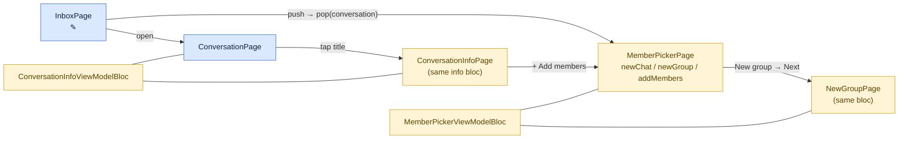
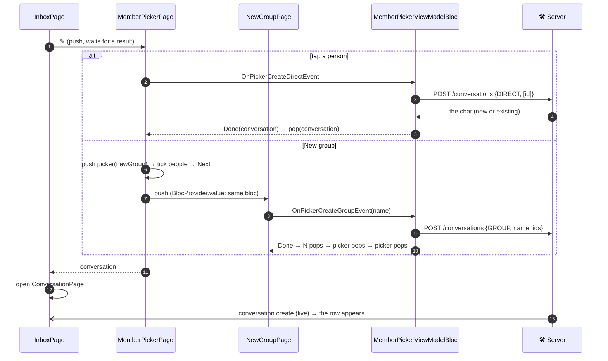

# Step 5.4 — Chat: new chats + groups

> ← Previous: [13-chat-realtime.md](13-chat-realtime.md) · Next: [15-chat-attachments.md](15-chat-attachments.md) → · Roadmap: [README.md](README.md)

```
5.1 Inbox ✅ · 5.2 Conversation ✅ · 5.3 Realtime ✅
5.4 New chat + groups   picker · create · rename · add / remove · leave · delete   ← this lesson
5.5 Attachments · 5.6 Extras
```

Until now you could only use chats that already existed. Now: ✎ → pick a
person (or "New group") → chat. And a group has a **Chat info** page.

## 1. Why

This step teaches:

- **One screen, several jobs**: the same picker makes a 1-to-1 chat, a
  group, or adds members (a `mode` + one BLoC).
- **Pages that return a result**: `Navigator.pop(conversation)` → the inbox
  opens it.
- **Sharing one BLoC between two pages** (`BlocProvider.value`): the chat's
  title and its info page show the same live name and members.
- **"Gone" as a state**: left / deleted / removed → the chat closes itself.



## 2. Picture

### The backend (read from `ConversationService`)

| Need | Endpoint | Rules |
|---|---|---|
| People | `GET /users?page&pageSize` | Open to every logged-in user. ⚠ `search` is **ignored** (paginate only). |
| New chat | `POST /chats/conversations` `{type, memberIds, name?}` | The server adds **me** (as ADMIN). DIRECT with someone I already chat with → returns the **existing** one. GROUP needs ≥ 2 members (with me). |
| Rename | `PATCH …/{id}` `{name}` | admin |
| Add | `POST …/{id}/members` `{memberIds}` | admin, groups only |
| Remove / leave | `DELETE …/{id}/members/{userId}` | myself = leave (anyone); others = admin |
| Delete | `DELETE …/{id}` | group: admin · direct: either person |

### The flows



### Screens

```
New chat                     New group (picker)            New group (name)
┌ ← New chat ──────────┐     ┌ ← New group        Next┐    ┌ ← New group ─────────┐
│ 🔍 Search by name…    │     │ 🔍 Search…             │    │        (👥)           │
│ 👥 New group          │     │ (DS)ⓧ (JD)ⓧ            │    │ Group name            │
│ (DS) Dara Sok         │     │ (DS) Dara Sok      ✓   │    │ [ Team ERP          ] │
│ (JD) Jane Doe         │     │ (JD) Jane Doe      ✓   │    │ [   Create group    ] │
│ (SC) Sok Chan         │     │ (SC) Sok Chan      ◯   │    │ 3 members (with you)  │
└───────────────────────┘     └────────────────────────┘    └───────────────────────┘

Chat info (admin)
┌ ← Chat info ──────────────────┐
│          (TE)                  │
│       Team ERP  ✎              │
│   Group · 3 members            │
│ 👤+ Add members                │
│ 3 members                      │
│ (VK) You              [Admin]  │
│ (DS) Dara Sok              ⊖   │
│ (JD) Jane Doe              ⊖   │
│ ─────────────────────────────  │
│ ⎋ Leave group           (red)  │
│ 🗑 Delete group          (red)  │
└────────────────────────────────┘
```

### Files

```
lib/core/network/api_endpoints.dart          + users, conversationMembers(id), conversationMember(id, userId)
lib/features/chat/
├── model/contact_model.dart                 NEW  a person from GET /users (+ matches(query))
├── repository/chat_repository.dart          + loadContacts · createDirect · createGroup · rename
│                                              · addMembers · removeMember · leave · deleteConversation
├── viewmodel/member_picker/                 NEW  load all · search · select · 3 jobs
├── viewmodel/conversation_info/             NEW  current conversation · actions · live · Gone
├── view/member_picker_page.dart             NEW  + enum MemberPickerMode
├── view/new_group_page.dart                 NEW  the name step
├── view/conversation_info_page.dart         NEW
├── view/conversation_page.dart              + info bloc, tappable title, closes when Gone
├── view/inbox_page.dart                     + ✎ button, _open / _startNewChat
└── widgets/  contact_tile · contact_list · picker_search_field · picker_new_group_tile
              selected_contacts_bar · new_group_form · inbox_new_chat_button
              member_tile · conversation_info_header · conversation_info_action_tile
              conversation_rename_sheet                                    (all NEW)
```

## 3. Code

### Search on the phone, so load everyone

The server ignores `search`, so the picker loads **every page** (100 per
page, up to 50 pages) and filters on the phone:

```dart
while (hasMore && page <= maxPages) {
  final result = await _repository.loadContacts(page: page);
  // page 1 shows at once; later pages are appended, keeping query + selection
}

bool matches(String query) =>               // ContactModel
    displayName.toLowerCase().contains(q) || email.toLowerCase().contains(q);
```

Me, disabled accounts and people already in the group (`excludeIds`) are
never shown.

### One picker, three jobs

```dart
enum MemberPickerMode { newChat, newGroup, addMembers }
```

| Mode | Tap a row | Top-right button | Result |
|---|---|---|---|
| `newChat` | `createDirect` | — ("New group" row on top) | the chat |
| `newGroup` | tick | **Next** → `NewGroupPage` | the new group |
| `addMembers` | tick | **Add (n)** → `addMembers` | the updated group |

### Pages that return a result

```dart
// InboxPage
final conversation = await ConfigRouter.pushPageAnimation<ConversationModel>(
  context, const MemberPickerPage());
if (conversation != null && context.mounted) await _open(context, conversation);
```

The picker closes with `Navigator.of(context).pop(state.conversation)` when the
bloc says `MemberPickerDoneState`.

**Two pages, one bloc, one listener.** `NewGroupPage` shares the picker's
bloc (`BlocProvider.value`). Both pages listen for `Done`, so only the page
**on top** may react:

```dart
listenWhen: (p, c) => c is MemberPickerDoneState && (ModalRoute.of(context)?.isCurrent ?? false),
```

Without that check, both pages would pop at once (two pops for one Done).

### `ConversationInfoViewModelBloc`: the current conversation

`ConversationPage` creates it next to the messages bloc
(`MultiBlocProvider`). Three things read it:

| Who | What |
|---|---|
| The chat's app bar title | name + avatar, live |
| `MessageList` | `members` (a new member's name shows in group bubbles) |
| `ConversationInfoPage` | everything + actions (`BlocProvider.value`) |

It listens to **two** live streams: the conversation topic
(`conversation.update`: renamed, members changed) and **my inbox queue**
(`conversation.remove`: the server sends "you were removed / it was deleted"
only there).

### "Gone" closes the chat

```dart
sealed ConversationInfoViewModelState
├── Ready(conversation, isBusy)
├── Failed(conversation, error)     → snackbar (e.g. 403 "Admin role required")
└── Gone(conversation, reason)      → left · deleted · removed
```

`ConversationPage` listens for `Gone`, closes everything above the inbox
(`popUntil(isFirst)`), and says why:

| reason | Snackbar |
|---|---|
| `left` | ✅ "You left “Team ERP”." |
| `deleted` | ✅ "“Team ERP” was deleted." |
| `removed` | ⚠ "You are no longer in “Team ERP”." |

"Removed" is found two ways: a live `conversation.update` whose members no
longer include me, or `conversation.remove` in my inbox queue.

### Admin buttons

```dart
bool get isAdmin => conversation.members.any((m) => m.userId == myId && m.role == MemberRole.admin);
```

It only **hides** buttons. The server still checks; a 403 becomes `Failed`
→ snackbar.

## 4. 🤔 Why like this? (other ways)

| Choice we made | Other way | Why we didn't pick the other way |
|---|---|---|
| Search on the phone, load all pages | Send `search` to the server | The server ignores it today. Fine for hundreds of people; ask the backend for real search later. |
| One picker with `mode` | 3 picker pages | Same list, search and selection; only the button differs. |
| Group name = a second page | A dialog after ticking | Room for the name, the people, and a big Create button; works with the keyboard. |
| Name required | Optional name | A group called "Group" is hard to find in the inbox. |
| Info bloc owned by the chat page | The info page makes its own bloc | The title wouldn't see a rename; two copies of the truth. |
| `Gone` state closes the chat | Each page checks after its own action | A live remove (someone else did it) must close it too: one place. |
| Hide admin buttons, server still checks | Trust the hidden buttons | The UI can be stale; the server is the real guard. |
| Picker returns the chat (`pop(result)`) | The picker opens the chat itself | The inbox owns "what's open" (unread rule from 5.3). |

**For the backend team:** `GET /users?search=` is ignored
(`UserService.list`, "paginate only").

## 5. Try it

```bash
flutter test                                    # 166 tests → All tests passed!
flutter run --flavor dev -t lib/main_dev.dart
```

1. Inbox → **✎** → the picker loads people (no you, no disabled accounts).
2. Type "dar" → only matching names / emails.
3. Tap a person you already chat with → the **existing** chat opens (no
   duplicate in the inbox).
4. ✎ → **New group** → tick 2 people → **Next** → name "Test" → **Create
   group** → the group opens; it appears in your inbox and in theirs (live).
5. Tap the chat's title → **Chat info**: ✎ rename → the title changes on
   both phones.
6. **+ Add members** → only people not in the group → tick → Add (1).
7. ⊖ a member → "Remove Dara?" → on Dara's phone the chat closes with
   "You are no longer in “Test”".
8. On another member's phone: **Leave group** → back in the inbox, ✅ "You
   left “Test”", the row is gone.
9. As admin: **Delete group** → everyone's chat closes / disappears.
10. A non-admin doesn't see ✎ / Add / ⊖ / Delete group.

## 6. Check yourself

1. Why does the picker load every page instead of searching on the server?
2. `NewGroupPage` and the picker share a bloc. Why does each listener check
   `ModalRoute.of(context)?.isCurrent`?
3. Why is the info bloc created by `ConversationPage` and not by the info
   page?
4. Someone else removes you from a group while you're reading it. Which
   live event(s) tell the app, and what happens on screen?
5. The ⊖ button is hidden for non-admins. Is that enough to stop them?

<details><summary>Answers</summary>

1. The server ignores `search` (`UserService.list` only paginates). To
   search we need everyone on the phone.
2. Both pages get `Done`. Without the check, both would call `pop` → two
   pages close for one result (and the wrong page gets it).
3. The chat's title and message names must change when the group changes.
   One bloc = one truth, shared by both pages with `BlocProvider.value`.
4. `conversation.update` on the topic (members without me) and/or
   `conversation.remove` on my inbox queue → `Gone(removed)` → the chat
   closes and a ⚠ snackbar says "You are no longer in …".
5. No. Hiding is for a clean UI. The server checks `requireAdmin` and answers
   403, which the app shows as a snackbar.

</details>
