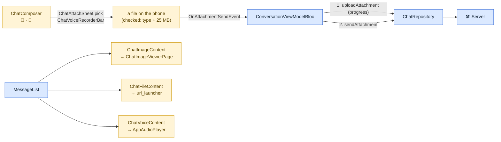
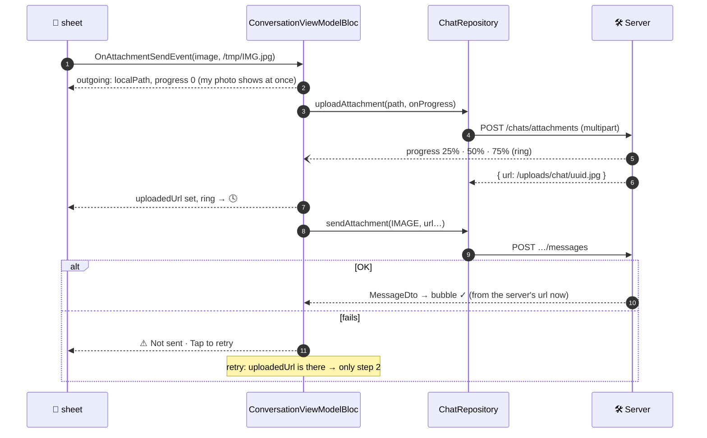

# Step 5.5 — Chat: attachments (photo · PDF · voice)

> ← Previous: [14-chat-groups.md](14-chat-groups.md) · Next: [16-chat-typing.md](16-chat-typing.md) → · Roadmap: [README.md](README.md)

```
5.1 Inbox ✅ · 5.2 Conversation ✅ · 5.3 Realtime ✅ · 5.4 Groups ✅
5.5 Attachments   photo · PDF · voice: upload, progress, retry, play   ← this lesson
5.6 Extras
```

📎 → a photo or a PDF. 🎤 → a voice note. Each one shows **at once** with
an upload ring, and plays / opens on the other phone.

## 1. Why

This step teaches:

- **Two requests for one message**: upload the file, then send a message
  that points to it.
- **Optimistic UI with progress**: your own file is drawn from the phone while
  it uploads (◔ 62%).
- **A smart retry**: if the upload already worked, a retry only re-sends
  step 2.
- **Device features in the UI, work in the BLoC**: picking and recording
  open system screens (they need a context); uploading is the bloc's job.
- **One shared player**: only one voice message plays at a time.



## 2. Picture

### The backend (read from `ChatAttachmentService` + `application.yml`)

```
1. POST /api/v1/chats/attachments   multipart "file"   → { url, contentType, sizeBytes }
2. POST /chats/conversations/{id}/messages
        { type, attachmentUrl, attachmentContentType, attachmentSizeBytes, durationSeconds? }
```

| Rule | So we… |
|---|---|
| Max 25 MB | check BEFORE uploading (`AttachmentRules.problem`) |
| Images: jpeg · png · webp · gif · heic | send photos as JPEG (image_picker, quality 80) |
| Audio: mpeg · mp4 · aac · ogg · wav | record AAC in `.m4a` → `audio/mp4` |
| Documents: **PDF only** | the file picker only offers `.pdf` |
| VOICE needs `durationSeconds` | send the recorded length |
| No original file name kept (`uuid.pdf`) | the bubble says "PDF document · 1.2 MB" |

### A photo, end to end



### Screens

```
(📎) ┌ Message… ─────────┐  (🎤)        🔴 0:07  ▁▃▅▂▆▃▁       ✕   (➤)
       📎 → Camera · Photo library · PDF document

┌──────────────┐   ┌─────────────────────────┐   ┌──────────────────────────┐
│   [photo]    │   │ [📄] PDF document        │   │ (▶)  ━━━━━━○─────  0:12 │
│     ◔ 62%    │   │      1.2 MB · Tap to open│   └──────────────── 10:42 ✓┘
└──────── 10:42┘   └──────────────── 10:42 ✓✓┘
 tap → full screen (pinch to zoom)
```

### Files

```
pubspec.yaml                                   + file_picker (MIT), url_launcher (BSD-3)
android/app/src/main/AndroidManifest.xml       + <queries> VIEW http/https (open PDFs)
lib/core/network/app_service.dart              + onSendProgress
lib/core/network/api_endpoints.dart            + chatAttachments
lib/core/audio/app_audio_player.dart           NEW  one player, ValueNotifier<AudioPlayback>
lib/features/chat/
├── model/chat_attachment.dart                 NEW  ChatAttachmentModel + AttachmentRules
├── model/outgoing_message.dart                + type, localPath, progress, uploadedUrl, …
├── repository/chat_repository.dart            + uploadAttachment · sendAttachment
├── viewmodel/conversation/                    + OnAttachmentSendEvent, upload → send, smart retry
├── view/chat_image_viewer_page.dart           NEW  full screen, pinch to zoom
├── view/conversation_page.dart                composer callbacks, stop audio on leave
└── widgets/  chat_attach_sheet · chat_voice_recorder_bar · chat_composer (📎 / 🎤)
              chat_image_content · chat_file_content · chat_voice_content
              message_bubble (+ media / body) · message_list
```

## 3. Code

### Check on the phone first

```dart
abstract final class AttachmentRules {
  static const int maxBytes = 25 * 1024 * 1024;
  static String? contentTypeFor(String fileName) => switch (ext) { 'jpg' => 'image/jpeg', 'm4a' => 'audio/mp4', 'pdf' => 'application/pdf', … _ => null };
  static String? problem({required String fileName, required int sizeBytes}); // null = OK
}
```

The server's rules, in **one** place. A 30 MB PDF gets "The file is 30.0 MB.
The limit is 25.0 MB." at once, not a 400 after a long upload.

### Upload with progress

```dart
// AppService.send(... onSendProgress: (sent, total) => ...)   ← dio's callback
final upload = await _repository.uploadAttachment(path, onProgress: (p) {
  if (percent - shown < 5 && percent < 100) return;   // redraw every 5 %, not every packet
  _updateOutgoing(emit, current.copyWith(progress: p));
});
```

`emit` may be called from the callback because the handler is still running
(it's waiting on the upload). `_updateOutgoing` always reads the **latest**
state and only changes that one bubble.

### The smart retry

```dart
if (current.uploadedUrl == null) { /* upload, then save uploadedUrl in the bubble */ }
result = await _repository.sendAttachment(..., attachment: ChatAttachmentModel(url: current.uploadedUrl!, ...));
```

Retry = the same `_deliver`. A bubble that already has `uploadedUrl` skips
step 1. A test checks the upload runs **once** for upload-OK + send-fail +
retry.

### The echo (5.3) for files

My own `message.send` echo can come before the HTTP answer. Text was matched
by **text**; a file has no text, so it's matched by **`uploadedUrl` ==
`attachmentUrl`**.

### Bubbles: `media` and `body`

```dart
MessageBubble(media: ChatImageContent(...))   // photo fills the bubble, time on a dark pill
MessageBubble(body: ChatFileContent(...))     // a row instead of the text
MessageBubble(body: ChatVoiceContent(...))
```

| Detail | Why |
|---|---|
| Photo ≤ 260 × 320, keeps its shape | The server doesn't tell us the size; a cap keeps the chat tidy. |
| A square placeholder until the first frame | A local image has **no size** before it loads → the bubble was 0×0 (found in the render check). |
| White time on a 45% black pill | Readable on any photo, light or dark mode. |
| `Image.file` while sending, `CachedNetworkImage` after | My photo shows at once; others' photos are cached like avatars. |

### Voice: record in the UI, play with one player

- `ChatVoiceRecorderBar` (`record`): asks for the microphone, records AAC
  mono 64 kbps (~0.5 MB/min), shows the time + a level meter, ✕ deletes, ➤
  sends. < 1 s = a mis-tap → thrown away. Stops itself at 10 min.
- `AppAudioPlayer` (`just_audio`, in `core/`): `toggle(key, source)`. A new
  key stops the old sound. Widgets listen to `playback` (a `ValueNotifier`)
  for ▶/⏸ and the progress. The chat page stops it when you leave
  (`PopScope`).

### PDF: open outside the app

```dart
launchUrl(Uri.parse(url), mode: LaunchMode.externalApplication);
```

`/uploads/**` is public on the backend (no token). Android 11+ needs the
`<queries>` VIEW entries in the manifest.

## 4. 🤔 Why like this? (other ways)

| Choice we made | Other way | Why we didn't pick the other way |
|---|---|---|
| Upload, then message | Send the file inside the message request | That's the backend's API; it also lets a retry skip the upload. |
| Optimistic bubble with the local file | Wait for the upload, then show | A 5 s upload with nothing on screen feels broken. |
| `uploadedUrl` remembered in the bubble | Retry = start again | Re-uploading a 20 MB file because one small request failed wastes data. |
| Check size/type on the phone | Let the server answer 400 | Faster, clearer, and no wasted upload. |
| JPEG 80, max 1600 px | Send the original | ~10× smaller, still sharp on a phone. |
| Tap 🎤 to record | Hold to record | Easier, accessible, no "hold while talking" for long notes. |
| One `AppAudioPlayer` | A player per bubble | Two voices at once; many native players use memory. |
| Open PDFs outside | An in-app PDF viewer package | One less big package; the phone's viewer is good. |

**For the backend team:** (1) Office files (docx / xlsx) are rejected
today; (2) the original file name isn't stored, so the bubble can't say
"Report.pdf".

## 5. Try it

```bash
flutter pub get
flutter test                                    # 177 tests → All tests passed!
flutter run --flavor dev -t lib/main_dev.dart
```

1. Open a chat → 📎 → **Photo library** → pick a photo → it appears at once
   with ◔ % → ✓. The other phone gets it live. Tap it → full screen, pinch.
2. 📎 → **PDF document** → "PDF document · 1.2 MB" → tap → it opens.
3. Try a PDF over 25 MB → a warning, nothing uploaded.
4. Tap 🎤 (first time: allow the microphone) → talk 5 s → ➤ → a voice bubble.
   On the other phone: ▶ plays, the time counts up. Start another voice →
   the first one stops.
5. Airplane mode → send a photo → ⚠ "Not sent". Wi-Fi on → tap → it goes.
   (If it failed after uploading, the log shows only the message request.)
6. Tap 🎤 and ➤ at once (< 1 s) → nothing is sent.
7. The inbox preview says "📷 Photo", "📎 File", "🎤 Voice message".

## 6. Check yourself

1. Why does sending a photo need two requests?
2. A photo uploaded fine, but the message request failed. What does Retry
   send, and how does the bloc know?
3. Why can the progress callback call `emit`?
4. Why did the photo bubble show nothing at first, and what fixed it?
5. Why is there only one `AppAudioPlayer`?

<details><summary>Answers</summary>

1. The backend stores files at `POST /chats/attachments` and gives back a
   `url`. The message only points to that `url`.
2. Only the message (step 2). The bubble kept `uploadedUrl` after the
   upload, and `_deliver` skips the upload when it's set.
3. The handler is still running: it's awaiting the upload. `emit` is valid
   until the handler finishes (`emit.isDone` guards the rest).
4. `Image.file` has no size before its first frame, so the bubble was 0×0.
   `frameBuilder` shows the square placeholder until a frame is ready.
5. So starting a voice message stops the one that was playing (like every
   chat app), and we don't keep many native players in memory.

</details>
