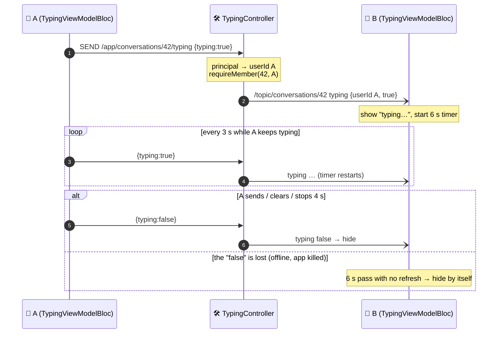

# Step 5.6 (part) — Chat: "typing…" (backend + app)

> ← Previous: [15-chat-attachments.md](15-chat-attachments.md) · Roadmap: [README.md](README.md)

The other person sees **"typing…"** (or **"Dara is typing…"** in a group)
under the chat title while you type.

This step changes **both** repos: the backend had no typing support, so we
added it (`erp_java_backend_claude`), then used it in the app.

## 1. Why

Until now the socket only **received**. Typing is the first thing the phone
**sends** over STOMP:

```
A types…  ──SEND /app/conversations/42/typing {typing:true}──►  server
                                                                  │ checks: A is a member
server ──► /topic/conversations/42  {event:"typing", payload:{userId: A, typing:true}} ──► B
```

It teaches:

- **SEND vs SUBSCRIBE**: `/app/...` goes to a server **handler**
  (`@MessageMapping`); `/topic/...` is a broadcast address.
- **Never trust the phone for "who"**: the server takes the user from the
  token (the STOMP principal), not from the body.
- **Live signals need timers on both sides**: a lost "stopped typing" must
  not leave "typing…" on screen forever.



## 2. Picture

```
┌ ←  (JD) Jane Doe ─────────┐        ┌ ←  (TE) Team ERP ─────────────┐
│        typing…            │        │    Dara and Jane are typing…  │
```

| Who types | Line under the title |
|---|---|
| direct chat | `typing…` |
| group, 1 | `Dara is typing…` |
| group, 2 | `Dara and Jane are typing…` |
| group, 3+ | `3 people are typing…` |
| nobody | group: `5 members` · direct: nothing |

### Files

```
BACKEND (erp_java_backend_claude)
src/main/java/.../chats/dto/TypingRequest.java        NEW  record TypingRequest(boolean typing)
src/main/java/.../chats/ws/TypingController.java      NEW  @MessageMapping("/conversations/{id}/typing")
src/main/java/.../chats/ws/WebSocketConfig.java       comment: the SEND destination
src/test/java/.../chats/ws/TypingControllerTest.java  NEW  4 tests
README.md                                              the new SEND destination

APP (erp_flutter_claude)
lib/core/realtime/stomp_connection.dart               + send(destination, body)
lib/core/realtime/realtime_service.dart               + send(destination, Map) — only while connected
lib/core/network/api_endpoints.dart                   + typingDestination(id)
lib/features/chat/model/chat_update.dart              + TypingChanged
lib/features/chat/repository/chat_repository.dart     + sendTyping(id, typing:)
lib/features/chat/viewmodel/typing/                   NEW  TypingViewModelBloc (in + out)
lib/features/chat/widgets/conversation_app_bar_title.dart  + typingNames, typingLabel()
lib/features/chat/widgets/chat_composer.dart          + onTextChanged
lib/features/chat/view/conversation_page.dart         provides the bloc, wires title + composer
API_LIST_BACKEND.md                                    §12 "Send (client → server)"
```

## 3. Code

### Backend: `TypingController`

```java
@MessageMapping("/conversations/{conversationId}/typing")   // client SENDs to /app/conversations/42/typing
public void typing(@DestinationVariable Long conversationId,
                   @Payload(required = false) TypingRequest body,
                   Principal principal) {
    if (principal == null) return;                          // no valid token on CONNECT
    Long userId = Long.valueOf(principal.getName());        // WHO = the token's user
    try { conversations.requireMember(conversationId, userId); }
    catch (RuntimeException notMember) { return; }          // silently ignore
    broadcaster.toConversation(conversationId, "typing",
        Map.of("conversationId", conversationId, "userId", userId, "typing", typing));
}
```

| Line | Why |
|---|---|
| `/app` prefix | `WebSocketConfig.setApplicationDestinationPrefixes("/app")`: these go to `@MessageMapping` methods, not to subscribers. |
| `Principal` | `StompAuthChannelInterceptor` set it from the token on CONNECT; `getName()` = the user id. The phone can't fake it. |
| `requireMember` | Only members can say "typing" in a chat. |
| Ignore, don't throw | An exception here would send a STOMP ERROR frame and may close the socket — too harsh for a cosmetic signal. |
| Nothing stored | Typing is a live signal; the clients' timers clean up. |

Tests (`TypingControllerTest`): member → broadcast with the session user id;
`false` is broadcast too; non-member → nothing; anonymous → nothing.

### App: the socket can SEND now

```dart
// RealtimeService
bool send(String destination, Map<String, Object?> body) {
  final connection = _connection;
  if (connection == null) return false;   // offline → drop it (a late "typing" is useless)
  connection.send(destination, jsonEncode(body));
  return true;
}
```

### App: `TypingViewModelBloc`, out and in

| Direction | Rule | Why |
|---|---|---|
| out | send `true` at most every **3 s** while the text changes | One frame per key would flood the server. |
| out | send `false` after **4 s** without changes, when the box is cleared, when the message is sent, or when the chat closes | So "typing…" goes away fast and right. |
| in | `true` → show them and (re)start a **6 s** timer | 6 s > 3 s re-send, so it doesn't flicker while they type. |
| in | `false`, their message arrives, or the timer ends → hide | A lost `false` fixes itself. |
| in | ignore **me** and other chats | The server sends to everyone in the topic, me too. |

The timers live in the bloc (not widgets), and the durations are constructor
parameters so tests can use 40 ms instead of seconds.

### Why a separate bloc?

`ConversationViewModelBloc` holds the messages. Typing changes every few
seconds; keeping it apart means the message list never rebuilds for it, and
the rules are tested on their own.

## 4. 🤔 Why like this? (other ways)

| Choice we made | Other way | Why we didn't pick the other way |
|---|---|---|
| A backend `@MessageMapping` | The phone SENDs straight to `/topic/...` | Works with Spring's defaults, but the phone writes `userId` (fake-able) and anyone could post to any chat. |
| Over STOMP | A REST `POST /typing` | A new HTTP request every 3 s is heavy; the socket is already open. |
| Re-send + expire | One `true`, one `false` | If the `false` is lost, "typing…" would stay forever. |
| Drop when offline | Queue and send later | "Typing" 30 s late is wrong information. |
| Show it in the title | A "•••" bubble in the list | Works even when you've scrolled up; no list rebuild. |

## 5. Try it

```bash
# backend: restart it (the new controller must be loaded)
cd ~/Documents/call_erp/erp_java_backend_claude && ./gradlew test    # all green
./gradlew bootRun

# app
flutter test                                    # 187 tests → All tests passed!
flutter run --flavor dev -t lib/main_dev.dart
```

1. Two phones in the same direct chat. A types → B's title: **typing…**
2. A stops typing → after ~4 s it's gone on B.
3. A types and sends → it disappears at once and the bubble arrives.
4. A group with 3 people: two type → "Dara and Jane are typing…".
5. A types, then turns on airplane mode → on B it disappears after ~6 s.

## 6. Check yourself

1. What's the difference between sending to `/app/...` and to `/topic/...`?
2. Why does the server take the user id from the `Principal`, not the body?
3. Why does the app re-send `typing: true` every 3 s, and expire after 6 s?
4. Why is a typing frame dropped (not queued) when the socket is down?
5. Why does the controller ignore a non-member instead of throwing?

<details><summary>Answers</summary>

1. `/app/...` goes to a server handler (`@MessageMapping`) that can check and
   decide; `/topic/...` is a broadcast address that subscribers receive.
2. The body is written by the phone and can be faked. The principal comes
   from the token checked on CONNECT.
3. So a lost `false` (offline, killed app) can't leave "typing…" forever: if
   no refresh arrives within 6 s, the other phone hides it. 6 > 3, so it
   doesn't flicker while someone really types.
4. "Typing" is only true *now*. Delivered later, it would be wrong.
5. A thrown exception becomes a STOMP ERROR frame, which can close the
   socket — far too harsh for a cosmetic signal.

</details>
