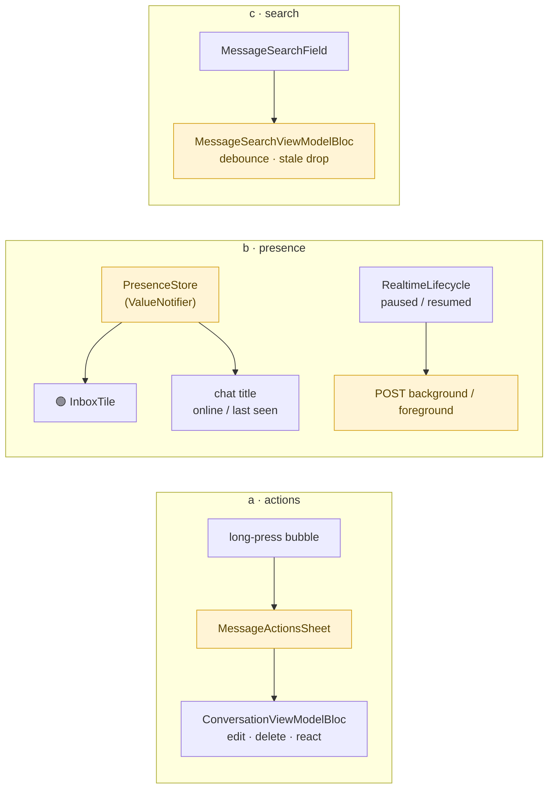

# Step 5.6 — Chat extras: message actions · online status · search

> ← Previous: [16-chat-typing.md](16-chat-typing.md) · Next: [18-call-signalling.md](18-call-signalling.md) → · Roadmap: [README.md](README.md)

```
5.6 typing ✅ (16)
5.6 a  message actions   long-press → react · copy · edit · seen by · delete   ← this lesson
5.6 b  online status     🟢 dot · "online" / "last seen 10:42" · background beacons
5.6 c  search            🔍 in a chat → results with the match in bold
```

The last chat step. After it, chat is done and Step 6 (calls) starts.

## 1. Why

| Part | New idea |
|---|---|
| a | **Optimistic with rollback** (reactions), an **edit mode** owned by the bloc, a one-shot **ActionFailed** state for snackbars |
| b | One **app-wide store** shared by two screens; **lifecycle beacons** that prepare calls |
| c | **Debounce** + **dropping stale answers** — the two rules of every search box |



## 2. Picture

### The backend (read from `MessageController`, `PresenceController`)

| Feature | Endpoint / event | Rules |
|---|---|---|
| Edit | `PATCH /chats/messages/{id}` `{body}` → live `message.edit` | own · TEXT · within **15 min** |
| Delete | `DELETE /chats/messages/{id}` → live `message.delete` | own. History **leaves deleted messages out** → we remove them too |
| React | `POST /chats/messages/{id}/reactions` `{emoji}` = toggle → live `reaction.toggle {messageId, reactions}` | several emoji per person |
| Presence | `GET /chats/presence?ids=…` · `/topic/presence` `presence.update` | ONLINE · BUSY (call) · OFFLINE + `lastSeenAt` |
| Beacons | `POST /chats/presence/background` · `/foreground` | a minimized phone = OFFLINE **at once** → calls ring it by push (Steps 6–7) |
| Search | `GET …/{id}/messages/search?q&page&pageSize` | case-insensitive, newest first |

### Screens

```
long-press                          chat                               search
┌──────────────────────────┐   ┌ ← (JD)🟢 Jane Doe          🔍 ┐   ┌ ← [Search messages ✕]┐
│ 👍 ❤️ 😂 😮 😢 🙏         │   │         online                 │   │ (JD) Jane Doe  12 Nov │
├──────────────────────────┤   │ ┌──────────────────┐           │   │  **Meet**ing tomorrow?│
│ ⧉ Copy                   │   │ │ Meeting tomorrow?│           │   └───────────────────────┘
│ ✎ Edit                   │   │ └──── edited 10:41┘           │
│ ✓✓ Seen by Jane          │   │  (😂)                          │
│ 🗑 Delete          (red) │   │        ┌──────────────┐        │
└──────────────────────────┘   │        │ See you at 9 │        │
                               │        └──────── 10:42 ✓✓┘     │
                               │                 (👍 2)(❤️)      │
                               ├────────────────────────────────┤
                               │ ✎ Editing message           ✕  │  ← edit mode
                               │ (📎) [See you at 9      ]  (✓) │
                               └────────────────────────────────┘
```

### Files

```
lib/core/network/api_endpoints.dart        + message(id), messageReactions(id), messageSearch(id),
                                             presence, presenceBackground/Foreground, presenceTopic
lib/core/realtime/realtime_lifecycle.dart  + onBackground / onForeground (paused / resumed)
lib/core/di/injection.dart                 beacons → AppService
lib/core/utils/chat_time.dart              + lastSeen()
lib/features/chat/
├── model/presence_model.dart              NEW
├── model/chat_update.dart                 + ReactionsChanged
├── repository/chat_repository.dart        + editMessage · deleteMessage · toggleReaction
│                                            · searchMessages · loadPresence · presenceUpdates
├── repository/presence_store.dart         NEW  app-wide online status
├── viewmodel/conversation/                + edit mode, delete, reactions, ActionFailed, live delete/react
├── viewmodel/message_search/              NEW  debounce + stale drop + paging
├── viewmodel/inbox/ · conversation_info/  + presence.watch(...)
├── view/conversation_page.dart            🔍, long-press → sheet, edit mode, presence line
├── view/conversation_search_page.dart     NEW
└── widgets/  message_actions_sheet · reaction_chips · presence_dot
              message_search_field · message_search_tile               (NEW)
              message_bubble (+ footer, onLongPress) · message_list · chat_composer (edit mode)
              inbox_tile / inbox_list (+ dot) · conversation_app_bar_title (+ presence line)
```

## 3. Code

### a · Reactions: optimistic with rollback

```dart
_emitData(emit, _withReactions(data, id, flipped));            // 1. at once
final result = await _repository.toggleReaction(id, emoji);    // 2. ask
result.fold(
  (error) => emit(ConversationActionFailedState(error: error,
                lastData: _withReactions(now, id, before))),   // 3a. put back + snackbar
  (server) => _emitData(emit, _withReactions(now, id, server)) // 3b. the server's list wins
);
```

The server returns the **full** list, so even if two people tap at the same
time, the final list is right. The live `reaction.toggle` updates everyone
else.

### a · Edit mode lives in the bloc

```dart
final MessageModel? editing;   // in ConversationLoadedState
```

`OnMessageEditStartEvent` → `editing` set → the composer shows "✎ Editing
message ✕", fills the box (in `didUpdateWidget`) and ➤ becomes ✓. Submit →
the banner closes at once → `PATCH` → the server's copy replaces the bubble
(keeping its ✓✓, which edit events don't carry). Same text / empty → just
leave edit mode. `canEdit` (mine · TEXT · < 15 min) only **hides** the
button; the server's "Edit window has expired" still becomes a snackbar.

### a · `ConversationActionFailedState`

A failed edit / delete / reaction is a **one-time message**, not a page
error: the messages stay, a `BlocConsumer` listener shows `AppSnackBar`.
(A failed **load** is still `ConversationErrorState` with the banner.)

### a · Delete = disappear

The history query skips deleted messages (`…DeletedAtIsNull`). If we showed
"Message deleted" live, a reload would make it vanish — the screen would
change by itself. So a delete (mine, or live) removes the bubble.

### b · `PresenceStore`: one answer for the whole app

```dart
watch(['2', '5'])   // only ids not known yet → ONE GET
/topic/presence     // presence.update → change that person (if watched)
reconnected         // GET again for everyone watched
logout              // forget everything
```

It's a `ValueNotifier<Map<userId, PresenceModel>>` (like
`RealtimeService.status`), registered once in `chat_di`. The inbox bloc
watches the other person of every direct chat; the info bloc watches the
open chat's other person. Widgets listen:

```dart
PresenceDot(userId: other.userId, presence: store.presence)          // 🟢 / 🟠
presenceLine(presence[other.userId])   // "online" · "in a call" · "last seen 10:42"
```

Typing wins over presence in the title ("typing…" first).

### b · Beacons (ready for calls)

```dart
case AppLifecycleState.paused:  onBackground();   // POST /chats/presence/background
case AppLifecycleState.resumed: onForeground();   // POST /chats/presence/foreground (+ reconnectNow)
```

Without them, a minimized phone looks ONLINE for ~30 s (until heartbeats
fail), and the server would **not** ring it by push. Best effort: if the
request doesn't make it, the heartbeat catches up.

### c · Search: debounce + drop stale answers

```dart
// every key: restart a 350 ms timer → only the LAST text is searched
_timer = Timer(debounce, () => add(OnSearchRunEvent(query)));

// an answer for "mee" arriving after you typed "meet" → thrown away
if (event.query != _latest) return;
```

The match is highlighted by `MessageSearchTile.split(text, query)` → parts
`(text, isMatch)`, drawn with `Text.rich` (bold + `primaryContainer`).

## 4. 🤔 Why like this? (other ways)

| Choice we made | Other way | Why we didn't pick the other way |
|---|---|---|
| Reactions optimistic + rollback | Wait for the server | A tap should feel instant; rollback keeps it honest. |
| Edit state in the bloc | `TextEditingController` juggling in the page | One source of truth; testable; delete-while-editing just works. |
| `ActionFailed` state | Reuse the load `Error` state | A failed reaction must not show a "No Internet" banner over the chat. |
| Remove deleted messages | Show "Message deleted" | The history API hides them; the screen must not change on reload. |
| One `PresenceStore` | Presence inside each bloc | The inbox and the chat show the same person; one fetch, one stream. |
| `?ids=` batch | One request per person | 50 chats = 1 request, not 50. |
| Debounce 350 ms | Search on every key | "meeting" = 7 requests → 1. |
| Drop stale answers | Show whatever arrives | A slow "mee" answer would overwrite the "meet" results. |
| No "jump to message" (v1) | Load pages until found | Could load many pages; a later step can add an "around id" API. |

### Fixed after testing on two phones: the inbox preview

Editing "Hi" → "Hi Bin" changed the open chat, but the **other phone's
inbox** still said "Hi". The backend sent `message.edit` / `message.delete`
only to the conversation topic, and the inbox listens to
`/user/queue/inbox`.

| Side | Change |
|---|---|
| Backend `MessageController.edit / delete` | + `broadcaster.toUsers(memberIds, "inbox", "message.edit" / "message.delete", dto)` — the same fan-out as `send` (test: `MessageControllerInboxFanOutTest`) |
| App `InboxViewModelBloc` | `MessageChanged` for the chat's **last** message → edited: new preview · deleted: "Message deleted", then `GET /conversations/{id}` for the real last one (keeping our unread count). Older messages → ignored. The order doesn't change. |

## 5. Try it

```bash
flutter test                                    # 214 tests → All tests passed!
flutter run --flavor dev -t lib/main_dev.dart
```

**a** — long-press your message → 👍 → a chip appears under it (and on the
other phone). Tap the chip → gone. ✎ Edit → change → ✓ → "edited" on both
phones. 🗑 Delete → "Delete message?" → it disappears on both. A message older
than 15 min has no Edit. A group: "Seen by Dara, Jane".

**b** — inbox: a 🟢 dot on people who have the app open. Open a direct chat →
"online". Minimize the app on the other phone → "last seen just now" within
a second or two (the background beacon).

**c** — 🔍 in a chat → type "mee" → after a short pause the results, with
"mee" in bold. Clear → back to the hint.

## 6. Check yourself

1. A reaction tap fails (offline). What does the user see, step by step?
2. Why is "editing" in the bloc's state and not just in the composer?
3. Why does a deleted message disappear instead of showing "Message deleted"?
4. Why is `PresenceStore` one app-wide object instead of part of each bloc?
5. What do the background / foreground beacons have to do with calls?
6. Name the two rules of a search box, and what each one prevents.

<details><summary>Answers</summary>

1. The chip appears at once (optimistic) → the request fails → the old list
   comes back and a red snackbar says why (`ConversationActionFailedState`).
2. So one place decides: the banner, the filled box, ✓ instead of ➤, and
   "the message I was editing was deleted → leave edit mode" all follow from
   one field, and it can be tested without widgets.
3. The history API leaves deleted messages out. Showing a placeholder live
   would make it vanish on the next reload — the screen would change by
   itself.
4. The inbox and an open chat show the same person; one store = one fetch,
   one live subscription, one answer, and it's cleared on logout.
5. A minimized phone must count as OFFLINE at once so the server rings it by
   push (VoIP / FCM) instead of only over the (sleeping) socket.
6. Debounce (one request after typing pauses — prevents a request per key)
   and dropping stale answers (prevents a slow old answer from overwriting
   the newest results).

</details>
