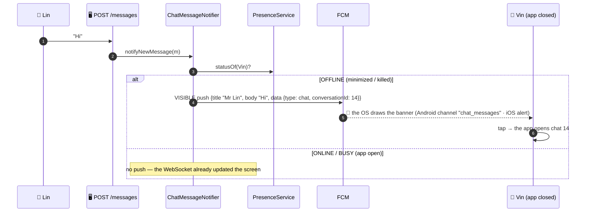
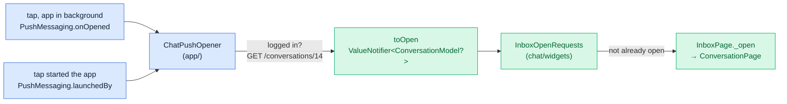

# Step 5.7 — Chat notifications (a banner when the app is closed)

> Branch **`feature/chat-notifications`** (app AND backend, from `feature/raw-websocket`).
> ← Previous: [17-chat-extras.md](17-chat-extras.md) · Uses: [24-push-setup.md](24-push-setup.md) · Roadmap: [README.md](README.md)

```
5.6 typing · actions · presence ✅
5.7 chat notifications                       ← this lesson
```

## 1. Why

When the app is **open**, a new message arrives on the live line (WebSocket)
and the screen updates. When the app is **minimized or killed**, the line is
gone, so the user saw nothing until they opened the app again.

The backend already sent a push for every message (`ChatMessageNotifier`),
but it was **data-only**, and the app ignored it (`call_push.dart`: "a chat
message push: not handled yet"). A data-only push shows nothing by itself,
and on iOS it often doesn't even wake the app.

This step teaches:

- **Visible vs data-only push.** A visible push has a `notification` part:
  the phone's OS draws the banner itself, even when the app is killed. The
  `data` still rides along for the tap.
- **Ask presence before you push.** Only an OFFLINE user gets a banner. If
  the app is open, the screen already updates live; a banner too would be
  noise.
- **A tap is a request.** The push layer doesn't open pages. It hands a
  conversation to the inbox, which opens it the normal way.

### Where a banner shows

| The app is… | Banner? | Who draws it |
|---|---|---|
| minimized / killed | ✅ | the OS (the backend's visible push) |
| open, on the **Chats list** | ✅ | the app: `AppMessageBanner` (the user's choice: the same as other screens) |
| open, on **another screen** (other chat, profile, call…) | ✅ | the app: `AppMessageBanner` |
| open, in **that chat** | ❌ | — (the message is right there) |

## 2. Picture





### Files

```
backend (erp_java_backend_claude)
features/devices/service/FcmService.java          + sendNotificationToTokens (VISIBLE), CHAT_CHANNEL_ID
features/chats/service/ChatMessageNotifier.java   only OFFLINE members · visible push · group "chat-<id>"
test: ChatMessageNotifierTest (+3 = 8)

app (erp_flutter_claude)
lib/core/push/push_messaging.dart            + onOpened · launchedBy()
lib/core/push/chat_notification_channel.dart NEW  the Android channel "chat_messages"
lib/app/chat_push.dart                       NEW  ChatPushOpener: tap → load the chat → toOpen
lib/features/chat/widgets/inbox_open_requests.dart NEW  the inbox takes the request ONCE
lib/features/chat/view/inbox_page.dart       + openRequests (skips the chat already open)
lib/features/chat/viewmodel/inbox/…bloc.dart + openConversationId getter
lib/features/chat/widgets/inbox_message_banners.dart NEW  app open, not on the inbox → banner
lib/core/widgets/app_message_banner.dart     NEW  the in-app banner (photo · name · text, tap)
lib/features/chat/viewmodel/inbox/…bloc.dart + incoming (news for the banner)
lib/app/app_di.dart · auth_gate.dart · main.dart   wiring
android/app/src/main/AndroidManifest.xml     default channel → chat_messages
test: test/app/chat_push_test.dart (5) · test/features/chat/inbox_open_requests_test.dart (3)
```

## 3. Code

### Backend: a visible push

```java
Message.builder()
    .setToken(token)
    .putAllData(data)                                    // for the tap
    .setAndroidConfig(AndroidConfig.builder()
        .setPriority(AndroidConfig.Priority.HIGH)
        .setNotification(AndroidNotification.builder()
            .setTitle(title).setBody(body)
            .setChannelId("chat_messages")              // the app made this channel
            .setTag(group)                              // "chat-14": newest replaces older
            .setSound("default").build())
        .build())
    .setApnsConfig(ApnsConfig.builder()
        .putHeader("apns-push-type", "alert")
        .setAps(Aps.builder()
            .setAlert(ApsAlert.builder().setTitle(title).setBody(body).build())
            .setSound("default")
            .setThreadId(group)                         // stacked per chat on iOS
            .build())
        .build())
    .build();
```

### Backend: who gets it

```java
List<Long> targetIds = members.findByConversation_Id(convId).stream()
        .filter(member -> !member.isMuted())                              // muted chat
        .map(ConversationMember::getUserId)
        .filter(id -> !id.equals(m.getSenderId()))                        // not me
        .filter(id -> presence.statusOf(id) == PresenceStatus.OFFLINE)    // 5.7: app not open
        .toList();
…
fcm.sendNotificationToTokens(tokens, title, body, data, "chat-" + convId);
```

A minimized app is OFFLINE at once, because the app sends
`POST /presence/background` (5.6). That's the same rule that makes a call
ring by push (7.2 / 7.3).

### App: the tap

```dart
// ChatPushOpener (app/)
void onTapped(Map<String, dynamic> data) {
  if (data['type'] != 'chat') return;          // calls have their own path
  _pending = '${data['conversationId']}';
  _tryOpen();
}

Future<void> _tryOpen() async {
  final id = _pending;
  if (id == null || !_session.isAuthenticated) return;   // cold start: wait for login
  _pending = null;
  (await _chat.loadConversation(id)).fold(
    (error) => debugPrint(…),                             // gone → stay on the inbox
    (conversation) => toOpen.value = conversation,
  );
}
```

```dart
// InboxPage — ONE goToChat for both taps (OS push and in-app banner)
void goToChat(ConversationModel conversation) {
  if (bloc.openConversationId == conversation.id) return;   // already on screen
  if (!(calls?.inCall.value ?? false)) {
    ConfigRouter.popToFirst(context);                        // ⑤ close Profile / other chat
  }
  _open(context, conversation);                              // ⑥ ConfigRouter.pushPageAnimation
}
```

**Where does the page open?** `ChatPushOpener` has no screen and no
`context`, so it only says WHICH chat. Its comment names the next stop, and
every page move goes through `ConfigRouter`, so a search for `ConfigRouter`
finds it:

```
tap ─► chat_push.dart (toOpen) ─► inbox_open_requests.dart ─► InboxPage goToChat
    ─► ConfigRouter.popToFirst ─► ConfigRouter.pushPageAnimation(ConversationPage)
```

**A race:** chat A is open, you tap a banner for chat B. `popToFirst` closes
A, and B opens at once. A's `_open` finishes its `await` LATER. If it sent
"nothing open" (`null`), B would count as closed (banners + unread inside B).
So a closing page sends `OnInboxConversationClosedEvent(A)`, and the bloc
clears it only if A is still the open chat.

`InboxOpenRequests` checks on every change AND on the first frame: on a cold
start the tap is known before the inbox exists (the splash comes first).

### App open: the in-app banner

The backend sends no push to an ONLINE user, so the app draws its own banner
from the live message. The inbox bloc already sees every new message
(`/user/queue/inbox`); it passes on only the ones worth a banner:

```dart
// InboxViewModelBloc, MessageArrived
if (!mine && !open && !mutedByMe && message.type != MessageType.call) {
  _incoming.add((conversation: updated, message: message));   // one-time news
}
```

The page only checks that the app is on screen:

```dart
// InboxMessageBanners
if (WidgetsBinding.instance.lifecycleState != AppLifecycleState.resumed) return; // OS push
AppMessageBanner.show(context, title: …, message: …, imageUrl: …,
                      onTap: () => openUnlessOpen(conversation));
```

The inbox page is the app's FIRST route and stays under every other page, so
its bloc hears every message, wherever you are. (A first version skipped the
banner while the Chats list was on top; the user wanted it there too.)

**Debug lines** (dev builds) say why a banner did or didn't show:
`[banner] msg 326 shown` · `skipped: app is paused` · `no news: mine=false open=true …` (the chat is open).

## 4. 🤔 Why like this? (other ways)

| Choice we made | Other way | Why we didn't pick the other way |
|---|---|---|
| Visible push (OS draws it) | Data-only + the app draws it with `flutter_local_notifications` | iOS doesn't reliably wake the app for data-only pushes (we saw it in the call-banner test); the OS-drawn banner also works when the app is killed |
| Only OFFLINE members | Push to everyone, hide it in the app | An open app gets a banner on top of the live update; iOS/Android would show it anyway in some states |
| `tag` / `thread-id` = `chat-<id>` | One notification per message | Ten messages from one chat = one banner (Android shows the newest), not ten |
| `ChatPushOpener` in `app/` | Open the page right in the push code | Push would import chat; `core/` must never import `features/`; the inbox already knows how to open a chat (marks it read, "back" refreshes) |
| A `ValueNotifier` the inbox takes once | A stream | A cold start's tap comes BEFORE the inbox exists; a stream would lose it, a value waits |
| In-app banner drawn by the app (`AppMessageBanner`) | A local system notification while open (`flutter_local_notifications`) | On iOS that plugin takes over the notification delegate and can break FCM's tap handling; an Overlay is the same on both systems and follows the theme |
| `incoming` as a stream on the bloc | A field in `InboxLoadedState` | It's one-time news, not screen state: a state field would need clearing, and `buildWhen` would rebuild the list for nothing |
| Its own Android channel "Messages" | The default channel | Users can mute chat banners without muting calls; high importance = pops up |

## 5. Try it

```bash
# backend
cd ~/Documents/call_erp/erp_java_backend_claude
./gradlew test --tests '*ChatMessageNotifier*'   # 8
./gradlew bootRun                                # restart: the new push

# app (a NEW build: the manifest and a new channel)
cd ~/Documents/call_erp/erp_flutter_claude
flutter test test/app/chat_push_test.dart test/features/chat/inbox_open_requests_test.dart
flutter run --flavor dev -t lib/main_dev.dart
```

| # | Do | Expect |
|---|---|---|
| 1 | B's app open **on the Chats list**; A sends "Hi" | 🔔 in-app banner + the chat moves to the top |
| 1b | B open on **another screen** (profile, another chat) | 🔔 in-app banner at the top; tap → that chat |
| 1c | B open **in that chat** | NO banner; the message appears in the chat |
| 2 | B **minimizes**; A sends "Hi" | 🔔 "Mr A · Hi" on B (Android + iPhone) |
| 3 | tap it | the app opens **that chat** |
| 4 | B **kills** the app; A sends "Hello"; tap | the app starts, then opens that chat |
| 5 | A sends 3 messages while B is minimized | Android: ONE banner (the newest); iOS: stacked as one group |
| 6 | B mutes the chat (if muted) | no banner |
| 7 | a group | title = the group name, body = "Mr A: Hi" |

Backend log:

```
[fcm] chat msg=310 conv=14 → users=[4] tokens=1
[fcm] sent NOTIFICATION type=chat to token=…abc123 id=projects/…
```

## 6. Check yourself

1. Why doesn't a data-only push show a banner, and why is it worse on iOS?
2. B has the app open on another chat. A sends a message. Does B get a banner? Why?
3. Why does `ChatPushOpener` wait for `isAuthenticated`?
4. The tap started the app. Why can't the inbox simply listen to a stream?
5. Why one Android channel just for chat?

<details><summary>Answers</summary>

1. Without a `notification` part, nothing tells the OS to draw anything: the
   app must do it. iOS often doesn't start the app for a data-only push, so
   nobody draws it.
2. No: B is ONLINE, so the backend skips B. The inbox (and the open chat,
   if it's that one) update live.
3. Loading the conversation needs the token. On a cold start the splash
   (auto-login) runs first; the request is kept until the session is open.
4. The tap is read at start-up, before the inbox is built. A stream would
   fire with nobody listening; a `ValueNotifier` keeps the value until the
   inbox takes it.
5. So the user can turn chat banners off (or change their sound) without
   touching calls, and so they pop up (high importance).

</details>
