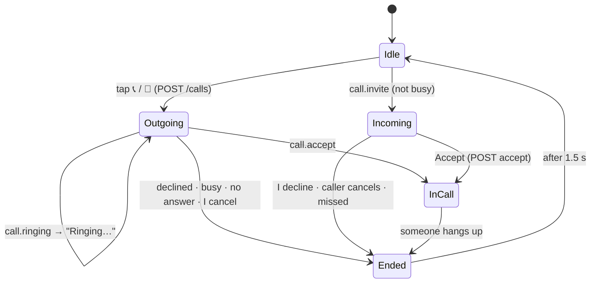
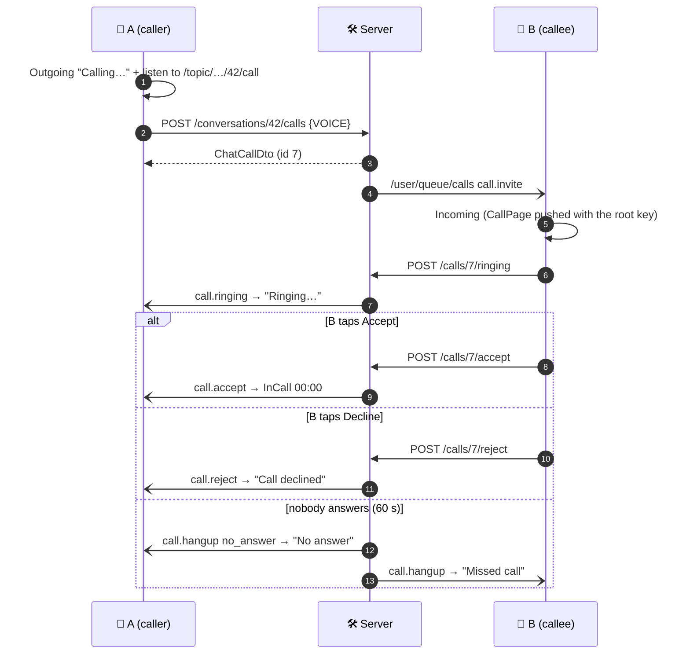

# Step 6.1 — Call: signalling (no sound yet)

> ← Previous: [17-chat-extras.md](17-chat-extras.md) · Roadmap: [README.md](README.md)

```
6.1 signalling   📞 → Calling… → Ringing… → Accept / Decline → in call → ended   ← this lesson
6.2 voice + video (Stream Video)
6.3 polish (sounds, call line in the chat, group calls, reconnecting)
```

A call has two parts:

| Part | Who does it | Step |
|---|---|---|
| **Signalling**: who calls whom, ringing, accept, decline, hang up | OUR backend (REST + STOMP) | **6.1** |
| **Media**: the sound and the picture | Stream Video (`streamCallCid`) | 6.2 |

We build the signalling first. It's the hard part (two phones, timing, many
ways to end), and you can test it on two phones without any sound.

## 1. Why

This step teaches:

- **A state machine**: a call is always in exactly ONE phase, and only some
  moves are allowed.
- **One app-wide bloc**: a call lives longer than any page, and an invite can
  come on any screen.
- **Two features that don't know each other**: chat starts calls, call shows
  names, and only `app/` connects them.
- **Every way a call can end** gets its own words ("Call declined", "Busy in
  another call", "No answer", "Call cancelled", "Missed call"…).



## 2. Picture

### The backend (read from `ChatCallController`, `ChatCallService`)

| I do | Request | Everyone hears (STOMP) |
|---|---|---|
| Start | `POST /chats/conversations/{id}/calls {type}` | `call.invite` → each callee's `/user/queue/calls` |
| My phone shows it | `POST /chats/calls/{id}/ringing` | `call.ringing` → the caller |
| Accept | `POST …/accept` | `call.accept {accepterId, call}` on `/topic/conversations/{id}/call` |
| Decline / busy | `POST …/reject[?reason=busy]` | `call.reject {rejecterId, reason, call}` |
| Hang up | `POST …/end` | `call.hangup {hangerUpperId, call}` |
| (server) 60 s, no answer | — | `call.hangup {reason: no_answer}` |

Server rules we rely on: it rings for 60 s, then MISSED; a caller who is already
in a call gets "Caller is already in an active call"; the caller's hang-up ends
the call for everyone; a ringing callee whose socket drops → ended after 5 s.

### One call, end to end



### Screens

```
Caller                      Callee (on ANY screen)        Both, after Accept
┌────────────────────┐  ┌────────────────────┐  ┌────────────────────┐
│       (JD)         │  │       (TE)         │  │       (JD)         │
│     Jane Doe       │  │     Team ERP       │  │     Jane Doe       │
│   📞 Voice call     │  │ 🎥 Group video call │  │   🎥 Video call     │
│   Calling… →       │  │   Incoming call    │  │      01:15         │
│   Ringing…         │  │                    │  │                    │
│       (⛔)          │  │ (⛔ Decline)(📞 Accept)│ │       (⛔ End)      │
└────────────────────┘  └────────────────────┘  └────────────────────┘
chat app bar: ← (JD) Jane Doe   📞 🎥 🔍     (📞 🎥 greyed while a call is on)
```

### Files

```
lib/core/network/api_endpoints.dart          + conversationCalls · call · callRinging/Accept/Reject/End
                                               · callsQueue · callTopic
lib/features/call/                            NEW FEATURE
├── model/call_enums.dart                     CallType · CallStatus (isOver) · ParticipantStatus
├── model/call_model.dart                     CallModel (ChatCallDto) + CallParticipantModel
├── model/call_peer.dart                      name + photo for the screen
├── model/call_update.dart                    sealed: CallInvited · CallRinging · CallAccepted
│                                               · CallRejected · CallHungUp
├── model/call_end_reason.dart                why it ended → the words on screen
├── model/call_config.dart                    ALL call timings
├── repository/call_repository.dart           start · ringing · accept · reject · end · load
│                                               · callsQueue · callTopic · reconnected
├── viewmodel/call/                           CallViewModelBloc — the state machine (app-wide)
├── view/call_page.dart                       ONE page for every phase
├── widgets/  call_route_listener · call_peer_header · call_status_text
│             call_timer_text · call_controls · call_action_button
└── call_di.dart                              registerCallModule(getIt, loadPeer:)
lib/features/chat/
├── model/chat_call_launcher.dart             NEW  how chat starts a call (no call import)
├── widgets/conversation_call_buttons.dart    NEW  📞 🎥
└── view/inbox_page.dart · conversation_page.dart   + calls:
lib/app/app.dart                              BlocProvider(call bloc) + CallRouteListener
lib/app/app_di.dart                           registerCallModule + loadPeer (chat → name / photo)
lib/app/auth_gate.dart                        ChatCallLauncher → the call bloc
```

## 3. Code

### The state: sealed, one class per phase

```dart
sealed class CallViewModelState {
  bool get isActive => switch (this) {
    CallOutgoingState() || CallIncomingState() || CallInCallState() => true,
    CallIdleState() || CallEndedState() => false,
  };
}
CallOutgoingState(conversationId, peer, type, call?, peerRinging)
CallIncomingState(call, peer, accepting)
CallInCallState(call, peer, connectedAt)
CallEndedState(peer, type, reason, message?)
```

Each phase holds **only** what it needs. An `InCall` can't be missing its call,
and an `Outgoing` call can be `null` (the POST hasn't answered yet). The
compiler checks every `switch`.

### One bloc for the whole app

```dart
..registerLazySingleton<CallViewModelBloc>(...)          // call_di.dart
BlocProvider.value(value: getIt<CallViewModelBloc>(), child: MaterialApp(...))  // app.dart
```

The bloc listens to `/user/queue/calls` from the start, so an invite arrives on
**any** screen. `CallRouteListener` (in `MaterialApp.builder`, beside the
navigator) sees Idle → Outgoing / Incoming and pushes `CallPage` with
`AppNavigator.rootKey`.

### The live updates: one `switch` on (state, event)

```dart
switch ((s, update)) {
  case (final CallOutgoingState o, CallRinging(:final userId)) when userId != me:
    emit(o.copyWith(peerRinging: true));                    // "Ringing…"
  case (CallOutgoingState(), CallRejected(:final reason, :final call)) when _isOver(call):
    _end(emit, reason == 'busy' ? CallEndReason.busy : CallEndReason.declined);
  case (CallIncomingState(), CallHungUp(:final call)) when _isOver(call):
    _end(emit, CallEndReason.missed);                      // the caller cancelled
  ...
  default: break;                                          // a group call goes on
}
```

A record pattern `(state, event)` reads like a table: "in THIS phase, when
THIS happens → do that". Events for another call id are dropped first.

### The rules from CALL_SCENARIOS.md and flutter-chat

| # | Rule | Code |
|---|---|---|
| 11 Busy | An invite while `isActive` → `reject(reason: 'busy')`, no screen | `_onInvite` |
| 18 Both call at once | No special code: each phone is busy → both see "Busy" | test "both call each other" |
| 13 Cancel while "Calling…" | Hang up before the POST answers → `end(id)` as soon as the id arrives | `_onStart` (`stillWaiting`) |
| 19 No answer | The callee's backstop only **closes** the screen, never `reject` (else saved as "declined") | `_onBackstop` |
| 10 Callee offline | Stays "Calling…" (no `ringing`) → the server's `no_answer` at 60 s | `CallHungUp` → `noAnswer` |
| — | "ringing" that beats the POST answer is kept | `_earlyRinging` |
| — | A socket drop loses events → `GET /calls/{id}` on `reconnected` | `_onResync` |

### Accept doesn't open a page

`CallPage` is ONE page for every phase. Accept only changes the state, so
nothing is unmounted under your finger. The old app's bug ("push the call page
first, then accept") can't happen here.

### Chat ↔ call without imports

```dart
// chat/model/chat_call_launcher.dart — chat's side of the deal
class ChatCallLauncher {
  final void Function(ConversationModel, {required String? myId, required bool video}) start;
  final ValueListenable<bool> inCall;   // greys 📞 🎥
}
```

`app/auth_gate.dart` builds it from the call bloc. `app/app_di.dart` gives the
call feature `loadPeer`: an incoming call has only ids, so `app/` asks the chat
repository for the conversation and returns `CallPeer(name, avatarUrl)`.

### The timer lives in a widget

`CallTimerText` ticks every second with its own `Timer`. The bloc only stores
`connectedAt`. A new state every second would rebuild the whole screen for
nothing.

## 4. 🤔 Why like this? (other ways)

| Choice we made | Other way | Why we didn't pick the other way |
|---|---|---|
| Signalling first, sound later | Stream Video from day one | Two hard things at once; bugs in one hide the other. |
| Sealed state per phase | One class with `phase` + many nullable fields (flutter-chat) | Impossible states ("InCall with no call") can't be written. |
| One app-wide bloc | A bloc per call page | An invite must arrive with no page open; the call outlives the chat page. |
| One `CallPage` for all phases | Separate incoming / outgoing / in-call pages | No page swap on Accept → no "dead context" bug. |
| Subscribe to the call topic BEFORE `POST /calls` | After the answer | A fast "ringing" / "accept" could arrive before we listen. |
| Callee backstop only closes | Send "reject" at the timeout | The server would save "declined" instead of "missed" (#19). |
| `ChatCallLauncher` + `loadPeer` from `app/` | chat imports call (or the reverse) | Features never import each other (CLAUDE.md). |
| Timer in the widget | Elapsed time in the state | 1 state per second = useless rebuilds. |

### Fixed after testing on two phones: "Caller is already in an active call"

A new call failed with the server's text **"Caller is already in an active
call"**. The server still had an old test call of ours as ANSWERED: its app
had died (hot restart / crash / killed) without sending `end`. The server
only cleaned up RINGING calls (the 60 s sweep), so that call stayed open
forever, and the server refused every new call.

| Side | Change |
|---|---|
| Backend (A) | `CallDisconnectHandler`: a user whose socket is gone for **30 s** during an ANSWERED call → the server hangs up for them (`leaveAnsweredForDisconnectedUser` = the same rules as `POST /end`) + `call.hangup reason: disconnect`. Config `answered-disconnect-grace-seconds`. Test: `CallDisconnectHandlerAnsweredTest`. |
| App (C) | That server text → `CallEndReason.stillInCall`: "You're still in another call. Try again in a moment." |

Not covered: a fast app restart reconnects within the 30 s, so the server
can't tell it apart from a network blip. In 6.2, when the app really knows
when its media ends, the app ends its own call.

## 5. Try it

```bash
flutter test                                    # 257 tests → All tests passed!
flutter run --flavor dev -t lib/main_dev.dart   # on TWO phones (two users)
```

1. A opens a chat with B → 📞. A: **Calling…** → (B's screen shows) **Ringing…**
2. B sees the incoming screen on any page. **Accept** → both show **00:00** and count.
   (No sound yet: that's 6.2.)
3. Either taps ⛔ → both: **Call ended** → the screen closes after 1.5 s.
4. A calls, B taps **Decline** → A: **Call declined**.
5. A calls, A taps ⛔ at once → A: **Call cancelled**, B: **Missed call** (closes at once).
6. A calls, nobody answers → at 60 s A: **No answer**, B: **Missed call**.
7. A ⇄ B in a call, C calls B → B's phone shows nothing; C: **Busy in another call**.
   During the call, 📞 🎥 are greyed in every chat.
8. B with the app closed → A stays on **Calling…** → **No answer** at 60 s
   (ringing a closed app is Step 7).

## 6. Check yourself

1. Why is the call bloc a singleton, when the chat blocs are made per page?
2. A taps ⛔ while "Calling…" and the `POST /calls` hasn't answered yet. What
   stops B's phone from ringing for 60 s?
3. Why does the callee's backstop never send "reject"?
4. Why does Accept not push a new page?
5. How does the chat show 📞 without importing the call feature?

<details><summary>Answers</summary>

1. A call must survive leaving the chat page, and an invite must be heard on
   any screen (even with no chat open). One bloc, created once, listening to
   `/user/queue/calls` all session.
2. The state is already Ended (cancelled). When the POST answers,
   `stillWaiting` is false → the bloc calls `end(callId)` at once, and the
   server sends B `call.hangup`.
3. The server marks an unanswered call MISSED. A "reject" would turn it into
   "declined", which is wrong (CALL_SCENARIOS.md #19).
4. `CallPage` follows the state for every phase. Accept just moves Incoming →
   InCall on the same page, so no widget (and no context) is thrown away.
5. `app/` gives the inbox a `ChatCallLauncher` (a `start` function and an
   `inCall` listenable). Chat only knows that small class; `app/` connects it
   to `CallViewModelBloc`.

</details>
