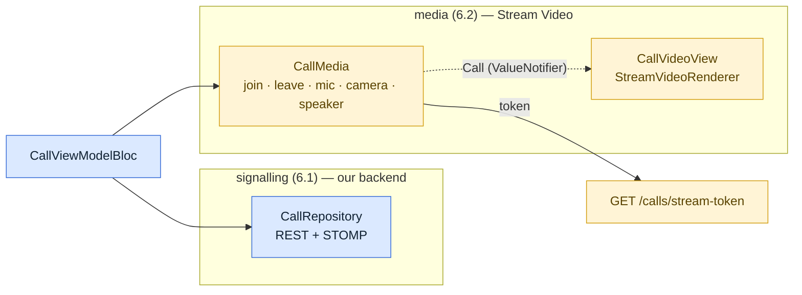
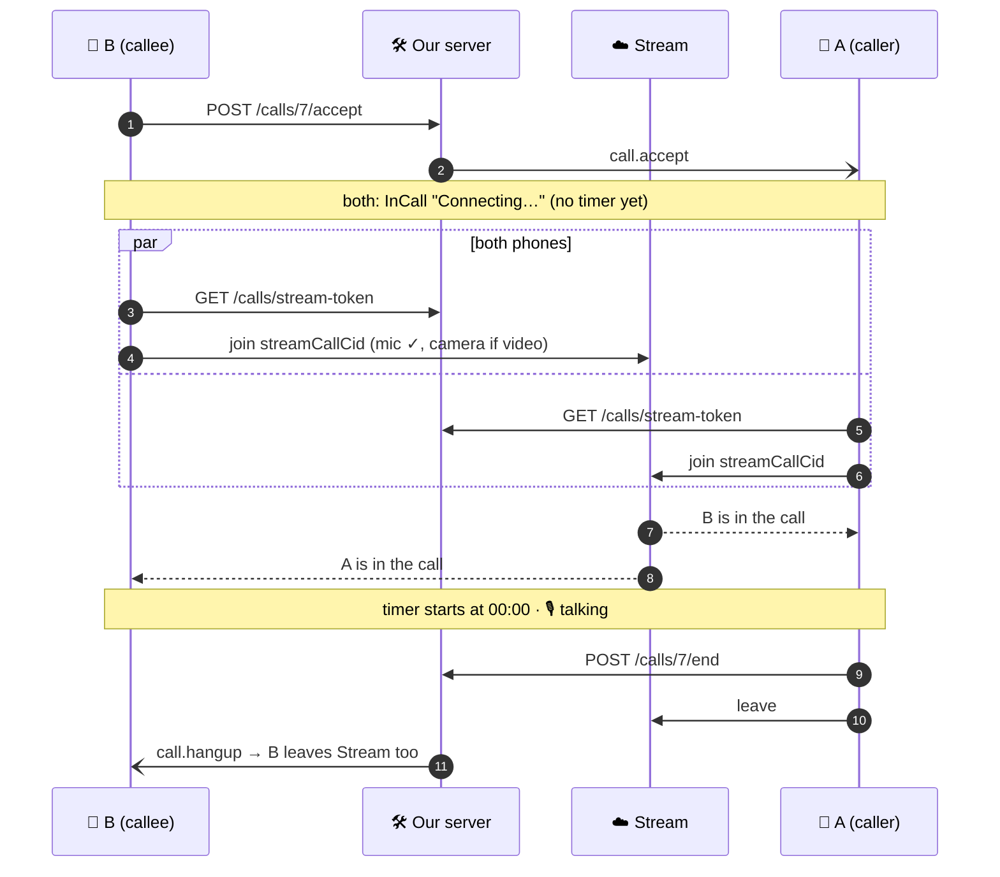

# Step 6.2 — Call: voice + video (Stream Video)

> ← Previous: [18-call-signalling.md](18-call-signalling.md) · Next: [20-call-sounds.md](20-call-sounds.md) → · Roadmap: [README.md](README.md)

```
6.1 signalling ✅   who calls, ring, accept, decline, hang up (OUR backend)
6.2 media           the sound and the picture (Stream Video)        ← this lesson
6.3 polish          sounds, call line in the chat, group calls, reconnecting
```

In 6.1 two phones agreed "we are in a call", but there was no sound. Now,
after Accept, both phones join the **Stream Video** call and talk.

## 1. Why

This step teaches:

- **Two systems, one call**: our backend decides *if* there is a call; Stream
  only carries the media. Each has one job.
- **A wrapper around a big SDK**: only `CallMedia` (and the widget that draws
  video) imports `stream_video_flutter`. The bloc doesn't know Stream exists,
  so it's easy to test.
- **"Connected" means the OTHER person is in the media call**, not "the server
  said accept". The timer waits for that (CALL_SCENARIOS.md #8).
- **Optimistic toggles with rollback** (mute, camera, speaker), like the
  reactions in 5.6.



## 2. Picture

### Accept → talking



### Screens

```
Voice, in call                      Video, in call (always dark)
┌──────────────────────┐   ┌──────────────────────┐
│        (JD)          │   │ Jane Doe       ┌───┐ │
│      Jane Doe        │   │ 01:15          │me │ │
│   📞 Voice call      │   │                └───┘ │
│   Connecting… → 00:42│   │    THEIR CAMERA      │
│                      │   │  (or their photo)    │
│ (🎙 Mute) (🔊 Speaker)│   │ (🎙) (🎥) (🔄) (🔊)   │
│       (⛔ End)        │   │       (⛔ End)        │
└──────────────────────┘   └──────────────────────┘
filled circle = "not normal": muted · loudspeaker on · camera off
```

### Files

```
lib/core/network/api_endpoints.dart        + callStreamToken
lib/features/call/
├── model/stream_token_model.dart          NEW  {token, apiKey, userId, expiresAt}
├── repository/call_repository.dart        + streamToken()
├── repository/call_media.dart             NEW  the ONLY Stream SDK user (+ the video widget)
├── viewmodel/call/                        InCall: connectedAt? · micOn · cameraOn · speakerOn · frontCamera
│                                          + media start / peer joined / 4 toggles
├── view/call_page.dart                    voice layout · video layout (dark theme)
├── widgets/  call_toggle_button · call_video_view · call_video_overlay
│             call_background · call_controls (+ toggles) · call_status_text (Connecting…)
└── call_di.dart                           + CallMedia (tokens from CallRepository)
```

## 3. Code

### `CallMedia.join`: token → client → permissions → join

```dart
final token = await _loadToken();                       // GET /calls/stream-token
final client = await _clientFor(token);                 // one StreamVideo per user
final micOn = await Permission.microphone.request().isGranted;
final cameraOn = video && await Permission.camera.request().isGranted;
final c = client.makeCall(callType: StreamCallType.fromString('default'), id: 'call-7');
await c.join(connectOptions: CallConnectOptions(
  microphone: micOn ? TrackOption.enabled() : TrackOption.disabled(),
  camera: cameraOn ? TrackOption.enabled() : TrackOption.disabled(),
  speakerDefaultOn: video,                              // video → loudspeaker
));
```

| Line | Why |
|---|---|
| Token from OUR server | Stream tokens are signed with the Stream **secret**. Only the server has it. |
| `tokenLoader` on the client | Tokens live 60 min; Stream asks for a new one by itself in a long call. |
| `StreamVideo.reset` before a new user | The SDK keeps ONE global client; logout → login must not reuse the old user. |
| Only CHECK permissions at join | `CallPermissionGate` already asked at 📞 / Accept; a track that's still off just joins disabled. |
| `join` creates the call if needed | The backend only creates the Stream call itself to ring offline phones. |
| `_generation` | Hang up while joining → the join that finishes later leaves at once. |

### The bloc: InCall has two moments

```dart
void _enterCall(emit, call, peer) {
  emit(CallInCallState(call: call, peer: peer,          // connectedAt: null → "Connecting…"
      cameraOn: call.isVideo, speakerOn: call.isVideo));
  add(OnCallMediaStartEvent(call.id));                  // join in its own handler
}
// CallMedia.peerPresent → true → connectedAt = now → the timer starts
```

The join fails (no internet, Stream down) → **`POST /end` + "Couldn't connect
the call"**. A call with no sound is no call, and the other side must not wait.
Every end path (`_end`) calls `_media.leave()`; logout calls `signOut()`.

### Toggles: optimistic + rollback

```dart
emit(next);                              // the button reacts at once
final ok = await apply(next);            // CallMedia.setMicrophone(...)
if (!ok) emit(flipped(now));             // e.g. permission denied → back
```

### Video: dark theme around the picture

`CallPage` swaps to `AppTheme.dark()` **above** the Scaffold while a video
call is on: white text and dark buttons on any picture, in light mode too.
(Found in the render check: a Theme INSIDE the Scaffold left the text dark.)

### Permissions first (asked by the user after testing)

`CallPermissionGate.ensure(context, video:)` runs **when I tap 📞 / 🎥** and
**when I tap Accept**, before anything reaches the server:

| Answer | Result |
|---|---|
| Mic ✓ | The call starts / is accepted. For video the camera is asked too; "no" = camera off. |
| Mic ✗ | No call. "Calls need the microphone." |
| Mic ✗ for good | "Allow the microphone" → **Open Settings**. |

So the system dialog never pops up in the middle of "Connecting…", and a
caller without a microphone never makes the other phone ring. `CallMedia.join`
now only **checks** the status.

## 4. 🤔 Why like this? (other ways)

| Choice we made | Other way | Why we didn't pick the other way |
|---|---|---|
| Our own call screen + `StreamVideoRenderer` | Stream's ready-made `StreamCallContainer` | Their screen has its own states and ringing, which would fight our signalling. |
| `CallMedia` wrapper | Call the SDK from the bloc | The bloc stays testable with a mock; one place to change if the SDK changes. |
| Join after Accept (both sides) | Caller joins while it rings (the old app) | Simpler; no half-joined calls to clean up when it's declined. Costs ~1 s of "Connecting…". |
| Timer starts when THEY are in the media | Timer at `call.accept` | The first seconds had no sound yet; the timer would lie (#8). |
| Join fails → end the call | Stay "in call" without sound | The other person would talk to silence. |
| Permissions asked at 📞 / Accept | At join (first version) or at app start | Ask when the user acts, before the other phone rings (Apple / Google guidelines: ask in context). |

## 5. Try it

```bash
flutter test                                    # 267 tests → All tests passed!
flutter run --flavor dev -t lib/main_dev.dart   # TWO real phones (emulators have no real mic / camera)
```

1. A 📞 B → B Accept → both **Connecting…** → **00:00** and you hear each other.
   (First time: allow the microphone.)
2. Tap **Mute** → the other side hears nothing; the button fills. Tap again.
3. **Speaker** → loud / earpiece.
4. A 🎥 B → Accept (allow the camera) → their camera full screen, yours small
   at the top right. **Camera** off → they see your photo. **Flip** → back camera.
5. Turn off Wi-Fi on one phone before Accept → **Couldn't connect the call**
   on that phone; the other gets **Call ended**.

## 6. Check yourself

1. Why does the phone get its Stream token from our server, not from Stream?
2. Why does the timer start when the OTHER person joins the media, not at
   `call.accept`?
3. What happens if the microphone permission is denied?
4. The join fails. Why do we also send `POST /end`?
5. Why is `CallMedia` the only class that imports the Stream SDK (with the
   video widget)?

<details><summary>Answers</summary>

1. The token is signed with the Stream secret. A secret in the app can be
   read by anyone; the server keeps it and signs a short-lived token per user.
2. Between accept and the media join there's ~1 s with no sound. The timer
   should count talking time (CALL_SCENARIOS.md #8).
3. The join still works with the mic track off: `micOn` is false and the
   Mute button shows "Unmute"; tapping it asks again.
4. Otherwise the server (and the other phone) still think we are in the
   call; they'd talk to silence, and we'd stay "busy".
5. One place knows the SDK: the bloc is tested with a mock, and an SDK change
   touches one file.

</details>
