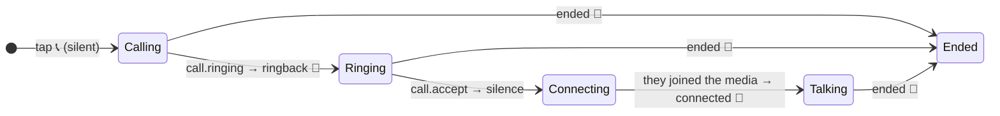

# Step 6.3a — Call: sounds

> ← Previous: [19-call-media.md](19-call-media.md) · Roadmap: [README.md](README.md)

```
6.3a sounds          ringback · ringtone · connected beep · ended beep   ← this lesson
6.3b reconnecting    "Reconnecting…", give up after 30 s
6.3c group calls     avatars / video grid
6.3d call line       "📞 Voice call · 2:31" in the chat (backend CALL message)
```

## 1. Why

A call without sounds feels broken: did it ring? did they answer? This step
teaches:

- **Sounds follow the state.** No widget plays a sound. One rule table maps
  "state before → state after" to a sound.
- **A pure function is the easiest thing to test.** `soundFor(prev, next)`
  needs no player, no timer, no phone.
- **Don't touch the call's audio.** During a call the phone's audio session
  belongs to WebRTC. A careless player can mute the call.

## 2. Picture

Like a real phone (CALL_SCENARIOS.md "Call sounds"):

| Moment | Caller hears | Callee hears |
|---|---|---|
| "Calling…" (their phone doesn't ring yet) | **silence** | — |
| "Ringing…" (their phone shows the call) | "tuut… tuut" (loop) | ringtone (loop) |
| Accept tapped / "Connecting…" | silence | silence |
| They are really in the call (00:00) | short rising beep | short rising beep |
| Ended · declined · missed · cancelled · busy | short falling beep | short falling beep |



### Files

```
lib/features/call/
├── model/call_sound.dart          NEW  ringback · ringtone · connected · ended · silence (asset + loop)
├── repository/call_sounds.dart    NEW  one just_audio player, never touches the audio session
├── viewmodel/call/                + soundFor(prev, next) (the rule table) · onChange plays it
└── call_di.dart                   + CallSounds
assets/sounds/                     call_ringback.wav · call_ringtone.wav · call_connected.wav · call_ended.wav
```

## 3. Code

### The rule table: a pure function in the bloc

```dart
static CallSound? soundFor(CallViewModelState prev, CallViewModelState next) {
  switch (next) {
    case CallOutgoingState(:final peerRinging):              // silent while "Calling…"
      final wasRinging = prev is CallOutgoingState && prev.peerRinging;
      return peerRinging && !wasRinging ? CallSound.ringback : null;
    case CallIncomingState(:final call, :final accepting):
      if (prev is! CallIncomingState || prev.call.id != call.id) return CallSound.ringtone;
      return accepting && !prev.accepting ? CallSound.silence : null;
    case CallInCallState(:final connectedAt):
      if (prev is! CallInCallState) return CallSound.silence; // "Connecting…" is quiet
      return prev.connectedAt == null && connectedAt != null ? CallSound.connected : null;
    case CallEndedState():
      return prev.isActive ? CallSound.ended : null;
    case CallIdleState():
      return null;
  }
}
```

`null` means "leave the player alone". That matters: the name of the caller
loading, or a tap on Mute, also change the state, and they must not restart
the ringtone.

The bloc's `onChange` (the same hook that drives `inCall`) calls it on
**every** change:

```dart
final sound = soundFor(change.currentState, change.nextState);
if (sound != null) _sounds?.play(sound);
```

### `CallSounds`: one player, hands off the audio session

```dart
AudioPlayer(
  handleAudioSessionActivation: false,   // iOS: don't activate / change the session
  handleInterruptions: false,            // don't pause on WebRTC's audio events
  androidApplyAudioAttributes: false,    // Android: don't change the audio usage
)
```

A new sound stops the old one (the ringtone stops when the beep plays).
`play()` is not awaited: in just_audio it finishes when the sound **stops**,
which for a loop is never.

## 4. 🤔 Why like this? (other ways)

| Choice we made | Other way | Why we didn't pick the other way |
|---|---|---|
| Sounds from state changes (`onChange`) | Play in each handler (`_onAccept`, `_end`…) | 10+ places to remember; one missed path = a ringtone that never stops. |
| `soundFor` pure + static | Logic inside the player | Tested as a table with no audio at all. |
| Its own player | Reuse `AppAudioPlayer` (voice messages) | That player has voice-message rules (one key, progress); calls need loops and must not touch the session. |
| Silent "Calling…" | Ringback at once | It would lie: the other phone may be off (CALL_SCENARIOS.md #10). |
| No ringtone in the background | Ring from the app | The phone's own call screen (CallKit / push, Step 7) rings there; two rings at once. |

## 5. Try it

```bash
flutter test                                    # 271 tests → All tests passed!
flutter run --flavor dev -t lib/main_dev.dart   # two phones, sound ON
```

1. A 📞 B with B's app **closed** → A: "Calling…" and **silence** → "No answer" + beep.
2. B's app open → A hears "tuut… tuut" when B's screen shows the call; B hears the ringtone.
3. B taps Accept → both silent ("Connecting…") → a short beep at 00:00.
4. Either taps End → a short falling beep on both.
5. A cancels while it rings → B's ringtone stops at once + beep.

## 6. Check yourself

1. Why does "Calling…" stay silent?
2. Muting the mic changes the state. Why doesn't the ringtone or the beep
   play again?
3. Why must the call sound player not activate the audio session?
4. Why are the sounds driven from `onChange`, not from each handler?

<details><summary>Answers</summary>

1. Until the other phone says it rings (`call.ringing`), we don't know it
   rings at all (it may be off). A ringback would lie.
2. `soundFor` returns `null` for changes that don't matter (Mute, the name
   loading), and `null` = leave the player alone.
3. The call's audio session belongs to WebRTC. Changing it can mute the call.
4. One place sees every change, so no end path can forget to stop the
   ringtone or play the ended beep.

</details>
