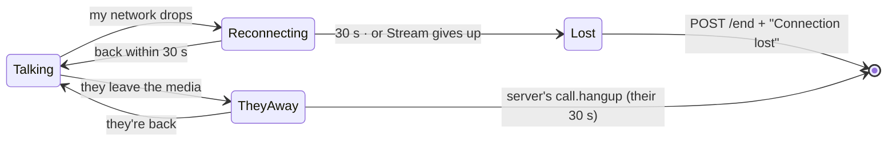

# Step 6.3b — Call: "Reconnecting…"

> ← Previous: [20-call-sounds.md](20-call-sounds.md) · Next: [22-call-groups.md](22-call-groups.md) → · Roadmap: [README.md](README.md)

```
6.3a sounds ✅
6.3b reconnecting    my network drops · their network drops · give up after 30 s   ← this lesson
6.3c group calls
6.3d call line in the chat
```

## 1. Why

Phones change networks all the time (Wi-Fi → 4G, a lift, a tunnel). Before
this step a drop meant silence with a timer still counting, and maybe a call
that never ended. This step teaches:

- **Two kinds of drop, two messages**: MY network ("Reconnecting…") vs THEIR
  network ("Jane is reconnecting…").
- **Every wait needs a limit**: 30 s, then "Connection lost". The same 30 s
  as the backend's `answered-disconnect-grace-seconds` (6.2 fix), so the
  phone and the server agree.
- **Map a big SDK status to a few words** (`MediaLink`): the bloc doesn't need
  Stream's 12 call statuses.

## 2. Picture



| What happened | My screen | Their screen |
|---|---|---|
| My Wi-Fi drops | **Reconnecting…** | **Jane is reconnecting…** |
| Back in 10 s | timer again (it never stopped counting) | timer again |
| Gone 30 s | **Connection lost** → closes | **Call ended** (the server hung up for me) |

### Files

```
lib/features/call/
├── model/call_config.dart          + reconnectTimeout = 30 s
├── model/call_end_reason.dart      + connectionLost ("Connection lost")
├── repository/call_media.dart      + MediaLink (connected · reconnecting · lost) + link stream
│                                     + linkOf(CallStatus) · Stream's reconnectTimeout = 30 s
├── viewmodel/call/                 InCall + reconnecting · peerAway; give-up timer
└── widgets/call_status_text.dart   "Reconnecting…" · "Jane is reconnecting…"
```

## 3. Code

### Stream's status → 3 words

```dart
static MediaLink? linkOf(CallStatus status) {
  if (status is CallStatusReconnectionFailed) return MediaLink.lost;
  if (status.isReconnecting || status.isMigrating) return MediaLink.reconnecting;
  if (status.isConnected || status.isJoined) return MediaLink.connected;
  return null;                       // joining, idle… not interesting here
}
```

And Stream itself is told to give up after 30 s (its default is **forever**):

```dart
StreamVideoOptions(defaultCallPreferences: DefaultCallPreferences(
  reconnectTimeout: CallConfig.reconnectTimeout,
  networkAvailabilityTimeout: CallConfig.reconnectTimeout,
))
```

### The bloc: a flag + a timer

```dart
case MediaLink.reconnecting:
  emit(s.copyWith(reconnecting: true));
  _reconnectGiveUp = Timer(reconnectTimeout, () => add(OnCallReconnectTimeoutEvent(id)));
case MediaLink.connected:
  _reconnectGiveUp?.cancel();
  emit(s.copyWith(reconnecting: false));
case MediaLink.lost:
  _giveUp(emit, s);                 // POST /end (best effort) + "Connection lost"
```

Two guards, in case one fails: Stream's own `ReconnectionFailed` and our
timer. On top, the server hangs up for a phone whose socket is gone 30 s.

### Their drop: `peerPresent` false AFTER the call started

```dart
if (event.present) emit(s.copyWith(connectedAt: s.connectedAt ?? _now(), peerAway: false));
else if (s.connectedAt != null) emit(s.copyWith(peerAway: true));
```

`connectedAt` is kept: when they come back, the timer shows the real call
length. We don't hang up for them; their phone or the server does.

### Sounds don't change

`soundFor` returns `null` for these InCall → InCall changes (`connectedAt`
stays the same), so no beep plays on a reconnect.

## 4. 🤔 Why like this? (other ways)

| Choice we made | Other way | Why we didn't pick the other way |
|---|---|---|
| 30 s, same as the server | Stream's default (forever) | A call stuck on "Reconnecting…" for minutes; the other person waits for nothing. |
| `MediaLink` (3 values) | Pass Stream's `CallStatus` to the bloc | The bloc would depend on the SDK; tests would need SDK objects. |
| Our timer AND Stream's timeout | Only one | Two independent guards; either one ends it. |
| Show their drop, don't end it | Hang up when they leave the media | A 3 s blip on their side would kill the call. |
| Timer keeps counting during a drop | Pause it | The call is still going (the server counts it), and it's simpler. |

## 5. Try it

```bash
flutter test                                    # 278 tests → All tests passed!
flutter run --flavor dev -t lib/main_dev.dart   # two phones, in a call
```

1. In a call, turn on airplane mode on A for 5 s, then off → A: **Reconnecting…**
   then the timer; B: **Jane is reconnecting…** then the timer. The voice comes back.
2. Airplane mode on A for 40 s → A: **Connection lost** at 30 s. B: **Call ended**
   (the server hung up for A).

## 6. Check yourself

1. What is the difference between "Reconnecting…" and "Jane is reconnecting…"?
2. Why 30 s, and why the same number as the backend?
3. Why does the app not hang up when the OTHER person leaves the media?
4. Name the three guards that end a call whose network is gone.

<details><summary>Answers</summary>

1. "Reconnecting…" = MY media link is down (`MediaLink.reconnecting`).
   "Jane is reconnecting…" = she left the media after the call started
   (`peerPresent` false → `peerAway`).
2. Long enough for a lift or a network switch, short enough not to keep
   someone waiting. Same as the server, so both sides end the call at about
   the same moment.
3. A short drop on their side would kill the call. Their phone (or the server,
   after 30 s) ends it if they don't come back.
4. Stream's `ReconnectionFailed` (its timeout set to 30 s), our own 30 s
   timer, and the backend hanging up for a socket gone 30 s.

</details>
