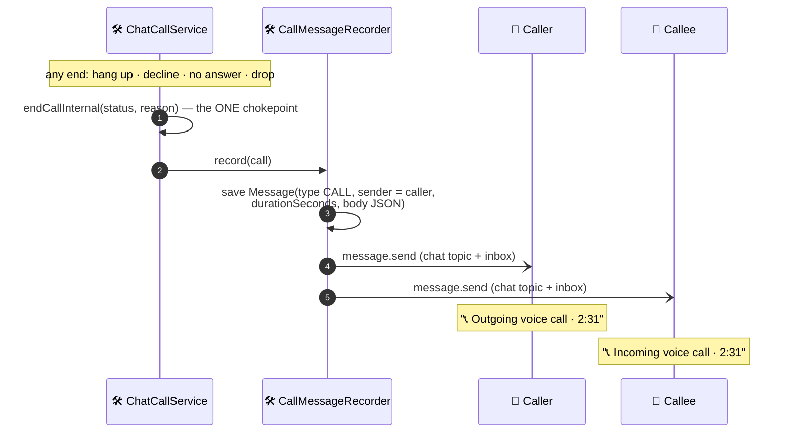

# Step 6.3d — Call: the call line in the chat (backend + app)

> ← Previous: [22-call-groups.md](22-call-groups.md) · Next: [24-push-setup.md](24-push-setup.md) → · Roadmap: [README.md](README.md)

```
6.3a sounds ✅ · 6.3b reconnecting ✅ · 6.3c groups ✅
6.3d call line    "📞 Outgoing voice call · 2:31" · "Missed voice call" 🔴   ← this lesson
```

Like WhatsApp or Telegram: every call leaves a line in the chat and in the
inbox preview. Tap it to call back.

This step changes **both** repos (option A, chosen by you): the server writes
the line, the app draws it.

## 1. Why

This step teaches:

- **Let the server write history.** A call line made by the server is in the
  history for everyone, on every phone, with the right unread count. Two
  phones writing it would make two lines (or none).
- **Reuse what exists.** A call line is a normal message with a new `type`:
  history, paging, live updates, the inbox preview, unread, delete and
  reactions all work with no new code.
- **The same data, different words per viewer.** One line says "Cancelled
  call" to the caller and "Missed voice call" to the callee.



## 2. Picture

```
                         ┌──────────────────────────┐
                         │ (↗) Cancelled call        │  mine
                         │     Tap to call back      │
                         └────────────────── 16:34 ┘
┌──────────────────────────┐
│ (🔴) Missed voice call    │  theirs, missed → red
│      Tap to call back     │
└────────────────── 16:44 ┘
                         ┌──────────────────────────┐
                         │ (🎥) Outgoing video call  │
                         │  1:02:05 · Tap to call back│
                         └────────────────── 17:03 ┘
inbox:  Jane Doe   📞 Missed voice call   ①
```

| Outcome (from the server) | Caller sees | Others see |
|---|---|---|
| answered | Outgoing voice call · 2:31 | Incoming voice call · 2:31 |
| ENDED, `caller_left`, not answered | Cancelled call | **Missed voice call** 🔴 |
| MISSED (no answer / dropped) | Voice call · No answer | **Missed voice call** 🔴 |
| REJECTED | Voice call · Declined | Declined call |
| REJECTED, `busy` | Voice call · Busy | **Missed voice call** 🔴 |

### Files

```
BACKEND (erp_java_backend_claude)
entity/MessageType.java                + CALL
service/CallMessageRecorder.java       NEW  save + send the call line (best effort)
service/ChatCallService.java           endCallInternal → callMessages.record(c)
service/MessageService.java            a client sending CALL → 400 (no fake "Missed call")
service/ChatMessageNotifier.java       preview "📞 Call"
repository/MessageRepository.java      search skips CALL (its body is JSON)
test: CallMessageRecorderTest (4)      README · docs/API.md

APP (erp_flutter_claude)
model/chat_enums.dart                  + MessageType.call
model/chat_call_info.dart              NEW  body JSON → outcome → words per viewer
widgets/chat_call_content.dart         NEW  the line inside a bubble (red when missed)
widgets/message_list.dart              CALL → ChatCallContent · no ✓✓ · onCallBack
widgets/inbox_tile.dart                "📞 Missed voice call" (no "You:")
view/conversation_page.dart            tap → call back (the same kind)
```

## 3. Code

### Backend: one chokepoint, one recorder

```java
private void endCallInternal(ChatCall c, CallStatus status, String reason) {
    …
    c.setDurationSeconds(...);
    callMessages.record(c);          // EVERY end passes here: hang up, decline,
}                                    // no-answer sweep, disconnect, all left
```

`CallMessageRecorder.record` saves a `Message` (`type = CALL`, sender = the
caller, `durationSeconds`, `body` = JSON), sets it as the conversation's last
message, and sends `message.send` to the topic + every inbox, the same as
`MessageController.send`. It's wrapped in `try/catch`: a call must always end,
even if the line can't be saved.

`MessageService.send` refuses `CALL` from clients, so nobody can post a fake
"Missed call".

### App: data → words

```dart
final info = ChatCallInfo.of(message);       // null if not a call line
info.title(mine: message.senderId == myId);  // "Missed voice call"
info.detail(mine: …);                        // "2:31" · "No answer" · null
info.missedFor(mine: …);                     // red?
```

All the wording lives in this one class (tested as a table), never in
widgets. The chat feature has its OWN small model: chat doesn't import the
call feature. Call back goes through the same `ChatCallLauncher` as 📞.

### Nothing else changed

- The conversation bloc adds a CALL `message.send` like any message: its
  echo check compares text / `attachmentUrl`, which a call line never matches.
- Unread: a callee's missed call counts (+1), the caller's own line doesn't.
- The bubble's text for a CALL is `previewText` ("📞 Call"), never the JSON.

## 4. 🤔 Why like this? (other ways)

| Choice we made | Other way | Why we didn't pick the other way |
|---|---|---|
| Server writes a CALL message | App merges `GET …/calls` into the list | Two paged lists merged by time; no inbox preview, no unread, no live update. |
| Server writes it | The caller's phone sends it | The caller's phone may be dead (that's why the call ended); two devices → two lines. |
| Body = JSON | New DB columns | No migration (`type` is `VARCHAR(16)`); `durationSeconds` already existed. |
| Sender = caller | Sender = system / nobody | "Mine" = "I called" gives the arrows and the words for free; `sender_id` is NOT NULL. |
| Words in `ChatCallInfo` | In the widget | Tested as a table; the inbox and the bubble say the same thing. |

## 5. Try it

```bash
# backend: restart (new code)
cd ~/Documents/call_erp/erp_java_backend_claude && ./gradlew test && ./gradlew bootRun

# app
flutter test                                    # 289 tests → All tests passed!
flutter run --flavor dev -t lib/main_dev.dart
```

1. A calls B, they talk, A hangs up → both chats: "Outgoing / Incoming voice
   call · 0:42"; the inbox shows it too.
2. A calls, B doesn't answer → A: "Voice call · No answer"; B: **Missed voice
   call** (red) and unread +1.
3. A calls and hangs up at once → A: "Cancelled call"; B: Missed.
4. B declines → A: "Voice call · Declined"; B: "Declined call".
5. Tap any line → a new call of the same kind.
6. Search "voice" in the chat → call lines are NOT found.

## 6. Check yourself

1. Why does the server write the call line, not the app?
2. Why is `endCallInternal` the right place to call the recorder?
3. Why does `MessageService.send` refuse `CALL`?
4. The same message says "Cancelled call" on one phone and "Missed voice call"
   on another. How?

<details><summary>Answers</summary>

1. It's history for everyone: one writer, saved even when a phone is dead,
   with unread / preview / live update for free.
2. Every way a call ends goes through it (hang up, decline, no answer,
   disconnect), so no end is forgotten and none is written twice.
3. So no client can post a fake call line.
4. `ChatCallInfo` turns the same data into words using `mine` (am I the
   sender = the caller?).

</details>
