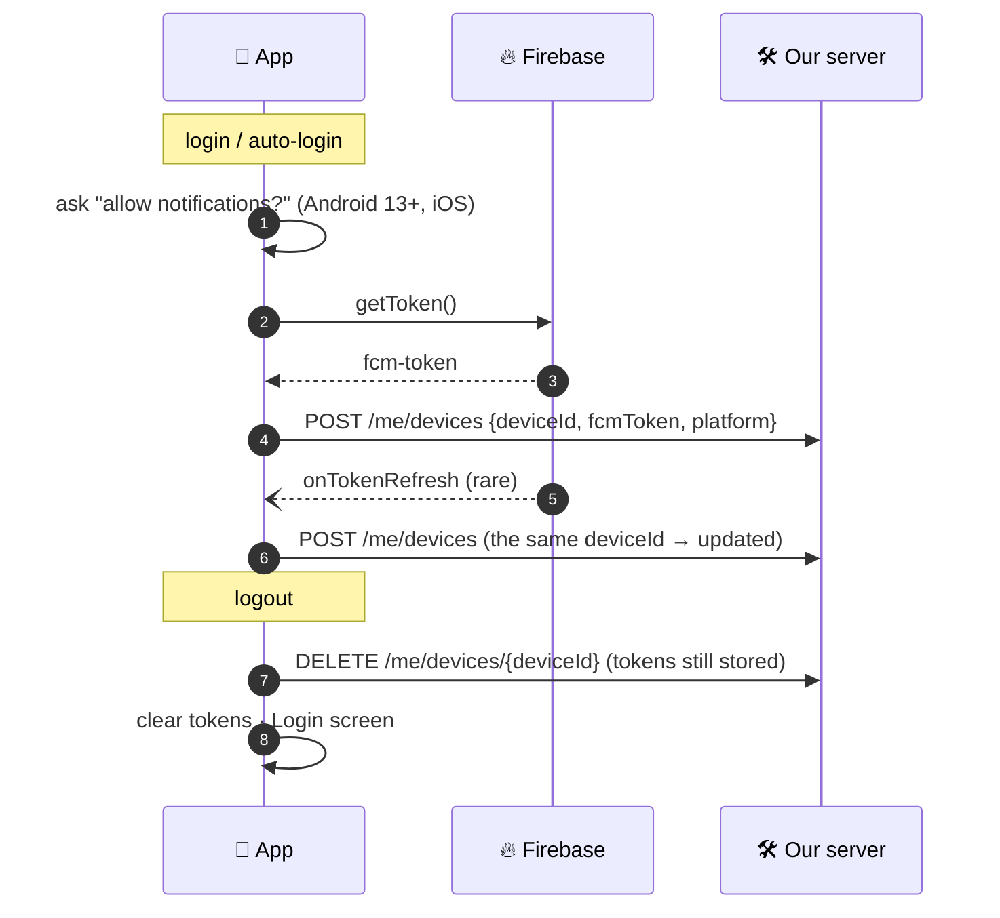

# Step 7.1 — Push: setup + this phone's token

> ← Previous: [23-call-line.md](23-call-line.md) · Roadmap: [README.md](README.md)

```
7.1 push setup      Firebase · this phone's FCM token → POST /me/devices · DELETE on logout   ← this lesson
7.2 Android ring    minimized / killed → full-screen call (our FCM call.invite)
7.3 iOS ring        VoIP push (Stream) + CallKit
7.4 accept from the ring → straight into the call
```

## 1. Why

Step 6 rings only phones whose app is OPEN (the STOMP socket is alive). A
minimized or killed app has no socket. Only a **push** can reach it. Before any
push can arrive, the server must know **where** to send it: this phone's FCM
token, saved under the logged-in user.

This step teaches:

- **A token per install, saved per user**: `deviceId` (ours) + `fcmToken`
  (Google's).
- **Follow the session**: login → save it; token changes → save it again;
  logout → remove it.
- **Order matters at logout**: the `DELETE` needs the access token, so it runs
  BEFORE the tokens are cleared.
- **The chosen design (option B)**: Android rings from OUR backend's FCM push
  (7.2), iOS from Stream's VoIP push (7.3).



## 2. Picture

| When | Request | Why |
|---|---|---|
| Logged in (login, or auto-login at start) | `POST /me/devices` | The server can push to me now. Sent at every start (an "upsert"), so a stale row fixes itself |
| Google changes the token | `POST /me/devices` again | The old token stops working |
| Logout | `DELETE /me/devices/{deviceId}` first | Otherwise the NEXT user on this phone gets my calls |

### Files

```
lib/main.dart                         + Firebase.initializeApp() (failure → app still runs) · PushRegistrar.attach()
lib/core/network/api_endpoints.dart   + myDevices · myDevice(id)
lib/core/push/                        NEW folder (core: chat, calls, any feature may push)
├── device_id_store.dart              this install's UUID (made once, SharedPreferences)
├── push_messaging.dart               the ONLY Firebase Messaging user: token · onTokenRefresh · permission
└── push_registrar.dart               follows the session → POST / DELETE /me/devices
lib/core/di/injection.dart            + DeviceIdStore · PushMessaging · PushRegistrar
lib/features/auth/repository/auth_repository.dart   + beforeLogout hook (runs FIRST)
lib/features/auth/auth_di.dart        beforeLogout: PushRegistrar.unregister
```

## 3. Code

### `deviceId`: ours, made once

```dart
String id() {
  final saved = _prefs.getString(_key);
  if (saved != null && saved.isNotEmpty) return saved;
  final fresh = const Uuid().v4();
  _prefs.setString(_key, fresh);
  return fresh;
}
```

The backend keys devices by **(user, deviceId)**. The same id every time means
`POST` **updates** this phone's row; it never piles up new rows.

### The registrar follows the session

```dart
void attach() {
  _session.addListener(_onSession);                        // login / logout
  _refresh = _messaging.onTokenRefresh.listen((t) {         // Google changed it
    if (_session.isAuthenticated) _register(t);
  });
  _onSession();                                             // already logged in?
}
```

`register()` = ask the permission → `token()` → `POST`. No token (no Google
Play services, iOS before APNs is set up) → nothing, no crash.

### Logout: DELETE first

```dart
Future<void> logout() async {
  try {
    try { await _beforeLogout?.call(); } catch (_) {}   // DELETE /me/devices/{id}
    … POST /auth/logout …
  } finally {
    await _tokenStorage.clear(); …                      // only now
  }
}
```

`AuthRepository` doesn't import push: `auth_di` gives it a plain function
(`beforeLogout`). The DELETE has a 3 s limit: offline must never block logout.

### Firebase never blocks the app

```dart
try { await Firebase.initializeApp(); } catch (e) { debugPrint(...); }
```

No `firebase_options.dart`: Firebase reads `google-services.json` /
`GoogleService-Info.plist`. Every flavor keeps the same app id, so one Firebase
app covers dev / uat / prod.

## 4. 🤔 Why like this? (other ways)

| Choice we made | Other way | Why we didn't pick the other way |
|---|---|---|
| Our own `deviceId` (UUID) | Use the FCM token as the id | The token changes; the row would multiply. |
| Register at every start | Only once after login | A token that changed while the app was closed is fixed at the next start. |
| `DELETE` before clearing tokens | After | The DELETE needs the access token. |
| `beforeLogout` hook | Auth imports `core/push` and calls it | Auth stays about auth; DI connects them (like `onLogout` in 4.1). |
| `core/push` | `features/call/push` | Chat messages can push too; it's shared infrastructure. |

**For the backend team:** `DeviceService.register` should also delete rows with
the same `fcmToken` for OTHER users. If a logout's `DELETE` is lost (offline),
the next user on that phone would otherwise still get the previous user's
pushes.

## 5. Try it

```bash
flutter test                                    # 299 tests → All tests passed!
flutter run --flavor dev -t lib/main_dev.dart   # a real phone
```

1. Log in → Android 13+ asks "Allow notifications?" → Allow.
2. The dev log shows `POST /api/v1/me/devices` with your `deviceId` → 200.
3. Backend: `GET /api/v1/me/devices` (Postman, your token) lists this phone.
4. Log out → the log shows `DELETE /api/v1/me/devices/<id>` BEFORE `/auth/logout`.
5. Nothing rings yet when the app is closed: that's 7.2.

## 6. Check yourself

1. Why do we need our own `deviceId` when Firebase already gives a token?
2. Why must the `DELETE` run before the tokens are cleared?
3. What happens if Firebase isn't set up for a flavor?
4. Why register at every start, not only after login?

<details><summary>Answers</summary>

1. The FCM token changes over time; `deviceId` stays the same for this
   install, so the server updates one row instead of adding new ones.
2. It's an authorized request: the interceptor needs the stored access token.
3. `initializeApp` fails, we log it, and the app runs: chat and in-app calls
   work, only pushes don't.
4. The token may have changed while the app was closed; an upsert at start
   fixes it.

</details>
