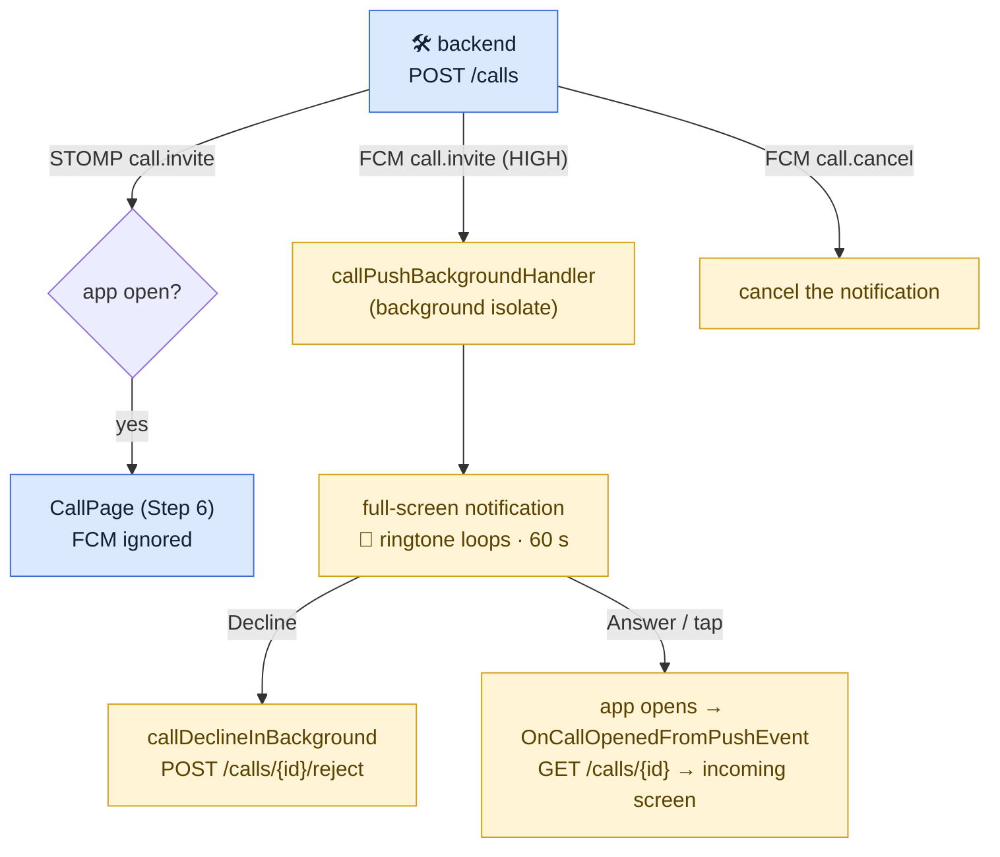

# Step 7.2 — Android: ring when the app is minimized or killed

> ← Previous: [24-push-setup.md](24-push-setup.md) · Next: [26-ios-ring.md](26-ios-ring.md) → · Roadmap: [README.md](README.md)

```
7.1 push setup ✅
7.2 Android ring    FCM call.invite → full-screen ring · Decline (even killed) · cancel · open → incoming screen   ← this lesson
7.3 iOS ring        VoIP push (Stream) + CallKit
7.4 Answer from the ring → straight into the call
```

## 1. Why

With the app closed there is no STOMP socket, so Step 6's invite never
arrives. Our backend ALSO sends an FCM push (`call.invite`, HIGH priority) to
each callee's saved token (7.1). This step turns that push into a real phone
ring.

This step teaches:

- **A background isolate**: Android runs a TOP-LEVEL Dart function for the
  push, in a fresh isolate where `main()` never ran: no DI, no session.
- **One ring at a time**: the app open → STOMP + our `CallPage`; the app
  closed → the notification. Never both.
- **Work without the app**: "Decline" on the notification calls the server
  from yet another background isolate, even when the app is killed.



## 2. Picture

```
Locked phone                         Unlocked, another app open
┌──────────────────────────┐        ┌──────────────────────────────┐
│ 12:41                    │        │ 📞 Mr Min                     │ heads-up
│                          │        │ Incoming voice call           │
│  📞 Mr Min               │        │    [ Decline ]   [ Answer ]   │
│  Incoming voice call     │        └──────────────────────────────┘
│                          │
│ [ Decline ]  [ Answer ]  │  ringtone repeats (FLAG_INSISTENT), 60 s max
└──────────────────────────┘
```

| Callee's app | What rings | Decline | Answer / tap |
|---|---|---|---|
| Open | our `CallPage` (STOMP, Step 6) | in the app | in the app |
| Minimized | the notification (the app's ringtone waits) | the bloc declines | app comes back → the incoming screen |
| Killed / locked | the notification, over the lock screen | **background isolate** → `POST /reject` | app starts → the incoming screen |

### Files

```
lib/main.dart                                  Firebase ok → setUpCallPushBackground() · after runApp → attachCallPush()
lib/app/call_push.dart                         NEW  the TOP-LEVEL handlers + the main-isolate bridge
lib/core/push/push_messaging.dart              + onForegroundData · setBackgroundHandler
lib/features/call/
├── model/call_push.dart                       NEW  FCM data → CallPushInvite / CallPushCancel
├── repository/call_notifications.dart         NEW  the ring notification (flutter_local_notifications)
├── repository/background_call_api.dart        NEW  reject WITHOUT DI (tokens · refresh once · never log out)
├── repository/call_sounds.dart                ringtone only in the foreground (waits, plays on resume)
├── viewmodel/call/                            + OnCallOpenedFromPushEvent · notifications.onIncoming
└── call_di.dart                               + CallNotifications
android/app/src/main/AndroidManifest.xml       + ActionBroadcastReceiver · MainActivity showWhenLocked/turnScreenOn
                                               − the stray FirebaseMessagingService (it stole pushes)
```

## 3. Code

### The background handler: no `main()`

```dart
@pragma('vm:entry-point')                    // keep it in a release build
Future<void> callPushBackgroundHandler(RemoteMessage message) async {
  await Firebase.initializeApp();
  final push = CallPush.fromData(message.data);
  …
  switch (push) {
    case CallPushInvite(): await notifications.showIncoming(push);
    case CallPushCancel(:final callId): await notifications.cancel(callId);
  }
}
```

It must be a **top-level** function (Android starts it by name), and it can't
use `getIt`: the box is empty in this isolate. `Flavor.current` falls back to
the `--flavor` build flag (CLAUDE.md "Killed app").

### The ring: a full-screen call notification

```dart
AndroidNotificationDetails(
  channelId, 'Incoming calls',
  importance: Importance.max, category: AndroidNotificationCategory.call,
  fullScreenIntent: true,                         // over the lock screen
  ongoing: true, autoCancel: false,               // can't be swiped away
  timeoutAfter: 60000,                            // = the server's ring time
  audioAttributesUsage: AudioAttributesUsage.notificationRingtone,
  sound: UriAndroidNotificationSound('content://settings/system/ringtone'),
  additionalFlags: Int32List.fromList([4]),       // FLAG_INSISTENT: loops
  actions: [Decline, Answer(showsUserInterface: true)],
)
```

### Decline when the app is killed

`callDeclineInBackground` → `BackgroundCallApi.reject(callId)`:

1. read the tokens from secure storage;
2. `POST /calls/{id}/reject` with the access token;
3. 401 → refresh **once** → save → try again;
4. refused / offline → **give up**. It never clears the tokens: a refresh race
   with the running app must not log the user out from a background tap.

### One ring at a time

| Who | Rule |
|---|---|
| `CallSounds` | the in-app ringtone only plays in the foreground; asked in the background → it waits and plays when the app comes back |
| `CallNotifications.onIncoming` | the bloc reports the ringing call; app in front → the notification is cancelled (the app rings) |
| app resumed while a call notification rings | `OnCallOpenedFromPushEvent` → `GET /calls/{id}` → still ringing for me → the incoming screen |
| leaves Incoming (answered, declined, ended) | the notification is cancelled |

## 4. 🤔 Why like this? (other ways)

| Choice we made | Other way | Why we didn't pick the other way |
|---|---|---|
| `flutter_local_notifications` (already in the project) | `flutter_callkit_incoming` | Its iOS side would fight Stream's CallKit in 7.3; and we need nothing it adds on Android. |
| Our backend's FCM (option B) | Stream's ring push on Android | One owner (our ids, our cancel); no double ring. |
| Decline in a background isolate | Open the app to decline | Declining must not open anything; the caller hears "declined" in ~1 s. |
| Never log out in the background | Use `TokenRefresher` | It clears the tokens on a refused refresh; a race with the open app would log the user out. |
| Answer opens the incoming screen | Accept at once | Accepting needs the microphone permission dialog (UI) → that's 7.4. |

**Needed on the backend:** `FCM_ENABLED=true` and
`FCM_SERVICE_ACCOUNT_JSON_PATH` (the Firebase service-account JSON of the same
Firebase project as `google-services.json`). Without it nothing is pushed.

## 5. Try it

```bash
# backend: FCM on (once)
FCM_ENABLED=true FCM_SERVICE_ACCOUNT_JSON_PATH=/path/service-account.json ./gradlew bootRun

flutter test                                    # 308 tests → All tests passed!
flutter run --flavor dev -t lib/main_dev.dart   # a REAL Android phone (the callee)
```

1. Android: log in (7.1 saves the token), then press Home (minimized).
2. Call it from the other phone → a heads-up ring with **Decline / Answer**.
3. **Decline** → the caller sees "Call declined" within ~1 s.
4. Again, then swipe the app away (killed) + lock the screen → it rings **over
   the lock screen**. Decline → declined; the app does NOT open.
5. Again, **Answer** → the app opens on the incoming screen → Accept → talk.
   (One tap less in 7.4.)
6. The caller hangs up while it rings → the notification disappears.

## 6. Check yourself

1. Why must the push handler be a top-level function, and why can't it use
   `getIt`?
2. How does the app avoid ringing twice when it's minimized but still connected?
3. Why does `BackgroundCallApi` never clear the tokens?
4. What does the backend need for any of this to work?

<details><summary>Answers</summary>

1. Android starts it by name in a NEW isolate where `main()` never ran, so
   the DI box is empty.
2. `CallSounds` holds the ringtone while in the background (the notification
   rings), and the bloc cancels the notification once the app is in front
   (the app rings).
3. A refresh in the background can race the open app (the refresh token
   rotates); clearing would log the user out because of a Decline tap.
4. `FCM_ENABLED=true` + the Firebase service-account JSON, and the phone's
   token saved by 7.1.

</details>
