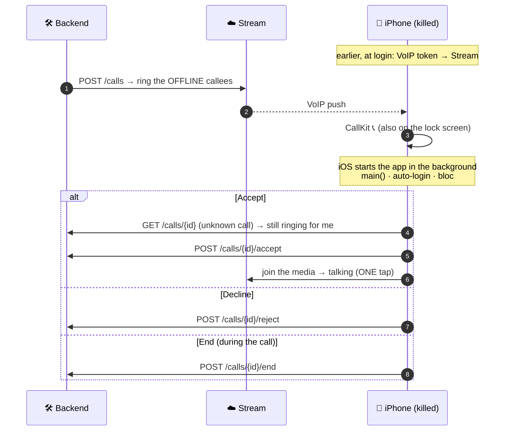

# Step 7.3 — iOS: ring when the app is minimized or killed (CallKit)

> ← Previous: [25-android-ring.md](25-android-ring.md) · Roadmap: [README.md](README.md)
>
> 🛠 Do it yourself, step by step (setup · every file · troubleshooting): [26b-ios-ring-handbook.md](26b-ios-ring-handbook.md)

```
7.1 push setup ✅ · 7.2 Android ring ✅
7.3 iOS ring        Stream VoIP push → CallKit · Accept / Decline / End → our backend   ← this lesson
7.4 Android: Answer → straight into the call
```

## 1. Why

iOS has strict rules for calls:

- A minimized or killed app gets **no** STOMP invite, and a normal push can't
  wake it to ring.
- The only way is a **VoIP push** (PushKit). iOS MUST show each one with
  **CallKit**, the system call screen (the same one as a phone call).
- Our backend already asks **Stream** to send that VoIP push (`ring: true`).
  It was missing one thing: the iPhone never gave Stream its VoIP token.

This step teaches:

- **Connect at login, not at the first call.** The Stream client is what
  hands the VoIP token to Stream, so it must exist before anyone calls.
- **One platform, one ring.** The push manager is on **iOS only**. Android
  rings from our FCM (7.2); registered with Stream too, it would ring twice.
- **The system's buttons drive OUR state machine.** CallKit's Accept /
  Decline / End become bloc events that take the same paths as our own
  buttons.



## 2. Picture

```
Locked iPhone                       Unlocked, another app open
┌──────────────────────────┐       ┌──────────────────────────────┐
│        Mr Min            │       │ 📞 Mr Min         (✕)  (📞)  │ CallKit banner
│   ERP voice call…        │       └──────────────────────────────┘
│                          │
│   (✕ Decline) (📞 Accept)│   Accept → talking; the green pill shows the call
└──────────────────────────┘
```

| Callee's iPhone | Who rings it | Accept |
|---|---|---|
| App open | our STOMP invite → `CallPage` (Step 6); Stream doesn't ring it (ONLINE) | in the app |
| Minimized | CallKit (the backend sees "background" → OFFLINE) | CallKit → straight into the call |
| Killed / locked | CallKit; iOS starts the app in the background | the same |

### Files

```
lib/features/call/
├── model/call_kit_action.dart            NEW  a CallKit button + OUR call id (cid → id)
├── repository/call_media.dart            + push manager (iOS only) · connectForRinging · callKit · endRing
└── viewmodel/call/                       + OnCallKitActionEvent · connect at login · every end → endRing
ios/Runner/AppDelegate.swift              ~300 → ~60 lines: Firebase · PushKit register · one safety rule
test/features/call/call_kit_action_test.dart   NEW
test/features/call/call_view_model_bloc_test.dart  + 9 CallKit tests
```

The backend needed **nothing** new: `ChatCallService.start` already rings
the OFFLINE callees through `StreamVideoService.ring`.

## 3. Code

### The push manager: iOS only

```dart
pushNotificationManagerProvider: _ringsWithCallKit       // iOS
    ? StreamVideoPushNotificationManager.create(
        iosPushProvider: const StreamVideoPushProvider.apn(name: apnProvider), // 'apn'
        androidPushProvider: …,                           // required, unused on iOS
      )
    : null,                                               // Android: no Stream ring
```

At `connect`, the SDK sends the VoIP token to Stream (`createDevice`). At
`disconnect` (our `signOut` on logout), it deletes it, so the next person to
log in on this iPhone won't get my calls.

### Connect at login

```dart
void _onSession() {
  if (!_session.isAuthenticated) { … OnCallResetEvent … }
  else if (!_ringReady) { _ringReady = true; _media.connectForRinging(); }
}
```

`connectForRinging()` does nothing on Android. On iOS it makes the client,
then asks CallKit: **"is a call already ANSWERED?"** That is the killed-app
case: you tapped Accept before Dart was running, so the live event was missed.
It's reported as an Accept, so the call isn't lost.

### CallKit buttons → our events

```dart
ActionCallAccept(:final data)  => (CallKitButton.accept,  data.callCid),
ActionCallDecline(:final data) => (CallKitButton.decline, data.callCid),
ActionCallEnded(:final data)   => (CallKitButton.end,     data.callCid),
```

`CallKitAction.callIdOf('default:erp-call-12')` → `'12'`. Our backend makes
the Stream id from our id, so no request is needed to go back.

| Button | The call on screen | Unknown call (the app was killed) |
|---|---|---|
| Accept | `_onAccept` | `GET /calls/{id}` → still ringing for me → `_onInvite` → `_onAccept` |
| Decline | `_onDecline` | `POST /reject` |
| End | `_onHangUp` (our red button) | ignored (already over) |

### Every end closes CallKit

```dart
void _end(...) {
  final callId = state.callId;
  if (callId != null) _media.endRing(callId);   // silent: not reported back as "End"
  …
}
```

The caller hangs up, the call times out, the call ends in the app: the
CallKit screen goes away too.

### The one native rule

If a CallKit ring appears while the app is **on screen** (a race: you opened
the app just as the backend rang), the AppDelegate closes it. Our own screen
already shows the call. The Dart side drops Decline / End while the app is on
screen, so closing that ring never declines the call you're looking at.

## 4. 🤔 Why like this? (other ways)

| Choice we made | Other way | Why we didn't pick the other way |
|---|---|---|
| Stream's VoIP push (option B) | Our backend sends VoIP via APNs | The backend would need its own APNs key + PushKit code; Stream already does it. |
| Our bloc handles the buttons | `observeCoreRingingEvents` (Stream accepts + joins by itself) | Stream would accept on ITS side only; our backend (the real signalling) would never hear it, and the caller would stay "Calling…". |
| Connect at login (iOS) | At the first call (as Android) | No client → no VoIP token at Stream → nothing can ring. |
| ~60 lines of Swift | The old ~300 lines + method channels | The old app rang every phone from both sides and patched the clashes. With "OFFLINE only" and one ring per platform, those patches aren't needed. |
| Mic only CHECKED on a CallKit accept | Ask for the permission | iOS can't show a permission dialog over the lock screen. |

## 5. Try it

Once, outside the code: an APNs key in Apple Developer → the Stream dashboard
→ Push Notifications → an **APN** provider named **`apn`**, **sandbox**,
bundle id `com.enterprise.erpMobile`. Disable any old `firebase` provider
(Android must not get Stream rings).

```bash
flutter test                                              # 321 tests → All tests passed!
flutter run --release --flavor dev -t lib/main_dev.dart   # a REAL iPhone, release
```

1. Open the app once, log in, and make one call with the app open (iOS asks
   for the microphone).
2. Swipe the app up (killed) and lock the iPhone.
3. Call it from the other phone → **CallKit rings on the lock screen**.
4. **Accept** → you talk (one tap). The caller's timer starts.
5. **End** on the CallKit screen → the caller sees "Call ended".
6. Again: **Decline** → the caller sees "Call declined" within ~1 s.
7. Again, the caller hangs up while it rings → CallKit stops.
8. App open → only our in-app screen, never CallKit.

Logs: Xcode → Window → Devices and Simulators → the iPhone → Open Console,
filter `Runner`.

## 6. Check yourself

1. Why must the Stream client exist right after login on iOS?
2. Why does Android get no push manager?
3. You Accept on CallKit while the app is killed. How does the bloc know
   the call, when it never saw the STOMP invite?
4. Why does Dart ignore Decline / End while the app is on screen?

<details><summary>Answers</summary>

1. The client is what gives Stream this iPhone's VoIP token. Without it,
   Stream has nowhere to send the ring.
2. Android rings from our backend's FCM (7.2). If Stream could reach it too,
   it would ring twice.
3. The Stream call id holds our id (`erp-call-12`). The bloc asks
   `GET /calls/12`, sees it still rings for me, and runs the normal invite
   and accept. If the live event was missed, `connectForRinging` finds the
   answered call in CallKit at start-up.
4. CallKit's buttons can't be seen then. A Decline / End at that moment is
   the AppDelegate closing a racing ring, and passing it on would decline
   the call on screen.

</details>
