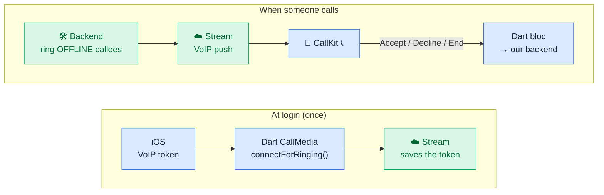

# Handbook — iOS ring (VoIP push + CallKit), do it yourself

> Companion to [26-ios-ring.md](26-ios-ring.md) (the lesson: WHY). This page is
> the HOW: every step, every file, every line of code, in order, so you can
> build it again, or fix it, **without an AI helper**.
>
> Roadmap: [README.md](README.md)

```
PART A  Outside the code (Apple · Stream · Xcode)     ← once per project
PART B  Native iOS (AppDelegate.swift)                ← start-up, PushKit
PART C  Dart (model · CallMedia · bloc)               ← tokens, buttons
PART D  Test on a real iPhone                         ← release build
PART E  When it doesn't work (troubleshooting)
PART F  Checklist (print it)
```

---

## 0. The idea in 30 seconds



Three facts to remember:

1. **Apple rule:** every VoIP push MUST be shown with CallKit at once, by
   native code. If not, iOS kills the app and later stops sending VoIP pushes.
   Stream's native plugin does this for us.
2. **Stream needs the iPhone's VoIP token.** The Stream **client** sends it,
   so the client must exist **from login**, not from the first call.
3. **Our backend is the boss of the call.** CallKit buttons must become
   OUR requests (`POST /accept · /reject · /end`), not Stream's.

---

## PART A — Outside the code

### A1. Apple Developer: an APNs key (`.p8`)

1. Open <https://developer.apple.com/account> → **Certificates, IDs &
   Profiles** → **Keys** → **+**.
2. Name it (for example `ERP APNs`), tick **Apple Push Notifications service
   (APNs)** → Continue → Register.
3. **Download** the `.p8`. Apple lets you download it **only once**. Keep it
   safe and never put it in git.
4. Write down:
   - **Key ID** (10 characters, shown on the key page)
   - **Team ID** (top right of the account page, or Membership)
   - **Bundle ID** of the app: `com.enterprise.erpMobile`

One `.p8` works for **all** your apps and for both sandbox and production.

### A2. Apple Developer: the App ID has Push

**Identifiers** → `com.enterprise.erpMobile` → make sure **Push
Notifications** is ticked. (Xcode usually does this when you add the
capability in A4.)

### A3. Stream dashboard: an APN provider

1. <https://dashboard.getstream.io> → your app → **Video & Audio** →
   **Push Notifications** (the name can differ a little between dashboard
   versions).
2. **New configuration** → type **APN**.
3. Fill it in:

   | Field | Value |
   |---|---|
   | **Name** | `apn` ← must equal the `apnProvider` in `CallMedia` (production: TestFlight / App Store builds) |
   | Auth key | the `.p8` file |
   | Key ID / Team ID | from A1 |
   | Bundle / Topic | `com.enterprise.erpMobile` |
   | Environment | **Sandbox / Development** for `flutter run` builds. Use **Production** for TestFlight / App Store |

4. **Disable any `firebase` provider** left from the old app. Android must
   NOT get Stream rings: it rings from our own FCM (Step 7.2), and two rings
   would happen.

> ⚠ The #1 mistake: the environment doesn't match the build. A
> `flutter run` build has `aps-environment = development` → Stream must use
> **sandbox**. A wrong environment is a **silent** failure: no error, no ring.

### A4. Xcode: capabilities

Open `ios/Runner.xcworkspace` (the workspace, not `.xcodeproj`) → target
**Runner** → **Signing & Capabilities**:

| Capability | Setting |
|---|---|
| **Push Notifications** | added |
| **Background Modes** | ✅ Voice over IP · ✅ Audio, AirPlay… · ✅ Remote notifications |

These write to two files. Check them:

`ios/Runner/Runner.entitlements`
```xml
<key>aps-environment</key>
<string>development</string>   <!-- production for TestFlight / App Store -->
```

`ios/Runner/Info.plist`
```xml
<key>UIBackgroundModes</key>
<array>
    <string>audio</string>
    <string>voip</string>
    <string>remote-notification</string>
</array>
<key>NSMicrophoneUsageDescription</key>
<string>ERP needs microphone access for voice and video calls and voice messages.</string>
<key>NSCameraUsageDescription</key>
<string>ERP needs camera access for video calls and to take a profile photo.</string>
```

Without `voip`, iOS never gives a VoIP token. Without the usage strings, the
app crashes when it asks for the mic or camera.

### A5. The backend (already done in this project)

Nothing to build, but know what it does:

| Where (`erp_java_backend_claude`) | What |
|---|---|
| `ChatCallService.start` | rings only callees whose presence is **OFFLINE** |
| `StreamVideoService.ring` | `POST video.stream-io-api.com/.../calls/default/{id}` with `ring: true` and the members |
| `StreamTokenService.cidForCall(id)` | Stream id = `default:erp-call-<our id>` |
| `PresenceService` | `/chats/presence/background` (sent by the app when minimized) → OFFLINE |

If you build a new backend, you need those four ideas.

---

## PART B — Native iOS: `ios/Runner/AppDelegate.swift`

The whole file. Every part is explained below it.

```swift
import Flutter
import UIKit
import Firebase
import flutter_local_notifications
import stream_video_push_notification
import CallKit

@main
@objc class AppDelegate: FlutterAppDelegate, CXCallObserverDelegate {
  private var isAppForeground = false          // starts false: a VoIP wake = background
  private let callObserver = CXCallObserver()  // watches every call on the phone

  override func application(
    _ application: UIApplication,
    didFinishLaunchingWithOptions launchOptions: [UIApplication.LaunchOptionsKey: Any]?
  ) -> Bool {
    FirebaseApp.configure()                                                   // B1
    UNUserNotificationCenter.current().delegate = self as UNUserNotificationCenterDelegate // B2
    FlutterLocalNotificationsPlugin.setPluginRegistrantCallback { registry in // B3
      GeneratedPluginRegistrant.register(with: registry)
    }
    GeneratedPluginRegistrant.register(with: self)                            // B4

    StreamVideoPKDelegateManager.shared.registerForPushNotifications()        // B5 ⭐

    callObserver.setDelegate(self, queue: DispatchQueue.main)                 // B6
    NotificationCenter.default.addObserver(                                   // B7
      self, selector: #selector(appDidBecomeActive),
      name: UIApplication.didBecomeActiveNotification, object: nil)
    NotificationCenter.default.addObserver(
      self, selector: #selector(appDidEnterBackground),
      name: UIApplication.didEnterBackgroundNotification, object: nil)

    return super.application(application, didFinishLaunchingWithOptions: launchOptions) // B8
  }

  @objc private func appDidBecomeActive() { isAppForeground = true }
  @objc private func appDidEnterBackground() { isAppForeground = false }

  // B9 — a CallKit ring that appears while the app is ON SCREEN is closed:
  // our own screen already shows that call (a rare race).
  func callObserver(_ callObserver: CXCallObserver, callChanged call: CXCall) {
    guard isAppForeground,
          !call.isOutgoing, !call.hasConnected, !call.hasEnded else { return }
    StreamVideoCallkitManager.shared.saveEndCall(call.uuid.uuidString, 6) // 6 = remoteEnded
  }
}
```

| Step | Line | Why | If you forget it |
|---|---|---|---|
| B1 | `FirebaseApp.configure()` | Firebase native start (FCM, 7.1) | Dart `Firebase.initializeApp()` may fail on iOS |
| B2 | notification delegate | Flutter plugins get "show this notification?" questions | notifications don't show while the app is open |
| B3 | registrant callback | a background engine (notification tap) also gets plugins | background tap → "plugin not found" crash |
| B4 | `register(with: self)` | connects every plugin to Dart | nothing native works |
| **B5** | **PushKit register** | asks iOS for the **VoIP token**; Stream's code receives VoIP pushes and shows CallKit | **no token → never rings** |
| B6 | `callObserver.setDelegate` | B9 gets called on every call change | B9 never runs (two rings in the race) |
| B7 | 2 lifecycle observers | `isAppForeground` = "user is looking" | B9 can't decide |
| B8 | `super.application` | Flutter finishes its start-up | the app doesn't start |
| B9 | the safety rule | closes a racing CallKit ring while the app is on screen | rare double ring: CallKit on top of our screen |

Why `didBecomeActive` / `didEnterBackground` and not *inactive*: CallKit
appearing over an open app makes it **inactive** for a moment, but the user is
still in the app. Only those two signals are reliable.

Why `saveEndCall(uuid, 6)`: a call that came from PushKit can only be closed
with `reportCall(endedAt:)` (reason 6 = remote ended). A normal
`CXEndCallAction` does not close it.

---

## PART C — Dart

### C1. Packages (`pubspec.yaml`)

```yaml
stream_video_flutter: ^1.7.2
stream_video_push_notification: ^1.7.2   # SAME version as stream_video_flutter
```

Then `flutter pub get` and `cd ios && pod install`.

### C2. The model: `lib/features/call/model/call_kit_action.dart`

A CallKit button + OUR call id. Stream gives `default:erp-call-12`, we need
`12`.

```dart
enum CallKitButton { accept, decline, end }

@immutable
class CallKitAction {
  const CallKitAction(this.button, this.callId);
  final CallKitButton button;
  final String callId;

  static const _prefix = 'erp-call-';

  /// `default:erp-call-12` → `12`. Not one of our calls → null.
  static String? callIdOf(String? cid) {
    if (cid == null) return null;
    final id = cid.substring(cid.indexOf(':') + 1);
    if (!id.startsWith(_prefix)) return null;
    final callId = id.substring(_prefix.length);
    return callId.isEmpty ? null : callId;
  }

  /// Our id → Stream id (to close its CallKit screen).
  static String cidOf(String callId) => 'default:$_prefix$callId';

  @override
  bool operator ==(Object other) =>
      other is CallKitAction && other.button == button && other.callId == callId;
  @override
  int get hashCode => Object.hash(button, callId);
  @override
  String toString() => 'CallKitAction(${button.name}, $callId)';
}
```

> The prefix MUST match the backend's `cidForCall` (`"default:erp-call-" + id`).
> Change one → change both.

### C3. `lib/features/call/repository/call_media.dart`

Five additions. `CallMedia` is the ONLY class that talks to the Stream SDK.

**C3.1 Imports + fields**

```dart
import 'package:flutter/widgets.dart' show AppLifecycleState, WidgetsBinding;
import 'package:stream_video_push_notification/stream_video_push_notification.dart';
import '../model/call_kit_action.dart';

CallMedia({
  required Future<StreamTokenModel?> Function() loadToken,
  bool Function()? onScreen,                       // a parameter for tests
}) : _loadToken = loadToken,
     _onScreen = onScreen ?? _appResumed;

final bool Function() _onScreen;
static bool _appResumed() =>
    WidgetsBinding.instance.lifecycleState == AppLifecycleState.resumed;

StreamSubscription<RingingEvent>? _ringSub;
final _callKit = StreamController<CallKitAction>.broadcast();

static const String apnProvider = 'apn';           // = the Stream dashboard name (A3)

static bool get _ringsWithCallKit =>               // iOS only!
    !kIsWeb && defaultTargetPlatform == TargetPlatform.iOS;

Stream<CallKitAction> get callKit => _callKit.stream;
```

**C3.2 The push manager when the client is made (`_create`)**

```dart
final client = StreamVideo(
  token.apiKey,
  user: User.regular(userId: token.userId),
  userToken: token.token,
  tokenLoader: (_) async => (await _loadToken())?.token ?? '',
  failIfSingletonExists: false,
  options: …,
  pushNotificationManagerProvider: _ringsWithCallKit
      ? StreamVideoPushNotificationManager.create(
          iosPushProvider: const StreamVideoPushProvider.apn(name: apnProvider),
          androidPushProvider: const StreamVideoPushProvider.firebase(
            name: 'firebase',                      // required by the API, unused on iOS
          ),
        )
      : null,                                      // Android: NO Stream ring
);
if (_ringsWithCallKit) _listenToCallKit(client);
```

What the SDK then does by itself:
- `connect()` (automatic, `autoConnect: true`) → `registerDevice()` → sends
  the VoIP token to Stream.
- `disconnect()` (our `signOut` → `StreamVideo.reset(disconnect: true)`) →
  `unregisterDevice()` → removes it.

**C3.3 Connect at login + catch an Accept made before Dart was alive**

```dart
Future<void> connectForRinging() async {
  if (!_ringsWithCallKit) return;
  try {
    final token = await _loadToken();
    if (token == null || !token.isUsable) return;
    final client = await _clientFor(token);
    final calls = await client.pushNotificationManager?.activeCalls();
    for (final c in calls ?? const <CallData>[]) {
      final callId = CallKitAction.callIdOf(c.callCid);
      if (c.isAccepted && callId != null) {
        _callKit.add(CallKitAction(CallKitButton.accept, callId));
      }
    }
  } catch (e) {
    debugPrint('[CallMedia] connectForRinging failed: $e');
  }
}
```

**C3.4 CallKit buttons → our stream**

```dart
void _listenToCallKit(StreamVideo client) {
  _ringSub?.cancel();
  _ringSub = client.pushNotificationManager?.onCallEvent.listen((event) {
    final (button, cid) = switch (event) {
      ActionCallAccept(:final data) => (CallKitButton.accept, data.callCid),
      ActionCallDecline(:final data) => (CallKitButton.decline, data.callCid),
      ActionCallEnded(:final data) => (CallKitButton.end, data.callCid),
      _ => (null, null),
    };
    final callId = CallKitAction.callIdOf(cid);
    if (button == null || callId == null) return;
    // On screen → the Decline / End is B9 closing a racing ring. Drop it.
    if (button != CallKitButton.accept && _onScreen()) return;
    _callKit.add(CallKitAction(button, callId));
  });
}
```

**C3.5 Close a CallKit screen + logout**

```dart
Future<void> endRing(String callId) async {
  if (!_ringsWithCallKit) return;
  try {
    await _client?.pushNotificationManager?.endCallByCid(
      CallKitAction.cidOf(callId),
      silent: true,            // silent = not reported back to us as "End"
    );
  } catch (_) {}
}

Future<void> signOut() async {
  await leave();
  await _ringSub?.cancel();
  _ringSub = null;
  _client = null;
  _clientUserId = null;
  try { await StreamVideo.reset(disconnect: true); } catch (_) {}   // removes the VoIP token
}
```

**C3.6 One client only**: `connectForRinging` (login) and `join` (first call)
can run at the same moment. `_clientFor` keeps the pending creation in
`_creating` and gives the SAME future to the second caller. Two `StreamVideo`
objects = two connections = strange bugs.

### C4. The bloc: `viewmodel/call/`

**C4.1 The event** (`call_view_model_event.dart`)

```dart
final class OnCallKitActionEvent extends CallViewModelEvent {
  OnCallKitActionEvent(this.action);
  final CallKitAction action;
}
```

**C4.2 In the constructor** (`call_view_model_bloc.dart`)

```dart
on<OnCallKitActionEvent>(_onCallKitAction);

_callKit = _media.callKit.listen((action) {
  if (!isClosed) add(OnCallKitActionEvent(action));
});
_session.addListener(_onSession);
_onSession();                       // already logged in (auto-login ran first)
```

Cancel `_callKit` in `close()`.

**C4.3 Connect at login**

```dart
bool _ringReady = false;

void _onSession() {
  if (!_session.isAuthenticated) {
    _ringReady = false;
    add(OnCallResetEvent());        // → _media.signOut()
  } else if (!_ringReady) {
    _ringReady = true;
    _media.connectForRinging();     // iOS: VoIP token → Stream (Android: no-op)
  }
}
```

**C4.4 The handler**

```dart
Future<void> _onCallKitAction(
  OnCallKitActionEvent event,
  Emitter<CallViewModelState> emit,
) async {
  final CallKitAction(:button, :callId) = event.action;
  final onScreen = state.callId == callId;
  switch (button) {
    case CallKitButton.accept:
      if (!onScreen) {
        if (state.isActive) return;               // busy
        final call = await _ringingForMe(callId); // GET /calls/{id}
        if (call == null) { _media.endRing(callId); return; } // too late
        if (state.isActive) return;               // raced
        await _onInvite(call, emit);              // → Incoming (+ "ringing")
      }
      if (state case CallIncomingState(:final call) when call.id == callId) {
        await _onAccept(OnCallAcceptEvent(), emit); // POST /accept → join
      }
    case CallKitButton.decline:
      if (onScreen) {
        _onDecline(OnCallDeclineEvent(), emit);
      } else {
        _repository.reject(callId);               // POST /reject
      }
    case CallKitButton.end:
      if (onScreen) _onHangUp(OnCallHangUpEvent(), emit); // = our red button
  }
}
```

`_ringingForMe(callId)` = `load(callId)`, and keep it only if the call is
`RINGING` and **I** am a `RINGING` participant (the same check as 7.2's
"opened from push").

**C4.5 Every end closes CallKit**: first lines of `_end(...)`:

```dart
final callId = state.callId;
if (callId != null) _media.endRing(callId);
```

### C5. Tests to keep

| Test | Proves |
|---|---|
| `call_kit_action_test.dart` | `default:erp-call-12` ↔ `12`; not ours → null |
| bloc: "logged in → connect for ringing" | the VoIP token is sent at login |
| bloc: "Accept, app was killed" | load → `ringing 7`, `accept 7` → InCall, join |
| bloc: "Accept twice" | accepted ONCE (live event + start-up check) |
| bloc: "Accept too late" | `endRing`, no screen |
| bloc: Decline unknown / End in call / End unknown | `reject` / `end` / nothing |
| bloc: "every end closes CallKit" | `endRing('7')` |

In tests, mock `media.callKit`, `media.connectForRinging()` and
`media.endRing(any())`, or every bloc test fails with a null stream.

---

## PART D — Test on a real iPhone

The simulator never gets VoIP pushes. Use a real iPhone.

```bash
flutter test                                              # all green first
flutter run --release --flavor dev -t lib/main_dev.dart   # RELEASE for the killed test
```

**Why release:** a debug iOS build can only start with `flutter run` / Xcode
attached. A VoIP push that starts a killed debug app → it crashes at launch.

| # | Do | Expect |
|---|---|---|
| 1 | Log in, call someone with the app OPEN | iOS asks for the mic → Allow |
| 2 | Swipe the app up (killed), lock the iPhone, call it | **CallKit rings on the lock screen** |
| 3 | Accept | talking at once; the caller's timer starts |
| 4 | End on CallKit | the caller: "Call ended" |
| 5 | Call again → Decline | the caller: "Call declined" within ~1 s |
| 6 | Call again → the caller hangs up while it rings | CallKit stops |
| 7 | App OPEN, call it | only our in-app screen, no CallKit |
| 8 | Log out, call that user | the iPhone does NOT ring |

**Where to read logs:**
- iPhone: Xcode → Window → **Devices and Simulators** → the phone → **Open
  Console** → filter `Runner` (look for `SV:PNManager`, `[CallMedia]`).
- Backend: `[call] callId=… — ringing OFFLINE callees via VoIP push: [..]`
  or `all callees ONLINE; skipping Stream VoIP ring`, plus
  `[stream] ring failed … status=…` on errors.

---

## PART E — When it doesn't work

Go **top to bottom**. Each row needs the row above it to work.

| Symptom | Check | Fix |
|---|---|---|
| Backend log says `all callees ONLINE; skipping` | Is the callee app really minimized? It must send `POST /chats/presence/background` | Minimize (Home), wait 1–2 s, call again. Look for that request in the dev log |
| Backend: `[stream] ring failed status=4xx` | the Stream request body / keys | read the message; the API key + secret must be the same app as the dashboard |
| Backend rings, the iPhone shows nothing | Is a VoIP device registered? Console: `SV:PNManager` `createDevice` | 1) you logged in after this build? 2) `voip` in Background Modes? 3) B5 line present? |
| Device registered, still nothing | Stream dashboard → the provider | **every `flutter run` build (even `--release`) is Development-signed = SANDBOX token**, which the production `apn` provider can't reach → test CallKit with a TestFlight / Ad Hoc build (or add a sandbox provider) · bundle id `com.enterprise.erpMobile` · right Key ID / Team ID |
| Rings only when the app is minimized, not when killed | the build type | killed test needs `--release` |
| Swiped away and still no ring | Low Power Mode / Focus / Do Not Disturb | turn them off; allow Notifications for the app |
| CallKit rings, Accept → nothing happens, the caller stays "Calling…" | Dart got the Accept? Console: `OnCallKitActionEvent` / `[CallMedia]` | the start-up check (`connectForRinging` → `activeCalls`) must run after login; is the user still logged in (refresh token not expired)? |
| Accept works, no sound | microphone permission | Settings → the app → Microphone ON (make one call with the app open first) |
| The call ended but CallKit stays (green pill) | `endRing` ran? | every `_end` calls `_media.endRing(callId)`; the Stream id prefix matches the backend |
| Two rings on iOS (CallKit + our screen) | B6 / B7 / B9 present? | the AppDelegate safety rule; and Dart drops Decline / End while on screen (C3.4) |
| **Android** rings twice | Stream has an Android device | disable the `firebase` provider in Stream; Android must have NO push manager (C3.2 `: null`) |
| After logout, the iPhone still rings | `signOut` ran? | `OnCallResetEvent` → `_media.signOut()` → `StreamVideo.reset(disconnect: true)` |
| Works in development, not in TestFlight | the environment | TestFlight / App Store = **production**: entitlements `production` + a production APN config in Stream |

**Apple's push "kill switch":** if the app gets VoIP pushes and does NOT show
CallKit (for example, you removed B5 or crashed early), iOS stops delivering
VoIP pushes to it. To recover, delete the app from the iPhone, restart the
phone, and install again.

---

## PART F — Checklist (print it)

```
OUTSIDE THE CODE
[ ] Apple: APNs key .p8 · Key ID · Team ID written down
[ ] Apple: App ID com.enterprise.erpMobile has Push Notifications
[ ] Stream: APN provider named "apn" · sandbox · bundle id · .p8
[ ] Stream: old "firebase" provider disabled
[ ] Xcode: Push Notifications + Background Modes (voip · audio · remote-notification)
[ ] Runner.entitlements aps-environment = development
[ ] Info.plist: NSMicrophoneUsageDescription · NSCameraUsageDescription

NATIVE
[ ] AppDelegate: FirebaseApp.configure · plugins · PushKit register (B5)
[ ] AppDelegate: callObserver + 2 lifecycle observers + the safety rule (B9)

DART
[ ] stream_video_push_notification = same version as stream_video_flutter
[ ] CallKitAction (prefix "erp-call-" = backend cidForCall)
[ ] CallMedia: push manager iOS ONLY · connectForRinging · callKit · endRing · signOut
[ ] CallMedia: one client only (_creating)
[ ] Bloc: connect at login · OnCallKitActionEvent · _end → endRing
[ ] Tests mock callKit / connectForRinging / endRing

TEST (real iPhone, --release)
[ ] killed + locked → CallKit rings
[ ] Accept = talking (1 tap) · End · Decline · caller cancels
[ ] app open → no CallKit · logout → no ring
```

---

## Where to read more

| Topic | Where |
|---|---|
| The WHY of this step | [26-ios-ring.md](26-ios-ring.md) |
| Android ring (FCM, 7.2) | [25-android-ring.md](25-android-ring.md) |
| Call rules (busy, crossed calls, timeouts) | `CALL_SCENARIOS.md` |
| Stream's own guide | getstream.io → Video → Flutter docs → "Ringing" and "Push notifications" |
| The SDK source (when docs aren't enough) | `~/.pub-cache/hosted/pub.dev/stream_video-1.7.2/lib/src/stream_video.dart` (search `onRingingEvent`, `activeCalls`) and `stream_video_push_notification-1.7.2/lib/src/stream_video_push_notification.dart` (`registerDevice`, `endCallByCid`) |
