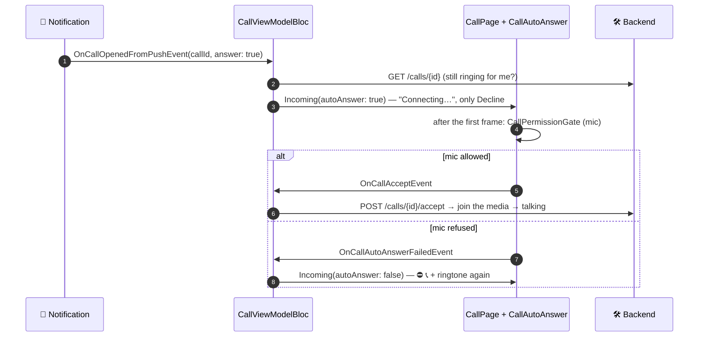

# Step 7.4 — Android: "Answer" on the ring → straight into the call

> ← Previous: [26-ios-ring.md](26-ios-ring.md) · Next: [28-voice-to-video.md](28-voice-to-video.md) → · Roadmap: [README.md](README.md)

```
7.1 push setup ✅ · 7.2 Android ring ✅ · 7.3 iOS ring (CallKit) ✅
7.4 Answer = Accept    one tap on the Android notification → talking   ← this lesson
```

## 1. Why

In 7.2, tapping **Answer** on the Android ring notification only OPENED the
incoming screen. You then tapped **Accept** a second time. iOS already does
it in one tap (CallKit Accept, 7.3). Now Android does too.

This step teaches:

- **A flag in the state, an action in the UI.** The bloc only says "the user
  already answered" (`autoAnswer`). The PAGE does the accept, because the
  microphone question needs a screen (`BuildContext`), and a bloc never has one.
- **One path for one action.** "Answer" runs the SAME code as the Accept
  button (mic check → `OnCallAcceptEvent`). No second accept path to keep in sync.
- **Don't use a listener for "the state was already set".** A
  `BlocListener` only sees CHANGES after it's built. When the app opens, the
  call page is often built when the state is ALREADY `autoAnswer`, so a
  listener would miss it. A small stateful widget checks on its first build.



## 2. Picture

```
Before (7.2)                          Now (7.4)
🔔 [Decline] [Answer]                 🔔 [Decline] [Answer]
        │ Answer                              │ Answer
        ▼                                     ▼
┌──────────────────┐                  ┌──────────────────┐
│     Mr Min       │                  │     Mr Min       │
│  Incoming call   │                  │   Connecting…    │
│ (⛔)       (📞)  │ ← 2nd tap         │       (⛔)       │ ← only to change your mind
└──────────────────┘                  └──────────────────┘
                                              ▼ (mic OK)
                                        00:00 talking
```

| Case | Result |
|---|---|
| Mic already allowed (usual) | Answer → "Connecting…" → talking. No dialog |
| Mic never asked | Answer → "Allow microphone?" → Allow → talking |
| Mic refused | the normal incoming screen (⛔ 📞) comes back + it rings again |
| Tap the notification body (not Answer) | the incoming screen, as in 7.2 |
| The call ended while the app opened | "Missed call" → closes (7.2) |
| STOMP already showed the call (app minimized, still alive) | Answer → that screen gets `autoAnswer` (no new load) |

### Files

```
lib/features/call/
├── viewmodel/call/call_view_model_state.dart   CallIncomingState + autoAnswer (==, hashCode, copyWith)
├── viewmodel/call/call_view_model_event.dart   + OnCallAutoAnswerFailedEvent
├── viewmodel/call/call_view_model_bloc.dart    _onOpenedFromPush: answer → autoAnswer · sounds
├── widgets/call_auto_answer.dart               NEW  runs the Accept path ONCE per call
├── widgets/call_controls.dart                  autoAnswer → only Decline
├── widgets/call_status_text.dart               autoAnswer → "Connecting…"
└── view/call_page.dart                         one accept(): the button AND CallAutoAnswer
test/features/call/  bloc (3) · sound rules · CallAutoAnswer (4) · controls
```

## 3. Code

### The bloc: just a flag

```dart
// already ringing on screen (STOMP was first) + "Answer"
if (s is CallIncomingState && s.call.id == event.callId) {
  if (event.answer && !s.accepting) emit(s.copyWith(autoAnswer: true));
  return;
}
…
await _onInvite(call, emit, autoAnswer: event.answer); // opened by Answer
```

The bloc never asks for permissions. `accepting` stays `false`: the PAGE
decides when to accept.

### One accept path

```dart
Future<void> accept() async {
  if (await CallPermissionGate.ensure(context, video: video)) {
    bloc.add(OnCallAcceptEvent());
  } else if (state case CallIncomingState(:final call)) {
    bloc.add(OnCallAutoAnswerFailedEvent(call.id)); // buttons back
  }
}
… CallControls(onAccept: accept) …
… CallAutoAnswer(state: state, onAnswer: accept) …
```

### CallAutoAnswer: once per call, even on the first build

```dart
void _maybeAnswer() {                    // from initState AND didUpdateWidget
  final s = widget.state;
  if (s is! CallIncomingState || !s.autoAnswer || s.accepting) return;
  if (_answered == s.call.id) return;    // never twice for one call
  _answered = s.call.id;
  WidgetsBinding.instance.addPostFrameCallback((_) {
    if (mounted) widget.onAnswer();      // a dialog needs a laid-out screen
  });
}
```

### A short "Connecting…": warm up while it rings

Before, everything Stream needed started only AFTER Accept: token request,
a new client, its socket, then the join. Now the bloc calls
`CallMedia.prepare()` the moment a call rings (mine or theirs), so after
Accept only the join is left:

```dart
Future<void> prepare() async {
  if (_client != null) return;   // iOS: made at login (7.3)
  await _newClient();            // token + client + socket, while it rings
}
// join(): final client = _client ?? await _newClient();
```

### Sounds

| change | sound |
|---|---|
| → Incoming with `autoAnswer` | silence (you already answered) |
| `autoAnswer` false → true | silence |
| mic refused (`autoAnswer` true → false) | ringtone again |

## 4. 🤔 Why like this? (other ways)

| Choice we made | Other way | Why we didn't pick the other way |
|---|---|---|
| `autoAnswer` flag + the page accepts | The bloc accepts at once (like iOS CallKit) | `CallMedia.join` only CHECKS the mic: a never-asked mic → a call with no sound and no reason shown. |
| The same `accept()` as the button | A second "auto" accept path | Two paths drift apart; one path = one set of rules (mic, camera, snackbars). |
| A stateful `CallAutoAnswer` widget | `BlocListener(listenWhen: autoAnswer)` | The page is often first built when the flag is ALREADY set → a listener never fires (the stuck "…" screen lesson). |
| Keep Decline visible | No buttons at all | You may change your mind during "Connecting…". |
| Open the app on Answer | Answer in the background (Android ConnectionService) | Big native work; the media needs the app anyway. |

## 5. Try it

```bash
flutter test                                              # 335 tests → All tests passed!
flutter run --release --flavor dev -t lib/main_dev.dart   # a REAL Android phone (the callee)
```

1. Android: log in, press Home. Call it from the other phone.
2. Tap **Answer** on the notification → the app opens on "Connecting…" →
   you talk. **One tap.**
3. Again with the app swiped away + the screen locked → it opens over the
   lock screen → talking.
4. Settings → the app → Microphone: Deny. Call → Answer → the mic dialog /
   snackbar → the normal ⛔ 📞 screen, ringing again.
5. Tap the notification BODY (not Answer) → the normal incoming screen.

## 6. Check yourself

1. Why doesn't the bloc accept the call itself when `answer` is true?
2. Why is `CallAutoAnswer` a stateful widget and not a `BlocListener`?
3. What makes sure the call is accepted only once?
4. What happens if the user refuses the microphone?

<details><summary>Answers</summary>

1. Accepting needs the microphone permission, which needs a screen
   (`BuildContext`). The bloc only sets a flag; the page runs the normal
   Accept path.
2. The page is often built for the first time when the state is already
   `autoAnswer`. A listener only reacts to later changes, so it would miss it.
3. `_answered` remembers the call id, and `_onAccept` ignores a second
   accept while `accepting` is true.
4. `OnCallAutoAnswerFailedEvent` turns `autoAnswer` off: the normal incoming
   screen comes back and the ringtone plays again.

</details>
