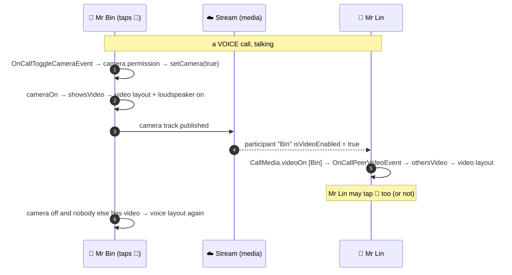

# Step 7.5 — Call: switch a voice call to video

> ← Previous: [27-answer-from-ring.md](27-answer-from-ring.md) · Next: [29-ios-call-banner-test.md](29-ios-call-banner-test.md) → · Roadmap: [README.md](README.md)

```
7.4 Answer = Accept ✅
7.5 voice → video     tap 🎥 in a voice call → both screens show video   ← this lesson
8   translations, tests, polish
```

## 1. Why

A voice call stayed a voice call: no camera button, and the video screen only
for calls STARTED as video. But the media layer (Stream) has no "voice" or
"video" mode at all: a camera track can be turned on at any moment. Only OUR
screen locked the type at the start.

This step teaches:

- **Decide the layout from what is happening, not from how it started.**
  `showsVideo` = started as video, OR my camera is on, OR someone else's is.
- **Follow the OTHER side through the media.** We don't send a message
  "I turned my camera on": Stream already tells every phone which participant
  has video. One more stream from `CallMedia` (`videoOn`) is enough.
- **The simplest option first (Telegram-style).** No "do you accept video?"
  question: no backend change. Asking first (WhatsApp-style) can come later.



## 2. Picture

```
Voice call                              after 🎥 (by either person)
┌──────────────────────┐               ┌───────────┬───────────┐
│        (MB)          │               │  Mr Bin   │  (me)     │
│       Mr Bin         │   tap 🎥 ─►   │ (camera)  │ small top │
│       01:12          │               │           │  right    │
│ (🎙)  (🎥̸)  (🔊)      │               │ (🎙)(🎥)(🔄)(🔊)        │
│        (⛔)          │               │        (⛔)            │
└──────────────────────┘               └───────────────────────┘
```

| What happens | Result |
|---|---|
| I tap 🎥 in a voice call | my camera on → video layout, loudspeaker on |
| Camera permission refused | stays voice (the toggle rolls back, 6.2) |
| THEY turn a camera on | my screen switches to video (I see them; my camera stays off) |
| Everybody's camera off again | back to the voice layout |
| A call started as video | always the video layout (as before) |
| I turned the speaker off in a video call, then camera off/on | my speaker choice stays |

### Files

```
lib/features/call/
├── repository/call_media.dart                  + videoOn (the others with a camera on)
├── viewmodel/call/call_view_model_state.dart   InCall + othersVideo · showsVideo
├── viewmodel/call/call_view_model_event.dart   + OnCallPeerVideoEvent
├── viewmodel/call/call_view_model_bloc.dart    follow videoOn · camera on in voice → speaker on
├── widgets/call_controls.dart                  🎥 in EVERY call; Flip only while my camera is on
└── view/call_page.dart                         the video layout when showsVideo
test/features/call/  bloc (4: voice · my camera · refused · their camera) · controls
```

No backend change. The call line in the chat still says "voice call" (how it
started).

## 3. Code

### One getter decides the layout

```dart
bool get showsVideo => call.isVideo || cameraOn || othersVideo.isNotEmpty;
…
final onVideo = state is CallInCallState && state.showsVideo;   // call_page.dart
```

### Who else has a camera on — from the media

```dart
_videoSub = c.state.valueStream
    .map((s) => {
          for (final p in s.otherParticipants)
            if (p.isVideoEnabled) p.userId,
        }.toList()..sort())
    .distinct(const ListEquality<String>().equals)   // same people → no event
    .listen(_video.add);
```

The same pattern as `peers` (6.3c): a set (no duplicates), sorted, `distinct`.

### Camera on in a voice call → the loudspeaker too

```dart
final wasVideo = before is CallInCallState && before.showsVideo;
await _toggle(…cameraOn…);                   // optimistic + rollback (6.2)
if (!wasVideo && s.cameraOn && !s.speakerOn) add(OnCallToggleSpeakerEvent());
```

Only for voice → video: in a call that is already video, the user's own
speaker choice wins.

## 4. 🤔 Why like this? (other ways)

| Choice we made | Other way | Why we didn't pick the other way |
|---|---|---|
| Just turn the camera on (Telegram) | Ask first: "switch to video?" (WhatsApp / FaceTime) | Needs a backend endpoint + STOMP event + a request state on both phones. Can come later. |
| Learn the other side's camera from Stream | Our own STOMP message "camera on" | Stream already knows (and it's always right, even after a reconnect). One source, no sync bugs. |
| `showsVideo` getter in the state | `if (call.isVideo)` checks in widgets | One rule in one place; widgets just read it. |
| The call record stays VOICE | Backend marks it video | A backend change for a history label; not worth it now. |

## 5. Try it

```bash
flutter test                                              # 343 tests → All tests passed!
flutter run --release --flavor dev -t lib/main_dev.dart   # two phones
```

1. Start a **voice** call, talk.
2. Phone A taps 🎥 → A shows video (B as a photo tile) and the loudspeaker
   turns on; B's screen switches to video and sees A.
3. B taps 🎥 too → both see each other.
4. Both turn the camera off → both back to the voice screen.
5. Deny the camera permission once → A stays in voice.

## 6. Check yourself

1. Why could we add this without changing the backend?
2. Which three things make `showsVideo` true?
3. How does B's phone know that A turned the camera on?
4. Why does the speaker turn on only for voice → video?

<details><summary>Answers</summary>

1. Video is just a camera track in the same Stream call; only our screen
   decided the layout from the start type.
2. The call started as video, my camera is on, or someone else's camera is on.
3. Stream marks A's participant `isVideoEnabled`; `CallMedia.videoOn` turns it
   into `OnCallPeerVideoEvent` → `othersVideo`.
4. A voice call is usually held to the ear (earpiece); video means looking at
   the screen. In a call that is already video, the user may have turned the
   speaker off on purpose; we keep that choice.

</details>
