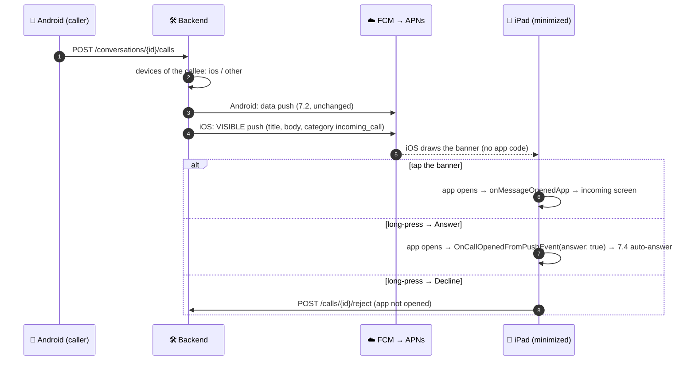

# Test branch — iOS: a call banner from our own push (no CallKit)

> ← Previous: [28-voice-to-video.md](28-voice-to-video.md) · Roadmap: [README.md](README.md)
>
> ⚠️ **Test branch only:** `test/ios-local-call-notification` (app AND backend).
> Not for release: a TestFlight / App Store build would ring TWICE
> (CallKit + this banner).

```
7.3 iOS ring = CallKit (Stream VoIP push, production APNs only)   ← real path
7.3b test path: our FCM push → an iOS banner, works with `flutter run`   ← this lesson
```

## 1. Why

CallKit (7.3) only rings on **TestFlight / Ad Hoc / App Store** builds: the
Stream `apn` provider is production, and every `flutter run` build gets a
**sandbox** VoIP token. So while developing, a minimized iPad never showed a
call. We wanted a way to SEE incoming calls on iOS with `flutter run`.

This lesson teaches:

- **A silent push is not a ring on iOS.** Android runs our Dart code for a
  data push (7.2). iOS often does NOT wake the app for a silent
  (`content-available`) push, never for a swiped-away app. So "Dart shows a
  local notification" does not work on iOS.
- **Let iOS draw it.** A VISIBLE push (title + body) is drawn by iOS itself:
  no app code runs, so it works minimized AND killed. FCM picks sandbox or
  production by itself, so it works with `flutter run`.
- **Debug with the device's own log.** We found 2 hidden causes only with
  `idevicesyslog`: the push WAS delivered, and the banner was blocked by
  screen mirroring.



## 2. Picture

```
Small banner                         Long-press / pull down
┌────────────────────────────┐       ┌────────────────────────────┐
│ 🟦 ERP              now    │       │ Mr Lin                     │
│ Mr Lin                     │  ──►  │ Incoming voice call        │
│ Incoming voice call        │       ├────────────────────────────┤
└────────────────────────────┘       │ Decline              (red) │
                                     │ Answer                     │
                                     └────────────────────────────┘
```

| | Android (7.2) | iOS banner (this branch) | iOS CallKit (7.3) |
|---|---|---|---|
| Who draws it | our app | iOS | iOS (call screen) |
| Buttons | always visible | only when expanded | big Accept / Decline |
| Ringtone | loops ≤ 60 s | one short sound | loops |
| `flutter run` build | ✅ | ✅ | ❌ (sandbox token) |
| App swiped away | ✅ | ✅ | ✅ |

### Files

```
App (test/ios-local-call-notification)
lib/features/call/repository/call_notifications.dart
      guard lets iOS in · DarwinInitializationSettings (category incoming_call:
      Decline / Answer) · iOS details for showIncoming
lib/core/push/push_messaging.dart
      onOpened / launchedBy(): data + the tapped button (actionIdentifier)
      + log [Push] permission=…
lib/app/call_push.dart
      banner tap → incoming screen · Answer → answer: true · Decline → reject

Backend (test/ios-local-call-notification)
devices/service/FcmService.java      sendAlertToTokens (visible, category)
                                     + dead token (UNREGISTERED) → delete row
devices/service/DeviceService.java   forgetToken
devices/repository/DeviceRepository  deleteByFcmToken
chats/controller/ChatCallController  pushInvite: ios → alert, other → data
test: FcmServiceTest (only UNREGISTERED is dead)
```

## 3. Code

### Backend: iOS gets a visible push, Android keeps the data push

```java
List<Device> devices = deviceService.listForUsers(targetIds);
List<String> iosTokens   = …filter(d -> d.getPlatform() == DevicePlatform.ios)…;
List<String> otherTokens = …filter(d -> d.getPlatform() != DevicePlatform.ios)…;
fcm.sendDataToTokens(otherTokens, data);                 // Android: 7.2
fcm.sendAlertToTokens(iosTokens, title, body, data);      // iOS: banner
```

```java
.setAps(Aps.builder()
        .setAlert(ApsAlert.builder().setTitle(title).setBody(body).build())
        .setSound("default")
        .setCategory(IOS_CALL_CATEGORY)   // "incoming_call" → the buttons
        .build())
```

### App: the category that gives the buttons

```dart
iOS: DarwinInitializationSettings(
  requestAlertPermission: false,   // already asked in bootstrap (FCM)
  notificationCategories: [
    DarwinNotificationCategory(iosCategory, actions: [
      DarwinNotificationAction.plain(actionDecline, 'Decline',
          options: {DarwinNotificationActionOption.destructive}),
      DarwinNotificationAction.plain(actionAnswer, 'Answer',
          options: {DarwinNotificationActionOption.foreground}),
    ]),
  ],
),
```

### App: which button was tapped

```dart
Stream<({Map<String, dynamic> data, String? action})> get onOpened =>
    FirebaseMessaging.onMessageOpenedApp.map(
      (m) => (data: m.data, action: m.actionIdentifier),
    );
…
switch (tap.action) {
  case CallNotifications.actionDecline: decline(invite.callId);
  case CallNotifications.actionAnswer:  open(invite.callId, answer: true);
  default:                              open(invite.callId, answer: false);
}
```

`answer: true` reuses 7.4 (`autoAnswer` → `CallAutoAnswer` → the Accept
button's path). `decline` is the same function the Android Decline uses.

### Backend: forget dead tokens

```java
} catch (FirebaseMessagingException ex) {
    if (isDeadToken(ex.getMessagingErrorCode())) {   // UNREGISTERED only
        devices.forgetToken(token);                   // delete the row
    } …
}
```

Before: 4 dead tokens of old installs were tried first (~0.4 s each), so the
iPad's push left 1.8 s late. Now they fail once and are gone.

## 4. 🤔 Why like this? (other ways)

| Choice we made | Other way | Why we didn't pick the other way |
|---|---|---|
| A VISIBLE push for iOS | Silent push + Dart shows a local notification | iOS often doesn't wake the app (we saw it in the log); never for a swiped-away app |
| Visible push for iOS only | Visible push for everyone | Android would show a plain system banner AND skip our handler (no full-screen ring) |
| Read `actionIdentifier` from firebase_messaging | Native Swift in `AppDelegate` for Decline | The plugin already passes the button: no native code |
| Delete only on `UNREGISTERED` | Delete on any error | A server / quota / auth error is temporary: the token may work next time |
| Keep it on a test branch | Ship it with CallKit | A production build would ring twice (CallKit + banner) |

## 5. Try it

```bash
# backend (test branch): restart it
./gradlew bootRun
# app (test branch)
flutter run --release --flavor dev -t lib/main_dev.dart
```

1. iPad: log in, press Home. Settings → Notifications → app → Banner Style:
   **Persistent**.
2. Call from Android → the banner "Mr Lin · Incoming voice call".
3. Tap it → the incoming screen. Long-press → **Answer** → talking;
   **Decline** → Android shows "Declined".
4. The backend log: `[fcm] sent ALERT …`; a dead token once:
   `[fcm] dead token=… → removed 1 device row(s)`.

### Debugging lessons (what really went wrong)

| What we saw | Real cause | How we found it |
|---|---|---|
| Crash "iOS settings must be set" | `flutter_local_notifications` initialized on iOS with Android settings only | the start-up log |
| No banner at all (silent push) | iOS didn't wake the app | backend `tokens=5` but no `[CallPush]` log |
| "Not shown" on another iPad | the test build was never installed on that iPad | `flutter run` log: no device found |
| Banner gone after 5 s | Banner Style = Temporary | iOS Settings |
| Delivered but no banner | **Screen Mirroring** was on: `will NOT appear as banner with reason 'Posting not permitted during screen sharing'` | `idevicesyslog` on the iPad |

```bash
# read the iPad's own log (USB), only our app's notifications
idevicesyslog -u <udid> | grep -iE "erpMobile|banner|presentable"
```

## 6. Check yourself

1. Why can't a silent push ring an iPhone reliably?
2. Why does Android keep the data push?
3. Why can't we show Decline / Answer on the small iOS banner?
4. When do we delete a device row?
5. Why does this stay on a test branch?

<details><summary>Answers</summary>

1. iOS decides if and when to wake the app for a silent push, and never does
   for a swiped-away app. A visible push is drawn by iOS itself.
2. A visible push on Android is drawn by the system and skips our handler, so
   there would be no full-screen ring with our buttons (7.2).
3. iOS shows notification buttons only when the notification is expanded
   (long-press / pull down), for every app.
4. Only when FCM says `UNREGISTERED` (the app was removed / reinstalled).
5. On TestFlight / App Store builds CallKit already rings; with this banner
   too, the iPad would ring twice.

</details>
