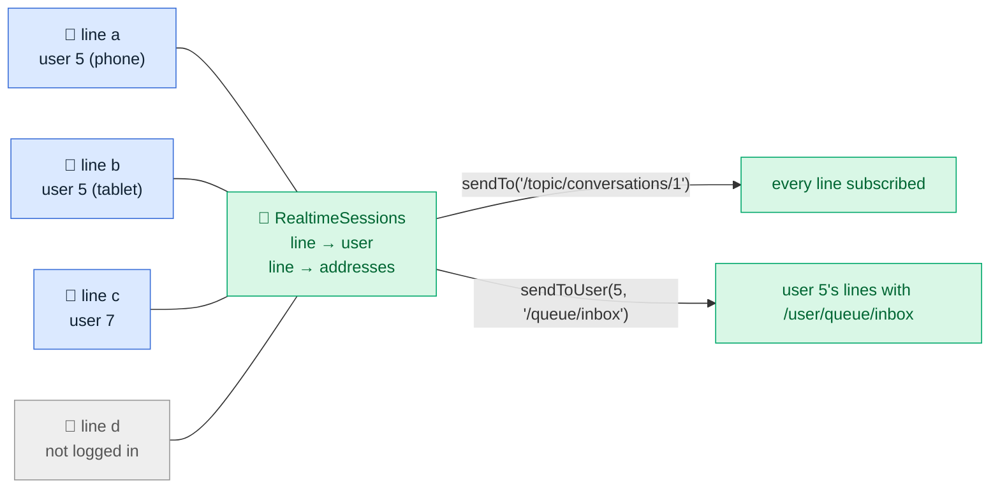

# Track B · R1 — plain WebSocket: the phone book (backend)

> Branch **`feature/raw-websocket`** (app AND backend, from `feature/rebuild`).
> ← Previous: [28-voice-to-video.md](28-voice-to-video.md) · Next: [31-raw-websocket-r2-door.md](31-raw-websocket-r2-door.md) → · Roadmap: [README.md](README.md)

```
Track B: realtime over a PLAIN WebSocket instead of STOMP
R1 the phone book (RealtimeSessions)                 ← this lesson
R2 the door /realtime + auth + ping/pong
R3 ChatBroadcaster sends on the new door · typing
R4 connect / disconnect events → presence + calls
R5 the app: ws_connection.dart (replaces stomp_connection.dart)
R6 two phones: chat, typing, presence, ✓✓, calls
```

## 1. Why

STOMP (Spring's broker) did a lot for us **for free**:

- it remembered **which line belongs to which user** (from the CONNECT token);
- it remembered **who listens to which address** (SUBSCRIBE);
- `convertAndSendToUser(5, "/queue/inbox")` reached **only user 5's** lines.

With a plain WebSocket there are no addresses and no users: just lines that
carry text. So before anything else we build the **phone book** that STOMP
kept for us. This step teaches:

- **Same address strings as STOMP** (`/topic/conversations/5`,
  `/user/queue/inbox`), so the app's repositories never change.
- **A `/user/...` address is private**: it only reaches the lines of that user.
- **A small interface for the line** (`RealtimeClient`), so tests use a toy
  line, the same idea as the app's `StompConnection` (13b, Stage 2).

The plan (decided in /discussion, option B):

| | |
|---|---|
| Keep | `ChatBroadcaster.toConversation / toUser`, `RealtimeService.subscribe`, all addresses, every BLoC and screen |
| New door | `/realtime` (plain WebSocket), **next to** the STOMP door `/ws` until the end (old builds / `feature/call` keep working) |
| Our letters | JSON: `auth` → `ready`, `subscribe` / `unsubscribe`, `message`, `send`, `ping` / `pong`, `error` |

| STOMP today | Our plain-WebSocket letter |
|---|---|
| CONNECT + token | 📱 `{"type":"auth","token":"eyJ…"}` (first letter, within 10 s) |
| CONNECTED | 🖥 `{"type":"ready"}` |
| SUBSCRIBE / UNSUBSCRIBE | 📱 `{"type":"subscribe","destination":"/topic/conversations/5"}` |
| MESSAGE | 🖥 `{"type":"message","destination":"…","event":"message.send","payload":{…}}` |
| SEND `/app/...` | 📱 `{"type":"send","destination":"/app/conversations/5/typing","body":{"typing":true}}` |
| heartbeat | 📱 `{"type":"ping"}` every 10 s → 🖥 `{"type":"pong"}`; silent 25 s = dead |
| ERROR | 🖥 `{"type":"error","message":"…"}` then close |

## 2. Picture



### Files (backend)

```
src/main/java/…/features/chats/realtime/         NEW package (STOMP stays in chats/ws/)
├── RealtimeClient.java      one line: id() · send(text) · close()
└── RealtimeSessions.java    the phone book (@Component)
src/test/java/…/features/chats/realtime/
└── RealtimeSessionsTest.java   6 tests with toy lines
```

## 3. Code

### One line = 3 buttons

```java
public interface RealtimeClient {
    String id();             // unique per line
    void send(String text);  // one JSON letter, never throws
    void close();
}
```

The real one (R2) wraps Spring's `WebSocketSession`; tests use `FakeClient`
that just remembers what it was sent.

### The phone book

```java
private final Map<String, Entry> lines = new ConcurrentHashMap<>();

private static final class Entry {
    final RealtimeClient client;
    volatile Long userId;                                   // null until "auth"
    final Set<String> destinations = ConcurrentHashMap.newKeySet();
}
```

| Method | Plain words | STOMP did this in… |
|---|---|---|
| `open(client)` | a new line (not logged in) | the WebSocket handshake |
| `authenticate(lineId, userId)` | this line belongs to user 5 | the guard on CONNECT (`setUser`) |
| `subscribe(lineId, destination)` | listen to an address (only when logged in) | SUBSCRIBE |
| `sendTo(destination, text)` | every line on that address | `convertAndSend("/topic/…")` |
| `sendToUser(userId, queue, text)` | that user's lines on `"/user" + queue` | `convertAndSendToUser` |
| `close(lineId)` → `Closed(userId, lastLine)` | who left, and was it their LAST line | `SessionDisconnectEvent` |
| `isOnline(userId)` | any logged-in line left? | presence's session count |

### Private means private

```java
public int sendToUser(long userId, String queue, String text) {
    String destination = "/user" + queue;                   // "/queue/inbox" → "/user/queue/inbox"
    for (Entry e : lines.values()) {
        if (e.userId != null && e.userId == userId && e.destinations.contains(destination)) {
            e.client.send(text);
            …
```

User 7 may subscribe to `/user/queue/inbox` too, but a letter for user 5
checks the **owner** of each line, so it never reaches user 7.

### `close` tells "last line"

```java
public Optional<Closed> close(String lineId) {
    Entry e = lines.remove(lineId);
    if (e == null || e.userId == null) return Optional.empty();
    return Optional.of(new Closed(e.userId, !isOnline(e.userId)));
}
```

A user can have 2 phones. Closing one ≠ offline. Only the LAST line means
"offline" (presence) and "gone" (the call rule, R4).

## 4. 🤔 Why like this? (other ways)

| Choice we made | Other way | Why we didn't pick the other way |
|---|---|---|
| Same address strings as STOMP | New names (`inbox`, `conv:5`) | The app's repositories and the backend's `ChatBroadcaster` callers would all change |
| A new package `chats/realtime/` | Change `chats/ws/` in place | Both doors live side by side until the end; mixing them is confusing |
| `RealtimeClient` interface | Use `WebSocketSession` directly | Tests would need a real socket; a 3-method interface is enough |
| A loop over all lines in `sendTo` | A second map `destination → lines` | Simpler and always right; with a few hundred lines it's fast. A second index can come later if needed |
| `ConcurrentHashMap` | `synchronized` everywhere | Lines open, close and send on many threads; concurrent maps are made for that |

## 5. Try it

```bash
cd ~/Documents/call_erp/erp_java_backend_claude
./gradlew test --tests '*RealtimeSessionsTest'     # 6 tests
./gradlew test                                      # everything still green
```

Nothing is wired to a socket yet (that's R2), so the app doesn't change.

## 6. Check yourself

1. What did STOMP do for free that `RealtimeSessions` now does?
2. User 7 subscribes to `/user/queue/inbox`. Can a letter for user 5 reach him?
3. User 5 has a phone and a tablet. He closes the phone. Is he offline?
4. Why keep the same address strings as STOMP?

<details><summary>Answers</summary>

1. Which line is which user, who listens to which address, private sends to
   one user.
2. No: `sendToUser` checks the owner of each line, not only the address.
3. No: `close` returns `lastLine = false`; only the tablet closing makes him
   offline.
4. So the app's repositories and the backend's broadcaster callers don't
   change; only the bottom layer does.

</details>
