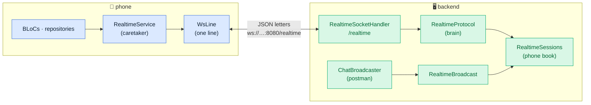
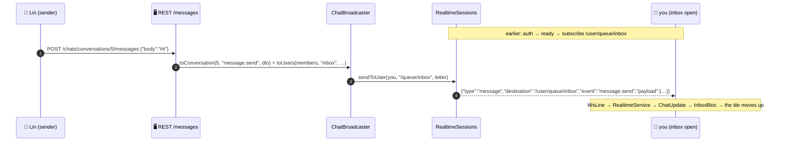
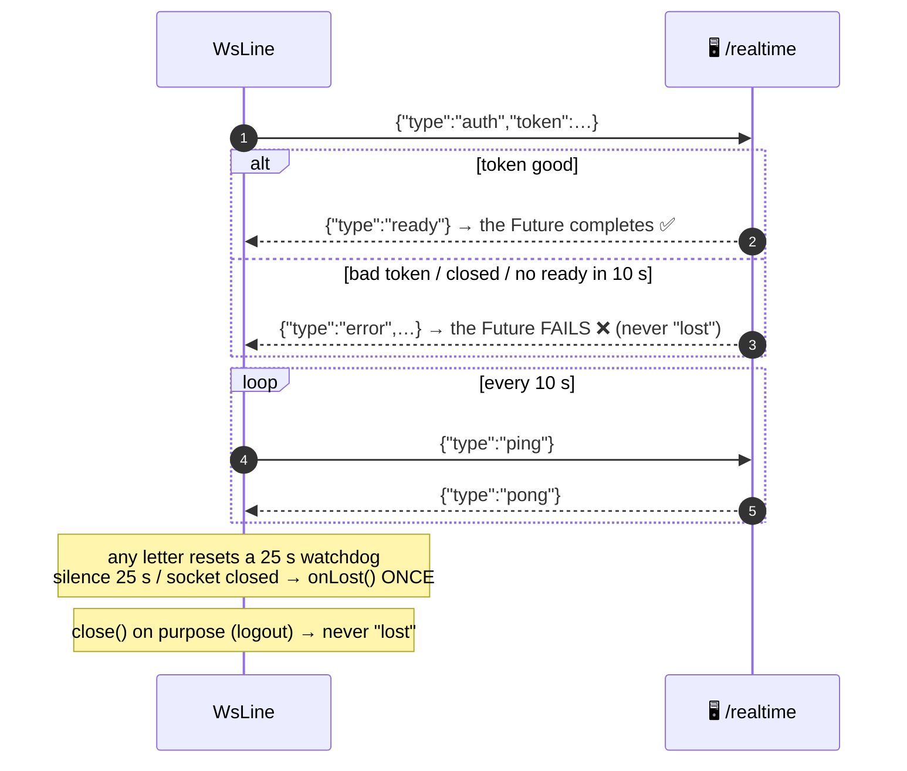

# Track B: plain WebSocket, set it up from zero (backend ↔ phone)

> Branch **`feature/raw-websocket`** (app AND backend).
> The step-by-step lessons: [R1](30-raw-websocket-r1-sessions.md) ·
> [R2](31-raw-websocket-r2-door.md) · [R3](32-raw-websocket-r3-broadcast.md) ·
> [R4](33-raw-websocket-r4-connections.md) · [R5](34-raw-websocket-r5-app.md) ·
> The STOMP version: [13b Stage 9](13b-realtime-reading-path.md) ·
> Roadmap: [README.md](README.md)

The R1–R5 lessons explain each piece as we built it. This page puts them in
ONE place, in the order you would build them **from an empty project**:
the backend first, then the phone, then make them meet.

## 📑 Contents

- [**Part 0: the big picture**](#part-0-the-big-picture)
  - [One line, our own letters](#one-line-our-own-letters)
  - [The 9 letters](#the-9-letters)
  - [The addresses](#the-addresses)
  - [One message, start to end](#one-message-start-to-end)
- [**Part 1: the backend (Spring), from zero**](#part-1-the-backend-spring-from-zero)
  - [1. The library](#1-the-library)
  - [2. `RealtimeClient` + `RealtimeSessions`: the phone book (R1)](#2-realtimeclient--realtimesessions-the-phone-book-r1)
  - [3. `RealtimeLetters`: the only place that writes letters](#3-realtimeletters-the-only-place-that-writes-letters)
  - [4. `RealtimeProtocol`: the brain (R2)](#4-realtimeprotocol-the-brain-r2)
  - [5. `RealtimeSocketHandler` + `RealtimeConfig`: the door `/realtime`](#5-realtimesockethandler--realtimeconfig-the-door-realtime)
  - [6. `SecurityConfig`: let the knock through](#6-securityconfig-let-the-knock-through)
  - [7. `RealtimeBroadcast` + `ChatBroadcaster`: the postman (R3)](#7-realtimebroadcast--chatbroadcaster-the-postman-r3)
  - [8. `UserConnections`: presence + calls (R4, R6)](#8-userconnections-presence--calls-r4-r6)
- [**Part 2: the phone (Flutter), from zero**](#part-2-the-phone-flutter-from-zero)
  - [9. The packages](#9-the-packages)
  - [10. `RealtimeConnection`: the remote with 3 buttons](#10-realtimeconnection-the-remote-with-3-buttons)
  - [11. `connectWebSocket` + `WsLine`: one line (R5)](#11-connectwebsocket--wsline-one-line-r5)
  - [12. `RealtimeService`: the caretaker](#12-realtimeservice-the-caretaker)
  - [13. `RealtimeLifecycle`: who presses the buttons](#13-realtimelifecycle-who-presses-the-buttons)
  - [14. The address + plain `ws://`](#14-the-address--plain-ws)
  - [15. Wire it once](#15-wire-it-once)
- [**Part 3: make them meet (the network)**](#part-3-make-them-meet-the-network)
- [**Part 4: try it**](#part-4-try-it)
  - [Knock from the Mac (no app)](#knock-from-the-mac-no-app)
  - [The tests](#the-tests)
  - [Two phones](#two-phones)
- [**Part 5: when it doesn't work**](#part-5-when-it-doesnt-work)
- [**❓ Check yourself**](#-check-yourself)

---

## Part 0: the big picture

[↑ Contents](#-contents)

### One line, our own letters

HTTP is "ask → answer → hang up". For chat and calls the SERVER must speak
first ("a new message for you!"), so the phone keeps ONE line open: a
**WebSocket**. A WebSocket only carries text. WHAT the text means is up to
us. STOMP was a ready-made set of rules; Track B uses **our own small JSON
letters** instead.

```
🖥 BACKEND (your Mac)                                   📱 PHONE
1 the library (spring-boot-starter-websocket)        9  the packages (web_socket_channel)
2 the phone book (RealtimeSessions)                  10 the remote (RealtimeConnection)
3 the letter writer (RealtimeLetters)                11 one line (connectWebSocket + WsLine)
4 the brain (RealtimeProtocol)                       12 the caretaker (RealtimeService)
5 the door /realtime (handler + config)              13 who presses the buttons (RealtimeLifecycle)
6 security: permitAll /realtime                      14 the address ws://<mac-ip>:8080/realtime
7 the postman (ChatBroadcaster → both doors)         15 wire it once (injection.dart + main.dart)
8 presence + calls (UserConnections)
                    └──── Part 3: same Wi-Fi + the right IP + port 8080 ────┘
```



### The 9 letters

One letter = one WebSocket text frame = one JSON object. `type` is always
there and always first.

| Who | Letter | Example | Means |
|---|---|---|---|
| 📱 | `auth` | `{"type":"auth","token":"eyJ…"}` | "this is me" (MUST be the first letter, within 10 s) |
| 🖥 | `ready` | `{"type":"ready"}` | "token OK, you're in" |
| 📱 | `subscribe` | `{"type":"subscribe","destination":"/user/queue/inbox"}` | "send me letters for this address" |
| 📱 | `unsubscribe` | `{"type":"unsubscribe","destination":"/topic/conversations/5"}` | "stop" |
| 🖥 | `message` | `{"type":"message","destination":"/topic/conversations/5","event":"message.send","payload":{…}}` | a real update |
| 📱 | `send` | `{"type":"send","destination":"/app/conversations/5/typing","body":{"typing":true}}` | the phone tells the server something (typing) |
| 📱 | `ping` | `{"type":"ping"}` | "still here" (every 10 s) |
| 🖥 | `pong` | `{"type":"pong"}` | "me too" |
| 🖥 | `error` | `{"type":"error","message":"Not allowed","destination":"…"}` | something was wrong (bad token → then the line closes) |

### The addresses

The same strings as in the STOMP days, so the repositories didn't change.

| Address | Who gets it | What comes |
|---|---|---|
| `/user/queue/inbox` | only ME | new messages for the inbox, edits, deletes, removed from a chat |
| `/user/queue/calls` | only ME | `call.invite`, `call.ringing` |
| `/topic/conversations/{id}` | members of that chat | messages, ✓✓ read, typing, chat changes |
| `/topic/conversations/{id}/call` | members of that chat | accept · reject · hangup |
| `/topic/presence` | everyone | 🟢 online · in a call · last seen |
| `/app/conversations/{id}/typing` | (phone → server) | the only `send` address |

### One message, start to end



Sending a message is still **HTTP** (it needs an answer: the saved message
or an error). The WebSocket only carries the NEWS to everyone.

---

## Part 1: the backend (Spring), from zero

[↑ Contents](#-contents)

Repo `~/Documents/call_erp/erp_java_backend_claude`, package
`features/chats/realtime/` (the old STOMP code stays in `chats/ws/`).

```
chats/realtime/
├── RealtimeClient.java         one line: id · send · close            (R1)
├── RealtimeSessions.java       the phone book                         (R1)
├── RealtimeLetters.java        builds every server letter             (R2)
├── RealtimeProtocol.java       the brain: auth, subscribe, ping, sweep (R2)
├── RealtimeSocketHandler.java  Spring ↔ the brain                     (R2)
├── RealtimeConfig.java         the door /realtime                     (R2)
└── RealtimeBroadcast.java      toTopic / toUser                       (R3)
chats/ws/ChatBroadcaster.java   the postman: BOTH doors                (R3)
chats/presence/UserConnections.java  presence + the call rule          (R4, R6)
core/security/SecurityConfig.java    permitAll "/realtime"             (R2)
```

### 1. The library

[↑ Contents](#-contents)

`build.gradle`:

```gradle
implementation 'org.springframework.boot:spring-boot-starter-websocket'
```

The same library STOMP used. Plain WebSocket support is inside it
(`@EnableWebSocket`, `TextWebSocketHandler`). The WebSocket uses the SAME
port as HTTP (`server.port`, 8080).

### 2. `RealtimeClient` + `RealtimeSessions`: the phone book (R1)

[↑ Contents](#-contents)

`RealtimeClient` is ONE line, as small as possible, so tests can use toy
lines without a real socket:

```java
public interface RealtimeClient {
    String id();
    void send(String text);
    void close();
}
```

`RealtimeSessions` remembers who is on which line and which addresses each
line listens to:

```
line "a1" → user 5 → { /user/queue/inbox, /topic/conversations/14 }
line "b7" → user 4 → { /user/queue/inbox, /topic/presence }
```

| Method | Does |
|---|---|
| `open(client)` / `authenticate(lineId, userId)` | a line knocks / its token was good |
| `subscribe(lineId, dest)` / `unsubscribe` | logged-in lines only |
| `sendTo(dest, text)` | every line that listens to `dest` (a topic) |
| `sendToUser(userId, "/queue/x", text)` | only THAT user's lines listening to `/user/queue/x` (private) |
| `close(lineId)` | → `Closed(userId, lastLine)` once (empty the 2nd time) |

Details: [30-raw-websocket-r1-sessions.md](30-raw-websocket-r1-sessions.md).

### 3. `RealtimeLetters`: the only place that writes letters

[↑ Contents](#-contents)

```java
public String ready()  { return write(letter("ready")); }
public String pong()   { return write(letter("pong")); }
public String error(String message) { … }
public String message(String destination, String event, Object payload) { … }

private static Map<String, Object> letter(String type) {
    Map<String, Object> m = new LinkedHashMap<>();   // keeps the order
    m.put("type", type);                             // "type" always FIRST
    return m;
}
```

One writer = every letter looks the same, and the logs read easily.

### 4. `RealtimeProtocol`: the brain (R2)

[↑ Contents](#-contents)

Plain Java (no Spring web types), so it's tested with toy lines and a fake
clock. It reads every letter:

```
open ─► wait for the FIRST letter
         ├─ "auth" + good token ─► authenticate · presence 🟢 · send "ready"
         └─ anything else / bad token / not JSON ─► "error" + close
logged in:
   "subscribe"   ─► allowed? ─► the phone book · no ─► error "Not allowed" (line stays open)
   "unsubscribe" ─► the phone book
   "send"        ─► /app/conversations/{id}/typing ─► TypingController (WHO = the line's user)
   "ping"        ─► "pong"
every 5 s (sweep): no auth after 10 s, or silent for 25 s ─► close
```

Who may listen where:

| Address | Rule |
|---|---|
| `/topic/presence` | any logged-in line |
| `/user/queue/[a-z-]+` | any logged-in line (it only ever gets ITS user's letters) |
| `/topic/conversations/{id}` and `…/call` | only if `ConversationService.requireMember(id, me)` passes |
| anything else | `error "Not allowed"` |

**Safety rule:** the server takes WHO from the line (the token at `auth`),
never from a letter's body. A phone can't say "I am user 7".

Details: [31-raw-websocket-r2-door.md](31-raw-websocket-r2-door.md).

### 5. `RealtimeSocketHandler` + `RealtimeConfig`: the door `/realtime`

[↑ Contents](#-contents)

The handler is only the adapter between Spring and the brain:

```java
public class RealtimeSocketHandler extends TextWebSocketHandler {
    public void afterConnectionEstablished(WebSocketSession session) {
        // safe to send from many threads; a slow phone can't block forever
        var client = new SpringClient(new ConcurrentWebSocketSessionDecorator(session, 5_000, 512 * 1024));
        protocol.onOpen(client);
    }
    protected void handleTextMessage(WebSocketSession session, TextMessage message) {
        protocol.onText(client, message.getPayload());
    }
    public void afterConnectionClosed(WebSocketSession session, CloseStatus status) {
        protocol.onClose(session.getId());
    }
}
```

The config opens the door:

```java
@Configuration
@EnableWebSocket
public class RealtimeConfig implements WebSocketConfigurer {
    public void registerWebSocketHandlers(WebSocketHandlerRegistry registry) {
        registry.addHandler(handler, "/realtime").setAllowedOriginPatterns("*");
    }
}
```

Two doors live side by side: STOMP `/ws` (old builds, `feature/call`) and
plain `/realtime` (this app).

### 6. `SecurityConfig`: let the knock through

[↑ Contents](#-contents)

```java
.requestMatchers(…, "/ws/**", …, "/realtime", …).permitAll()
```

A WebSocket starts with an HTTP "upgrade" request that has **no**
`Authorization` header. Without `permitAll` → 401 → the line never opens.
It is still safe: the token is checked one step later, in the `auth` letter.

```
HTTP upgrade to /realtime  → permitAll (anyone may knock)
{"type":"auth","token":…}  → the brain checks the ID card
```

### 7. `RealtimeBroadcast` + `ChatBroadcaster`: the postman (R3)

[↑ Contents](#-contents)

```java
// RealtimeBroadcast
public int toTopic(String destination, String event, Object payload) {
    return sessions.sendTo(destination, letters.message(destination, event, payload));
}
public int toUser(long userId, String queue, String event, Object payload) {
    return sessions.sendToUser(userId, queue, letters.message("/user" + queue, event, payload));
}
```

`ChatBroadcaster` keeps its old method names and sends EVERY update through
BOTH doors:

```java
private void toTopic(String destination, String event, Object payload) {
    template.convertAndSend(destination, ChatEvent.of(event, payload));   // STOMP /ws
    realtime.toTopic(destination, event, payload);                        // plain /realtime
}
// toConversation(id) · toCall(id) · toPresence() · toUser(s)(id, "inbox" | "calls")
```

Rule: nothing sends around `ChatBroadcaster` (presence too), or one door
would miss it.

Details: [32-raw-websocket-r3-broadcast.md](32-raw-websocket-r3-broadcast.md).

### 8. `UserConnections`: presence + calls (R4, R6)

[↑ Contents](#-contents)

ONE rule for "a user's line came / went", used by both doors:

```
auth OK    ─► connected(user, "rt:" + lineId)   ─► PresenceService.connect → 🟢
line closed ─► disconnected("rt:" + lineId, how) ─► PresenceService.disconnect
              no line left (any door)? ─► CallDisconnectHandler (end a ring / hang up a call)
```

- Presence counts connections across BOTH doors (closing one ≠ offline).
- `"rt:"` so a plain-door id never clashes with a STOMP session id.
- **How the line ended (R6):** the phone's OS closes a killed app's socket
  AT ONCE → `Drop.CLOSED` → a call is hung up after **3 s**
  (`closed-disconnect-grace-seconds`). A network drop sends nothing; the
  25 s sweep closes the line → `Drop.SILENT` → **30 s** (it may come back).

Details: [33-raw-websocket-r4-connections.md](33-raw-websocket-r4-connections.md).

---

## Part 2: the phone (Flutter), from zero

[↑ Contents](#-contents)

```
lib/core/realtime/
├── realtime_connection.dart   the remote (interface) + RealtimeConnector type
├── ws_connection.dart         connectWebSocket + WsLine (our letters)       (R5)
├── realtime_service.dart      the caretaker: reconnect, fresh token, address book
├── realtime_event.dart        {event, payload} → RealtimeEvent
└── realtime_lifecycle.dart    login / app front / network back → start / stop / reconnect
lib/core/config/environments.dart   the address ws://…:8080/realtime
lib/core/di/injection.dart          wiring · lib/main.dart: attach()
```

### 9. The packages

[↑ Contents](#-contents)

`pubspec.yaml`:

```yaml
web_socket_channel: ^3.0.1   # the WebSocket itself (our JSON letters)
connectivity_plus: ^7.0.0    # "network is back" → reconnect at once
```

`stomp_dart_client` was removed after R6. No package knows our letters;
`ws_connection.dart` does (about 200 lines).

### 10. `RealtimeConnection`: the remote with 3 buttons

[↑ Contents](#-contents)

```dart
abstract interface class RealtimeConnection {
  void Function() subscribe(String destination, void Function(String? body) onMessage);
  void send(String destination, String body);
  void close();
}

typedef RealtimeConnector = Future<RealtimeConnection> Function({
  required String url, required String token, required void Function() onLost,
});
```

Tiny on purpose: `RealtimeService` only presses these 3 buttons. That's why
STOMP → plain WebSocket was ONE new file on the phone.

### 11. `connectWebSocket` + `WsLine`: one line (R5)

[↑ Contents](#-contents)

```dart
Future<RealtimeConnection> connectWebSocket({required String url, required String token,
                                             required void Function() onLost}) async {
  final channel = WebSocketChannel.connect(Uri.parse(url));
  await channel.ready.timeout(const Duration(seconds: 10));   // the socket is open
  return WsLine.open(incoming: channel.stream, sendRaw: channel.sink.add,
                     closeRaw: () => channel.sink.close(), token: token, onLost: onLost);
}
```

`WsLine` does the letters and the timers:



- A `message` letter goes to the listener of its `destination`, as the RAW
  text. `RealtimeEvent.tryParse` reads `event` + `payload` from it.
- Our own JSON `ping`, not WebSocket ping frames: the server's sweep only
  sees letters.

Details: [34-raw-websocket-r5-app.md](34-raw-websocket-r5-app.md).

### 12. `RealtimeService`: the caretaker

[↑ Contents](#-contents)

The same as in the STOMP days (13b Stage 3); only the connector changed:

```dart
RealtimeService({required this.url, required Future<String?> Function() accessToken,
                 RealtimeConnector connector = connectWebSocket, …})
```

| It does | How |
|---|---|
| reconnect by itself | `onLost` → wait 1 s, 2 s, 4 s … 30 s → try again |
| a FRESH token each try | `accessToken()` → `TokenRefresher.validTokens()` (one shared refresh) |
| remember addresses | its address book; after a reconnect it subscribes everything again |
| tell the app "I'm back" | `reconnected` stream → the inbox / open chat / call reload |
| `send` | while connected; dropped (false) when not (typing doesn't matter later) |

### 13. `RealtimeLifecycle`: who presses the buttons

[↑ Contents](#-contents)

```
logged in              ─► realtime.start()   (+ "foreground" if the app is on screen)
logged out             ─► realtime.stop()
app back in front      ─► realtime.reconnectNow() + POST /chats/presence/foreground
app minimized          ─► POST /chats/presence/background  (OFFLINE → calls ring by push)
network back (Wi-Fi/4G)─► realtime.reconnectNow()   ← connectivity_plus
```

No page ever starts or stops the line.

### 14. The address + plain `ws://`

[↑ Contents](#-contents)

`lib/core/config/environments.dart`:

```dart
static const String localApiBaseUrl  = 'http://172.26.17.118:8080';         // REST
static const String localRealtimeUrl = 'ws://172.26.17.118:8080/realtime';  // the line
```

| Part | Means |
|---|---|
| `ws://` | plain WebSocket (like `http://`); an HTTPS server → **`wss://`** |
| `172.26.17.118` | your Mac's IP on the Wi-Fi |
| `8080` | the backend port (the same as REST) |
| `/realtime` | the door from step 5 (NOT `/ws`, that's STOMP) |

Rule: same host + port as the REST URL; `http` → `ws` (`https` → `wss`) +
`/realtime`. `Flavor.realtimeUrl` picks one per flavor;
`ApiEndPoint.websocketUrl` reads it.

```bash
ipconfig getifaddr en0   # your Mac's Wi-Fi IP (it changes with the network!)
```

Plain `ws://` / `http://` (dev, no HTTPS) must be allowed:

```xml
<!-- Android: android/app/src/main/AndroidManifest.xml -->
<application … android:usesCleartextTraffic="true">

<!-- iOS: ios/Runner/Info.plist -->
<key>NSAppTransportSecurity</key>
<dict><key>NSAllowsArbitraryLoads</key><true/></dict>
<key>NSLocalNetworkUsageDescription</key>
<string>ERP uses the local network …</string>
```

iOS asks **"Allow … local network?"** the first time; until you tap Allow,
everything to the Mac fails. A real `https` / `wss` server needs none of
this.

### 15. Wire it once

[↑ Contents](#-contents)

`lib/core/di/injection.dart`:

```dart
getIt.registerLazySingleton<RealtimeService>(
  () => RealtimeService(
    url: ApiEndPoint.websocketUrl,
    accessToken: () async => (await getIt<TokenRefresher>().validTokens())?.accessToken,
  ),
);
getIt.registerLazySingleton<RealtimeLifecycle>(
  () => RealtimeLifecycle(session: getIt<AuthSession>(), realtime: getIt<RealtimeService>(),
                          onBackground: …, onForeground: …),
);
```

`lib/main.dart`:

```dart
getIt<RealtimeLifecycle>().attach();   // from now on, login connects by itself
```

Then the features only call `realtime.subscribe('/user/queue/inbox')` (in
their repository) and listen.

---

## Part 3: make them meet (the network)

[↑ Contents](#-contents)

```
📱 phone ── Wi-Fi "Office" ──► 🖥 Mac 172.26.17.118:8080   (the SAME Wi-Fi)
```

| Check | How |
|---|---|
| backend running? | `curl http://localhost:8080/health` on the Mac |
| the right branch? | the backend runs `feature/raw-websocket` (it has `/realtime`); restart after pulling |
| phone reaches the Mac? | open `http://<mac-ip>:8080/health` in the **phone's browser** |
| same Wi-Fi? | not 4G, not a guest network |
| right IP? | `ipconfig getifaddr en0` = `environments.dart` |
| Mac firewall | allow Java (or turn it off while testing) |
| iOS Local Network | Settings → the app → Local Network ON |
| Android emulator | `10.0.2.2` = the Mac (`localhost` = the emulator itself) |
| iOS simulator | `localhost` works |

---

## Part 4: try it

[↑ Contents](#-contents)

### Knock from the Mac (no app)

A bad token, no password needed (Node 22+ has `WebSocket` built in):

```bash
node -e '
const ws = new WebSocket("ws://localhost:8080/realtime");
ws.onopen = () => ws.send(JSON.stringify({type: "auth", token: "nope"}));
ws.onmessage = (e) => console.log("server:", e.data);
ws.onclose = (e) => console.log("closed", e.code);'
# server: {"type":"error","message":"Invalid or expired token"}
# closed 1000
```

| Knock | The server answers |
|---|---|
| bad token | `error "Invalid or expired token"` → closed |
| `ping` before `auth` | `error "Send auth first"` → closed |
| nothing at all | `error "auth timeout"` after 10–15 s → closed |

### The tests

```bash
# backend
cd ~/Documents/call_erp/erp_java_backend_claude
./gradlew test --tests '*realtime*' --tests '*UserConnections*' --tests '*CallDisconnect*'

# phone
cd ~/Documents/call_erp/erp_flutter_claude
flutter test test/core/realtime/
```

### Two phones

| # | Do | Expect |
|---|---|---|
| 1 | log in | the inbox shows NO "Connecting…" |
| 2 | send "Hi" from A | B's inbox and chat show it at once |
| 3 | B opens the chat | A sees ✓ → ✓✓ |
| 4 | A types | B sees "typing…" |
| 5 | both open | 🟢 both ways; minimize one → it goes "last seen" |
| 6 | stop the backend 30 s, start it | "Connecting…" → back by itself, the inbox reloads |
| 7 | call with both apps open | rings, accept, talk, hang up, a call line in the chat |
| 8 | callee minimized / killed | rings by push |
| 9 | swipe away during a call | the other phone: "Call ended" after ~3 s |

Backend log lines to watch:

```
[call-disconnect] user=4 socket CLOSED (app gone?) — re-check in 5s (in a call: 3s)
[call-disconnect] user=4 gone — hung up 1 answered call(s)
```

---

## Part 5: when it doesn't work

[↑ Contents](#-contents)

| You see | Likely cause |
|---|---|
| timeout; `/health` fails in the phone's browser too | network: IP / Wi-Fi / firewall (Part 3) |
| `/health` works in the browser, the app fails on iOS | Local Network permission is off |
| REST works, "Connecting…" forever | `realtimeUrl` wrong (`/ws` instead of `/realtime`, `http` instead of `ws`), or the backend is an old build without `/realtime` (404 on the upgrade) |
| opens, then closes at once | bad / expired token on `auth` (the server sends `error` first) |
| connected, but a chat gets no updates | `error "Not allowed"` in the log: not a member of that chat |
| 🟢 never shows for one user | that user's app was minimized and never sent `/foreground` (fixed in R6: login on screen sends it) |
| the line drops every ~25 s | the app's ping isn't reaching the server (an old build) |
| a call doesn't end after a swipe | the backend wasn't restarted after R6 (3 s rule), or the line was SILENT (network), so it waits 30 s |

---

## ❓ Check yourself

[↑ Contents](#-contents)

1. Why is `/realtime` `permitAll`, and where is the token really checked?
2. Which letter must come first, and what happens if it doesn't?
3. Why does a private letter to `/user/queue/inbox` never reach another user?
4. Why does sending a message still use HTTP?
5. Why our own `ping` letter, not WebSocket ping frames?
6. The phone swaps STOMP for the plain WebSocket. Which phone files change?
7. Swipe away vs Wi-Fi gone during a call: how does the server tell them
   apart, and how long does each wait?

<details><summary>Answers</summary>

1. The upgrade request has no `Authorization` header, so it must be let in;
   the token is checked in the first letter (`auth`), and a bad one closes
   the line.
2. `auth`, within 10 s. Anything else first → `error` + close.
3. `sendToUser` only looks at THAT user's lines, and the user comes from the
   token, never from the letter.
4. It needs an answer (the saved message or an error); the WebSocket only
   carries the news to everyone.
5. The server's 25 s sweep only sees letters; built-in ping frames never reach
   `RealtimeProtocol`.
6. Only `core/realtime/` (the new `ws_connection.dart`, the interface rename)
   and `environments.dart`. Repositories, BLoCs and screens: none.
7. A killed app's socket is CLOSED by its OS at once → 3 s. A network drop is
   SILENT; the 25 s sweep closes it → 30 s more (it may come back).

</details>
