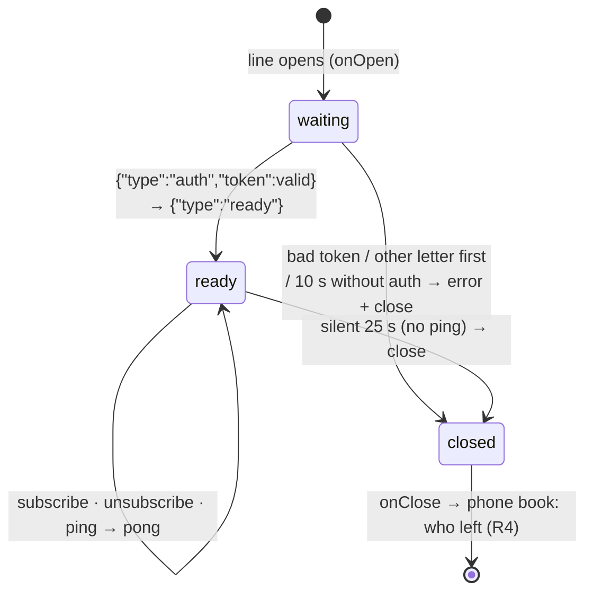
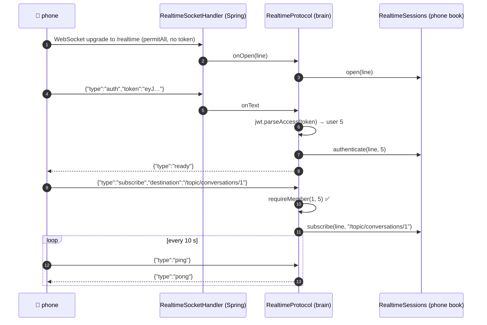

# Track B · R2 — plain WebSocket: the door `/realtime` (backend)

> Branch **`feature/raw-websocket`** (app AND backend).
> ← Previous: [30-raw-websocket-r1-sessions.md](30-raw-websocket-r1-sessions.md) · Next: [32-raw-websocket-r3-broadcast.md](32-raw-websocket-r3-broadcast.md) → · Roadmap: [README.md](README.md)

```
R1 the phone book (RealtimeSessions) ✅
R2 the door /realtime + auth + ping/pong          ← this lesson
R3 ChatBroadcaster sends on the new door · typing
R4 connect / disconnect → presence + calls
R5 the app: ws_connection.dart
R6 two phones
```

## 1. Why

R1 built the phone book. Now we open a **door** where phones can come in, and
we write the **rules at the door**: what STOMP's CONNECT, SUBSCRIBE and
heartbeats did for us.

This step teaches:

- **Brain and adapter apart.** `RealtimeProtocol` (the rules, plain Java) is
  tested with toy lines and a fake clock. `RealtimeSocketHandler` (Spring's
  WebSocket) only passes events to it.
- **The token comes in the first letter**, not the HTTP upgrade (the same
  idea as STOMP's CONNECT; 13b Stage 9). So `/realtime` is `permitAll` in
  `SecurityConfig`, and the door itself checks the token.
- **A server must not trust silence.** A line that never logs in (10 s) or
  stops talking (25 s, no ping) is closed. That's how a dead phone is noticed.
- **Who may listen where.** Your own `/user/queue/...` and `/topic/presence`:
  yes. A chat topic: only if you're a member. Anything else: no.

## 2. Picture





### Files (backend, `features/chats/realtime/`)

```
RealtimeLetters.java        the server's letters as JSON: ready · pong · error · message
RealtimeProtocol.java       the BRAIN (@Component): auth · subscribe rules · ping · sweep (10 s / 25 s)
RealtimeSocketHandler.java  Spring's TextWebSocketHandler → protocol calls (the adapter)
RealtimeConfig.java         @EnableWebSocket: the door "/realtime" (next to STOMP's "/ws")
core/security/SecurityConfig.java   + "/realtime" in permitAll
test: RealtimeProtocolTest.java     12 tests (toy lines + a fake clock)
```

## 3. Code

### The door

```java
@Configuration
@EnableWebSocket
public class RealtimeConfig implements WebSocketConfigurer {
    public void registerWebSocketHandlers(WebSocketHandlerRegistry registry) {
        registry.addHandler(handler, "/realtime").setAllowedOriginPatterns("*");
    }
}
```

`@EnableWebSocket` (plain) and `@EnableWebSocketMessageBroker` (STOMP) live
side by side: two doors, `/realtime` and `/ws`.

### The adapter: Spring events → brain

```java
public void afterConnectionEstablished(WebSocketSession session) {
    SpringClient client = new SpringClient(
        new ConcurrentWebSocketSessionDecorator(session, 5_000, 512 * 1024));
    protocol.onOpen(client);
}
protected void handleTextMessage(WebSocketSession s, TextMessage m) { protocol.onText(client, m.getPayload()); }
public void afterConnectionClosed(WebSocketSession s, CloseStatus st) { protocol.onClose(s.getId()); }
```

**Why `ConcurrentWebSocketSessionDecorator`?** Spring's session must not be
sent to from two threads at once (a chat message and a pong at the same
moment → error). The decorator queues sends safely, and a phone that's too
slow (5 s / 512 KB waiting) is dropped instead of blocking everyone.

### The brain: the first letter must be "auth"

```java
if (!line.authed) {
    if (!"auth".equals(type)) fail(line, "Send auth first");
    else auth(line, letter.path("token").asText(""));
    return;
}

private void auth(Line line, String token) {
    try {
        long userId = jwt.parseAccess(token).userId();   // the SAME check as REST / STOMP
        line.authed = true;
        sessions.authenticate(line.client.id(), userId);
        line.client.send(letters.ready());               // = STOMP's CONNECTED
    } catch (Exception e) {
        fail(line, "Invalid or expired token");          // error + close
    }
}
```

### Who may listen where

```java
boolean allowed(String destination, long userId) {
    if ("/topic/presence".equals(destination)) return true;
    if (USER_QUEUE.matcher(destination).matches()) return true;   // /user/queue/x: only MY lines get it (R1)
    Matcher m = CONVERSATION_TOPIC.matcher(destination);          // /topic/conversations/42(/call)
    if (m.matches()) {
        try { conversations.requireMember(Long.parseLong(m.group(1)), userId); return true; }
        catch (Exception e) { return false; }                      // not a member
    }
    return false;                                                  // unknown address
}
```

A refused subscribe sends `{"type":"error","message":"Not allowed",
"destination":"…"}`, and the line **stays open** (one bad address isn't a
reason to hang up).

### The sweep: nobody stays silent

```java
@Scheduled(fixedRate = 5_000)
public void sweep() {
    for (Line line : lines.values()) {
        if (!line.authed && line.openedAt.plus(AUTH_TIMEOUT).isBefore(now)) fail(line, "auth timeout");
        else if (line.lastSeen.plus(IDLE_TIMEOUT).isBefore(now)) line.client.close();
    }
}
```

Every letter (even `ping`) updates `lastSeen`. The phone pings every 10 s, so
an alive phone is never closed; a dead one is closed after 25–30 s (the same
time STOMP's heartbeats took).

## 4. 🤔 Why like this? (other ways)

| Choice we made | Other way | Why we didn't pick the other way |
|---|---|---|
| Token in the first letter | Token in the URL (`/realtime?token=…`) | URLs end up in server / proxy logs: a token leak |
| Token in the first letter | `Authorization` header on the upgrade | Not every WebSocket client can set headers (browsers can't); the first letter works everywhere |
| Brain (`RealtimeProtocol`) + adapter (`RealtimeSocketHandler`) | Everything in the handler | The handler needs real Spring sessions in tests; the brain tests in milliseconds with toy lines |
| Membership check on subscribe | Trust the phone (STOMP's current setup subscribes freely) | Anyone could listen to any chat by guessing its id |
| `@Scheduled` sweep every 5 s | A timer per line | One loop for all lines is simpler; ±5 s doesn't matter here |
| Server waits for the phone's `ping` | Server sends pings | The phone must notice a dead line too (R5); its ping + our pong covers both sides |

## 5. Try it

```bash
cd ~/Documents/call_erp/erp_java_backend_claude
./gradlew test --tests '*realtime*'     # 18 tests (6 R1 + 12 R2)
./gradlew bootRun                         # restart: the door /realtime opens
```

Knock with a BAD token (no password needed), from the Mac:

```bash
node -e '
const ws = new WebSocket("ws://localhost:8080/realtime");
ws.onopen = () => ws.send(JSON.stringify({type: "auth", token: "nope"}));
ws.onmessage = (e) => console.log("server:", e.data);
ws.onclose = (e) => console.log("closed", e.code);'
# server: {"type":"error","message":"Invalid or expired token"}
# closed 1000
```

**What the real server answered** (2026-11-27, no password needed):

| Knock | Server | |
|---|---|---|
| bad token | `error "Invalid or expired token"` → closed | ✅ |
| `ping` before `auth` | `error "Send auth first"` → closed | ✅ |
| silent, no letter | `error "auth timeout"` after 12.9 s → closed | ✅ (10 s + the 5 s sweep) |
| not JSON as the FIRST letter | first run: `error "Not JSON"` but the line **stayed open** | ⚠️ → fixed |

The live knock found a gap the tests missed: bad JSON was checked BEFORE the
"first letter must be auth" rule. Now, before auth, bad JSON = error +
close (after auth it's only an error). New test:
`notJson_asTheFirstLetter_errorAndClose`. Also `"type"` is now always the
FIRST key of a server letter (`RealtimeLetters.letter(type)`), so logs read
easily.

**Lesson:** tests check what you THOUGHT of; a real knock checks what you
didn't.

## 6. Check yourself

1. Why is `/realtime` `permitAll`, and where is the token checked?
2. What happens if the phone sends `subscribe` before `auth`?
3. You subscribe to a chat you're not in. What do you get? Is the line closed?
4. Why does the server close a line that's silent for 25 s?

<details><summary>Answers</summary>

1. The upgrade request has no token; the first letter `auth` carries it and
   `RealtimeProtocol.auth` checks it with `jwt.parseAccess`.
2. `error "Send auth first"`, then the line is closed.
3. `{"type":"error","message":"Not allowed","destination":…}`; the line stays open.
4. A dead phone (killed, no network) can't say goodbye. Without the sweep the
   server would think it's still online (presence, calls: R4).

</details>
