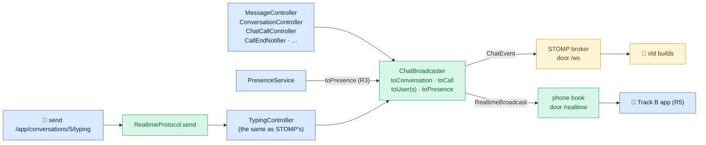

# Track B · R3 — plain WebSocket: letters go out through BOTH doors (backend)

> Branch **`feature/raw-websocket`** (app AND backend).
> ← Previous: [31-raw-websocket-r2-door.md](31-raw-websocket-r2-door.md) · Roadmap: [README.md](README.md)

```
R1 the phone book ✅ · R2 the door /realtime ✅
R3 ChatBroadcaster → both doors · typing over "send"     ← this lesson
R4 connect / disconnect → presence + calls
R5 the app: ws_connection.dart
R6 two phones
```

## 1. Why

After R2, a phone could come in at `/realtime` and subscribe, but **no letter
ever arrived**: every service still sent through STOMP only. In R3 the
postman learns to use both doors.

This step teaches:

- **One place to change.** Every live letter in the backend already goes
  through `ChatBroadcaster` (13b Stage 1). So we change ONE class, and messages,
  edits, reads, reactions, conversations and calls all reach the new door.
- **Find the one that went around it.** `PresenceService` called Spring's
  STOMP template directly. Now it calls `ChatBroadcaster.toPresence` like
  everyone else.
- **Reuse the rules, don't copy them.** Typing from the plain door calls the
  SAME `TypingController` that STOMP uses: "who" comes from the line's login,
  and the member check is still in one place.

## 2. Picture



### Files (backend)

```
chats/realtime/RealtimeBroadcast.java   NEW  the plain door's postman: toTopic · toUser
chats/ws/ChatBroadcaster.java           every method → STOMP AND RealtimeBroadcast; + toPresence
chats/presence/PresenceService.java     no SimpMessagingTemplate; uses toPresence
chats/realtime/RealtimeProtocol.java    "send" → /app/conversations/{id}/typing → TypingController
test: RealtimeBroadcastTest (4) · RealtimeProtocolTest (+3 = 15)
```

## 3. Code

### The postman for the plain door

```java
public int toTopic(String destination, String event, Object payload) {
    return sessions.sendTo(destination, letters.message(destination, event, payload));
}
public int toUser(long userId, String queue, String event, Object payload) {
    String destination = "/user" + queue;                     // the address the phone subscribed to
    return sessions.sendToUser(userId, queue, letters.message(destination, event, payload));
}
```

The letter is turned into JSON **once** (with Spring's `ObjectMapper`, the
same one STOMP uses, so dates and field names are identical), then the SAME
text goes to every line.

```json
{"type":"message","destination":"/topic/conversations/1","event":"message.send","payload":{"id":264,"body":"Hello",…}}
```

The app's `RealtimeEvent.tryParse` only reads `event` + `payload`, so this is
the same envelope as STOMP's body.

### ChatBroadcaster: same methods, two doors

```java
private void toTopic(String destination, String event, Object payload) {
    template.convertAndSend(destination, ChatEvent.of(event, payload));   // door /ws (STOMP)
    realtime.toTopic(destination, event, payload);                        // door /realtime
}
public void toUser(Long userId, String destination, String event, Object payload) {
    template.convertAndSendToUser(String.valueOf(userId), "/queue/" + destination, ChatEvent.of(event, payload));
    realtime.toUser(userId, "/queue/" + destination, event, payload);
}
public void toPresence(String event, Object payload) { toTopic("/topic/presence", event, payload); }
```

**Can a phone get a letter twice?** No. A phone is connected through ONE door:
the STOMP app through `/ws`, the Track B app through `/realtime`.

### Typing over "send"

```java
private void send(Line line, String destination, JsonNode body) {
    Matcher m = TYPING.matcher(destination);                  // /app/conversations/(\d+)/typing
    if (!m.matches()) { line.client.send(letters.error("Unknown destination", destination)); return; }
    long me = sessions.userOf(line.client.id()).orElseThrow(); // WHO = this line's token
    boolean isTyping = !body.has("typing") || body.path("typing").asBoolean(true);
    typing.typing(Long.parseLong(m.group(1)), new TypingRequest(isTyping), () -> String.valueOf(me));
}
```

`() -> String.valueOf(me)` is a tiny `Principal`: the same thing STOMP gives
`TypingController`. So the controller can't tell which door the letter came
through, and its rules (member check, broadcast) run unchanged.

## 4. 🤔 Why like this? (other ways)

| Choice we made | Other way | Why we didn't pick the other way |
|---|---|---|
| Change ONE class (`ChatBroadcaster`) | Add `realtime.toTopic(...)` next to every send in every service | ~15 places; one missed = a silent bug |
| Both doors at once | Switch everything to `/realtime` now | Old builds / `feature/call` would go deaf; we remove `/ws` only at the end |
| Reuse `TypingController` | Copy its member check into the protocol | Two copies drift apart |
| JSON once per letter | `send(object)` per line | 100 lines = 100 times the same JSON work |
| `PresenceService` → `toPresence` | Leave it on the template | Presence would never reach the new door (the 🟢 dot would stop) |

## 5. Try it

```bash
cd ~/Documents/call_erp/erp_java_backend_claude
./gradlew test --tests '*realtime*'    # 25 tests (6 + 15 + 4)
./gradlew test                         # everything green
```

A full live test needs a logged-in phone on `/realtime`: that's R5 (the app)
and R6 (two phones).

## 6. Check yourself

1. Why did we only change `ChatBroadcaster` (plus `PresenceService`)?
2. Why could `PresenceService` not stay as it was?
3. A phone sends `send /app/conversations/5/typing` with `"userId": 99` in the
   body. Who does the server say is typing?
4. Can an old STOMP phone and a new `/realtime` phone in the same chat both
   get the message?

<details><summary>Answers</summary>

1. Every live letter already goes through it; one change covers all of them.
2. It sent `/topic/presence` with the STOMP template directly, so the new
   door would never get presence.
3. The line's own user (from its `auth` token); the body is never trusted for WHO.
4. Yes: `ChatBroadcaster` sends to both doors with the same address; each
   phone gets it once, through its own door.

</details>
