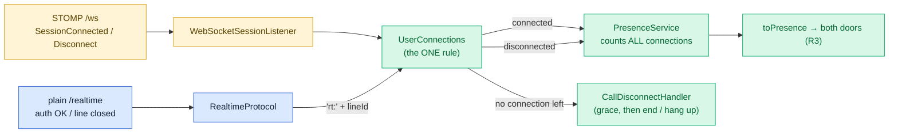
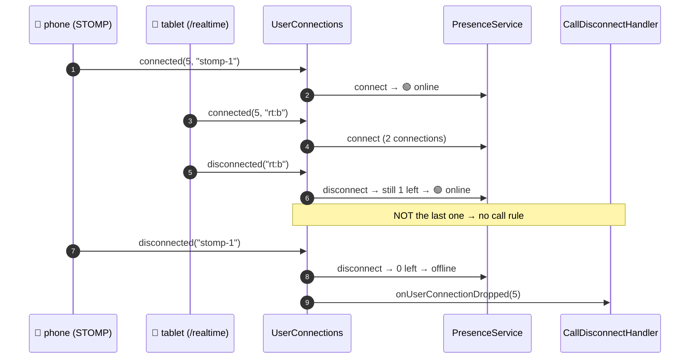

# Track B · R4 — plain WebSocket: presence + calls know the new door (backend)

> Branch **`feature/raw-websocket`** (app AND backend).
> ← Previous: [32-raw-websocket-r3-broadcast.md](32-raw-websocket-r3-broadcast.md) · Roadmap: [README.md](README.md)

```
R1 phone book ✅ · R2 door /realtime ✅ · R3 both doors ✅
R4 connect / disconnect → presence + calls          ← this lesson
R5 the app: ws_connection.dart
R6 two phones
```

## 1. Why

Two important rules depend on **"is this user's line open?"**:

- **Presence** (5.6): 🟢 online / offline / "last seen". It also decides
  whether a call rings by **push** (an OFFLINE callee is rung by push, 7.2 / 7.3).
- **The call rule** (`CallDisconnectHandler`, 6.x): a user whose line is gone
  → end their ring quickly, and hang up an ANSWERED call after 30 s (a
  crashed / killed app must not leave a call open forever).

Both learned about lines **only from STOMP's events** (`SessionConnectedEvent`
/ `SessionDisconnectEvent`). A phone on `/realtime` was invisible to them:
always "offline", and its calls never cleaned up. That was the risky part of
Track B.

This step teaches:

- **Move the rule to one place, then call it from both doors.** The rule
  ("connected → presence; last one gone → the call rule") moves from the
  STOMP listener into `UserConnections`. Both doors call it.
- **Count connections across doors.** A user can have the old app (STOMP) on
  a phone and the new one (`/realtime`) on a tablet. Closing one ≠ offline.
- **Ids from two worlds must not clash.** The plain door uses `"rt:" + lineId`.

## 2. Picture





### Files (backend)

```
chats/presence/UserConnections.java          NEW  the ONE rule (connected / disconnected)
chats/presence/WebSocketSessionListener.java  STOMP events → UserConnections (rule moved out)
chats/realtime/RealtimeProtocol.java          auth OK → connected("rt:"+id) · close → disconnected
test: UserConnectionsTest (4, REAL PresenceService) · RealtimeProtocolTest (+3 = 18)
```

## 3. Code

### The one rule

```java
public void connected(Long userId, String connectionId) {
    presence.connect(userId, connectionId);
}

public Long disconnected(String connectionId) {
    Long userId = presence.disconnect(connectionId);
    if (userId != null && !presence.hasLiveSession(userId)) {   // the LAST one (any door)
        callDisconnect.onUserConnectionDropped(userId);
    }
    return userId;
}
```

This is exactly what `WebSocketSessionListener` did before, moved out so the
plain door can use it too. `PresenceService` already counted connections by
id; it never cared which door they came through.

### The plain door tells it

```java
// RealtimeProtocol.auth — the token was good
sessions.authenticate(line.client.id(), userId);
connections.connected(userId, connectionId(line.client.id()));   // 🟢
line.client.send(letters.ready());

// RealtimeProtocol.onClose — any close: the phone, the 25 s sweep, a network drop
Optional<RealtimeSessions.Closed> closed = sessions.close(lineId);
if (closed.isPresent()) connections.disconnected(connectionId(lineId));

static String connectionId(String lineId) { return "rt:" + lineId; }
```

- Only a **logged-in** line is reported (a bad token never counts as online).
- `sessions.close` returns empty the second time, so a double close callback
  reports ONCE.
- The 25 s sweep (R2) closes a dead phone → `onClose` → presence offline →
  the call rule. That's the same ~20–30 s STOMP's heartbeats took.

## 4. 🤔 Why like this? (other ways)

| Choice we made | Other way | Why we didn't pick the other way |
|---|---|---|
| One shared `UserConnections` | Copy the rule into `RealtimeProtocol` | Two copies of the call rule = they drift; the call rule took many fixes |
| `PresenceService` counts all connections | Use R1's `Closed.lastLine` | `lastLine` only knows ONE door; a STOMP phone + a `/realtime` tablet would look offline too early |
| `"rt:"` prefix | Trust that ids never clash | Spring makes both ids, but a clash would mark the wrong connection gone; the prefix costs nothing |
| Report only after a good `auth` | Report on open | A line without a valid token isn't a user yet |

## 5. Try it

```bash
cd ~/Documents/call_erp/erp_java_backend_claude
./gradlew test --tests '*UserConnections*' --tests '*realtime*'   # 4 + 28
./gradlew test                                                     # everything green
```

The full check (🟢 dot, a call rings by push when the app is minimized, a
killed app's call is hung up after 30 s) needs the app on `/realtime`: R5 + R6.

## 6. Check yourself

1. Before R4, what did presence think of a phone on `/realtime`?
2. A user has the old app on a phone and the new app on a tablet. The tablet
   closes. Online or offline? Does the call rule run?
3. Why the `"rt:"` prefix?
4. A phone on `/realtime` is killed. What closes its line, and when is it
   marked offline?

<details><summary>Answers</summary>

1. Always offline: presence only heard STOMP's events.
2. Still online (the phone's STOMP connection is left); the call rule doesn't run.
3. So a plain-door id can never be mistaken for a STOMP session id in presence.
4. The R2 sweep (no ping for 25 s) closes it → `onClose` → `disconnected` →
   offline after ~25–30 s, and the call rule starts its grace.

</details>
