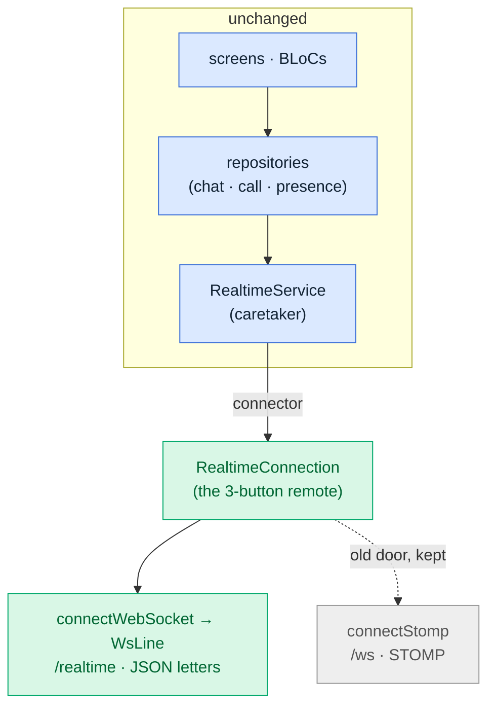
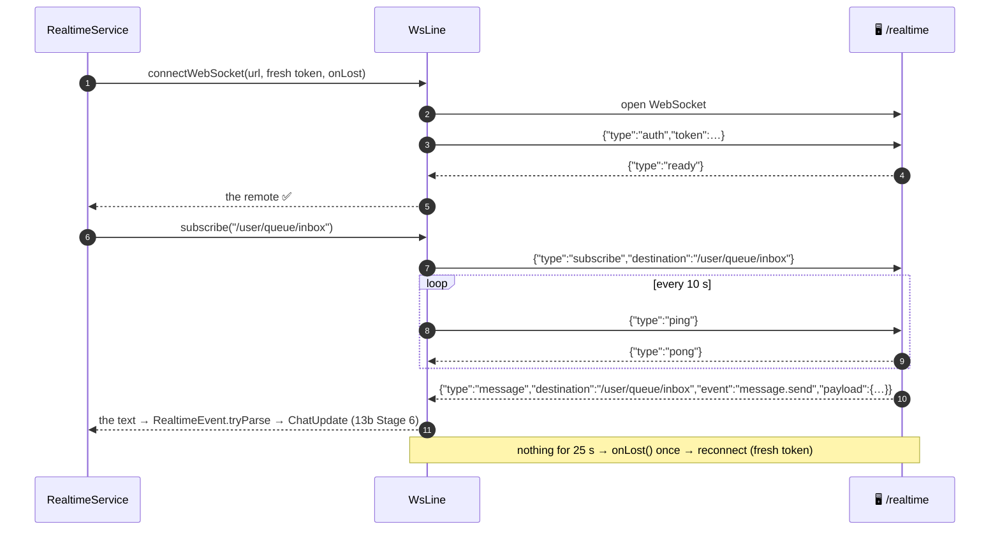

# Track B · R5 — plain WebSocket: the app speaks our letters

> Branch **`feature/raw-websocket`** (app AND backend).
> ← Previous: [33-raw-websocket-r4-connections.md](33-raw-websocket-r4-connections.md) · Roadmap: [README.md](README.md)

```
R1 phone book ✅ · R2 door /realtime ✅ · R3 both doors ✅ · R4 presence + calls ✅
R5 the app: ws_connection.dart                      ← this lesson
R6 two phones
```

## 1. Why

The backend can now talk on `/realtime` (R1–R4). The app still spoke STOMP on
`/ws`. In R5 the app switches doors.

This step teaches:

- **The "remote control" pays off.** In 13b Stage 2 we said `StompConnection`
  is tiny "so tests can fake it". It also means we can swap the WHOLE
  protocol by writing one new file: `RealtimeService`, the repositories, the
  BLoCs and the screens don't change.
- **The same envelope.** A server letter
  `{"type":"message","destination","event","payload"}` already has `event` +
  `payload`, so the old `RealtimeEvent.tryParse` reads it as it is.
- **Both sides watch for a dead line.** The app pings every 10 s; the server
  answers `pong`. If the app hears nothing for 25 s, the line is dead → `onLost`
  → `RealtimeService` reconnects (13b Stage 3). The server has its own 25 s
  sweep (R2).

## 2. Picture





### Files (app)

```
lib/core/realtime/
├── realtime_connection.dart   NEW  RealtimeConnection (the remote) + RealtimeConnector (moved from stomp_connection)
├── ws_connection.dart         NEW  connectWebSocket + WsLine (our letters, ping, watchdog)
├── stomp_connection.dart      the old door, kept (implements RealtimeConnection)
└── realtime_service.dart      only: type names + default connector = connectWebSocket
lib/core/config/environments.dart   realtimeUrl → ws://…:8080/realtime
test/core/realtime/ws_connection_test.dart   NEW 11 tests (a StreamController = the server)
test/core/realtime/realtime_service_test.dart  only the interface name
```

No new package: `web_socket_channel` was already in `pubspec.yaml`.

## 3. Code

### Open = connect + auth + wait for "ready"

```dart
Future<RealtimeConnection> connectWebSocket({required String url, required String token,
                                             required void Function() onLost}) async {
  final channel = WebSocketChannel.connect(Uri.parse(url));
  await channel.ready.timeout(const Duration(seconds: 10));
  return WsLine.open(incoming: channel.stream, sendRaw: channel.sink.add,
                     closeRaw: () => channel.sink.close(), token: token, onLost: onLost);
}
```

`WsLine` never touches a real socket: it gets a stream (letters in) and two
functions (send / close). The test gives it a `StreamController` instead.

### Read each letter

```dart
switch (json['type']) {
  case 'ready':   _ping = Timer.periodic(pingEvery, (_) => _write({'type': 'ping'}));
                  _ready.complete(this);                          // the buzzer ✅
  case 'message': _listeners[json['destination']]?.call(text);    // the SAME text → tryParse
  case 'error':   if (!_ready.isCompleted) _fail(…)                // bad token → the buzzer ❌
                  else debugPrint(…);                              // e.g. "Not allowed" (subscribe)
  default:        break;                                           // pong
}
```

### `_fail`: before vs after (13b Stage 2, the same idea)

```dart
void _fail(Object why) {
  if (_done) return;                 // once only
  _done = true;
  …stop timers, close…
  if (!_ready.isCompleted) _ready.completeError(StateError('realtime: $why'));  // couldn't connect
  else _onLost();                                                              // was in, line broke
}
```

`close()` sets `_done` too, so hanging up on purpose (logout) is NEVER
reported as "lost" (no reconnect after logout).

### The watchdog

```dart
_sub = incoming.listen((data) {
  _watchdog?.cancel();
  _watchdog = Timer(deadAfter, () => _fail('silent'));   // any letter = alive
  …
});
```

Our ping every 10 s gets a pong, so an alive line always has a letter within
25 s. Silence = a dead line (the Wi-Fi died without closing the socket).

## 4. 🤔 Why like this? (other ways)

| Choice we made | Other way | Why we didn't pick the other way |
|---|---|---|
| Rename to `RealtimeConnection` | Keep the name `StompConnection` | It isn't STOMP any more; a wrong name misleads |
| Keep `stomp_connection.dart` | Delete it now | Two doors until Track B ends; switching back = one line (`connector:`) |
| `WsLine` takes a stream + 2 functions | Use the socket inside | No fake socket needed: a `StreamController` is the server |
| Pass the raw letter text on | Build a new `{event, payload}` | `RealtimeEvent.tryParse` already ignores extra keys; less work, nothing to get wrong |
| Our JSON `ping` | WebSocket's built-in ping frames (`pingInterval`) | The server's 25 s sweep (R2) counts LETTERS; built-in pings never reach it |

## 5. Try it

```bash
flutter test test/core/realtime/          # 18 tests (7 caretaker + 11 line)
flutter test                              # 354, all green
flutter run --flavor dev -t lib/main_dev.dart
```

The backend must run `feature/raw-websocket` (it has `/realtime`). Log in: the
inbox should NOT show "Connecting…", and a message from another phone should
appear at once. Full checks: R6.

## 6. Check yourself

1. Which files changed outside `core/realtime/` and `environments.dart`?
2. Why can `RealtimeEvent.tryParse` read the new letters unchanged?
3. Why our own `ping` letter, not WebSocket's built-in ping?
4. You log out. Does `RealtimeService` reconnect? Why not?

<details><summary>Answers</summary>

1. None (only a test's interface name). Repositories, BLoCs, screens: unchanged.
2. A `message` letter has `event` + `payload`; `tryParse` ignores the extra
   `type` / `destination`.
3. The server's dead-line sweep only sees letters; built-in ping frames
   never reach `RealtimeProtocol`.
4. No: `stop()` → `close()` sets `_done`, so it's never reported as lost
   (and `RealtimeService` is off duty anyway).

</details>
