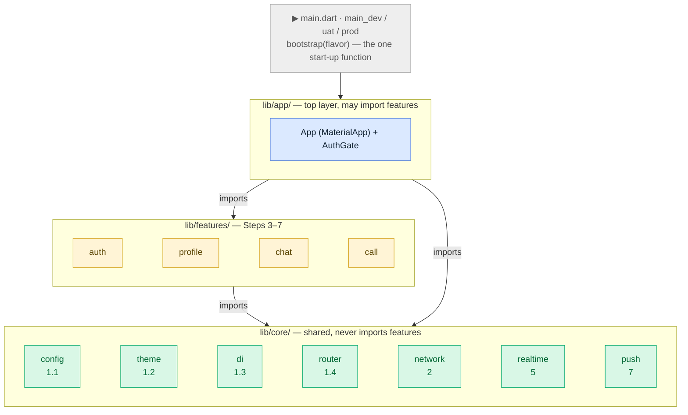
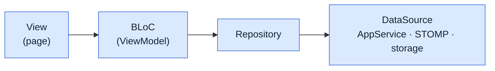
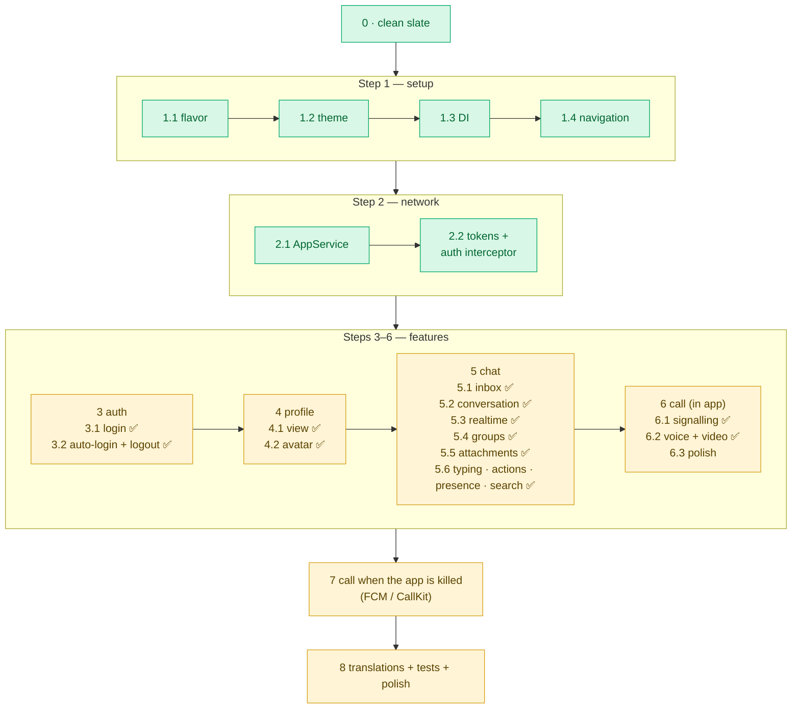

# 🧱 Rebuild From Zero — START HERE

We deleted `lib/core`, `lib/features`, `lib/shared`, `lib/localization` and
`test/` on branch `feature/rebuild`, and we build the app again **step by step**.

The old, working app stays on branch `feature/call`. Use it as a reference:

```bash
git show feature/call:lib/core/config/flavor.dart
```

## 🎯 The goal: 4 features

```
lib/
├── core/            shared infrastructure (config, network, DI, router, theme…)
└── features/
    ├── auth/        login, splash auto-login, logout
    ├── profile/     view / edit my profile, avatar
    ├── chat/        inbox, conversation, groups (STOMP)
    └── call/        voice / video (Stream Video + CallKit)
```

## 🏛️ The big picture (where every step fits)



Inside **each** feature, the same 4 layers:



**Rule:** `features/` may use `core/`, but `core/` never imports from
`features/`. Arrows only point **down**.

## 🗺️ Roadmap



🟩 done · 🟨 to do

Each step ends with an app that **runs**. Don't start the next step until the
current one works.

| Step | Topic | Lesson | Status |
|---|---|---|---|
| 0 | Clean slate | — | ✅ |
| 1.1 | Flavor (dev / uat / prod) | [01-flavor.md](01-flavor.md) | ✅ |
| 1.2 | Theme (design tokens) | [02-theme.md](02-theme.md) | ✅ |
| 1.3 | DI (service locator) | [03-di.md](03-di.md) | ✅ |
| 1.4 | Navigation (ConfigRouter + AuthGate) | [04-router.md](04-router.md) | ✅ |
| 2.1 | Network: AppService (template style), envelope, NetworkErrorModel | [05-network.md](05-network.md) | ✅ |
| 2.2 | Network: tokens + auth interceptor (refresh) | [06-auth-interceptor.md](06-auth-interceptor.md) | ✅ |
| 3.1 | Auth: login (model · repository · ViewModel BLoC · form) | [07-login.md](07-login.md) | ✅ |
| 3.2 | Auth: splash auto-login + real logout | [08-auto-login-logout.md](08-auto-login-logout.md) | ✅ |
| 4.1 | Profile: view (`/users/me` + `/employees/me`), logout moves here | [09-profile-view.md](09-profile-view.md) | ✅ |
| 4.2 | Profile: avatar (camera / gallery / remove, multipart upload) | [10-profile-avatar.md](10-profile-avatar.md) | ✅ |
| 4.3 | Profile: edit name / phone (needs backend `PATCH /users/me`) | — | ⏸ |
| 5.1 | Chat: inbox (paged list, my id from the JWT, replaces the demo Home) | [11-chat-inbox.md](11-chat-inbox.md) | ✅ |
| 5.2 | Chat: conversation (paged history, optimistic send text, mark read) | [12-chat-conversation.md](12-chat-conversation.md) | ✅ |
| 5.3 | Chat: realtime (STOMP: live inbox + messages + ✓✓, reconnect, shared token refresh) | [13-chat-realtime.md](13-chat-realtime.md) | ✅ |
| 5.4 | Chat: new chat + groups (member picker, create, rename, add / remove, leave, delete) | [14-chat-groups.md](14-chat-groups.md) | ✅ |
| 5.5 | Chat: attachments (photo · PDF · voice: upload with progress, smart retry, player) | [15-chat-attachments.md](15-chat-attachments.md) | ✅ |
| 5.6 | Chat: typing (backend `TypingController` + app) | [16-chat-typing.md](16-chat-typing.md) | ✅ |
| 5.6 | Chat: message actions (edit / delete / reactions / seen by) · presence (online, last seen, beacons) · search | [17-chat-extras.md](17-chat-extras.md) | ✅ |
| 6.1 | Call: signalling (📞 / 🎥 → Calling… / Ringing… → Accept / Decline → in call → ended; busy, cancel, timeouts) — no sound yet | [18-call-signalling.md](18-call-signalling.md) | ✅ |
| 6.2 | Call: voice + video (Stream Video: token, join, mute, speaker, camera, video view) | [19-call-media.md](19-call-media.md) | ✅ |
| 6.3 | Call: polish (sounds, call line in the chat, group calls, reconnecting) | — | ⏳ |
| 7 | Call in background / killed app | see `../IOS_CALL`, `../ANDROID_CALL` | ⏳ |
| 8 | Translations, tests, polish | — | ⏳ |

## 📖 How each lesson is written

1. **Why**: what problem this step solves.
2. **Picture**: a small diagram.
3. **Code**: the files, explained line by line.
4. **🤔 Why like this?**: the other ways we could have written it, and why
   we didn't pick them.
5. **Try it**: commands to run and what you should see.
6. **Check yourself**: 2–3 questions.
